By the end of this lesson you will be able to read the three fields of a Python `float`, predict which decimal literals it stores inexactly, and choose a summation and a comparison that keep the digits you need. Every number below comes from one experiment script in the course repository, `scripts/diagrams/lessons/3.2_data.py`, which you can rerun.

**You need:** binary (base 2) notation from Lesson 3.1.

## The problem floats solve

A Python `int` is exact at any size (Lesson 3.1). A real number such as 0.1, $\pi$ or $10^{-300}$ is different. A 64-bit word has only $2^{64}$ bit patterns, so a `float` stores one value from a finite set, and every real number is rounded to the nearest one. In exchange, one float covers magnitudes from about $5 \times 10^{-324}$ to $1.8 \times 10^{308}$. Model weights, gradients and losses in artificial intelligence (AI) are floats, so this rounding is inside every training run.

## Intuition: three fields in one word



A float has three fields: a sign bit, an exponent field that sets the magnitude, and a fraction field (the significand, often called the mantissa) that sets how finely values are resolved. The layout drawn above is the binary floating-point format that Python's `float` uses. I have not opened the IEEE 754 standard itself, so I checked the field widths against NumPy's `finfo` instead. For a normal float64, the value is $(-1)^s \times 1.f \times 2^{e-1023}$, where $f$ is the fraction read in binary and $e$ is the stored exponent field.

The gap between a float and its neighbour is the **unit in the last place** (ulp). It doubles each time the value crosses a power of two. At 1.0 the float64 gap is $2^{-52} \approx 2.2 \times 10^{-16}$, which Python exposes as `sys.float_info.epsilon`. The gap is 0.125 at $10^{15}$, 2.0 at $10^{16}$ and 16384.0 at $10^{20}$ (`math.ulp`, measured). At 1.0, float16 has a gap of $9.8 \times 10^{-4}$ and bfloat16 (brain floating point, 16 bits: 1 sign, 8 exponent, 7 fraction) has $7.8 \times 10^{-3}$.

## Worked example by hand: why 0.1 + 0.2 is not 0.3

Start with what is stored. The float nearest to 0.1 is $3602879701896397 / 2^{55}$, slightly larger than one tenth. Its bits are `3fb999999999999a`: sign 0, exponent field 1019 (so the scale is $2^{1019-1023} = 2^{-4}$), and a fraction. The exact sum of the stored 0.1 and the stored 0.2 is $0.30000000000000001665\ldots$

The two floats around 0.3 are $0.29999999999999998890\ldots$ (the one that the literal `0.3` stores) and $0.30000000000000004441\ldots$. They are $2^{-54} \approx 5.55 \times 10^{-17}$ apart. The exact sum is $2^{-55}$ from each, so it lies exactly halfway. Round-half-to-even picks the neighbour whose last bit is 0: the lower one ends in hex digit 3 (bit 1), the upper one in hex digit 4 (bit 0). The sum therefore rounds up to `0.30000000000000004`. The run below confirms each step.



```python
from decimal import Decimal
from fractions import Fraction
import math, struct

print(Decimal(0.1))
print(Fraction(0.1))
print(0.1 + 0.2, 0.1 + 0.2 == 0.3)

exact = Fraction(0.1) + Fraction(0.2)
lo, hi = 0.3, math.nextafter(0.3, 1.0)
print(Decimal(lo))
print(Decimal(hi))
print(exact - Fraction(lo) == Fraction(hi) - exact)
print(struct.pack(">d", lo).hex(), struct.pack(">d", hi).hex())
bits = struct.unpack(">Q", struct.pack(">d", 0.1))[0]
print(bits >> 63, (bits >> 52) & 0x7FF, bits & ((1 << 52) - 1))
print(len(str(Decimal(0.1)).replace("0.", "").lstrip("0")))
```

```output
0.1000000000000000055511151231257827021181583404541015625
3602879701896397/36028797018963968
0.30000000000000004 False
0.299999999999999988897769753748434595763683319091796875
0.3000000000000000444089209850062616169452667236328125
True
3fd3333333333333 3fd3333333333334
0 1019 2702159776422298
55
```

The last line of the output counts the significant digits of the stored 0.1: 55. The `repr` of 0.1 is short only because Python prints the shortest string that parses back to the same float. The stored value is the long decimal above.

## Absorption: a large value swallows a small one

Because the gap grows with magnitude, adding a small number can change nothing. Near $10^{20}$ the gap is 16384, so the midpoint is 8192 away, and adding $1.0$ rounds back to $10^{20}$. Near $10^{16}$ the gap is 2, and adding 1 lands exactly on a midpoint; the tie goes to the neighbour with an even significand, which is $10^{16}$. In float32 the gap at $2^{24}$ is 2, so $2^{24} + 1$ is also a tie, and it goes to $2^{24}$.



```python
import math
import numpy as np

print(math.ulp(1e20), 1e20 + 1.0 == 1e20)
print(1e16 + 1.0 == 1e16)
print(np.float32(2**24) + np.float32(1) == np.float32(2**24))
print(np.spacing(np.float32(2**24)))
```

```output
16384.0 True
True
True
2.0
```

## Accumulation: rounding errors add up

Each addition rounds, and the rounding errors do not cancel. The diagram compares five ways of summing 0.1 one million times. The target is the decimal 100000, and the bar length is $\log_{10}$ of the absolute error.



```python
import math

n = 1_000_000
total = 0.0
for _ in range(n):
    total += 0.1
print(repr(total), total - 100_000)
print(repr(math.fsum([0.1] * n)))
```

```output
100000.00000133288 1.3328826753422618e-06
100000.0
```

`math.fsum` keeps several partial sums and returns exactly 100000.0 here (Python `math` documentation). NumPy's `sum` on a float64 array is far more accurate than the Python loop, with an error of $2.9 \times 10^{-11}$. The float32 loop is the worst case. This block needs NumPy, so it runs locally:

<details><summary>Run locally: needs pip install numpy (run with numpy 2.5.5)</summary>

```python
import numpy as np

n = 1_000_000
print(repr(float(np.full(n, 0.1).sum())))
acc = np.float32(0.0)
for x in np.full(n, 0.1, dtype=np.float32):
    acc = np.float32(acc + x)
print(repr(float(acc)))
print(repr(float(np.full(n, 0.1, dtype=np.float32).sum())))
```

```output
100000.00000000003
100958.34375
100000.0078125
```

</details>

The float32 loop is off by 958, almost 1%. The same numbers summed in float32 by NumPy's `sum` are off by 0.0078. The method matters as much as the format.

## Cancellation: subtracting nearly equal numbers

Take $x = 10^{15}$ and compare $\sqrt{x+1} - \sqrt{x}$ with the algebraically identical $1/(\sqrt{x+1} + \sqrt{x})$. The identity follows by multiplying the first expression by its conjugate. Each square root is stored to within half an ulp, which is $1.9 \times 10^{-9}$ at this magnitude. The true difference is only $1.58 \times 10^{-8}$, so the subtraction removes the shared leading digits and leaves mostly rounding noise.



```python
import math

x = 1e15
naive = math.sqrt(x + 1) - math.sqrt(x)
stable = 1 / (math.sqrt(x + 1) + math.sqrt(x))
print(naive)
print(stable)
```

```output
1.862645149230957e-08
1.5811388300841893e-08
```

An 80-digit `decimal` calculation gives $1.58113883008418927 \times 10^{-8}$ (the reference in my script). The naive form is 17.8% too large, and the rewritten form is correct to about one bit (relative error $3.8 \times 10^{-18}$).

The same trap hits statistics. The variance of $10^9 + \{4, 7, 13, 16\}$ is 22.5. The shortcut $E[x^2] - E[x]^2$ computes two numbers near $10^{18}$, where the spacing is 128, and returns zero. The two-pass formula, which subtracts the mean before squaring, returns the right value.

```python
data = [1e9 + v for v in (4, 7, 13, 16)]
n = len(data)
s1, s2 = sum(data), sum(x * x for x in data)
print(s2 / n - (s1 / n) ** 2)
mean = s1 / n
print(sum((x - mean) ** 2 for x in data) / n)
```

```output
0.0
22.5
```

## Comparing floats

Exact equality on computed values is fragile. `math.isclose` tests $|a - b| \le \max(\text{rel\_tol} \cdot \max(|a|, |b|),\ \text{abs\_tol})$, with `rel_tol` defaulting to $10^{-9}$ and `abs_tol` defaulting to 0.0 (Python `math` documentation).

```python
import math

print(0.1 + 0.2 == 0.3, math.isclose(0.1 + 0.2, 0.3))
print(math.isclose(0.0, 1e-20), math.isclose(0.0, 1e-20, abs_tol=1e-12))
nan = float("nan")
print(nan == nan, math.isnan(nan))
```

```output
False True
False True
False True
```

Because `abs_tol` is 0.0 by default, any nonzero value compared with 0.0 fails unless you pass `abs_tol`. A NaN (not a number) is unequal to everything, including itself, so test for it with `math.isnan`.

## Where this matters for AI

Mixed-precision training stores weights, activations and gradients in half precision to save memory, keeps a float32 copy of the weights for the updates, and scales the loss so that small gradients survive (Micikevicius et al., arXiv:1710.03740). The abstract claims a memory reduction "by nearly 2x" and expects speed-ups on future hardware; it does not measure a speed-up. Bfloat16 keeps the exponent range of float32 and cuts the fraction to 7 bits. Kalamkar et al. (arXiv:1905.12322) report, in their abstract, the same results as float32 with the same iterations and no hyper-parameter changes. Their study emulates the format in software rather than running on bfloat16 hardware.

The precision traps follow directly. An update smaller than the gap is lost:

```python
import struct
import numpy as np

def to_bfloat16(x):
    """Round a float32 to bfloat16: keep the top 16 bits, round to nearest even."""
    b = struct.unpack(">I", struct.pack(">f", x))[0]
    b = (b + 0x7FFF + ((b >> 16) & 1)) & 0xFFFF0000
    return struct.unpack(">f", struct.pack(">I", b))[0]

print(to_bfloat16(1.0 + 1e-3) == 1.0)
print(to_bfloat16(1.0 + 4e-3))
print(to_bfloat16(0.1))
print(np.float16(1.0) + np.float16(1e-4) == np.float16(1.0))
print(np.float32(1.0) + np.float32(1e-4) == np.float32(1.0))
```

```output
True
1.0078125
0.10009765625
True
False
```

An update of $10^{-3}$ to a bfloat16 weight of 1.0 disappears, and an update of $4 \times 10^{-3}$ rounds to a full gap. The same update of $10^{-4}$ vanishes in float16 but survives in float32. The `to_bfloat16` function is my emulation (it keeps the top 16 bits of a float32), because NumPy has no bfloat16 type.

> [!KEY-INSIGHT]
> A float is the nearest representable value, not the number you typed. Every float result carries an error that depends on the magnitude of the operands, the operation and the order of operations.

## Common traps

> [!TRAP]
> `print(0.1)` shows the shortest string that parses back to the same float, not the stored value. The stored value of 0.1 has 55 significant decimal digits.

> [!TRAP]
> Absorption: $10^{20} + 1.0 = 10^{20}$ in float64, and a float32 counter started at $2^{24}$ stays at 16777216.0 after ten increments of 1.0. Large running totals hide small increments.

> [!TRAP]
> The variance shortcut $E[x^2] - E[x]^2$ returns 0.0 for data with a large offset and a true variance of 22.5. Use the two-pass or Welford formula, and check any running-statistics code on data with a large offset.

> [!TRAP]
> `math.isclose(x, 0.0)` is `False` for every nonzero `x` unless you pass `abs_tol`. Choose the absolute tolerance from the scale of your quantities.

## Summary

- A float stores a sign, an exponent and a fraction. The fraction width sets the precision, and the gap between neighbours doubles each time the value crosses a power of two.
- 0.1 and 0.2 are stored inexactly, and their exact sum lies halfway between two floats. The tie rounds to the even neighbour, giving 0.30000000000000004.
- Adding a value smaller than half the gap changes nothing, and rounding errors accumulate over repeated additions.
- Subtracting nearly equal numbers cancels the shared leading digits. Rewrite the expression, or use a compensated sum such as `math.fsum`.
- Compare with `math.isclose` and an explicit absolute tolerance, not with `==`.

## Quiz time

### Question 1: Prediction

Without running code, what does `1e16 + 1.0 == 1e16` return in float64? Use the gap rule: the spacing near $10^{16}$ is 2.

<details><summary>Show solution</summary>

It returns `True`. Near $10^{16}$ the gap is 2, so $10^{16} + 1$ lies exactly halfway between $10^{16}$ and $10^{16} + 2$. The tie goes to the neighbour with an even significand. The significand of $10^{16}$ is $10^{16}/2 = 5 \times 10^{15}$, which is even, so the sum rounds back to $10^{16}$. The run above prints `True`.

</details>

### Question 2: Calculation

Using only the spacing $2^{-54} \approx 5.55 \times 10^{-17}$ near 0.3, how far is the exact sum $0.1 + 0.2$ from each neighbour, and why does it round up?

<details><summary>Show solution</summary>

The exact sum sits halfway, so it is $2^{-55} \approx 2.8 \times 10^{-17}$ from each neighbour. A tie rounds to the neighbour with an even last bit. The lower neighbour ends in hex digit 3 (bit 1) and the upper one in hex digit 4 (bit 0), so the result is the upper neighbour, $0.30000000000000004$.

</details>

### Question 3: Bug-spotting

A training loop accumulates a float32 running sum of one million values of 0.1, then checks `total == 100000.0`. Name two problems.

<details><summary>Show solution</summary>

First, float32 accumulation over a million additions is off by 958 (about 1%), so the sum is far from 100000.0. The cause is precision and summation order, not the comparison. Second, `==` on computed floats is fragile even when the error is small. Sum in float64 with a compensated method such as `math.fsum`, and compare with `math.isclose` using a tolerance chosen from the scale of the values.

</details>

### Question 4: Explanation

Why does $\sqrt{x+1} - \sqrt{x}$ lose accuracy at $x = 10^{15}$, while $1/(\sqrt{x+1} + \sqrt{x})$ does not?

<details><summary>Show solution</summary>

Each square root is stored with an error of up to half an ulp, about $1.9 \times 10^{-9}$. The true difference is about $1.58 \times 10^{-8}$, so the subtraction cancels the shared leading digits and most of the result is rounding noise (the naive form is 17.8% too large). The rewritten form adds two large positive numbers, so it has no cancellation, and its relative error is about $3.8 \times 10^{-18}$.

</details>

## References

1. Python Software Foundation. "Floating-Point Arithmetic: Issues and Limitations", The Python Tutorial, Section 15. https://docs.python.org/3/tutorial/floatingpoint.html (opened)
2. Python Software Foundation. "math: Mathematical functions" (`isclose`, `fsum`, `ulp`, `nextafter`). https://docs.python.org/3/library/math.html (opened)
3. Micikevicius, P. et al. "Mixed Precision Training." arXiv:1710.03740 (2017; ICLR 2018 according to the arXiv page). https://arxiv.org/abs/1710.03740 (opened; abstract only)
4. Kalamkar, D. et al. "A Study of BFLOAT16 for Deep Learning Training." arXiv:1905.12322 (2019). https://arxiv.org/abs/1905.12322 (opened; abstract only)
