Python stops a recursive function after about 1,000 nested calls and raises `RecursionError`. In this lesson you will work out where that limit sits, measure it, and rewrite a deep recursion as a loop or as a loop with an explicit stack.

**You need:** the call stack and frames (Lesson 7.1), and a function that calls itself.

## The problem the limit solves

A call that has not returned yet keeps its frame on the call stack (Lesson 7.1). A recursive function that handles one item and then calls itself for the rest keeps one frame per item, and all of them are alive at the same time. A list of 2,000 items therefore needs about 2,000 frames before the first call can return.

The limit caps how many frames may exist at once. `sys.setrecursionlimit()` sets it and `sys.getrecursionlimit()` reads it. The Python documentation says the limit "prevents infinite recursion from causing an overflow of the C stack and crashing Python" [1]. Infinite recursion is the case it is built for, but a deep, finite recursion hits the same wall.

## Worked example, by hand

Take `total(xs, i)` from the first code block. It calls itself once for each index from `0` to `len(xs)`. For a list of $n$ items, count the frames:

- one frame for each index $i = 0, 1, \ldots, n$, which is $n + 1$ frames;
- plus the `<module>` frame that made the first call.

So $n = 500$ needs $502$ frames, under the limit of 1,000, and $n = 2000$ needs $2002$, over it. The first block checks both predictions.

```python
import sys

sys.setrecursionlimit(1000)   # set explicitly, so the result does not depend on the runner

def total(xs, i=0):
    if i == len(xs):
        return 0
    return xs[i] + total(xs, i + 1)

print("sum of 500 numbers:", total(list(range(500))))
try:
    print("sum of 2000 numbers:", total(list(range(2000))))
except RecursionError:
    print("sum of 2000 numbers: RecursionError, the stack limit was reached")
```

```output
sum of 500 numbers: 124750
sum of 2000 numbers: RecursionError, the stack limit was reached
```

> [!KEY-INSIGHT]
> The limit counts frames, not items. A recursion over $n$ items holds about $n$ frames at once; a loop over $n$ items holds one.

## Intuition: the limit counts every frame



The limit counts every frame on the stack, including the ones that are not recursive. In the measurements below, the test harness adds four frames under the recursion: `<module>`, a counting helper `max_ok()`, a `lambda`, and `via_helper()`. With those four in place, the deepest call that fits is `rec(995)`, which holds 996 recursive frames, and 996 + 4 = 1,000. Called straight from the counting helper, the deepest call is `rec(997)`. So the depth you can reach depends on what sits beneath the recursion. No single "maximum depth" holds for every program.

## A loop holds one frame

Replace the recursion with a loop, and the stack holds one frame whatever the length of the list.

```python
def total_loop(xs):
    result = 0
    for x in xs:
        result += x
    return result

print("loop, 2000 numbers:", total_loop(list(range(2000))))
print("loop, 1000000 numbers:", total_loop(range(1_000_000)))
```

```output
loop, 2000 numbers: 1999000
loop, 1000000 numbers: 499999500000
```



The loop is the right tool for a sum, but many recursive problems are not sums. Trees and graphs are the usual case. Two questions decide the rewrite. First, how deep can the input go? Ten items are no concern; a million are. Second, does each call wait for exactly one other call, as in a sum, or for several, as in a tree? A single pending call turns into a loop. Several pending calls need a stack that you manage yourself, which is the next section.

## When the loop is not obvious: an explicit stack

Depth-first search (DFS, a traversal that goes as deep as it can before it backtracks) is naturally recursive: visit a node, then recurse into each neighbour. On a path of 5,000 nodes the recursion goes 5,000 levels deep. The fix is to keep the stack as a list that your code manages. A list used with `append` and `pop` is last in, first out (LIFO), so `pop()` always takes the entry pushed most recently.

```python
def dfs_stack(adj, start):
    stack, visited, order = [start], set(), []
    while stack:
        node = stack.pop()              # last in, first out
        if node in visited:
            continue
        visited.add(node)
        order.append(node)
        stack.extend(adj[node])         # push the children; they are visited later
    return order

tree = {0: [1, 2], 1: [3, 4], 2: [], 3: [], 4: []}
print("pop order:", dfs_stack(tree, 0))

n = 5000
path = {i: [] for i in range(n)}
for i in range(n - 1):
    path[i].append(i + 1)
    path[i + 1].append(i)
print("visited on a 5000-node path:", len(dfs_stack(path, 0)))
```

```output
pop order: [0, 2, 1, 4, 3]
visited on a 5000-node path: 5000
```



The pop order `0, 2, 1, 4, 3` is the order the stack produces: the last child pushed is visited first. A recursive version that loops over the children in their listed order visits `0, 1, 3, 4, 2` instead. The recursive order is my reasoning, not a measurement. Both versions reach every reachable node, which is also my reasoning; on 200 random graphs, the experiment found the two versions visited the same set of nodes. The explicit stack is an ordinary list in heap memory, so the recursion limit does not apply to it: the experiment ran the same function on 100,000 nodes.

## Measuring the boundary

The numbers in the diagrams come from one experiment run on CPython 3.12.13. The block below repeats the measurements in a standalone script, so you can run them yourself. Its raw depths depend on how many frames the interpreter and the script put beneath the recursion, so the block prints only quantities that do not change with that setup. `max_ok(fn)` finds the largest `n` for which `fn(n)` does not raise, by bisection (halving the search interval). `frames_at_deepest` counts every frame on the stack at that deepest call.

<details><summary>Run locally: the exact depths depend on your interpreter</summary>

```python
import sys

LEAF = []   # frames counted at the deepest call of the most recent successful run

def rec(n):
    """Plain recursion: n + 1 frames at the deepest point."""
    if n == 0:
        f, c = sys._getframe(), 0
        while f is not None:            # count every frame, including <module>
            c += 1
            f = f.f_back
        LEAF.append(c)
        return 0
    return 1 + rec(n - 1)

def max_ok(fn, hi=100_000):
    """Largest n for which fn(n) does not raise RecursionError (bisection)."""
    lo = 0
    while lo < hi:
        mid = (lo + hi + 1) // 2
        try:
            fn(mid)
            lo = mid
        except RecursionError:
            hi = mid - 1
    return lo

def call_with(fn, n):
    """One frame, like max_ok, so the stack matches the bisection's stack."""
    return fn(n)

def frames_at_deepest(fn):
    """Frames on the stack at the deepest call that fits."""
    m = max_ok(fn)
    LEAF.clear()
    call_with(fn, m)
    return LEAF[-1]

def via_helper(fn, n):
    return fn(n)

def with_wrappers(k):
    """A function that calls rec(n) below k extra wrapper frames."""
    def run(n):
        def wrap(j):
            if j == 0:
                rec(n)
            else:
                wrap(j - 1)
        wrap(k)
    return run

def count_down(n):
    return "done" if n == 0 else count_down(n - 1)

print("default limit:", sys.getrecursionlimit())
print("frames at the deepest call, rec straight from max_ok:", frames_at_deepest(rec))
print("frames at the deepest call, rec behind a lambda and a helper:",
      frames_at_deepest(lambda n: via_helper(rec, n)))
base = max_ok(with_wrappers(0))
for k in (10, 50, 200):
    print(f"levels lost with {k} wrapper frames:", base - max_ok(with_wrappers(k)))
print("tail-recursive count_down reaches the same depth as rec:",
      max_ok(count_down) == max_ok(rec))

def dfs_rec(adj, node, seen):
    seen.add(node)
    for nxt in adj[node]:
        if nxt not in seen:
            dfs_rec(adj, nxt, seen)
    return seen

path = {i: [] for i in range(5000)}
for i in range(4999):
    path[i].append(i + 1)
    path[i + 1].append(i)
try:
    print("recursive DFS, 5000-node path:", len(dfs_rec(path, 0, set())))
except RecursionError:
    print("recursive DFS, 5000-node path: RecursionError")

def nest(d):
    x = []
    for _ in range(d):
        x = [x]
    return x

print("repr of 9000 nested lists, length:", len(repr(nest(9000))))
try:
    repr(nest(200_000))
    print("repr of 200000 nested lists: ok")
except RecursionError as e:
    print("repr of 200000 nested lists:", e)

sys.setrecursionlimit(200_000)
print("rec(100000) with limit 200000:", rec(100_000))
try:
    repr(nest(200_000))
    print("repr of 200000 nested lists with limit 200000: ok")
except RecursionError as e:
    print("repr of 200000 nested lists with limit 200000:", e)
```

```output
default limit: 1000
frames at the deepest call, rec straight from max_ok: 1000
frames at the deepest call, rec behind a lambda and a helper: 1000
levels lost with 10 wrapper frames: 10
levels lost with 50 wrapper frames: 50
levels lost with 200 wrapper frames: 200
tail-recursive count_down reaches the same depth as rec: True
recursive DFS, 5000-node path: RecursionError
repr of 9000 nested lists, length: 18002
repr of 200000 nested lists: maximum recursion depth exceeded while getting the repr of an object
rec(100000) with limit 200000: 100000
repr of 200000 nested lists with limit 200000: maximum recursion depth exceeded while getting the repr of an object
```

</details>

Two results matter. The deepest call that fits holds exactly the limit, 1,000 frames, whether it is called straight from the counting helper or behind a lambda and a helper. And each extra wrapper frame costs exactly one level: 10, 50 and 200 wrapper frames cost 10, 50 and 200 levels. In the raw depths of the same run, the recursion reached 997 levels when called straight from the counting helper, 995 behind the lambda and helper, and 995, 985, 945 and 795 for `k = 0, 10, 50, 200` wrapper frames (diagram below).



The recursive DFS fails on the 5,000-node path at the default limit, and the explicit-stack version above does not. Python does not remove tail calls: `count_down` ends with a call to itself and reaches the same depth as an ordinary recursion. In 2009 Guido van Rossum argued against tail-call elimination for Python, because it removes frames that tracebacks need [3].

## Memory per frame

Each frame also costs memory. Measured on one macOS machine, the peak resident memory (RSS, the RAM the process occupies) grew from about 16 MiB to about 30 MiB when the depth went from 0 to 100,000 frames. That is about 150 bytes per frame. Treat the figure as an order of magnitude: it is one machine and one interpreter, and the allocator rounds memory to pages. It is also why a limit of 1,000 is a guard and not a memory budget.



## Raising the limit is not a fix

`sys.setrecursionlimit(200000)` lets `rec(100000)` finish, and in the block above it did, without a crash. The limit is still a guard, not a capacity. The docs say that the highest possible limit is platform-dependent and that "a too-high limit can lead to a crash" [1]. The 3.12 release notes add that the recursion limit now applies only to Python code, while builtin functions "are protected by a different mechanism" [2]. The nested `repr` in the block shows that second guard: `repr` of 200,000 nested lists raises `RecursionError` even with the limit at 200,000. Before 3.12, one counter guarded both kinds of recursion, as the rejected PEP 651 describes [4]. A higher limit can still be the right step for a bounded input whose depth you have measured on the machine that will run it; for unbounded input, change the algorithm.

## Common traps

> [!TRAP]
> **"Raise the limit and move on."** A higher limit moves the wall. It does not remove the frames, and the docs warn about crashes. Replace the recursion with a loop or an explicit stack.

> [!TRAP]
> **"Infinite recursion means a hung program."** In CPython, a recursive call that never reaches its base case stops with `RecursionError` after about 1,000 calls. Check that each call moves towards the base case, for example `countdown(n - 1)` and not `countdown(n + 1)`.

> [!TRAP]
> **"Tail recursion is optimised."** It is not, in CPython. `count_down` reaches the same depth as an ordinary recursion, and the block above checks that it does [3].

> [!TRAP]
> **"Catch the error and retry."** The function stopped partway, and its frames are gone. Catching `RecursionError` is fine for cleanup or for reporting; it does not make the work succeed. Rewrite the function instead.

> [!TRAP]
> **"The limit counts my calls."** It counts every frame, including `<module>`, helpers and lambdas. A depth you measured in one program does not carry over to another.

## Summary

- A recursion over a list holds about one frame per item at once, and the limit (1,000 by default) caps that count.
- The limit counts every frame on the stack, so the depth you can reach depends on what sits beneath the recursion.
- A loop holds one frame; a list you manage yourself (LIFO, with `append` and `pop`) replaces the call stack for tree and graph traversals.
- Raising the limit moves the wall and can crash the interpreter; CPython does not remove tail calls.

## Quiz time

### Question 1: Does this call raise?

With the default limit of 1,000, the function `total(xs, i)` from the first block is called straight from the module, as `total(list(range(990)))`. Does it raise `RecursionError`?

<details><summary>Show Solution</summary>

No. The call makes one frame for each index from 0 to 990, which is 991 frames, plus the `<module>` frame, a total of 992. That is below the limit of 1,000. A list of 1,000 items would need 1,002 and would fail.

</details>

### Question 2: Find the bug

```python
def countdown(n):
    if n == 0:
        return "liftoff"
    return countdown(n + 1)

print(countdown(5))
```

What does the program do, and why?

<details><summary>Show Solution</summary>

It does not loop forever. `n` moves away from the base case `n == 0`, so the recursion never ends, and the frames pile up until the limit is reached. The program stops with `RecursionError`. The fix is `countdown(n - 1)`, which moves towards the base case.

</details>

### Question 3: Calculation

With no wrapper frames, the deepest successful recursion in the measurements above is `rec(995)`. Using the measured rule that each extra wrapper frame costs one level, how deep does it reach behind 200 wrapper frames?

<details><summary>Show Solution</summary>

795, which is 995 minus 200. The measured value at `k = 200` is 795.

</details>

### Question 4: Explain to a colleague

A colleague says, "Set the recursion limit to 10**6 and the problem is solved." Give two reasons to disagree and the fix you would propose.

<details><summary>Show Solution</summary>

First, the limit is a guard against crashes, not a capacity: the docs say that a too-high limit "can lead to a crash" and that the highest value depends on the platform [1]. Second, a higher limit does not help every kind of recursion. In the block above, `repr` of 200,000 nested lists still raised `RecursionError` with the limit at 200,000, which fits the separate guard for builtin code described in [2]. The fix is to rewrite the recursion as a loop, or as a loop with an explicit stack, so that the number of frames does not grow with the input.

</details>

## References

1. Python Software Foundation, "sys: System-specific parameters and functions," Python 3.12 documentation. https://docs.python.org/3.12/library/sys.html
2. Python Software Foundation, "What's New In Python 3.12," Improved Modules, sys. https://docs.python.org/3.12/whatsnew/3.12.html
3. Guido van Rossum, "Tail Recursion Elimination," blog post, 22 April 2009. https://neopythonic.blogspot.com/2009/04/tail-recursion-elimination.html
4. "PEP 651: Robust Stack Overflow Handling" (rejected proposal, used for background on the single counter before 3.12). https://peps.python.org/pep-0651/
