By the end of this lesson you will be able to predict which method Python calls when a class inherits from two parents, compute a class's method resolution order (MRO) by hand with the C3 merge, and explain why Python sometimes refuses to create a class at all.

**You need:** classes, inheritance and method overriding (Lesson 10.1), and `__bases__` (the tuple of a class's direct parents).

## The problem MRO solves

With single inheritance, the search for a method is a straight line: the instance's class, then its parent, then the grandparent. With multiple inheritance, a class can have two paths up to the same ancestor. That is the **diamond**: `D` inherits from `B` and `C`, and both `B` and `C` inherit from `A`. When `D().show()` is called, which `show` should run? Python needs a fixed rule, and the rule must give the same answer every time the program runs.

The **method resolution order (MRO)** is that rule written down as a list. It is a tuple of classes, stored in each class's `__mro__` attribute (Reference 3), and attribute lookup walks it from left to right, stopping at the first class whose `__dict__` contains the name.

## Intuition: the diamond



The arrows point from child to parent. The MRO on the right is a single line that visits every class once, and it always ends at `object`, the root of all classes. Read it as "look in D, then B, then C, then A, then object".

## Depth-first search gets it wrong

The obvious rule is depth-first search: go up the first base as far as it goes, then try the next base. Applied to the diamond, it visits `B`, then `A`, then `C`. That puts `A` before `C`, and it is wrong for the diamond, because `C` is a more specific version of `A`. The code below runs both rules on the same classes. `C` overrides `show`, and `B` does not.

```python
class A:
    def show(self):
        return "A.show"

class B(A):
    pass

class C(A):
    def show(self):
        return "C.show"

class D(B, C):
    pass

def naive_dfs(cls):
    """Depth-first, left to right, keep the first occurrence of each class."""
    order = [cls]
    for base in cls.__bases__:
        order += naive_dfs(base)
    unique = []
    for k in order:
        if k not in unique:
            unique.append(k)
    return unique

print("C3 MRO   :", [k.__name__ for k in D.__mro__])
print("naive DFS:", [k.__name__ for k in naive_dfs(D)])
print("D().show():", D().show())
```

```output
C3 MRO   : ['D', 'B', 'C', 'A', 'object']
naive DFS: ['D', 'B', 'A', 'object', 'C']
D().show(): C.show
```

Python uses the C3 order, so `D().show()` runs `C.show`. The naive order would have found `A.show` first, because `A` appears before `C` in the depth-first list.



In the experiment script (`scripts/diagrams/lessons/10.2_data.py`) the naive order disagrees with C3 in 293 of the 315 accepted random hierarchies, so this is not a rare case.

## Worked example by hand: the C3 merge

C3 is defined recursively. For a class $C$ with direct bases $B_1, \dots, B_N$, let $L[X]$ denote the MRO of class $X$. Then

$$
L[C] = C + \operatorname{merge}\big(L[B_1], \dots, L[B_N],\ [B_1, \dots, B_N]\big)
$$

The last list in the merge is the list of direct bases, written in the order the class statement gives them. The **merge** works like a deal of cards: repeatedly take the **head** (first element) of some list, provided it does not appear in the **tail** (everything after the first element) of any list. Remove that head from every list where it is first, and repeat. If at some point no list has an acceptable head, the merge fails.

For $D(B, C)$, with $L[B] = [B, A, \text{object}]$ and $L[C] = [C, A, \text{object}]$:



1. The heads are $B$, $C$ and $B$. $B$ is in no tail, so take $B$.
2. Now the heads are $A$, $C$ and $C$. $A$ is in the tail of the second list $[C, A, \text{object}]$, so it is blocked. Take $C$.
3. Now the lists are $[A, \text{object}]$ and $[A, \text{object}]$. $A$ is free. Take $A$.
4. Only $\text{object}$ is left. Take it.

So $L[D] = [D, B, C, A, \text{object}]$, which matches `D.__mro__` in the code above. The same steps in code, with the merge written out:

```python
def c3_merge(seqs):
    """Repeatedly take the first head that is in no other list's tail."""
    seqs = [list(s) for s in seqs if s]
    result = []
    while seqs:
        for s in seqs:
            head = s[0]
            if not any(head in t[1:] for t in seqs):
                break
        else:
            raise TypeError("no consistent head: C3 fails")
        result.append(head)
        for s in seqs:
            if s[0] == head:
                del s[0]
        seqs = [s for s in seqs if s]
    return result

# D(B, C): L[B] = [B, A, object], L[C] = [C, A, object], bases = [B, C]
merged = c3_merge([["B", "A", "object"], ["C", "A", "object"], ["B", "C"]])
print(["D"] + merged)
```

```output
['D', 'B', 'C', 'A', 'object']
```

## Under the hood: the rule and its two guarantees

Simionato's essay on the Python 2.3 MRO (Reference 1) states the two properties that C3 is designed to keep:

- **Local precedence.** The bases appear in the MRO in the order the class statement lists them. For `class D(B, C)`, `B` comes before `C`.
- **Monotonicity.** If $C_1$ precedes $C_2$ in the MRO of a class, then $C_1$ also precedes $C_2$ in the MRO of every subclass. A subclass cannot reverse an ordering its parents agreed on.

Both hold for every class the experiment accepted (315 of 315 in the random test below). Simionato's essay shows why the rule matters. For `class G(F, E)`, the old Python 2.2 order gave `G, E, F, object`, which reverses the bases the programmer wrote. In the essay's setup, where `E` subclasses `F`, C3 cannot order `class G(F, E)` at all and raises `TypeError` rather than reordering the bases.

These are properties of the output, not proofs that the algorithm is correct in general. The essay argues the design and checks it on examples. My random test checks the implementation against CPython on the hierarchies it generated. It does not establish that C3 is correct for every possible hierarchy.

## When the merge fails

The merge can fail. If the bases ask for two orders that contradict each other, no MRO exists, and Python refuses to create the class.



```python
class A: pass
class B(A): pass

try:
    class X(A, B): pass
except TypeError as e:
    print(e)
```

```output
Cannot create a consistent method resolution
order (MRO) for bases A, B
```

The error is raised at class creation, not when the method is called. That is good: the bug is found at import time, not in the middle of a run. The fix is to drop the redundant base, so `class X(B)` already gets `A` through `B`, or to reorder the bases so that the more specific class comes first.

## Testing the claim on random hierarchies

I made 500 random attempts to create a class, each with one to three bases drawn from earlier accepted classes (seed 10), and compared my C3 implementation with CPython's `__mro__`:



My C3 matched CPython's `__mro__` in all 315 accepted cases, and both rejected the same 185 attempts. The longest MRO built had 34 classes. The script is in `scripts/diagrams/lessons/10.2_data.py`, and you can run it with the standard library alone.

## What `super()` does with the MRO

The MRO belongs to the instance's class, not to the class where the method is written. `super()` uses it too: it continues the search from the class that contains the call, but along the MRO of `type(self)`. The example below shows this.

```python
class Base:
    def hello(self):
        return ["Base"]

class Left(Base):
    def hello(self):
        return ["Left"] + super().hello()

class Right(Base):
    def hello(self):
        return ["Right"] + super().hello()

class Bottom(Left, Right):
    def hello(self):
        return ["Bottom"] + super().hello()

print(Bottom.__mro__)
print(Bottom().hello())
print(Left().hello())
```

```output
(<class '__main__.Bottom'>, <class '__main__.Left'>, <class '__main__.Right'>, <class '__main__.Base'>, <class 'object'>)
['Bottom', 'Left', 'Right', 'Base']
['Left', 'Base']
```

Inside `Left.hello`, `super()` searches the MRO of `Bottom` after `Left`, so it reaches `Right`. `Left` never names `Right`, yet `Right` runs for a `Bottom` instance. The Python documentation describes this behaviour (Reference 2). Lesson 10.3 builds on it.

## Common traps

> [!TRAP]
> The MRO is per class, not per method. `Bottom.__mro__` decides what `super()` means inside `Left`, even though `Left` has no idea about `Bottom`.

> [!TRAP]
> Listing a base before one of its own subclasses can make the MRO impossible. `class X(A, B)` fails when `B` subclasses `A`. Put `B` first, or drop `A`.

> [!TRAP]
> Depth-first intuition ("go up the first base all the way") gives a different answer from Python on diamonds. Always check the MRO with `Class.__mro__` instead of guessing.

## Summary

- The MRO is the tuple of classes searched in order for an attribute. It is stored as `cls.__mro__`.
- Python 2.3 introduced C3 linearization, which computes the MRO by merging the parents' MROs with the list of direct bases. In the experiment, Python 3.12 matched the rule in every case tested.
- C3 keeps the bases' order (local precedence) and never lets a subclass reverse it (monotonicity).
- When the bases contradict each other, the merge has no valid head, and Python raises `TypeError` at class creation.
- `super()` follows the MRO of `type(self)`, not the MRO of the class where the call is written.

## Quiz time

### Question 1: Calculation

Compute `K.__mro__` for `class K(Right, Left)`, where `class Left(Base)`, `class Right(Base)` and `class Base` (with no explicit base, so it inherits from `object`). Write the C3 merge in one line.

<details><summary>Show solution</summary>

The merge is $L[K] = K + \operatorname{merge}([\text{Right}, \text{Base}, \text{object}], [\text{Left}, \text{Base}, \text{object}], [\text{Right}, \text{Left}])$.

Take `Right` (no tail contains it), then `Left` (no tail contains it), then `Base`, then `object`. So the MRO is `K, Right, Left, Base, object`. The bases are swapped, so `Right` comes first. Swapping the bases swaps the two middle classes but keeps `Base` and `object` at the end.

</details>

### Question 2: Prediction

Given the `Base`, `Left`, `Right`, `Bottom` classes from the `super()` example, what does `Left().hello()` return, and why does it not contain `Right`?

<details><summary>Show solution</summary>

It returns `['Left', 'Base']`. The instance is a `Left`, so `type(self)` is `Left`, and its MRO is `Left, Base, object`. `super()` inside `Left.hello` searches that MRO after `Left`, which reaches `Base` first. `Right` is not in `Left.__mro__`, so it is never reached.

</details>

### Question 3: Bug-spotting

A developer writes:

```python
class GrandParent: pass
class Parent(GrandParent): pass
try:
    class Child(GrandParent, Parent): pass
except TypeError:
    print("TypeError")
```

```output
TypeError
```

Why does `class Child(GrandParent, Parent)` raise `TypeError`, and what is the smallest fix?

<details><summary>Show solution</summary>

The merge is $L[\text{Child}] = \text{Child} + \operatorname{merge}([\text{GrandParent}, \text{object}], [\text{Parent}, \text{GrandParent}, \text{object}], [\text{GrandParent}, \text{Parent}])$. The head `GrandParent` is in the tail of the second list, so it is blocked. The head `Parent` is in the tail of the third list, so it is blocked too. No head is free, so the merge fails. Local precedence says `GrandParent` before `Parent`, but `Parent`'s own MRO says the reverse.

The fix is to swap the bases to `class Child(Parent, GrandParent)`, which is consistent. Removing `GrandParent` entirely also works, because `Parent` already supplies it. Note that the original order `class Child(Parent, GrandParent)` is legal even though `GrandParent` is redundant: a separate check I ran while writing this lesson (not part of the experiment script) gives the MRO `Child, Parent, GrandParent, object`.

</details>

### Question 4: Explanation

Why does Python use the MRO of `type(self)` for `super()` instead of the MRO of the class containing the method?

<details><summary>Show solution</summary>

A method written in a parent class must work for any subclass, including subclasses created later that insert new classes into the hierarchy. Using `type(self)`'s MRO lets a cooperative chain (each class calling `super()`) reach every class in the instance's hierarchy exactly once. Using the defining class's own MRO would skip classes that a subclass added. The Python documentation for `super()` says the MRO of `object_or_type` determines the search (Reference 2).

</details>

## References

1. Michele Simionato, "The Python 2.3 Method Resolution Order", Python HOWTO (historical appendix), https://docs.python.org/3/howto/mro.html. Defines the C3 merge, local precedence and monotonicity. Essay also at https://www.python.org/download/releases/2.3/mro/.
2. Python Software Foundation, "Built-in Functions: super", Python 3 documentation, https://docs.python.org/3/library/functions.html#super. Says the search continues after `type` along the MRO of `object_or_type`, and that `__mro__` is used by both `getattr()` and `super()`.
3. Python Software Foundation, "The Python Language Reference: Data model", section 3.2.10.1 (special attributes), https://docs.python.org/3/reference/datamodel.html. Defines `type.__mro__`, and section 3.2.10.2 says a metaclass may override `mro()`.
