By the end of this lesson you will be able to say exactly which class `super()` calls, write a set of classes whose `__init__` methods each run once, and spot the mistakes that break such a chain. Every number below comes from one script, and the script's output is pasted in.

**You need:** classes and inheritance (Lesson 10.1) and the method resolution order, or MRO, which is the order Python searches classes for an attribute (Lesson 10.2).

## The problem super() solves

Multiple inheritance (MI) means a class has more than one parent. A common shape is the *diamond*: a class `D` inherits from `B` and `C`, and both inherit from `A`. If `B` and `C` each set up some state, what should happen to `A`?

The naive answer is for each class to name its base directly. The code below counts how many times `A.__init__` runs.

```python
calls = []

class A:
    def __init__(self):
        calls.append("A")

class B(A):
    def __init__(self):
        calls.append("B")
        A.__init__(self)          # names the base directly

class C(A):
    def __init__(self):
        calls.append("C")
        A.__init__(self)

class D(B, C):
    def __init__(self):
        calls.append("D")
        B.__init__(self)
        C.__init__(self)

D()
print(calls)
print("A ran", calls.count("A"), "times")
```

```output
['D', 'B', 'A', 'C', 'A']
A ran 2 times
```

`A` ran twice, so any state it sets is set twice. In a larger diamond the repeats multiply. `super()` exists to make each class in the chain run exactly once.

## super() means "next in the MRO", not "parent"

The word "parent" misleads here. `super()` does not look at the bases of the class where it is written. It looks at the MRO of the instance's class, and calls the next class after the current one.

 moves one step along type(self).__mro__.")

For `D()`, the MRO is `D, B, C, A, object` (MRO position 1 to 5). `D.__init__` calls `super()`, which moves to position 2, `B`. `B` calls `super()`, which moves to position 3, `C`, even though `C` is not a base of `B`. `C` calls `super()`, which moves to `A`. `A` does not call `super()`, so the chain stops there.

Each class runs once, and `A` is reached through the chain instead of by name:

```python
calls = []

class A:
    def __init__(self):
        calls.append("A")

class B(A):
    def __init__(self):
        calls.append("B")
        super().__init__()

class C(A):
    def __init__(self):
        calls.append("C")
        super().__init__()

class D(B, C):
    def __init__(self):
        calls.append("D")
        super().__init__()

D()
print(calls)
print([k.__name__ for k in D.__mro__])
print("A ran", calls.count("A"), "time")
```

```output
['D', 'B', 'C', 'A']
['D', 'B', 'C', 'A', 'object']
A ran 1 time
```



The top row of the figure is the naive design from the previous section, and the bottom row is this one. The bottom row has one fewer call, and the call to `C` is now made through the chain.

> [!KEY-INSIGHT]
> `super()` is resolved at call time from `type(self).__mro__`, the MRO of the object's actual class. The same `super()` line in class `B` can call different classes for different instances.

## Binding happens on the instance, not the class statement

Four classes make this concrete. Each `who()` method calls `super()`, and the output shows where each call lands.



```python
class Base:
    def who(self):
        return "Base"

class Left(Base):
    def who(self):
        return "Left>" + super().who()

class Right(Base):
    def who(self):
        return "Right>" + super().who()

class Bottom(Left, Right):
    def who(self):
        return "Bottom>" + super().who()

print(Bottom().who())
print(Left().who())
print(Left.who(Bottom()))
print(super(Left, Bottom()).who())
```

```output
Bottom>Left>Right>Base
Left>Base
Left>Right>Base
Right>Base
```

Read the third line carefully. `Left.who` is the same function in both cases. Called on a `Left` instance, its `super()` reaches `Base`. Called on a `Bottom` instance, its `super()` reaches `Right`, because `Right` follows `Left` in `Bottom.__mro__`. The fourth line is the explicit two-argument form, `super(Left, obj)`. The Python documentation states the rule: the search "starts from the class right after the *type*" in the MRO of `object_or_type` (Python documentation, `super`). Zero-argument `super()` is the same call with `type` and the first argument filled in by the compiler.

Under the hood, `super(type, obj)` returns a small proxy object. It remembers `type` and `obj`. When you read an attribute from the proxy, it walks `type(obj).__mro__` from the position just after `type`, and returns the first match. Nothing about the proxy is stored on the instance. This is the mechanism to keep in mind when a result looks wrong: check `type(obj).__mro__`, not the bases in the source file.

> [!NOTE]
> The proxy description is my reading of the documented search rule, not a copy of CPython's C source. The observable behaviour, which the four printed lines show, is what this lesson relies on.

## Cooperative __init__ with keyword arguments

Every class in the chain must pass the rest of the arguments upward, so each class has to accept whatever the others need. The usual pattern is to take the keyword arguments it owns, consume them, and forward the rest with `**kw`. The chain ends at `object.__init__`, which accepts no arguments (Hettinger, 2011).

Trace one call by hand. `Shape(name="square", color="red")` gives `Shape` the dictionary `{name, color}`. `Shape` forwards it to `super()`, which is `Named`. `Named` takes `name`, and forwards `{color}` to `Colored`. `Colored` takes `color`, and forwards `{}` to `object`, which accepts nothing. Every key was consumed, so the call succeeds.



```python
class Named:
    def __init__(self, name, **kw):
        print("Named got", {"name": name, **kw})
        self.name = name
        super().__init__(**kw)

class Colored:
    def __init__(self, color, **kw):
        print("Colored got", {"color": color, **kw})
        self.color = color
        super().__init__(**kw)

class Shape(Named, Colored):
    def __init__(self, **kw):
        super().__init__(**kw)

s = Shape(name="square", color="red")
print(s.name, s.color)
try:
    Shape(name="square", color="red", size=3)
except TypeError as e:
    print(f"TypeError: {e}")
```

```output
Named got {'name': 'square', 'color': 'red'}
Colored got {'color': 'red'}
square red
Named got {'name': 'square', 'color': 'red', 'size': 3}
Colored got {'color': 'red', 'size': 3}
TypeError: object.__init__() takes exactly one argument (the instance to initialize)
```

The second call fails because `size` reaches the end of the chain, and `object.__init__` has no room for it. The error text is the one CPython 3.12 printed; other versions may word it differently.

## Broken chains fail silently

`super()` only continues the chain if every class in it calls `super()`. If one class does not, the classes after it never run, and nothing raises an error until an attribute is read.

 call ends the chain without an error.")

```python
class ParentA:
    def __init__(self):
        self.a = "A"              # no super() call

class ParentB:
    def __init__(self):
        self.b = "B"

class Child(ParentA, ParentB):
    def __init__(self):
        super().__init__()

child = Child()
print(hasattr(child, "b"))
try:
    child.b
except AttributeError as e:
    print(f"{type(e).__name__}: {e}")
```

```output
False
AttributeError: 'Child' object has no attribute 'b'
```

`Child()` itself succeeds. The failure appears only when `child.b` is read, possibly far from the line that caused it. A quick check is to print `type(obj).__mro__` and confirm that every class in it that defines `__init__` also calls `super()`, except the last one before `object`. The fix is to add `super().__init__()` to `ParentA`. A mixin written for cooperative use should call `super()` even when it looks like the last base in the code you can see, because another user may later put a class after it in the MRO.

## Common traps

> [!TRAP]
> **Naming the base in a diamond.** `A.__init__(self)` inside `B` runs `A` once through `B`, and again through `C`. The count was 2 in the first example.

> [!TRAP]
> **One missing super() call.** The chain stops at the class that omits it, and the error appears later, as an `AttributeError`, not at the place of the mistake.

> [!TRAP]
> **Keyword arguments reaching object.** If a class passes a keyword that no class in the chain consumes, `object.__init__` raises `TypeError`. Every class must consume what it owns.

> [!TRAP]
> **Zero-argument super() outside a method.** On Python 3.12, calling `super()` in a plain function with no arguments raises `RuntimeError: super(): no arguments`. The compiler fills in the class and the first argument only inside a method body (PEP 3135).

> [!TRAP]
> **Reading super() as "my parent".** The next class depends on the instance. A method that works in a single-inheritance class can change behaviour when a new subclass adds another base.

## Summary

- `super()` calls the next class after the current one in `type(self).__mro__`, not the parent named in the class statement.
- In a diamond, naming the base class directly runs the shared base twice; `super()` runs it once (2 calls versus 1 in the experiment).
- The same `super()` line can reach different classes for different instances (`Right` for a `Bottom` instance, `Base` for a `Left` instance).
- Cooperative `__init__` methods take the keywords they own, consume them, and forward the rest with `**kw`; `object.__init__` rejects any leftover keyword.
- A class that omits `super()` silently ends the chain, and the failure shows up later as a missing attribute.

## Quiz time

### Question 1: What does this print?

```python
class Base:
    def who(self):
        return "Base"

class Left(Base):
    def who(self):
        return "Left>" + super().who()

class Right(Base):
    def who(self):
        return "Right>" + super().who()

class Bottom(Left, Right):
    def who(self):
        return "Bottom>" + super().who()

print(Left.who(Left()))
```

<details><summary>Show Solution</summary>

It prints `Left>Base`. The instance is a `Left`, so its MRO is `Left, Base, object`. The `super()` inside `Left` looks for the class after `Left` and finds `Base`. The `Bottom` and `Right` classes do not appear in this MRO.

</details>

### Question 2: Predict the trace

`B` calls `A.__init__(self)` directly, while `C` uses `super()`. What does `D()` record?

```python
calls = []

class A:
    def __init__(self):
        calls.append("A")

class B(A):
    def __init__(self):
        calls.append("B")
        A.__init__(self)

class C(A):
    def __init__(self):
        calls.append("C")
        super().__init__()

class D(B, C):
    def __init__(self):
        calls.append("D")
        super().__init__()

D()
print(calls)
```

<details><summary>Show Solution</summary>

It prints `['D', 'B', 'A']`. `D`'s `super()` reaches `B`. `B` names `A` directly, so the chain never visits `C`. `A` runs once, but `C` is skipped. Running this code confirms the output. The lesson is that a class that bypasses `super()` also removes every later class from the chain.

</details>

### Question 3: Why not Base.__init__?

Explain in two or three sentences why a cooperative mixin should call `super().__init__()` rather than naming its base class.

<details><summary>Show Solution</summary>

A mixin does not know which classes will come after it in a subclass's MRO. `super()` resolves the next class from the instance's MRO at call time, so the mixin works in any combination. Naming a base fixes the next class in advance, which causes both the double call in a diamond and the skipped class in Question 2.

</details>

### Question 4: Why does this fail?

```python
class Named:
    def __init__(self, name, **kw):
        self.name = name
        super().__init__(**kw)

class Shape(Named):
    def __init__(self, **kw):
        super().__init__(**kw)

Shape(name="square", size=3)
```

<details><summary>Show Solution</summary>

`size` is not consumed by `Named`, so it is forwarded to `object.__init__`, which accepts no keywords. The call raises `TypeError`. The fix is to add a class that takes `size` and consumes it before the chain reaches `object`, or to stop passing `size` through the chain.

</details>

## References

- Python Software Foundation. "super" (built-in functions), Python 3 documentation. https://docs.python.org/3/library/functions.html#super (checked: search starts at the class after `type` in the MRO of `object_or_type`; zero-argument form uses the enclosing class and first argument).
- "PEP 3135: New Super." Python Enhancement Proposals. https://peps.python.org/pep-3135/ (checked: the `__class__` cell that zero-argument `super()` relies on).
- Hettinger, Raymond. "Python's super() considered super!" Blog post, 26 May 2011. https://rhettinger.wordpress.com/2011/05/26/super-considered-super/ (checked: cooperative `__init__` with keyword arguments, and the chain ending at `object.__init__`).
