In this lesson you will predict the result shape of a NumPy operation on arrays of different shapes, using two rules. You will also meet the case where broadcasting returns a wrong answer without raising any error.

**You need:** NumPy arrays and their `.shape` attribute. Lesson 15.1 explains strides; you need it only for the last section.

## The problem broadcasting solves

An *axis* is one direction along an array. The *shape* lists the number of entries along each axis, so `(2, 3)` means 2 rows (axis 0) and 3 columns (axis 1). Suppose you have a 2-by-3 table and want to add the correction `[10, 20, 30]` to every row. A Python loop would work, but NumPy lets you write `a + b` directly, even though the shapes `(2, 3)` and `(3,)` differ.

Broadcasting is the set of rules that makes this legal. NumPy's manual describes it as stretching the smaller array to match the larger one, and notes that the stretching is only conceptual: the input values are not physically copied (Reference 1).

## Intuition: line the shapes up from the right



NumPy compares the two shapes starting from the last axis and moves left. Two sizes are compatible when they are equal, or when one of them is 1 (Reference 1). An array with fewer axes is treated as if it had size-1 axes added on the left. The result has, on each axis, the larger of the two sizes.

If any pair is incompatible, NumPy raises a `ValueError`, which is Python's exception for a bad argument value.

## Worked example by hand

 of the result is a[i, j] + b[j].")

1. The shapes are `(2, 3)` and `(3,)`. Treat `b` as `(1, 3)`.
2. Axis 1: 3 and 3 are equal. Axis 0: 2 and 1 are compatible, because 1 stretches to 2. The result shape is `(2, 3)`.
3. Row 0: $1+10=11$, $2+20=22$, $3+30=33$. Row 1: $4+10=14$, $5+20=25$, $6+30=36$.

The code below reproduces these numbers.

```python
import numpy as np

a = np.array([[1, 2, 3], [4, 5, 6]])   # shape (2, 3)
b = np.array([10, 20, 30])             # shape (3,)
c = a + b                              # b is matched against the last axis of a
print(c)
print("result shape:", c.shape)
```

```output
[[11 22 33]
 [14 25 36]]
result shape: (2, 3)
```

## Testing the rules

`np.broadcast_shapes` computes the result shape from two shapes, without creating any arrays. The first four pairs below are compatible; the last one is not.

```python
import numpy as np

pairs = [((2, 3), (3,)), ((3, 1), (1, 4)), ((4,), (4, 1)), ((8, 1, 6, 1), (7, 1, 5))]
for s1, s2 in pairs:
    print(s1, s2, "->", np.broadcast_shapes(s1, s2))

try:
    np.array([1, 2, 3]) + np.array([10, 20])
except ValueError as err:
    print("ValueError:", str(err).strip())
```

```output
(2, 3) (3,) -> (2, 3)
(3, 1) (1, 4) -> (3, 4)
(4,) (4, 1) -> (4, 4)
(8, 1, 6, 1) (7, 1, 5) -> (8, 7, 6, 5)
ValueError: operands could not be broadcast together with shapes (3,) (2,)
```

Check the four-axis example by reading from the right: 1 against 5 gives 5; 6 against a missing axis gives 6; 1 against 7 gives 7; 8 against a missing axis gives 8. That is `(8, 7, 6, 5)`.

## Outer sum: a column and a row

![A column a (3, 1) and a row b (1, 4) form a 3 by 4 table; entry (i, j) is a[i] + b[j]; the highlighted cell is 3 + 20 = 23](diagrams/15.2-outer.svg "Shapes (3, 1) and (1, 4) broadcast to (3, 4). The result has 12 entries.")

Broadcasting is most useful when both inputs have a size-1 axis. A column `(3, 1)` and a row `(1, 4)` are each compatible with the other, so their sum covers every combination of one column entry and one row entry. This pattern computes all pairwise sums or differences without a loop. For example, `x[:, None] - y[None, :]` gives every difference between the entries of `x` and the entries of `y`.

```python
import numpy as np

col = np.array([1, 2, 3]).reshape(3, 1)   # shape (3, 1)
row = np.array([10, 20, 30, 40])          # shape (4,), treated as (1, 4)
table = col + row
print(table.shape)
print(table)
```

```output
(3, 4)
[[11 21 31 41]
 [12 22 32 42]
 [13 23 33 43]]
```

## The silent bug: (4,) against (4, 1)



Suppose `y` is a vector of true values with shape `(4,)`, and `y_hat` is a vector of predictions that you reshaped to `(4, 1)`. Shapes `(4,)` and `(4, 1)` are compatible, so NumPy computes a `(4, 4)` table that compares every true value with every prediction. The mean squared error (MSE), which is the mean of the squared differences, is then taken over 16 entries instead of 4.

```python
import numpy as np

y = np.array([1.0, 2.0, 3.0, 4.0])
y_hat = np.array([1.5, 1.5, 3.5, 3.5])

good = np.mean((y - y_hat) ** 2)                 # (4,) and (4,): 4 errors
bad = np.mean((y - y_hat.reshape(4, 1)) ** 2)    # (4,) and (4, 1): 16 errors
print("correct MSE:", good)
print("buggy MSE:", bad)
print("shape of buggy difference:", (y - y_hat.reshape(4, 1)).shape)
```

```output
correct MSE: 0.25
buggy MSE: 2.25
shape of buggy difference: (4, 4)
```

## Under the hood: a broadcast view stores no extra data

Broadcasting can also be inspected directly. `np.broadcast_to` returns a view of an array with a new shape. The manual says it is a read-only view in which more than one element can refer to a single memory location (Reference 2).

```python
import numpy as np

b = np.array([1.0, 2.0, 3.0])
view = np.broadcast_to(b, (1000, 3))
print("view shape:", view.shape)
print("view strides:", view.strides)
print("b strides:", b.strides)
print("view.nbytes:", view.nbytes)
print("writeable:", view.flags.writeable)
print("shares memory with b:", np.shares_memory(view, b))
```

```output
view shape: (1000, 3)
view strides: (0, 8)
b strides: (8,)
view.nbytes: 24000
writeable: False
shares memory with b: True
```

A stride is the number of bytes to step along an axis to reach the next entry (Reference 3). For the view, the stride along axis 0 is 0 bytes. The byte offset of element `(i, j)` is `i*0 + j*8`, so every row reads the same three floats. The `nbytes` value of 24000 is the size of the view (1000 × 3 × 8 bytes), not the memory it uses. The view holds no new data.

> [!ADVANCED]
> The ufunc loop for `a + b` does not need to build this view. It can read each input with its own strides, so the repeated axis costs nothing in input memory. This follows from the stride definition and the outputs above. The NumPy manual states the no-copy behaviour but does not describe the loop internals (Reference 1).

Broadcasting saves copies of the inputs. It does not save memory for the output, because the result of an operation is a new array with the full result shape. The outer sum of a `(1000, 1)` and a `(1, 1000)` array of float64 values has $1000 \times 1000 \times 8 = 8{,}000{,}000$ bytes, although each input is only 8,000 bytes.

## Common traps

> [!TRAP]
> A `(n,)` array minus an `(n, 1)` array runs without an error and produces `(n, n)`. Check `.shape` after every `reshape`, because `reshape(-1, 1)` creates the second shape.

> [!TRAP]
> Square matrices hide axis mistakes. `X.mean(axis=1)` has shape `(3,)`, not `(3, 1)`. For a 3-by-3 matrix, `X - X.mean(axis=1)` still runs, but it subtracts along the wrong axis.

```python
import numpy as np

X = np.array([[1.0, 2.0, 6.0],
              [4.0, 8.0, 3.0],
              [2.0, 2.0, 5.0]])
right = X - X.mean(axis=1, keepdims=True)   # each row minus its own mean
wrong = X - X.mean(axis=1)                  # shape (3,): subtracts along columns
print("right row sums:", right.sum(axis=1))
print("wrong row sums:", wrong.sum(axis=1))
```

```output
right row sums: [0. 0. 0.]
wrong row sums: [-2.  4. -2.]
```

> [!TRAP]
> Broadcasting cannot write into a smaller array. The output must already have the broadcast shape. Adding `(3, 4)` into a `(3, 1)` array in place fails with `non-broadcastable output operand with shape (3,1) doesn't match the broadcast shape (3,4)`.

> [!TRAP]
> Outer operations grow quadratically. Two float64 vectors of length 10,000 need 80,000 bytes each, but their outer sum needs $10{,}000 \times 10{,}000 \times 8 = 800{,}000{,}000$ bytes, which is 800 MB.

## Summary

- NumPy compares shapes from the right. Two sizes are compatible when they are equal or when one of them is 1. Missing leading axes count as 1.
- Each axis of the result takes the larger of the two sizes.
- Broadcasting avoids copying the inputs; the output is still a new array of the full result size.
- The silent failures come from `(n,)` against `(n, 1)` and from square matrices, where two wrong axes both have the right size. Check shapes before you trust a result.

## Quiz time

### Question 1: What is the shape of the result?

What is the shape of `np.ones((5, 1)) + np.ones((1, 5))`?

<details><summary>Show Solution</summary>

Axis 1 has sizes 1 and 5, giving 5. Axis 0 has sizes 5 and 1, giving 5. The result is `(5, 5)`.

</details>

### Question 2: Predict the shape

What is the shape of `np.ones((2, 1, 4)) + np.ones((3, 1))`?

<details><summary>Show Solution</summary>

Align from the right. The last axes are 4 and 1, which gives 4. The middle axes are 1 and 3, which gives 3. The first axis is 2 in one array and missing in the other, which gives 2. The result is `(2, 3, 4)`.

</details>

### Question 3: Find the bug

A model returns predictions with shape `(8,)`, but the code below reshapes them before computing the loss.

```python
import numpy as np

targets = np.arange(8.0)                 # shape (8,)
model_output = np.zeros(8)               # shape (8,)
pred = model_output.reshape(-1, 1)       # shape (8, 1)
loss = np.mean((targets - pred) ** 2)
```

<details><summary>Show Solution</summary>

`targets - pred` has shape `(8, 8)`, so the loss averages 64 entries instead of 8, and no error is raised. The fix is to keep both arrays at shape `(8,)`, for example by writing `pred = model_output.ravel()` or by not reshaping at all.

</details>

### Question 4: Calculate the memory

How many bytes does the result of `np.zeros((100, 1)) + np.zeros((1, 200))` occupy with float64 entries?

<details><summary>Show Solution</summary>

The result has $100 \times 200 = 20{,}000$ entries of 8 bytes each: $160{,}000$ bytes.

</details>

### Question 5: Explain the stride

Why does `np.broadcast_to` return a read-only view whose stride along the broadcast axis is 0?

<details><summary>Show Solution</summary>

The view must not copy the data, so it reuses the original memory. A stride of 0 means that stepping along that axis moves 0 bytes, so every index on that axis reads the same values. Writing through one row would change every row, because those rows share memory. For this reason NumPy marks the view read-only.

</details>

## References

1. NumPy developers, "Broadcasting," NumPy v2.5 manual. https://numpy.org/doc/stable/user/basics.broadcasting.html
2. NumPy developers, "numpy.broadcast_to," NumPy v2.5 manual. https://numpy.org/doc/stable/reference/generated/numpy.broadcast_to.html
3. NumPy developers, "numpy.ndarray.strides," NumPy v2.5 manual. https://numpy.org/doc/stable/reference/generated/numpy.ndarray.strides.html
