After this lesson you can predict whether two PyTorch tensors share memory, and compute the byte address of any element from its shape, strides and storage offset. A tensor is a small record of metadata that points into a flat buffer of numbers, and several tensors can point into the same buffer.

**You need:** Python, NumPy arrays, and lessons 15.1 (strides) and 15.4 (views and copies). The PyTorch blocks need `pip install torch`; they were run with torch 2.15.0 and numpy 2.5.5.

## The problem

A 2×3 float32 matrix holds six numbers, 24 bytes in total. If every row slice, transpose or reshape copied those bytes, a training loop that reshapes activations thousands of times would spend its time moving memory instead of computing. The fix is to separate what a tensor *is* (its metadata) from where its numbers *live* (a storage buffer). An operation that only changes how the buffer is read, called a view, costs a few bytes of metadata and no copy.

## Intuition: three layers



Read the figure from top to bottom.

1. **The Python object.** In PyTorch's C++ source, a Python tensor is a struct named `THPVariable`. The header in the 2.15.0 wheel declares a `PyObject_HEAD` followed by an `at::Tensor cdata` field and autograd hook pointers. The Python object is a handle; the numbers are not in it.
2. **The metadata.** The `at::Tensor` wraps a `TensorImpl`. It holds the sizes and strides, `storage_offset_` (in elements), the dtype and the device. A view is a new `TensorImpl` with its own sizes, strides and offset, pointing at the same storage.
3. **The storage.** `TensorImpl` holds a `Storage` member. That points to a `StorageImpl`, which holds `data_ptr_` (the address of the bytes) and a byte count. `StorageImpl` is reference-counted, so the bytes live as long as any tensor uses them.

For the example in the figure, `t.untyped_storage().nbytes()` is 24, and `t` and `v` report the same storage pointer.

## Worked example by hand

A stride is the number of steps in memory needed to move one index along an axis. For the row-major 2×3 matrix `x`, the strides are (3, 1) elements: one row down skips three elements, one column across skips one. The element at index (i, j) is at byte address

$$\text{addr}(i,j) = \text{base} + \text{itemsize}\,(\text{offset} + s_0\, i + s_1\, j)$$

where $s_0, s_1$ are the strides in elements, `offset` is the storage offset in elements, and `itemsize` is 4 bytes for float32.

Now transpose it. `xt = x.t()` has shape (3, 2) and strides (1, 3). No bytes move; only the metadata changes. The element `xt[2, 1]` sits at index 2·1 + 1·3 = 5, so its byte offset is 5 × 4 = 20. It holds the value 5, which is `x[1, 2]`. The figure below shows the same six cells read two ways.



NumPy uses the same model but reports strides in bytes. Run this block; it needs only NumPy.

```python
import numpy as np

a = np.arange(6, dtype=np.float32).reshape(2, 3)
at = a.T
print("a strides (bytes):", a.strides)
print("a.T strides (bytes):", at.strides)
print("a.T C-contiguous:", at.flags["C_CONTIGUOUS"])
print("share memory:", np.shares_memory(a, at))
print("a.T[2, 1] =", at[2, 1], "at byte", 2 * at.strides[0] + 1 * at.strides[1])
```

```output
a strides (bytes): (12, 4)
a.T strides (bytes): (4, 12)
a.T C-contiguous: False
share memory: True
a.T[2, 1] = 5.0 at byte 20
```

NumPy's documentation defines `ndarray.strides` as "bytes to step in each dimension when traversing an array" [1]. PyTorch's `stride()` counts elements instead, as the torch output below shows (`xt` has strides (1, 3) for a float32 matrix). Divide NumPy's strides by `itemsize` to compare them.

## The same mechanism in PyTorch

The next block needs torch. It creates a NumPy array, wraps it with `torch.as_tensor`, takes a view, writes through the view, and checks the sharing rules.

<details><summary>Run locally: needs pip install torch (torch 2.15.0, numpy 2.5.5)</summary>

```python
import numpy as np
import torch

a = np.array([[1, 2, 3], [4, 5, 6]], dtype=np.float32)
t = torch.as_tensor(a)            # same dtype and device: shares a's buffer
v = t.view(6)                     # new metadata, same storage

print("t shares a's buffer:", t.data_ptr() == a.ctypes.data)
print("v shares t's storage:", v.untyped_storage().data_ptr() == t.untyped_storage().data_ptr())
print("v stride, offset:", v.stride(), v.storage_offset())
print("v._base is t:", v._base is t)

v[0] = 10
print("a after v[0] = 10:", a.reshape(-1).tolist())

x = torch.arange(6, dtype=torch.float32).reshape(2, 3)
xt = x.t()
print("xt stride:", xt.stride(), "contiguous:", xt.is_contiguous())
print("xt[2, 1] =", xt[2, 1].item(), "at byte", (2 * xt.stride()[0] + 1 * xt.stride()[1]) * xt.element_size())
try:
    xt.view(6)
except RuntimeError:
    print("xt.view(6) raises RuntimeError")

s = torch.arange(12, dtype=torch.float32).reshape(3, 4)
col = s[:, 1:3]
print("col offset:", col.storage_offset(), "bytes in:", col.data_ptr() - s.untyped_storage().data_ptr())

print("torch.tensor(a) shares:", torch.tensor(a).data_ptr() == a.ctypes.data)
print("as_tensor with dtype change shares:", torch.as_tensor(a, dtype=torch.float64).data_ptr() == a.ctypes.data)
```

```output
t shares a's buffer: True
v shares t's storage: True
v stride, offset: (1,) 0
v._base is t: True
a after v[0] = 10: [10.0, 2.0, 3.0, 4.0, 5.0, 6.0]
xt stride: (1, 3) contiguous: False
xt[2, 1] = 5.0 at byte 20
xt.view(6) raises RuntimeError
col offset: 1 bytes in: 4
torch.tensor(a) shares: False
as_tensor with dtype change shares: False
```

</details>

The output shows four things. `as_tensor` wraps the NumPy buffer without copying, so the write `v[0] = 10` reaches the NumPy array `a`. The view `v` has the same storage as `t`. `xt.view(6)` fails because no single stride can describe six elements in the transposed layout. A copy with `torch.tensor(a)` does not share.

The PyTorch documentation says that `as_tensor` builds the tensor with `torch.from_numpy()` when the NumPy input has the same dtype and device [2]. Our last line shows that a dtype change makes it copy. The docs describe a view as sharing "the same underlying data with its base tensor" and list the operations that return views, including slicing, `transpose`, `t`, `permute`, `select`, `view` and `unfold`. They also say `reshape` and `flatten` may return either a view or a new tensor [3].



A slice is a view with a non-zero offset. In `s[:, 1:3]`, the first selected element is one element into the buffer, so its data pointer is 4 bytes past the storage start.



A write through a view changes the buffer for every tensor that shares it.



## Common traps

> [!TRAP]
> NumPy's `strides` are in bytes and PyTorch's `stride()` is in elements. Mixing them gives addresses that are off by the item size.

> [!TRAP]
> `torch.as_tensor(a)` shares memory when the dtype and device already match, the condition in the docs [2]. With a different dtype it copied in our run, and `torch.tensor(a)` copied too.

> [!TRAP]
> A view writes through to its base. Changing `v` changed the NumPy array `a`. Check for other holders of the buffer before you mutate a tensor in place.

> [!TRAP]
> `.view()` needs strides that can describe the new shape. `xt.view(6)` raised RuntimeError. Use `reshape` when you are unsure, but remember it may return a copy.

> [!TRAP]
> Data pointers are machine-specific. Compare them for equality, as the code above does; do not print them or hard-code them.

## Summary

- A PyTorch tensor is a thin Python handle over metadata (sizes, strides, storage offset, dtype, device), which points at a reference-counted storage buffer.
- Views (slices, `transpose`, `t`, `view`) reuse the buffer and change only the metadata; they cost no copy.
- Element (i, j) of a strided tensor is at byte offset itemsize × (offset + s0·i + s1·j); NumPy reports strides in bytes, PyTorch in elements.
- `torch.as_tensor` wraps a NumPy array without copying when dtype and device match; `torch.tensor` copied in our run.

## Quiz time

### Question 1: Calculation

`x = torch.arange(12, dtype=torch.float32).reshape(3, 4)` and `y = x[:, 2:4]`. What is `y.storage_offset()`, and how many bytes into `x`'s storage is `y[0, 0]`?

<details><summary>Show Solution</summary>

The offset is 2. Element y[0, 0] is x[0, 2], which holds the value 2 at storage index 2. At 4 bytes per float32 that is 8 bytes into the buffer.

</details>

### Question 2: Prediction

```python
import numpy as np
import torch

a = np.zeros(4, dtype=np.float32)
t = torch.as_tensor(a)
u = t[::2]
u[1] = 7.0
print(a)
```

<details><summary>Show Solution</summary>

`u` is the view `[t[0], t[2]]`, so `u[1]` is `t[2]`. The output is `[0. 0. 7. 0.]`. The step slice is a view and the write reaches `a`.

</details>

### Question 3: Find the bug

```python
import numpy as np
import torch

a = np.ones(3, dtype=np.float32)
t = torch.tensor(a)
t[0] = 5.0
print(a)  # the author expected [5. 1. 1.]
```

<details><summary>Show Solution</summary>

The output is `[1. 1. 1.]`. `torch.tensor(a)` copied the data, so the write changed only `t`. To share the buffer, use `t = torch.as_tensor(a)`, which shares memory here because the dtype and device match. If the author wants a copy, the current code is correct and the expectation is wrong.

</details>

### Question 4: Explanation

Why does `xt.view(6)` raise an error for `xt = x.t()`, while `xt.reshape(6)` succeeds?

<details><summary>Show Solution</summary>

`view` reinterprets the same bytes with a new shape, and the new shape must be expressible with the existing strides. The transposed tensor has strides (1, 3), so six elements in one dimension have no valid single stride. `reshape` may return a copy instead of a view; the docs say it may return either a view or a new tensor [3].

</details>

## References

1. NumPy documentation, `numpy.ndarray.strides`, https://numpy.org/doc/stable/reference/generated/numpy.ndarray.strides.html (opened: strides are in bytes).
2. PyTorch 2.15 documentation, `torch.as_tensor`, https://docs.pytorch.org/docs/2.15/generated/torch.as_tensor.html (opened: shares memory with an ndarray of the same dtype and device, via `torch.from_numpy()`).
3. PyTorch 2.15 documentation, "Tensor Views", https://docs.pytorch.org/docs/2.15/tensor_view.html (opened: view definition, view-returning operations, `reshape` and `flatten` may return either a view or a new tensor).

Source files read in the installed torch 2.15.0 wheel: `torch/include/torch/csrc/autograd/python_variable.h` (struct `THPVariable`), `c10/core/TensorImpl.h` (`storage_`, `sizes_and_strides_`, `storage_offset_`), and `c10/core/StorageImpl.h` (`data_ptr_`, `size_bytes_`, reference counting via `intrusive_ptr_target`).
