Training a model means computing the gradient of a loss with respect to every parameter. In this lesson you will build a small reverse-mode automatic differentiation (AD) engine: a **tape** that records NumPy operations and replays them backwards with the chain rule, and you will check its gradients against finite differences. You will also see why one backward pass gives the gradient of a scalar loss, however many parameters it has.

**You need:** NumPy arrays and broadcasting (Lesson 15.2), and the single-variable chain rule. The engine that works on one scalar at a time is Lesson 18.2.

## The problem gradients solve

Gradient descent updates each parameter $\theta_i$ by $-\eta\,\partial L/\partial\theta_i$, where $L$ is the loss and $\eta$ the learning rate. A network with a million parameters needs a million partial derivatives per step. There are three standard ways to get them:

- **Symbolic differentiation** writes out a formula for each partial derivative. For a real program the formulas grow very fast (reasoning, not measured).
- **Finite differences** perturb one input at a time: $\partial f/\partial\theta_i \approx \big(f(\theta + h e_i) - f(\theta - h e_i)\big)/2h$. That is two evaluations of the function per input, and rounding error limits the accuracy.
- **Automatic differentiation** applies the chain rule to the primitive operations the program actually executes. The result is exact up to floating-point rounding. Baydin et al. (2015) survey AD as a broader family of techniques that includes backpropagation (arXiv:1502.05767).

## Worked example, by hand

Take $f(x, y) = (xy + y)^2$ at $x = 2$, $y = 4$. Name the intermediate values so that every step is one primitive operation:

Forward: $a = xy = 8$, $b = a + y = 12$, $f = b^2 = 144$.

Reverse mode starts at the output and applies the chain rule backwards. Write $\partial f/\partial v$ for the gradient of the output with respect to a node $v$.

1. $\partial f/\partial f = 1$.
2. $f = b \cdot b$ uses $b$ twice, and both uses contribute: $\partial f/\partial b = 2b = 24$.
3. $b = a + y$ gives $\partial b/\partial a = 1$, so $\partial f/\partial a = 24$. It also gives $\partial b/\partial y = 1$, so this path contributes 24 to $\partial f/\partial y$.
4. $a = xy$ gives $\partial a/\partial x = y = 4$, so $\partial f/\partial x = 24 \cdot 4 = 96$. It also gives $\partial a/\partial y = x = 2$, so this path contributes $24 \cdot 2 = 48$ to $\partial f/\partial y$.
5. $y$ feeds two paths, so $\partial f/\partial y = 24 + 48 = 72$.

Check against the closed form $f = y^2(x+1)^2$: $\partial f/\partial x = 2y^2(x+1) = 2 \cdot 16 \cdot 3 = 96$ and $\partial f/\partial y = 2y(x+1)^2 = 2 \cdot 4 \cdot 9 = 72$. Both match.



Two rules come out of this example. A node's gradient is the **sum** of its contributions from every place it is used. And the backward pass must visit each operation once, in reverse order. The second rule needs a record of the forward pass, which is what the tape provides.

## Intuition: a tape

The forward pass records each primitive as one entry on a list, the **tape**. An entry holds the output, the inputs, and a **vector-Jacobian product (VJP)** rule. A VJP rule takes the gradient of the output and returns the gradient for each input. For $a = xy$, the rule is: given $g = \partial f/\partial a$, return $g\,y$ for $x$ and $g\,x$ for $y$. The backward pass is a loop over the tape from the last entry to the first.



## Code: a NumPy tape

The engine below supports `add`, `mul`, `matmul` and `sum`. `add` and `mul` broadcast, so their VJP rules must undo broadcasting; `unbroadcast` does that. The first block runs the worked example, then checks the gradient of a small model against central differences. It needs only NumPy.

```python
import numpy as np

def unbroadcast(grad, shape):
    """Sum a gradient back down to the shape of the operand it belongs to."""
    while grad.ndim > len(shape):          # axes added on the left by broadcasting
        grad = grad.sum(axis=0)
    for axis, size in enumerate(shape):    # axes that were 1 and got stretched
        if size == 1 and grad.shape[axis] != 1:
            grad = grad.sum(axis=axis, keepdims=True)
    return grad

class Var:
    """A value in the computation, plus the gradient accumulated for it."""
    def __init__(self, value):
        self.value = np.asarray(value, dtype=float)
        self.grad = np.zeros_like(self.value)

class GradTape:
    """Records each primitive as (output, inputs, vjp rule) in execution order."""
    def __init__(self):
        self.ops = []

    def _record(self, out, inputs, vjp):
        self.ops.append((out, inputs, vjp))
        return out

    def var(self, value):
        return Var(value)

    def add(self, a, b):
        out = Var(a.value + b.value)
        return self._record(out, (a, b), lambda g: (unbroadcast(g, a.value.shape),
                                                    unbroadcast(g, b.value.shape)))

    def mul(self, a, b):
        out = Var(a.value * b.value)
        return self._record(out, (a, b), lambda g: (unbroadcast(g * b.value, a.value.shape),
                                                    unbroadcast(g * a.value, b.value.shape)))

    def matmul(self, a, b):
        out = Var(a.value @ b.value)
        return self._record(out, (a, b), lambda g: (g @ b.value.T, a.value.T @ g))

    def sum(self, a):
        out = Var(a.value.sum())
        return self._record(out, (a,), lambda g: (np.full(a.value.shape, g),))

    def backward(self, out):
        assert out.value.size == 1, "backward needs a scalar output"
        out.grad = np.ones_like(out.value)
        for node, inputs, vjp in reversed(self.ops):   # walk the tape backwards
            for inp, g in zip(inputs, vjp(node.grad)):
                inp.grad = inp.grad + g                # accumulate: fan-out adds contributions

# Worked example: f = (x*y + y)^2 at x = 2, y = 4
tape = GradTape()
x = tape.var(2.0)
y = tape.var(4.0)
a = tape.mul(x, y)          # a = x*y
b = tape.add(a, y)          # b = a + y
f = tape.mul(b, b)          # f = b*b, so b is used twice
tape.backward(f)
print("forward:  a =", a.value, " b =", b.value, " f =", f.value)
print("backward: df/db =", b.grad, " df/da =", a.grad, " df/dx =", x.grad, " df/dy =", y.grad)

# Gradient check on a small model: loss = sum((X @ W + bias)^2), bias has shape (2,)
rng = np.random.default_rng(0)
W0 = rng.normal(size=(3, 2))
X0 = rng.normal(size=(4, 3))
bias0 = rng.normal(size=(2,))

def loss_np(W, X, bias):
    z = X @ W + bias
    return np.sum(z * z)

tape = GradTape()
W, X, bias = tape.var(W0), tape.var(X0), tape.var(bias0)
z = tape.add(tape.matmul(X, W), bias)     # bias (2,) broadcasts to (4, 2)
loss = tape.sum(tape.mul(z, z))
tape.backward(loss)

h = 1e-6
numeric = np.zeros_like(W0)
for i in range(W0.shape[0]):
    for j in range(W0.shape[1]):
        Wp, Wm = W0.copy(), W0.copy()
        Wp[i, j] += h
        Wm[i, j] -= h
        numeric[i, j] = (loss_np(Wp, X0, bias0) - loss_np(Wm, X0, bias0)) / (2 * h)
print("loss =", round(float(loss.value), 6), " bias.grad shape =", bias.grad.shape)
print("max |tape - central difference| for W:", f"{np.abs(W.grad - numeric).max():.2e}")

# The trap: accumulating an unreduced gradient silently changes the shape
g = np.ones((2, 3))
print("unbroadcast(g, (3,)) =", unbroadcast(g, (3,)))
bias_grad = np.zeros(3)
print("naive  bias_grad + g has shape", (bias_grad + g).shape)
```

```output
forward:  a = 8.0  b = 12.0  f = 144.0
backward: df/db = 24.0  df/da = 24.0  df/dx = 96.0  df/dy = 72.0
loss = 6.456596  bias.grad shape = (2,)
max |tape - central difference| for W: 5.26e-10
unbroadcast(g, (3,)) = [2. 2. 2.]
naive  bias_grad + g has shape (2, 3)
```

The forward values and the backward gradients match the hand calculation: 8, 12, 144 and 24, 24, 96, 72. The tape gradient for `W` agrees with the central difference to $5.3 \times 10^{-10}$. That size is what you would expect from balancing two errors at step $h = 10^{-6}$: the truncation error of the central difference, roughly $h^2$, and the rounding error, roughly machine precision divided by $h$. This balance is reasoning, not a measurement. It means the check can confirm a rule to about 9 digits, not to full precision. The bias gradient has the bias's shape `(2,)`, because `unbroadcast` summed the broadcast axis away.

## Forward mode and reverse mode: how many sweeps

**Forward mode** carries a tangent alongside each value, so one sweep gives the derivative in one input direction. **Reverse mode** sweeps once from the output and gives the derivative with respect to every input. For a scalar $f: \mathbb{R}^n \to \mathbb{R}$, forward mode needs $n$ sweeps and reverse mode needs one. The block below runs the same small function $f(x) = \sum_i (x_i^2 + x_i)$ both ways and counts the primitive rule evaluations. The counts are exact for this program, not timings, so they are the same on every machine.



```python
import numpy as np

calls = 0  # counts primitive rule evaluations (one per op per sweep)

def f_forward_mode(x, t):
    """Carry (value, tangent) through f(x) = sum(x*x + x) for one input direction t."""
    global calls
    h = x * x;  th = 2 * x * t;  calls += 1     # mul rule
    g = h + x;  tg = th + t;     calls += 1     # add rule
    f = g.sum(); tf = tg.sum();  calls += 1     # sum rule
    return tf

def grad_forward_mode(x):
    # one forward sweep per input direction: n sweeps for n inputs
    return np.array([f_forward_mode(x, np.eye(len(x))[i]) for i in range(len(x))])

def grad_reverse_mode(x):
    global calls
    gg = np.ones_like(x);            calls += 1  # sum rule: df/dg = 1 everywhere
    gh = gg;  gx_direct = gg         # add rule: both inputs receive gg
    calls += 1
    gx_mul = gh * x + gh * x         # mul rule for h = x*x: x is used twice
    calls += 1
    return gx_direct + gx_mul        # accumulate the two contributions to x

print(" n  forward_calls  reverse_calls  same_gradient")
for n in [1, 4, 16, 64, 256]:
    x = np.linspace(-1.0, 1.0, n)
    calls = 0
    gf = grad_forward_mode(x)
    fwd = calls
    calls = 0
    gr = grad_reverse_mode(x)
    rev = calls
    assert np.allclose(gf, 2 * x + 1) and np.allclose(gr, 2 * x + 1)
    print(f"{n:3d}  {fwd:13d}  {rev:13d}  {np.allclose(gf, gr)}")
```

```output
 n  forward_calls  reverse_calls  same_gradient
  1              3              3  True
  4             12              3  True
 16             48              3  True
 64            192              3  True
256            768              3  True
```

Forward mode grows linearly with $n$; reverse mode does not. The same argument says reverse mode is the better choice when there are many inputs and few outputs, which is the situation of a scalar training loss over millions of parameters. For $m$ outputs, reverse mode needs $m$ sweeps (reasoning from the same count), so forward mode wins when there are few inputs and many outputs. Reverse mode has a cost of its own: the tape keeps every intermediate value until the backward pass finishes, so memory grows with the length of the computation (reasoning, not measured here).

## Common traps

> [!TRAP]
> **Forgetting to undo broadcasting.** `np.zeros(3) + g` with `g` of shape `(2, 3)` silently returns shape `(2, 3)`. Sum over the broadcast axes first, as in the diagram below.



> [!TRAP]
> **Overwriting instead of accumulating.** Writing `inp.grad = g` instead of `inp.grad = inp.grad + g` loses contributions. For $f = b \cdot b$ with $b = 12$, one use alone gives $g \cdot b = 12$. The correct total is 24.

> [!TRAP]
> **Calling backward twice.** This tape keeps the gradients from the first call and adds to them on the second. TensorFlow's `tf.GradientTape` allows one gradient call on a non-persistent tape unless `persistent=True` (TensorFlow API docs). Use a fresh tape for each loss.

> [!TRAP]
> **Non-scalar outputs.** `backward` asserts a scalar. For a vector output you must seed the sweep with an upstream gradient of the same shape. TensorFlow calls this argument `output_gradients`. Without a seed the gradient is undefined.

> [!TRAP]
> **A passing gradient check is evidence at one point.** Finite differences compare two approximations at one input. Repeat the check at several random inputs and shapes before trusting a new rule.

## Summary

- Reverse-mode AD records each primitive on a tape with a VJP rule, then applies the rules in reverse order.
- A node's gradient is the sum of its contributions from every use. A broadcast operand's gradient must be summed back to its own shape.
- One reverse sweep gives the gradient of a scalar output with respect to any number of inputs. Forward mode needs one sweep per input.
- Central differences check a rule to about 9 digits here. The step size balances truncation and rounding error.

## Quiz time

### Question 1: Calculation

For $f = (xy + y)^2$ at $x = 3$, $y = 1$, find $\partial f/\partial x$ and $\partial f/\partial y$ with the hand method from this lesson.

<details><summary>Show solution</summary>

Forward: $a = xy = 3$, $b = a + y = 4$, $f = 16$. Then $\partial f/\partial b = 2b = 8$ and $\partial f/\partial a = 8$. So $\partial f/\partial x = 8 \cdot y = 8$. For $y$, two paths contribute: $8$ through $b$ and $8 \cdot x = 24$ through $a$, giving $\partial f/\partial y = 32$. Check: $2y^2(x+1) = 8$ and $2y(x+1)^2 = 32$.

</details>

### Question 2: Prediction

Using the `GradTape` class from the first code block (it is not runnable on its own), what does this print, and why?

```
tape = GradTape()
x = tape.var(3.0)
f = tape.mul(x, x)
tape.backward(f)
print(x.grad)
```

<details><summary>Show solution</summary>

It prints `6.0`. The same `Var` is both inputs of the `mul`. The VJP rule returns $g \cdot x = 3$ for each input, and the accumulation `inp.grad = inp.grad + g` adds them: $3 + 3 = 6 = 2x$.

</details>

### Question 3: Bug-spotting

A colleague writes `inp.grad = g` in the backward loop instead of `inp.grad = inp.grad + g`. For $f = b \cdot b$ with $b = 12$, what gradient does $b$ receive, and what should it be?

<details><summary>Show solution</summary>

It receives $12$. Each use of $b$ gives a contribution $g \cdot b = 12$, and the assignment keeps only the last one. The correct value is $12 + 12 = 24$, which is $2b$.

</details>

### Question 4: Explanation

Why does reverse mode need one sweep for a scalar loss with a million parameters, while forward mode needs a million sweeps?

<details><summary>Show solution</summary>

Reverse mode starts from the single output and propagates its gradient back to all inputs in one pass. Forward mode carries one input direction through the program per sweep, so it needs one sweep per input. The counts in the block above show this: 3 rule evaluations for reverse mode at every $n$, and $3n$ for forward mode.

</details>

## References

1. Baydin, A. G., Pearlmutter, B. A., Radul, A. A., and Siskind, J. M. (2015). *Automatic differentiation in machine learning: a survey.* arXiv:1502.05767. https://arxiv.org/abs/1502.05767 (abstract page opened; cited for the framing of AD as a family of techniques that includes backpropagation).
2. TensorFlow. *tf.GradientTape* API documentation. https://www.tensorflow.org/api_docs/python/tf/GradientTape (opened; cited for the recording rule, the single gradient call on a non-persistent tape, and the `output_gradients` argument).
3. NumPy. *Broadcasting.* NumPy manual. https://numpy.org/doc/stable/user/basics.broadcasting.html (opened; cited for the broadcasting rules used by `unbroadcast`).
