You will write a scalar automatic differentiation (autograd) engine in about 70 lines of pure Python. It records each arithmetic operation during the forward pass, then computes the derivative of a final value with respect to every input in one backward pass. You will trace one backward pass by hand, check the gradients against finite differences and PyTorch, and train a small neural network with it.

**You need:** the chain rule from calculus, Python classes with operator methods such as `__add__`, and the computational-graph idea from Lesson 18.1.

## The problem

A neural network's loss $L$ depends on every weight $w_i$, and gradient descent needs $\partial L / \partial w_i$ for each one. Two obvious routes are poor.

- **Finite differences** perturb each weight and re-run the model. With $N$ weights, a central difference needs $2N$ extra forward passes per step. Our network below has 17 parameters (weights and biases); a model with a million would need two million.
- **Symbolic differentiation** expands the formula for $L$ into one closed-form expression. The expression grows with the model, and work is not reused.

Autograd avoids both. It stores the operations of the forward pass as a directed acyclic graph (DAG), then walks that graph backward once, applying the chain rule at each node. Reasoning from first principles: each node's backward rule costs about as much as its forward rule, so one backward sweep costs a small multiple of one forward pass, not one pass per weight.

## Intuition: forward values, backward gradients



The forward pass fills the boxes from left to right. The backward pass fills the rose labels from the output back to the inputs. Where two paths meet, as at `a` here, the contributions add.

## Worked example by hand

Take $f = \mathrm{relu}(ab + a)$ at $a = 2$, $b = 3$, where relu is the rectified linear unit, $\mathrm{relu}(x) = \max(0, x)$.

Forward: $c = ab = 6$, then $d = c + a = 8$, then $e = \mathrm{relu}(d) = 8$.

Backward. For a graph, the chain rule sums over all paths from the input to the output, multiplying local derivatives along each path:

$$
\frac{\partial e}{\partial a} = \underbrace{\frac{\partial e}{\partial d}\,\frac{\partial d}{\partial a}}_{\text{direct path}} + \underbrace{\frac{\partial e}{\partial d}\,\frac{\partial d}{\partial c}\,\frac{\partial c}{\partial a}}_{\text{path through } c} = 1 \cdot 1 + 1 \cdot 1 \cdot b = 1 + 3 = 4
$$

The same method gives $\partial e / \partial b = 1 \cdot 1 \cdot a = 2$. The relu derivative is 1 because $d = 8 > 0$. The backward pass visits nodes in reverse topological order, so each gradient is complete before it is passed on.



## Four primitives

Everything is built from four operations. Each stores its own backward rule as a closure, a small function that remembers the values it needs.

| Operation | Forward | Backward (adds into the inputs) |
|---|---|---|
| add | `o = x + y` | `x.grad += o.grad`; `y.grad += o.grad` |
| multiply | `o = x * y` | `x.grad += y.data * o.grad`; `y.grad += x.data * o.grad` |
| power by a constant `k` | `o = x ** k` | `x.grad += k * x.data**(k-1) * o.grad` |
| ReLU | `o = max(0, x)` | `x.grad += (o.data > 0) * o.grad` |

Subtraction, negation and division reuse these: `x - y` is `x + (-y)`, and `x / y` is `x * y**-1`.

Two design points carry the whole engine. The first is `+=`. A node that feeds two consumers receives two contributions, and the multivariable chain rule says to add them. The second is the order of the backward sweep. A topological order lists each node after all of its inputs, so reversing it lists each node after all of its consumers. That guarantees a node's gradient is complete before its own backward rule runs. The argument assumes the graph has no cycles, which holds for expressions built by a forward pass.

## Code

The whole engine, the worked example and three checks run in the block below. It uses only the standard library, so it runs in the browser.

```python
# Micrograd-style scalar autograd, standard library only
import random

class Value:
    """A scalar that remembers how it was computed, so it can differentiate itself."""

    def __init__(self, data, _children=(), _op=""):
        self.data = float(data)
        self.grad = 0.0                  # dL/dself, filled in by backward()
        self._backward = lambda: None    # pushes self.grad into the children
        self._prev = _children           # the inputs this node was computed from
        self._op = _op                   # for printing only

    def __repr__(self):
        return f"Value(data={self.data:.4g}, grad={self.grad:.4g})"

    def __add__(self, other):
        other = other if isinstance(other, Value) else Value(other)
        out = Value(self.data + other.data, (self, other), "+")

        def _backward():
            self.grad += out.grad        # d(a+b)/da = 1
            other.grad += out.grad       # d(a+b)/db = 1
        out._backward = _backward
        return out

    def __mul__(self, other):
        other = other if isinstance(other, Value) else Value(other)
        out = Value(self.data * other.data, (self, other), "*")

        def _backward():
            self.grad += other.data * out.grad     # d(ab)/da = b
            other.grad += self.data * out.grad     # d(ab)/db = a
        out._backward = _backward
        return out

    def __pow__(self, k):
        assert isinstance(k, (int, float)), "exponent must be a plain number"
        out = Value(self.data ** k, (self,), f"**{k}")

        def _backward():
            self.grad += k * self.data ** (k - 1) * out.grad   # power rule
        out._backward = _backward
        return out

    def relu(self):
        out = Value(max(0.0, self.data), (self,), "relu")

        def _backward():
            self.grad += (out.data > 0) * out.grad   # gradient passes only where active
        out._backward = _backward
        return out

    def backward(self):
        # Topological order: every node appears after all of its inputs.
        order, seen = [], set()
        def visit(v):
            if v not in seen:
                seen.add(v)
                for child in v._prev:
                    visit(child)
                order.append(v)
        visit(self)

        self.grad = 1.0                  # dL/dL = 1
        for v in reversed(order):        # outputs first, inputs last
            v._backward()

    # Everything else is built from the four primitives above.
    def __neg__(self):          return self * -1
    def __sub__(self, other):   return self + (-other)
    def __rsub__(self, other):  return Value(other) + (-self)
    def __radd__(self, other):  return self + other
    def __rmul__(self, other):  return self * other
    def __truediv__(self, other): return self * other ** -1
    def __rtruediv__(self, other): return Value(other) * self ** -1


# 1. Worked example: e = relu(a*b + a)
a = Value(2.0); b = Value(3.0)
c = a * b; d = c + a; e = d.relu()
e.backward()
print("e =", e.data, "| a.grad =", a.grad, "| b.grad =", b.grad)
print("c.grad =", c.grad, "| d.grad =", d.grad)

# 2. A node used twice: y = a*a
a = Value(3.0); y = a * a; y.backward()
print("y = a*a =", y.data, "| dy/da =", a.grad, "(2a = 6)")

# 3. Backward twice on the same graph
a = Value(2.0); b = Value(3.0); e = a * b + a
e.backward(); first = a.grad
e.backward(); second = a.grad
print("a.grad after 1st backward:", first, "| after 2nd:", second)

# 4. Recursion depth of the topological sort
def chain(n):
    y = Value(1.0)
    for _ in range(n):
        y = y + 1.0
    return y
for n in (500, 2000):
    try:
        chain(n).backward()
        print(f"chain of {n} additions: ok")
    except RecursionError:
        print(f"chain of {n} additions: RecursionError")

# 5. Gradient check: a function written once, run on floats and on Value
def f(x, y):
    return (x * y + y ** 2) / (x + 3.0) - x ** 3
x0, y0 = 1.5, -0.5
x, y = Value(x0), Value(y0)
f(x, y).backward()
print(f"f(1.5, -0.5) = {f(x0, y0):.6f}")
print(f"autograd: df/dx = {x.grad:.10f}, df/dy = {y.grad:.10f}")
for h in (1e-1, 1e-3, 1e-5, 1e-7, 1e-9, 1e-11):
    dx = (f(x0 + h, y0) - f(x0 - h, y0)) / (2 * h)
    dy = (f(x0, y0 + h) - f(x0, y0 - h)) / (2 * h)
    print(f"h={h:.0e}  |err dx| = {abs(dx - x.grad):.1e}  |err dy| = {abs(dy - y.grad):.1e}")

# 6. A tiny MLP (17 parameters) trained by plain gradient descent
random.seed(0)
X = [[2.0, 3.0], [1.0, -1.0], [-1.0, 0.5], [0.5, 2.0]]
T = [1.0, -1.0, -1.0, 1.0]
H = 4
W1 = [[Value(random.uniform(-1, 1)) for _ in range(2)] for _ in range(H)]
b1 = [Value(0.0) for _ in range(H)]
W2 = [Value(random.uniform(-1, 1)) for _ in range(H)]
b2 = Value(0.0)
params = [p for row in W1 for p in row] + b1 + W2 + [b2]

def predict(xs):
    hidden = []
    for j in range(H):
        s = b1[j]
        for i in range(2):
            s = s + W1[j][i] * xs[i]
        hidden.append(s.relu())
    out = b2
    for j in range(H):
        out = out + W2[j] * hidden[j]
    return out

lr = 0.01
for step in range(101):
    loss = Value(0.0)
    for xs, t in zip(X, T):
        loss = loss + (predict(xs) - t) ** 2
    if step % 20 == 0:
        print(f"step {step:3d}  loss {loss.data:.4f}")
    for p in params:
        p.grad = 0.0            # parameters persist across steps, so zero them
    loss.backward()
    for p in params:
        p.data -= lr * p.grad   # plain gradient descent
print("parameters:", len(params))
```

```output
e = 8.0 | a.grad = 4.0 | b.grad = 2.0
c.grad = 1.0 | d.grad = 1.0
y = a*a = 9.0 | dy/da = 6.0 (2a = 6)
a.grad after 1st backward: 4.0 | after 2nd: 11.0
chain of 500 additions: ok
chain of 2000 additions: RecursionError
f(1.5, -0.5) = -3.486111
autograd: df/dx = -6.8364197531, df/dy = 0.1111111111
h=1e-01  |err dx| = 1.0e-02  |err dy| = 3.9e-16
h=1e-03  |err dx| = 1.0e-06  |err dy| = 6.2e-14
h=1e-05  |err dx| = 1.4e-10  |err dy| = 7.3e-13
h=1e-07  |err dx| = 3.9e-09  |err dy| = 3.1e-10
h=1e-09  |err dx| = 5.7e-07  |err dy| = 9.2e-09
h=1e-11  |err dx| = 2.3e-05  |err dy| = 9.2e-09
step   0  loss 4.9346
step  20  loss 0.9243
step  40  loss 0.6329
step  60  loss 0.5560
step  80  loss 0.5376
step 100  loss 0.5308
parameters: 17
```

Reading the output against the hand calculation: `e = 8.0`, `a.grad = 4.0` and `b.grad = 2.0` match the 1 + 3 and the 2 above. The square check gives `dy/da = 6.0`, which is $2a$ at $a = 3$. The training loss falls from 4.93 to 0.53 over 100 steps with a learning rate of 0.01, and all 17 parameters (weights and biases) are updated by the same backward pass.

## Gradient check

A central difference approximates a derivative by $\frac{f(x+h) - f(x-h)}{2h}$. A Taylor expansion shows its truncation error is of order $h^2$ (established calculus; reasoning). Floating-point round-off adds an error of order $\varepsilon |f| / h$, where $\varepsilon \approx 2.2 \times 10^{-16}$ for double precision. Balancing the two gives a best step of order $\varepsilon^{1/3} \approx 6 \times 10^{-6}$. This is a heuristic estimate that ignores constants, not a theorem, and the real optimum depends on the function's higher derivatives.

The check uses one function, `f`, evaluated twice: once on floats and once on `Value` objects. The output shows the best step is near $h = 10^{-5}$, where the error is $1.4 \times 10^{-10}$. At $h = 10^{-11}$ round-off dominates and the error grows to $2.3 \times 10^{-5}$.



<details><summary>Run locally: needs pip install torch</summary>

Cross-check the same function in PyTorch. The output below is from PyTorch 2.15.0 on the CPU, in float64.

```python
import torch

x = torch.tensor(1.5, dtype=torch.float64, requires_grad=True)
y = torch.tensor(-0.5, dtype=torch.float64, requires_grad=True)
f = (x * y + y ** 2) / (x + 3.0) - x ** 3
f.backward()
print(f"torch: f = {f.item():.6f}, df/dx = {x.grad.item():.10f}, df/dy = {y.grad.item():.10f}")
```

```output
torch: f = -3.486111, df/dx = -6.8364197531, df/dy = 0.1111111111
```

PyTorch agrees with the engine to 10 decimal places on both derivatives. PyTorch is an independent implementation, so this agreement is a stronger check than the finite difference alone.

</details>

## Common traps

> [!TRAP]
> **Gradients accumulate across backward calls.** Running `backward()` twice on the same graph gives `a.grad = 11.0`, not 8.0. Only the root's gradient is reset to 1. Intermediate nodes keep their old gradients and grow, so the second pass adds into them too. In training, rebuild the graph every step and zero the parameters' gradients before `backward()`. The parameters persist; the intermediate nodes are rebuilt.

> [!TRAP]
> **`=` instead of `+=`.** For `y = a * a`, both operands are the same node, so the multiply rule runs twice. With `+=`, `a.grad` becomes $3 + 3 = 6 = 2a$. With `=`, the second write overwrites the first and you get 3. Reasoning from the code, not measured.

> [!TRAP]
> **Deep graphs hit the recursion limit.** The topological sort recurses once per level of the graph. A chain of 500 additions works; a chain of 2000 raises `RecursionError`. CPython's default limit is 1000, which we confirmed with `sys.getrecursionlimit()` on Python 3.12.13. The fix is an iterative depth-first search with an explicit stack (reasoning). Raising the limit with `sys.setrecursionlimit` can crash the interpreter if set too high, according to the Python documentation.

> [!TRAP]
> **Step size is a trade-off.** A central difference with $h = 10^{-11}$ returns a gradient with error $2.3 \times 10^{-5}$, far worse than $h = 10^{-5}$. Round-off, not the formula, is the problem. Pick $h$ near $\varepsilon^{1/3}$ and test it on a function whose derivative you know.

> [!TRAP]
> **Only constant exponents.** `Value ** Value` fails the assertion in `__pow__`. This is deliberate: the power rule above assumes a constant $k$. Division and subtraction are safe, because they reduce to multiplication and a constant power.

## Summary

- A `Value` records its inputs and a closure that pushes its gradient back to them, so one backward sweep gives the derivative of the output with respect to every leaf.
- The chain rule sums over paths; `+=` implements that sum when a node has several consumers.
- A reverse topological order makes each gradient complete before it is used.
- Autograd is checked by finite differences, and the step size has a sweet spot set by round-off.

## Quiz time

### Question 1: Calculation

For $f = ab + b^2$ with $a = 1$ and $b = 2$, what are $\partial f / \partial a$ and $\partial f / \partial b$?

<details><summary>Show solution</summary>

$\partial f/\partial a = b = 2$. $\partial f/\partial b = a + 2b = 1 + 4 = 5$. The engine returns `2.0` and `5.0` for these, which we confirmed by running it.

</details>

### Question 2: Prediction

Predict the two printed values.

```python
a = Value(2.0)
y = a * a
y.backward()
print(a.grad)
y.backward()
print(a.grad)
```

<details><summary>Show solution</summary>

It prints `4.0`, then `8.0`. The first pass gives $2a = 4$. The second pass adds another $2a = 4$ to the leaf `a`, because leaves keep their gradients between calls. The root `y` is reset to 1 each time, so only the leaf accumulates.

</details>

### Question 3: Bug spotting

A colleague writes this `__add__` backward rule. What goes wrong with `a + a`?

```python
def _backward():
    self.grad = out.grad
    other.grad = out.grad
```

<details><summary>Show solution</summary>

When `a + a` is computed, `self` and `other` are the same node. The first assignment sets `a.grad = 1.0`, and the second overwrites it with the same value, so the result is 1.0 instead of the correct 2.0. The fix is to use `+=`, which adds both contributions (reasoning from the code, not run).

</details>

### Question 4: Explanation

Suppose a hidden ReLU unit's pre-activation is negative for every training sample. Why does its incoming weight stop changing, and what does that imply for training?

<details><summary>Show solution</summary>

The ReLU backward rule multiplies by `(o.data > 0)`, which is 0 for every sample. So no gradient reaches the unit's weights, and gradient descent never moves them. The unit stays "dead" for the rest of training. This is reasoning from the backward rule in the code above.

</details>

## References

- Baydin, A. G., Pearlmutter, B. A., Radul, A. A., Siskind, J. M. (2018). *Automatic differentiation in machine learning: a survey.* Journal of Machine Learning Research 18(153), 1–43. arXiv:1502.05767. Opened the arXiv abstract page; the abstract's first sentence confirms the topic. Used for the general reverse-mode context.
- Karpathy, A. *micrograd*, GitHub repository, `github.com/karpathy/micrograd`. Opened the README; it describes the project as a tiny scalar autograd engine that implements backpropagation over a dynamically built DAG. This lesson follows that design with its own code.
- Python Software Foundation. `sys` module documentation, `sys.setrecursionlimit` and `sys.getrecursionlimit`, `docs.python.org/3/library/sys.html`. Opened the page; the recursion-limit warning is quoted in the trap above.
