A loss function turns one prediction and one target into a single number that is larger when the prediction is worse. In this lesson you will compute mean squared error (MSE), binary cross-entropy (BCE), multi-class cross-entropy (CE) and Kullback–Leibler (KL) divergence by hand and in NumPy, choose the right one for an output type, and see why CE trains better than MSE when a sigmoid output is confidently wrong.

**You need:** the empirical risk from Lesson 19.1, logarithms, and the idea that a probability lies between 0 and 1.

## The problem a loss solves

A spam filter outputs $p = 0.9$ for an email that is spam, and $p = 0.1$ for one that is not. Training needs a single number per example that says how wrong each output is, and that falls as the output improves. Gradient descent then lowers the average of that number over the training set (Lesson 19.1). The loss you choose decides which mistakes hurt most.

## Choose the loss by what the model outputs



MSE and BCE are the two-output special cases; CE generalises BCE to $K$ classes.

## Mean squared error

For $n$ examples with targets $y_i$ and predictions $\hat{y}_i$:

$$
\mathrm{MSE} = \frac{1}{n}\sum_{i=1}^{n} (y_i - \hat{y}_i)^2
$$

Take $y = [1, 0, 1, 1]$ and $p = [0.9, 0.1, 0.8, 0.7]$. The squared errors are $0.01$, $0.01$, $0.04$ and $0.09$. Their mean is $0.0375$. Because the error is squared, the fourth point, which is off by $0.3$, contributes most of the total.

## Binary cross-entropy

When the output is a probability $p = P(y = 1)$, MSE is a poor fit, as the next sections show. Binary cross-entropy averages the negative log-probability assigned to the true label:

$$
\mathrm{BCE} = -\frac{1}{n}\sum_{i=1}^{n} \big[\, y_i \ln p_i + (1 - y_i)\ln(1 - p_i) \,\big]
$$

Only one of the two terms is active for each example. For the four points above, the first point has $y = 1$ and $p = 0.9$, so its term is $-\ln 0.9 = 0.105361$. The fourth has $p = 0.7$, so its term is $-\ln 0.7 = 0.356675$. The mean is $0.197635$. The table in the diagram below lists all four terms.



Units: $\ln$ is the natural logarithm, so the loss is in nats (one nat is $1/\ln 2 \approx 1.44$ bits).

## Why the loss shape matters

Take a true label $y = 1$. The two per-example losses are $-\ln p$ for BCE and $(1-p)^2$ for MSE. The plot below shows both.



Both losses fall as $p$ rises, so both train the model in the right direction. The difference is the slope when the model is wrong. To see it, write $p = \sigma(z)$, where $\sigma$ is the sigmoid and $z$ is the logit (the pre-activation score). The chain rule gives:

$$
\frac{\partial\,\mathrm{CE}}{\partial z} = \frac{\partial(-\ln p)}{\partial p}\cdot p(1-p) = -\frac{1}{p}\cdot p(1-p) = p - 1
$$

$$
\frac{\partial\,\mathrm{MSE}}{\partial z} = \frac{\partial(1-p)^2}{\partial p}\cdot p(1-p) = -2(1-p)\,p(1-p)
$$

The CE derivative cancels the sigmoid's $p(1-p)$ factor against the $1/p$ from the logarithm, leaving $p - 1$. The MSE derivative keeps that factor, so when $p$ is near 0 the gradient is near 0 too. The bars below show the sizes.



The code below reproduces these numbers from the formulas.

```python
import numpy as np

def sigmoid(z):
    return 1.0 / (1.0 + np.exp(-z))

for z in [-5.0, 0.0, 2.0]:
    p = sigmoid(z)
    g_ce = p - 1.0                             # dCE/dz, true y = 1
    g_mse = -2.0 * (1.0 - p) * p * (1.0 - p)   # dMSE/dz
    print(f"z={z:5.1f}  dCE/dz={g_ce:+.6f}  dMSE/dz={g_mse:+.6f}")
```

```output
z= -5.0  dCE/dz=-0.993307  dMSE/dz=-0.013207
z=  0.0  dCE/dz=-0.500000  dMSE/dz=-0.250000
z=  2.0  dCE/dz=-0.119203  dMSE/dz=-0.025031
```

At $z = -5$ the CE gradient is 75 times the MSE gradient. At $z = 0$ the ratio is 2. The ratio is not monotone in $z$, so the claim is about the confidently wrong regime, not every point.

## Multi-class cross-entropy

With $K$ classes, the model outputs logits $z_1, \dots, z_K$ and the softmax turns them into probabilities:

$$
p_k = \frac{e^{z_k}}{\sum_{j=1}^{K} e^{z_j}}, \qquad \mathrm{CE} = -\sum_{k=1}^{K} y_k \ln p_k = -\ln p_{\text{true}}
$$

The second form holds because the label $y$ is one-hot: one entry is 1 and the rest are 0. For logits $[2, 1, 0.1]$ with true class 0, the softmax is $[0.659001,\ 0.242433,\ 0.098566]$ and $\mathrm{CE} = -\ln 0.659001 = 0.41703$. The gradient with respect to the logits is $p - y = [-0.340999,\ 0.242433,\ 0.098566]$. A finite-difference estimate of the gradient agreed to within $10^{-10}$.

```python
import numpy as np

y = np.array([1.0, 0.0, 1.0, 1.0])
p = np.array([0.9, 0.1, 0.8, 0.7])

mse = np.mean((y - p) ** 2)
bce_terms = -(y * np.log(p) + (1 - y) * np.log(1 - p))
print("squared errors:", (y - p) ** 2)
print("MSE:", round(mse, 4))
print("BCE terms:", np.round(bce_terms, 6))
print("BCE:", round(bce_terms.mean(), 6))

logits = np.array([2.0, 1.0, 0.1])
z = logits - logits.max()                      # subtract the max for stability
probs = np.exp(z) / np.exp(z).sum()
ce = -np.log(probs[0])                         # true class is class 0
print("softmax:", np.round(probs, 6))
print("CE:", round(ce, 6))
print("grad wrt logits:", np.round(probs - np.array([1.0, 0.0, 0.0]), 6))
```

```output
squared errors: [0.01 0.01 0.04 0.09]
MSE: 0.0375
BCE terms: [0.105361 0.105361 0.223144 0.356675]
BCE: 0.197635
softmax: [0.659001 0.242433 0.098566]
CE: 0.41703
grad wrt logits: [-0.340999  0.242433  0.098566]
```

## Cross-entropy and KL divergence

Let $P$ be the true distribution and $Q$ the model's. The entropy of $P$ and the cross-entropy of $P$ with $Q$ are:

$$
H(P) = -\sum_x P(x)\ln P(x), \qquad H(P,Q) = -\sum_x P(x)\ln Q(x)
$$

The KL divergence is:

$$
D_{\mathrm{KL}}(P\,\|\,Q) = \sum_x P(x)\ln\frac{P(x)}{Q(x)}
$$

Expanding the logarithm of the ratio gives $D_{\mathrm{KL}}(P\|Q) = \sum_x P\ln P - \sum_x P\ln Q = -H(P) + H(P,Q)$. Rearranged:

$$
H(P,Q) = H(P) + D_{\mathrm{KL}}(P\,\|\,Q)
$$



For $P = [0.2, 0.3, 0.5]$ and $Q = [0.1, 0.4, 0.5]$ (in nats):

```python
import numpy as np

P = np.array([0.2, 0.3, 0.5])
Q = np.array([0.1, 0.4, 0.5])
H_P = -np.sum(P * np.log(P))
H_PQ = -np.sum(P * np.log(Q))
kl_pq = np.sum(P * np.log(P / Q))
kl_qp = np.sum(Q * np.log(Q / P))
print("H(P) =", round(H_P, 6))
print("H(P,Q) =", round(H_PQ, 6))
print("KL(P||Q) =", round(kl_pq, 6), " check H(P)+KL =", round(H_P + kl_pq, 6))
print("KL(Q||P) =", round(kl_qp, 6))
```

```output
H(P) = 1.029653
H(P,Q) = 1.081978
KL(P||Q) = 0.052325  check H(P)+KL = 1.081978
KL(Q||P) = 0.045758
```

KL is not symmetric: $D_{\mathrm{KL}}(P\|Q) \neq D_{\mathrm{KL}}(Q\|P)$, so it is not a distance. The order matters: $P$ is the distribution the samples come from, and $Q$ is the one you are scoring.

**Why this explains classification loss.** A one-hot label has $H(P) = 0$, because $P\ln P$ is 0 when $P$ is 0 or 1. So for one-hot labels, $\mathrm{CE} = D_{\mathrm{KL}}(P\|Q) = -\ln q_{\text{true}}$. Minimising cross-entropy over the model is the same as minimising the KL divergence from the label. This is a derivation from the definitions above, not a claim about every training setup. Variational autoencoders use a KL term in their training objective (Kingma and Welling, 2013). I did not open the body of that paper to check the exact form, so treat that link as my own reading.

## Common traps

> [!TRAP]
> **MSE on probabilities for classification.** As the gradient section shows, a confidently wrong sigmoid output gets almost no gradient under MSE. Use BCE or CE for classification outputs. Focal loss (Lin et al., 2017) goes further and down-weights well-classified examples to handle class imbalance.

> [!TRAP]
> **Clipping does not fix log(0).** `-np.log(0.0)` is `inf`. Clipping the probability to $10^{-15}$ gives a finite loss of $-\ln(10^{-15}) = 34.54$, but it hides a model that outputs exact zeros. Compute the loss from logits with a log-softmax instead.

> [!TRAP]
> **Softmax overflows.** `np.exp(1000)` overflows to `inf`, and `inf / inf` is `nan`. Subtract the maximum logit first. The stable version is shown in the code below.

> [!TRAP]
> **Swapping the KL arguments.** $D_{\mathrm{KL}}(P\|Q)$ and $D_{\mathrm{KL}}(Q\|P)$ differ ($0.052325$ versus $0.045758$ here). Check which distribution is the data before you write the sum.

> [!TRAP]
> **Mixing log bases.** Losses that use $\ln$ are in nats, and those using $\log_2$ are in bits. A loss in bits is 1.44 times the same loss in nats. Pick one base and keep it.

```python
import numpy as np

z = np.array([1000.0, 0.0])
with np.errstate(over="ignore", invalid="ignore"):
    naive = np.exp(z) / np.exp(z).sum()
print("naive softmax:", naive)
lse = z.max() + np.log(np.exp(z - z.max()).sum())
print("stable softmax:", np.exp(z - lse))
```

```output
naive softmax: [nan  0.]
stable softmax: [1. 0.]
```

## Summary

- MSE suits regression. BCE suits a single sigmoid output, and CE suits $K$ softmax outputs. The output type picks the loss.
- For the four-point example, MSE is $0.0375$ and BCE is $0.197635$.
- For a sigmoid output with a true label of 1, the CE gradient is $p - 1$, and the MSE gradient is $-2(1-p)p(1-p)$. The MSE gradient vanishes when the model is confidently wrong.
- Cross-entropy equals entropy plus KL divergence, $H(P,Q) = H(P) + D_{\mathrm{KL}}(P\|Q)$. With one-hot labels, minimising cross-entropy means minimising the KL divergence.
- KL divergence is not symmetric, and softmax needs the maximum subtracted before exponentiating.

## Quiz time

### Question 1: Calculation

For one example with true label $y = 0$ and predicted probability $p = 0.2$, what is the BCE loss in nats?

<details><summary>Show solution</summary>

With $y = 0$, only the $(1-y)\ln(1-p)$ term is active. So $\mathrm{BCE} = -\ln(1 - 0.2) = -\ln 0.8 = 0.223144$ nats.

</details>

### Question 2: Prediction

A sigmoid output with true label $y = 1$ receives logit $z = -5$. Which gradient is larger in magnitude, the BCE gradient or the MSE gradient, and by about what factor?

<details><summary>Show solution</summary>

The BCE gradient is $p - 1 = -0.993307$ and the MSE gradient is $-2(1-p)p(1-p) = -0.013207$. The BCE gradient is larger by a factor of about 75. This is the confidently wrong regime shown in the gradient diagram.

</details>

### Question 3: Bug-spotting

A colleague computes `kl = np.sum(P * np.log(P / Q))` with `P = [0.5, 0.5, 0.0]` and `Q = [0.5, 0.0, 0.5]`. What goes wrong, and how do you fix it?

<details><summary>Show solution</summary>

The second term has $P = 0.5$ and $Q = 0$, so the term is `inf`. The third term has $P = 0$, and NumPy evaluates $0 \cdot \ln(0/0.5) = 0 \cdot \ln 0 = 0 \cdot (-\infty)$, which is `nan`. The sum is therefore `nan`. The convention $0 \ln 0 = 0$ has to be applied on purpose. The fix is to sum only over entries where $P > 0$, and to make $Q$ strictly positive there, for example by adding a small constant and renormalising. With that smoothing the KL divergence is finite, $6.5612$ for a smoothing constant of $10^{-6}$, which shows the sensitivity to $Q$ near zero.

</details>

### Question 4: Explanation

Why does training a 10-class classifier with one-hot labels and cross-entropy also minimise the KL divergence from the label distribution to the model?

<details><summary>Show solution</summary>

For a one-hot label $P$, $H(P) = -\sum_x P(x)\ln P(x) = 0$, because each non-zero term has $P = 1$ and $\ln 1 = 0$. The identity $H(P,Q) = H(P) + D_{\mathrm{KL}}(P\|Q)$ then gives $\mathrm{CE} = D_{\mathrm{KL}}(P\|Q)$. Since $H(P)$ does not depend on the model $Q$, minimising CE over $Q$ also minimises the KL divergence.

</details>

## References

1. Kingma, D. P. and Welling, M. (2013). *Auto-Encoding Variational Bayes.* arXiv:1312.6114. The abstract confirms the variational lower bound; the KL term is in the paper body, which I did not open.
2. Lin, T.-Y., Goyal, P., Girshick, R., He, K. and Dollár, P. (2017). *Focal Loss for Dense Object Detection.* arXiv:1708.02002. The abstract describes reshaping standard cross-entropy to down-weight well-classified examples, and names class imbalance as the central issue.
