In this lesson you will split a model's expected test error into three parts (label noise, bias and variance), measure all three for polynomial regression with NumPy, and see how ridge (L2) and lasso (L1) penalties trade bias for variance. You will also see why an L1 penalty sets some coefficients to exactly zero and an L2 penalty does not.

**You need:** mean squared error (Lesson 19.2), empirical risk (Lesson 19.1), and NumPy arrays.

## The problem this solves

Take 100 noisy points sampled from $y = \sin(2\pi x)$ on $[0, 1]$, where the label noise has standard deviation $\sigma = 0.3$. Fit a polynomial of degree $d$, which has $d + 1$ coefficients. Degree 1 is a straight line: it cannot bend, so it misses the curve everywhere. Degree 15 has enough freedom to chase the noise in each training set, so its curve changes a lot from one training set to the next. Both fits are bad, for different reasons.



## Bias and variance, defined by repetition

Imagine drawing many training sets from the same process and fitting the model to each one. At an input $x$ you get one prediction $\hat f_D(x)$ per training set $D$. Two quantities summarise these predictions:

- **Bias** is the gap between the average prediction and the truth: $\text{bias}(x) = \mathbb{E}_D[\hat f_D(x)] - f(x)$. A line cannot follow a sine wave, so its average is wrong however much data you add.
- **Variance** is how far the predictions scatter around their own average: $\mathbb{E}_D\big[(\hat f_D(x) - \mathbb{E}_D[\hat f_D(x)])^2\big]$.

Assumptions: squared-error loss; the test label is $y = f(x) + \varepsilon$ with $\mathbb{E}[\varepsilon] = 0$ and $\text{Var}(\varepsilon) = \sigma^2$; and $\varepsilon$ is independent of the training set $D$. Write $m(x) = \mathbb{E}_D[\hat f_D(x)]$. Expanding $y - \hat f_D = \varepsilon + (f - \hat f_D)$ gives a cross term whose expectation is zero, because $\varepsilon$ has mean zero and is independent of $\hat f_D$. The remaining term splits the same way, since $\mathbb{E}_D[\hat f_D - m] = 0$. The result (label (b), reasoning from first principles):

$$\mathbb{E}\big[(y - \hat f_D(x))^2\big] = \underbrace{\sigma^2}_{\text{noise}} + \underbrace{\big(f(x) - m(x)\big)^2}_{\text{bias}^2} + \underbrace{\mathbb{E}_D\big[(\hat f_D(x) - m(x))^2\big]}_{\text{variance}}.$$

The decomposition holds for squared loss. Our experiment estimates each term by averaging over 500 training sets and a 200-point grid, and the identity holds exactly for those averages.

## Worked example: the bias of a straight line, by hand

Let $x$ be uniform on $[0, 1]$. A straight line fitted by least squares, averaged over many training sets, approaches the best straight line $m(x) = a + bx$, with $b = \text{Cov}(f, x) / \text{Var}(x)$. Here $\int_0^1 x \sin(2\pi x)\,dx = -\frac{1}{2\pi}$, and $\mathbb{E}[\sin 2\pi x] = 0$, so $\text{Cov}(f, x) = -\frac{1}{2\pi}$. With $\text{Var}(x) = \frac{1}{12}$, the part of $f$ that a line explains is

$$\frac{\text{Cov}(f,x)^2}{\text{Var}(x)} = \frac{12}{4\pi^2} = \frac{3}{\pi^2} \approx 0.304.$$

Since $\text{Var}(f) = \frac{1}{2}$, the squared bias of a line is $\frac{1}{2} - \frac{3}{\pi^2} \approx 0.196$. The simulation below measures 0.200 for degree 1. The 0.004 gap is most likely sampling error from averaging 500 fits; I did not test this separately.

## Code: measure all three terms

This block uses only NumPy. It reproduces the numbers in this lesson.

```python
import numpy as np

SIGMA = 0.3                       # label noise standard deviation (sigma)
N_TRAIN = 100                     # points per training set
N_SETS = 500                      # independent training sets
GRID = np.linspace(0, 1, 200)     # where error is measured

def f(x):
    return np.sin(2 * np.pi * x)  # the true function

rng = np.random.default_rng(0)
X_TR = rng.uniform(0, 1, (N_SETS, N_TRAIN))
Y_TR = f(X_TR) + rng.normal(0, SIGMA, (N_SETS, N_TRAIN))
Y_TE = f(GRID) + rng.normal(0, SIGMA, (N_SETS, GRID.size))   # fresh noisy labels

def features(x, degree):
    # Legendre polynomials of t = 2x - 1: well conditioned on [0, 1]
    return np.polynomial.legendre.legvander(2 * x - 1, degree)

def fit(x, y, degree, lam=0.0):
    X = features(x, degree)
    if lam == 0.0:
        return np.linalg.lstsq(X, y, rcond=None)[0]           # ordinary least squares
    P = np.sqrt(lam) * np.diag([0.0] + [1.0] * degree)         # ridge, intercept unpenalised
    A = np.vstack([X, P])
    b = np.concatenate([y, np.zeros(degree + 1)])
    return np.linalg.lstsq(A, b, rcond=None)[0]

def predict(w, x):
    return features(x, len(w) - 1) @ w

def decompose(degree, lam=0.0):
    preds = np.empty((N_SETS, GRID.size))
    for r in range(N_SETS):
        preds[r] = predict(fit(X_TR[r], Y_TR[r], degree, lam), GRID)
    mean_pred = preds.mean(axis=0)
    bias2 = float(np.mean((mean_pred - f(GRID)) ** 2))
    variance = float(np.mean(preds.var(axis=0)))
    test_mse = float(np.mean((preds - Y_TE) ** 2))             # Monte Carlo check
    return bias2, variance, bias2 + variance + SIGMA ** 2, test_mse

print("Degree sweep (no penalty)")
print(f"{'deg':>3} {'bias^2':>8} {'var':>8} {'bias2+var+s2':>13} {'test MSE':>9}")
for d in range(1, 16):
    b2, v, e, t = decompose(d)
    print(f"{d:3d} {b2:8.3f} {v:8.3f} {e:13.3f} {t:9.3f}")

print("\nRidge sweep at degree 12")
for lam in [0.0, 1e-6, 1e-4, 1e-2, 1e-1, 1.0, 10.0, 100.0]:
    b2, v, e, t = decompose(12, lam)
    print(f"lam={lam:8.0e} bias2={b2:.3f} var={v:.3f} expected={e:.3f} test={t:.3f}")
```

```output
Degree sweep (no penalty)
deg   bias^2      var  bias2+var+s2  test MSE
  1    0.200    0.007         0.296     0.298
  2    0.200    0.012         0.302     0.303
  3    0.005    0.004         0.099     0.099
  4    0.005    0.006         0.100     0.100
  5    0.000    0.006         0.096     0.096
  6    0.000    0.008         0.098     0.098
  7    0.000    0.009         0.099     0.099
  8    0.000    0.013         0.103     0.103
  9    0.000    0.019         0.109     0.109
 10    0.000    0.037         0.127     0.126
 11    0.000    0.178         0.268     0.267
 12    0.001    0.429         0.520     0.519
 13    0.001    0.376         0.466     0.465
 14    0.003    1.020         1.113     1.112
 15    0.006    2.076         2.172     2.171

Ridge sweep at degree 12
lam=   0e+00 bias2=0.001 var=0.429 expected=0.520 test=0.519
lam=   1e-06 bias2=0.001 var=0.428 expected=0.519 test=0.517
lam=   1e-04 bias2=0.000 var=0.339 expected=0.429 test=0.428
lam=   1e-02 bias2=0.000 var=0.038 expected=0.128 test=0.128
lam=   1e-01 bias2=0.000 var=0.021 expected=0.111 test=0.111
lam=   1e+00 bias2=0.001 var=0.011 expected=0.103 test=0.103
lam=   1e+01 bias2=0.053 var=0.005 expected=0.148 test=0.149
lam=   1e+02 bias2=0.322 var=0.004 expected=0.417 test=0.419
```

How this works:

1. `legvander` builds Legendre polynomials of $t = 2x - 1$. This basis is better conditioned than raw powers $x^k$, so the least-squares solve adds little numerical error of its own.
2. Every degree and every $\lambda$ uses the same 500 training sets, so the rows are directly comparable.
3. The last column uses fresh noisy labels. It agrees with the decomposition to about 0.001, which is a check on the algebra.
4. The ridge penalty leaves out the intercept, the constant term.

## Overfitting: where variance takes over

Read the degree sweep from the top. Degree 1 has bias$^2$ 0.200 and variance 0.007, so almost all its error is bias. From degree 3 on, bias$^2$ is near zero, and the total error is set by the variance. The minimum is at degree 5, where the total is 0.096, just above the noise floor $\sigma^2 = 0.09$. The variance then grows from 0.006 at degree 5 to 0.178 at degree 11 and 2.076 at degree 15. Past the minimum, the extra error is almost entirely variance.



> [!TRAP]
> Variance estimates can be unstable. With only 25 training points, the estimated variance was 15,667 at degree 10 and about $2.5 \times 10^{11}$ at degree 15. A quick check with 40 points gave degree-15 expected errors of about $3.1 \times 10^5$ and $1.7 \times 10^6$ for two seeds. A few training sets with badly spread inputs produce wild fits and dominate the average. With 100 points, two seeds agree: degree 5 gives 0.096 under both. The lesson's numbers use 100 points.

## Regularization: ridge (L2) shrinks coefficients

Ridge regression minimises $\|y - Xw\|_2^2 + \lambda \|w\|_2^2$. The penalty $\lambda$ controls the strength of shrinkage. Scikit-learn calls it `alpha`. At degree 12, with no penalty the total error is 0.520, of which 0.429 is variance. Increasing the penalty trades variance for bias:

| $\lambda$ | bias$^2$ | variance | total |
|---|---|---|---|
| 0 | 0.001 | 0.429 | 0.520 |
| $10^{-4}$ | 0.000 | 0.339 | 0.429 |
| $10^{-2}$ | 0.000 | 0.038 | 0.128 |
| 1 | 0.001 | 0.011 | 0.103 |
| 10 | 0.053 | 0.005 | 0.148 |
| 100 | 0.322 | 0.004 | 0.417 |


> [!WARNING]
> The minimum in this table is an oracle: it is chosen with access to the true function. In practice, choose $\lambda$ with k-fold cross-validation (split the training data into $k$ parts, fit on $k - 1$, score on the held-out part, and average). Choosing $\lambda$ on the test set reports an optimistic error.

## L1 (lasso): why some coefficients become exactly zero

The lasso minimises $\frac{1}{2}\|y - Xw\|_2^2 + \lambda \|w\|_1$, where $\|w\|_1 = \sum_j |w_j|$. The geometry is easiest to see when the features are orthonormal, $X^\top X = I$. Write $\hat w$ for the ordinary least-squares solution. Then the objective separates coordinate by coordinate (label (b)):

- Ridge, with objective $\frac{1}{2}\|y - Xw\|^2 + \lambda\|w\|^2$: setting the derivative to zero gives $w_j = \hat w_j / (1 + 2\lambda)$. Every coefficient shrinks, and none reaches zero unless $\hat w_j$ already was zero.
- Lasso: the minimiser is the soft threshold $w_j = \text{sign}(\hat w_j)\,(|\hat w_j| - \lambda)_+$. Any coefficient with $|\hat w_j| \le \lambda$ becomes exactly zero.

The illustration below shows the same effect for two parameters. It is a drawing, not measured data.



> [!TRAP]
> In scikit-learn the two penalties are scaled differently. The ridge objective is $\|Xw - y\|_2^2 + \alpha\|w\|_2^2$, with no $1/n$ factor. The lasso objective is $\frac{1}{2n}\|Xw - y\|_2^2 + \alpha\|w\|_1$, with $n$ the number of samples (checked on the scikit-learn linear models page). The same numerical `alpha` therefore means different things for `Ridge` and `Lasso`. Tune each one separately.

## Does the lasso help on a sparse problem?

Now the features are 20 Gaussian columns, and only 3 of them affect the output. We draw 60 training points with noise 0.5, tune each penalty by 5-fold cross-validation on the training data only, and repeat 100 times. The results are averages over those 100 runs, evaluated on 2,000 fresh points.



Mean test error over 100 runs: ordinary least squares 0.384, ridge 0.382, lasso 0.305. The noise floor is 0.25. The lasso predicts best, but it does not select the true features cleanly: its cross-validated penalty kept 8.5 features on average, against 3 true ones. Sparsity and prediction are different goals, and cross-validation optimises prediction.

<details><summary>Run locally: needs pip install scikit-learn (version 1.9.1 used)</summary>

```python
import numpy as np
import sklearn
from sklearn.linear_model import LinearRegression, RidgeCV, LassoCV

P_FEAT, N_SP, SIG_SP, REPEATS = 20, 60, 0.5, 100
W_TRUE = np.zeros(P_FEAT)
W_TRUE[:3] = [2.0, -1.5, 1.0]                 # only 3 of 20 features matter

rs = np.random.default_rng(1)
X_big = rs.normal(size=(2000, P_FEAT))
y_big_clean = X_big @ W_TRUE
sums = {"ols": [], "ridge": [], "lasso": []}
nz = []
for rep in range(REPEATS):
    X = rs.normal(size=(N_SP, P_FEAT))
    y = X @ W_TRUE + rs.normal(0, SIG_SP, N_SP)
    y_test = y_big_clean + rs.normal(0, SIG_SP, 2000)
    models = {
        "ols": LinearRegression().fit(X, y),
        "ridge": RidgeCV(alphas=np.logspace(-3, 3, 25), cv=5).fit(X, y),   # alpha by 5-fold CV on training data
        "lasso": LassoCV(cv=5, random_state=0).fit(X, y),                  # alpha by 5-fold CV on training data
    }
    for k, m in models.items():
        sums[k].append(float(np.mean((m.predict(X_big) - y_test) ** 2)))
    nz.append(int(np.sum(np.abs(models["lasso"].coef_) > 1e-12)))
print("scikit-learn", sklearn.__version__)
print("mean test MSE over", REPEATS, "runs:", {k: round(float(np.mean(v)), 3) for k, v in sums.items()})
print("noise floor sigma^2 =", SIG_SP ** 2)
print("lasso nonzero coefficients: mean", round(float(np.mean(nz)), 2), "min", min(nz), "max", max(nz))
```

```output
scikit-learn 1.9.1
mean test MSE over 100 runs: {'ols': 0.384, 'ridge': 0.382, 'lasso': 0.305}
noise floor sigma^2 = 0.25
lasso nonzero coefficients: mean 8.54 min 3 max 18
```

</details>

## Common traps

> [!TRAP]
> A low training error does not mean a good model. Training error falls as the degree rises, so it always points to the most complex model. Score models on data they were not fitted to.

> [!TRAP]
> Penalties depend on feature scale. A feature measured in metres and the same feature in millimetres receive different effective penalties. Standardise features before using ridge or lasso on real data.

> [!TRAP]
> One training set gives one sample of the variance, which can mislead. Compare models over many training sets or with repeated cross-validation, as in the experiments above.

> [!TRAP]
> Penalising the intercept shifts the fitted mean toward zero. Leave the intercept unpenalised.

> [!TRAP]
> The decomposition assumes squared loss. For classification with 0-1 loss, the split into bias and variance is different. Do not apply the formulas above without checking the loss.

## Summary

- Expected squared test error is label noise plus squared bias plus variance; the formula is derived above and checked numerically.
- For polynomial fits to $\sin(2\pi x)$ with 100 points, the best degree is 5 (total 0.096). Lower degrees are biased, and higher degrees are dominated by variance.
- Ridge (L2) shrinks every coefficient. In our sweep, the best penalty was $\lambda = 1$, which cut the degree-12 error from 0.520 to 0.103.
- Lasso (L1) can set coefficients to exactly zero when $|\hat w_j| \le \lambda$ in the orthonormal case, and it predicted best on the sparse problem (0.305 against 0.382 for ridge).

## Quiz time

### Question 1: Calculation

At degree 5 with no penalty, the measured bias$^2$ is 0.000 and the variance is 0.006, with noise $\sigma^2 = 0.09$. What is the expected test error, and what fraction of it is irreducible noise?

<details><summary>Show Solution</summary>

The expected error is $0.09 + 0.000 + 0.006 = 0.096$, which matches the table. The noise share is $0.09 / 0.096 \approx 0.94$, or about 94%. No model of this family can get below 0.09 on this data.

</details>

### Question 2: Prediction

Suppose $X^\top X = I$, $\hat w = (0.05, -0.8)$, and the penalty is $\lambda = 0.1$ with the objective convention above. What do the lasso and ridge estimates give?

<details><summary>Show Solution</summary>

Lasso soft-thresholds each coordinate. For the first, $|0.05| \le 0.1$, so $w_1 = 0$. For the second, $w_2 = \text{sign}(-0.8)(0.8 - 0.1) = -0.7$. Ridge divides by $1 + 2\lambda = 1.2$, giving $(0.0417, -0.6667)$. Ridge leaves both nonzero; lasso sets the first to exactly zero.

</details>

### Question 3: Bug spotting

This code chooses the polynomial degree. What does it pick, and why?

```python
best = None
for d in range(1, 16):
    w = np.linalg.lstsq(features(x_train, d), y_train, rcond=None)[0]
    err = np.mean((predict(w, x_train) - y_train) ** 2)   # training error
    if best is None or err < best[1]:
        best = (d, err)
print("chosen degree:", best[0])
```

<details><summary>Show Solution</summary>

In exact arithmetic it picks degree 15. The degree-$d$ feature space is contained in the degree-$(d+1)$ space, so the least-squares training error cannot increase with $d$. The fix is to score on validation data or with cross-validation, not on the training set.

</details>

### Question 4: Explanation

In our experiment, moving from 25 to 100 training points removed the heavy-tailed variance estimates. Why would more points reduce the variance of a least-squares fit?

<details><summary>Show Solution</summary>

A heuristic (label (c), not a theorem): the average leverage of least squares is roughly $p/n$, where $p$ is the number of coefficients and $n$ the number of points. With $p = 16$ and $n = 25$, the ratio is 0.64, and a few badly placed points can dominate the fit. With $n = 100$ the ratio is 0.16 and the fit is stable. This is an approximation; it does not give the exact variance.

</details>

## References

1. M. Belkin, D. Hsu, S. Ma and S. Mandal, "Reconciling modern machine learning practice and the bias-variance trade-off," arXiv:1812.11118 (2018; revised 2019). Abstract page opened. Used for the classical U-shaped curve and what lies beyond it (double descent). Not used in the experiments.
2. R. Tibshirani, "Regression shrinkage and selection via the lasso," *Journal of the Royal Statistical Society: Series B*, 58(1), 267–288 (1996). Abstract page opened. Used for the lasso and its exact zeros.
3. scikit-learn developers, "Linear Models," user guide section 1.1, https://scikit-learn.org/stable/modules/linear_model.html. Opened. Used for the Ridge and Lasso objectives and their scaling (version 1.9.1 used).
