By the end of this lesson you can write an energy-based classifier, derive the gradient of its negative log-likelihood (NLL), and explain why training only on correct answers collapses. We work through a one-input example by hand, then train two models in NumPy.

**You need:** softmax and cross-entropy from 19.2, gradient descent (the update $w \leftarrow w - \eta\,\nabla L$ with learning rate $\eta$), and the gradient of a squared norm.

## The problem: normalising over every candidate

A softmax classifier turns scores into probabilities by dividing by a sum over all candidate outputs. With 3 classes that sum has 3 terms. A 20-token sentence over a 50,000-word vocabulary has $50000^{20} \approx 10^{94}$ candidates, and the same kind of sum would be needed for every input. This sum is the partition function $Z$.

An energy-based model (EBM) avoids the sum. It gives each pair $(x, y)$ one number, the energy $E(x, y)$. Low energy means the pair is compatible; high energy means it is not. Inference only has to rank candidates, so no normalisation is needed.

## Intuition



Inference is an argmin over candidates. Training changes the parameters so that the energy of the true output falls and the energy of wrong outputs rises. The loss function decides how that reshaping happens.

## Worked example by hand

Take one input $x = 1$ and three candidate classes, each with a one-dimensional prototype $w = (0, 1, 3)$. The energy is the squared distance $E_y = (x - w_y)^2$. We use inverse temperature $\beta = 1$, which multiplies the energies inside the exponential.

- Energies: $E = (1, 0, 4)$. Inference picks $y^* = 1$, the smallest energy.
- Gibbs (Boltzmann) probabilities: $p_y = e^{-E_y}/Z$, with $Z = e^{-1} + e^{0} + e^{-4} = 0.3679 + 1 + 0.0183 = 1.3862$. So $p = (0.2654, 0.7214, 0.0132)$.
- If the target is $y = 0$, the NLL is $E_0 + \log Z = 1 + 0.3266 = 1.3266$. This equals $-\log 0.2654 = 1.3266$, as it must.
- The margin loss against the wrong candidate $y = 1$, with margin $m = 1$, is $\max(0, m + E_0 - E_1) = \max(0, 1 + 1 - 0) = 2$.

```python
import numpy as np

x = 1.0
w = np.array([0.0, 1.0, 3.0])          # one prototype per candidate class
E = (x - w) ** 2                        # energy of each candidate
print("energies:", E)
print("argmin (inference):", int(np.argmin(E)))

Z = np.exp(-E).sum()                    # partition function, beta = 1
p = np.exp(-E) / Z
print("Z =", round(Z, 4))
print("p(y|x) =", np.round(p, 4))

t = 0                                   # target class
print("NLL for target 0:", round(E[t] + np.log(Z), 4), "= -log p =", round(-np.log(p[t]), 4))
m = 1.0
print("margin loss vs class 1:", max(0.0, m + E[t] - E[1]))
```

```output
energies: [1. 0. 4.]
argmin (inference): 1
Z = 1.3862
p(y|x) = [0.2654 0.7214 0.0132]
NLL for target 0: 1.3266 = -log p = 1.3266
margin loss vs class 1: 2.0
```

 become Gibbs probabilities through exp(-E) and division by Z")

## Two losses, derived

Two loss functions cover most of the EBM literature we need here. Both are defined from the energies alone; the derivations below use only the definitions above (my own reasoning).

**Negative log-likelihood.** With target $t$,

$$
\mathcal{L}_{\text{NLL}} = E_t + \log \sum_k e^{-E_k}.
$$

Differentiating the log-sum term gives $-\sum_k p_k \, \partial E_k / \partial W$, so

$$
\frac{\partial \mathcal{L}_{\text{NLL}}}{\partial W} = \frac{\partial E_t}{\partial W} - \sum_k p_k \frac{\partial E_k}{\partial W}.
$$

The first term pulls the true energy down (the positive phase). The second is an average over the model's own distribution (the negative phase). For 3 candidates it is a 3-term sum. For sentences it is an expectation over $10^{94}$ outputs, which is why EBM training usually estimates it with Markov chain Monte Carlo (MCMC) sampling. Song and Kingma's tutorial (below) says the unknown normalising constant is what makes EBM training difficult, and reviews maximum-likelihood training with MCMC.

**Margin loss.** For a true energy $E_t$ and a wrong candidate with energy $E_k$,

$$
\mathcal{L}_{\text{margin}} = \max(0,\; m + E_t - E_k).
$$

It needs no sum over candidates and no $Z$. It is exactly zero once $E_k \ge E_t + m$, so it stops pushing. It also has no probability interpretation.


The NLL with $E_t = 0$ is $\log(1 + e^{-E_k})$. At $E_k = 0$ it equals $\log 2 = 0.693$, and it keeps falling as $E_k$ grows. The margin loss is linear and reaches zero at $E_k = m$.

Check: when the outputs are logits $z$, setting $E = -z$ makes the NLL identical to softmax cross-entropy. The difference was $2.2 \times 10^{-16}$ in our run, so the NLL is the cross-entropy of 19.2 written in energy form.

## Training with both losses

The following block trains a prototype model, $E(x, k) = \lVert x - c_k \rVert^2$, with NLL and with the margin loss on synthetic 2-D data (three Gaussian blobs, 60 points each). Both use the same learning rate of 0.01 and 20 epochs.

```python
import numpy as np

K = 3

def make_data(seed, n=60):
    rng = np.random.default_rng(seed)
    centers = np.array([[0.0, 0.0], [3.0, 0.0], [0.0, 3.0]])
    X = np.vstack([c + rng.normal(0.0, 1.0, size=(n, 2)) for c in centers])
    return X, np.repeat(np.arange(K), n)

def energies(C, x):                     # E_k = ||x - c_k||^2 for every class k
    return ((x - C) ** 2).sum(axis=1)

def grad_nll(C, x, t):                  # gradient of E_t + log sum_k exp(-E_k)
    E = energies(C, x)
    a = np.exp(-(E - E.min()))
    p = a / a.sum()
    g = np.eye(K)[t] - p                # dL/dE_k = 1[k = t] - p_k
    return g[:, None] * (-2.0) * (x - C)

def grad_margin(C, x, t, m):            # gradient of sum_{k != t} max(0, m + E_t - E_k)
    E = energies(C, x)
    g = np.zeros_like(C)
    for k in range(K):
        if k != t and m + E[t] - E[k] > 0:
            g[t] += -2.0 * (x - C[t])
            g[k] += 2.0 * (x - C[k])
    return g

def accuracy(C, X, y):
    pred = ((X[:, None, :] - C) ** 2).sum(-1).argmin(axis=1)
    return np.mean(pred == y)

X, y = make_data(0)
Xt, yt = make_data(2, n=500)
for method in ["nll", "margin"]:
    rng = np.random.default_rng(1)
    C = rng.normal(0.0, 0.5, size=(K, 2))
    for ep in range(1, 21):
        for i in rng.permutation(len(X)):
            g = grad_nll(C, X[i], y[i]) if method == "nll" else grad_margin(C, X[i], y[i], 1.0)
            C = C - 0.01 * g
        if ep in (1, 5, 10, 20):
            print(f"{method:6s} epoch {ep:2d}  test acc {accuracy(C, Xt, yt):.3f}")
```

```output
nll    epoch  1  test acc 0.769
nll    epoch  5  test acc 0.811
nll    epoch 10  test acc 0.867
nll    epoch 20  test acc 0.893
margin epoch  1  test acc 0.769
margin epoch  5  test acc 0.857
margin epoch 10  test acc 0.887
margin epoch 20  test acc 0.891
```

Both analytic gradients agree with finite differences: the largest error is $1.3 \times 10^{-10}$ for NLL and $5.5 \times 10^{-10}$ for the margin loss at a random point (`scripts/diagrams/lessons/19.6_experiment.py`). This is a check on the algebra, not on accuracy.

## Collapse without negatives

Take a second energy, $E(x, k) = \lVert W_k x \rVert^2$, and train it on the true-class energy alone. Since $\partial E / \partial W = 2 (Wx) x^\top$, one gradient step gives $W \leftarrow W (I - 2\eta\, x x^\top)$, where $\eta$ is the learning rate. Along the direction of $x$, the factor is $1 - 2\eta \lVert x \rVert^2$, which is below one. Each step shrinks $W$, so every energy goes to zero. The constant function $E \equiv 0$ has zero loss and no discrimination (reasoning from the update rule).

```python
import numpy as np

rng = np.random.default_rng(3)
X = rng.normal(0.0, 1.0, size=(60, 2)) + np.array([2.0, 0.0])   # 60 inputs of one class
W = rng.normal(0.0, 0.5, size=(2, 2))   # true-class energy E(x) = ||W x||^2
lr = 0.01
for epoch in range(1, 11):
    for x in X:
        W -= lr * 2.0 * np.outer(W @ x, x)       # gradient of E_true alone
    E = np.array([np.sum((W @ x) ** 2) for x in X])
    if epoch in (1, 2, 5, 10):
        print(f"epoch {epoch:2d}  mean E_true {E.mean():.3e}")
```

```output
epoch  1  mean E_true 2.138e-02
epoch  2  mean E_true 9.539e-04
epoch  5  mean E_true 8.298e-08
epoch 10  mean E_true 1.417e-14
```

The three-class version in `scripts/diagrams/lessons/19.6_experiment.py` (30 epochs, learning rate 0.005) shows the same pattern. The mean true-class energy falls from 0.296 after epoch 1 to $1.9 \times 10^{-13}$ after epoch 30. When the margin loss is applied to the same energy, the mean true-class energy stays near 1 (0.92 at epoch 30), and the mean gap to the wrong classes stays near 2.



## Results, and what they do not show

Using the prototype model on a larger synthetic set (3000 test points), the learning rate chosen on a separate validation set was 0.01 for both losses. Final test accuracy was 0.918 for NLL and 0.912 for the margin loss (margin $m = 1$).



The 0.6-point gap is about one standard error per accuracy (roughly 0.5 points at 3000 points), and it comes from a single training seed. This experiment does not rank the two losses. The margin sweep shows what the margin controls: the energy scale.

| margin $m$ | test accuracy | mean energy gap on test |
|---|---|---|
| 0.25 | 0.899 | 0.71 |
| 0.5 | 0.902 | 1.27 |
| 1 | 0.912 | 2.30 |
| 2 | 0.914 | 4.28 |
| 4 | 0.916 | 8.36 |

The gap grows roughly in proportion to $m$ (gap divided by $m$ lies between 2.1 and 2.8), while accuracy moves by 1.7 points across a sixteen-fold change in $m$. The margin sets how far apart the energies must be, not how well the model classifies.

## Common traps

> [!TRAP]
> **Energies are not probabilities.** An energy of 0.3 does not mean a 30 percent chance. Only differences between candidates for the same $x$ carry meaning; comparing energies across different inputs compares nothing.

> [!TRAP]
> **A zero loss can mean a dead model.** The positive-only objective reaches a loss near $10^{-13}$ and says nothing about discrimination. Always check the gap between classes, not only the loss.

> [!TRAP]
> **Margins depend on scale.** Doubling every energy changes the margin loss but not the argmin. Never compare margin values across runs that use different $m$ or different energy scales.

> [!TRAP]
> **Small accuracy gaps are noise until shown otherwise.** A 0.6-point difference on 3000 points from one seed is inside the noise. Run several seeds and report the spread before claiming one loss is better.

> [!TRAP]
> **Sampled negatives bias the NLL gradient.** The negative phase is an expectation under the model. A short MCMC chain gives samples that are not from the model distribution, so the gradient is biased in a way this toy does not measure (reasoning).

## Summary

- An energy-based model scores pairs $(x, y)$ with an unnormalised energy $E(x, y)$. Inference is an argmin and needs no partition function $Z$.
- The NLL gradient is a positive phase (true energy down) minus an expectation under the model (all energies up). That expectation is the intractable part for large output spaces.
- The margin loss $\max(0, m + E_t - E_k)$ needs no normalisation and stops once the margin is met. Its energy scale depends on $m$.
- Training only on true-class energies collapses to a constant energy: the mean true-class energy fell to $1.9 \times 10^{-13}$ after 30 epochs.
- On the three-class toy, NLL and margin loss are within one standard error of each other. The experiment does not separate them.

## Quiz time

### Question 1 (Calculation)
Using the energies $E = (1, 0, 4)$ from the worked example and $\beta = 1$, compute $p(y = 2 \mid x)$. Then compute the margin loss with $m = 0.5$ when the target is $y = 2$ and the wrong candidate is $y = 1$.

<details>
<summary>Show Solution</summary>

**Solution:**
$p(y = 2 \mid x) = e^{-4} / 1.3862 = 0.01832 / 1.3862 = 0.0132$.

Margin loss: $\max(0, 0.5 + E_2 - E_1) = \max(0, 0.5 + 4 - 0) = 4.5$. The target has the high energy here, so the loss is large.
</details>

### Question 2 (Bug-spotting)
A colleague writes the margin loss as `max(0.0, margin + e_neg - e_pos)`. Describe what training does with this loss.

<details>
<summary>Show Solution</summary>

**Solution:**
The sign of the true energy is flipped. The loss is zero when $E_{\text{pos}} - E_{\text{neg}} \ge m$, that is, when the true energy is higher than the wrong one by the margin. Gradient descent then lowers the wrong candidate's energy and raises the true one, so the model learns the reversed ranking. The correct form is $\max(0, m + E_{\text{pos}} - E_{\text{neg}})$.
</details>

### Question 3 (Prediction)
Two classes have $E_{\text{true}} = 0.5$ and $E_{\text{wrong}} = 1.0$, with $m = 1$. Compute the margin loss. Then multiply both energies by 2 and recompute. What changes, and what does not?

<details>
<summary>Show Solution</summary>

**Solution:**
Before scaling: $\max(0, 1 + 0.5 - 1.0) = 0.5$.

After scaling, $E = (1.0, 2.0)$: $\max(0, 1 + 1.0 - 2.0) = 0$.

The argmin does not change, since the ranking is preserved. The loss does change, because the margin is an absolute number and the energies are now further apart. This is why the margin sweep's energy gap tracks $m$.
</details>

### Question 4 (Explanation)
After 30 epochs of positive-only training, the mean true-class energy is about $10^{-13}$. Why is this not evidence that the model works?

<details>
<summary>Show Solution</summary>

**Solution:**
The constant function $E \equiv 0$ gives zero loss for every input. The energy gap between classes also goes to zero, so the argmin is decided by rounding noise rather than by any learned ranking. A low loss here reflects the collapsed solution, not discrimination.
</details>

## References

1. Song, Y. and Kingma, D. P. (2021). *How to Train Your Energy-Based Models.* arXiv:2101.03288. https://arxiv.org/abs/2101.03288 (abstract read: EBMs define densities only up to an unknown normalising constant, which makes maximum-likelihood training hard; the tutorial covers MCMC-based maximum likelihood and MCMC-free alternatives.)
2. Grathwohl, W. et al. (2019). *Your Classifier is Secretly an Energy Based Model and You Should Treat it Like One.* arXiv:1912.03263. https://arxiv.org/abs/1912.03263 (abstract read: a discriminative classifier can be reinterpreted as an energy-based model of the joint distribution. The identity between logits and negative energies used above is my own numerical check, not a claim I read in the abstract.)
