By the end of this lesson you will compute a dot product, a cosine similarity and the projection of one vector onto another, by hand and in NumPy. You will also see why a least-squares fit is a projection.

**You need:** sums written with $\sum$ (sigma, "add up over an index") and square roots. Python with NumPy for the code.

## The problem this solves

A machine learning model sees a data point as a list of numbers. A word, a sentence or a student becomes a vector, and a model learns by comparing and combining such vectors. Two questions come up again and again. How similar are two vectors? And how much of one vector is explained by another? Dot products, cosine similarity and projections answer these questions.

## Vectors and vector spaces

A vector in $\mathbb{R}^n$ is an ordered list of $n$ real numbers. Vectors can be added component by component and multiplied by a scalar (a single real number). A **vector space** is any set of vectors closed under these two operations, with the usual rules: addition is associative and commutative, a zero vector exists, and every vector has a negative. A **subspace** is a subset that is itself closed under both operations and contains the zero vector. A line through the origin and a plane through the origin are subspaces of $\mathbb{R}^2$ and $\mathbb{R}^3$.

The **span** of vectors $u_1, \dots, u_k$ is the set of all their linear combinations $c_1 u_1 + \dots + c_k u_k$. A **basis** is a minimal set whose span is the whole space. The **dimension** of a space is the number of vectors in any basis. The projections below are defined onto a span, so the span is the object to keep in mind.

## Dot product

The dot product of $a, b \in \mathbb{R}^n$ multiplies matching positions and adds the results:

$$
a \cdot b = \sum_{i=1}^{n} a_i b_i
$$

It takes two vectors and returns one number, a scalar.



For $a = (1, 2, 3)$ and $b = (4, -5, 6)$ the products are $4, -10, 18$, and $a \cdot b = 4 - 10 + 18 = 12$. Two facts follow directly from the definition. The dot product is symmetric, $a \cdot b = b \cdot a$, because multiplication of numbers commutes. And $a \cdot a = \sum_i a_i^2 = \|a\|^2$, where $\|a\|$ is the length (Euclidean norm) of $a$. The geometric form $a \cdot b = \|a\|\,\|b\|\cos\theta$, where $\theta$ is the angle between the vectors, follows from the law of cosines. That is reasoning from first principles, not a cited result.

```python
import numpy as np

a = np.array([1.0, 2.0, 3.0])
b = np.array([4.0, -5.0, 6.0])

terms = a * b                          # position-by-position products
print("terms:", terms)
print("a . b =", np.dot(a, b), "= sum of terms =", terms.sum())
print("b . a =", np.dot(b, a))
print("|a| =", np.linalg.norm(a), "= sqrt(a . a) =", np.sqrt(a @ a))

cat = np.array([4.0, 1.0])
dog = np.array([3.0, 2.0])
car = np.array([1.0, 4.0])

def cosine(p, q):
    return (p @ q) / (np.linalg.norm(p) * np.linalg.norm(q))

print("cos(cat, dog) =", round(cosine(cat, dog), 4))
print("cos(dog, car) =", round(cosine(dog, car), 4))
print("cos(cat, car) =", round(cosine(cat, car), 4))
print("cos(cat, 10*cat) =", round(cosine(cat, 10 * cat), 4))
```

```output
terms: [  4. -10.  18.]
a . b = 12.0 = sum of terms = 12.0
b . a = 12.0
|a| = 3.7416573867739413 = sqrt(a . a) = 3.7416573867739413
cos(cat, dog) = 0.9417
cos(dog, car) = 0.7399
cos(cat, car) = 0.4706
cos(cat, 10*cat) = 1.0
```

## Cosine similarity: direction, not length

Dividing the dot product by both lengths gives the **cosine similarity**:

$$
\cos\theta = \frac{a \cdot b}{\|a\|\,\|b\|} \in [-1, 1]
$$

It depends only on the angle. In the figure, "cat" and "dog" point in nearly the same direction, while "car" points away from both. The vectors are two-dimensional toy values chosen for drawing. Real word embeddings have hundreds of dimensions, and word-embedding models such as word2vec are evaluated on word-similarity tasks, where similarity is measured this way (Mikolov et al., 2013).



The cosine of cat and dog is $14 / (\sqrt{17}\sqrt{13}) \approx 0.942$. Multiplying a vector by 10 leaves the cosine unchanged, which the last line of the output confirms. The same dot product is the score that attention in Transformer models computes between query and key vectors; Lesson 25.1 works through that computation.

## Projection onto a line

The **projection** of $x$ onto a nonzero vector $u$ is the point $p$ on the line $\{s u\}$ that is closest to $x$. Write $p = t u$ and require the leftover $r = x - p$ to be perpendicular to $u$, so $r \cdot u = 0$. Then:

$$
t = \frac{x \cdot u}{u \cdot u}, \qquad p = t\,u, \qquad r = x - p
$$

Take $x = (3, 3)$ and $u = (2, 1)$. Then $x \cdot u = 9$ and $u \cdot u = 5$, so $t = 1.8$, $p = (3.6, 1.8)$ and $r = (-0.6, 1.2)$. Check: $r \cdot u = -1.2 + 1.2 = 0$. Pythagoras also holds: $\|x\|^2 = 18 = \|p\|^2 + \|r\|^2 = 16.2 + 1.8$.



Why is $p$ the closest point? For any scalar $s$, write $x - su = r + (p - su)$. The vector $p - su$ is a multiple of $u$, and $r \perp u$, so the cross term vanishes and $\|x - su\|^2 = \|r\|^2 + \|p - su\|^2$. The second term is zero only at $s = t$. This needs $u \neq 0$. Geometrically, the shortest segment from a point to a line meets the line at a right angle, which is why the residual is perpendicular to $u$.



The code computes the same quantities in NumPy:

```python
import numpy as np

x = np.array([3.0, 3.0])
u = np.array([2.0, 1.0])

t = (x @ u) / (u @ u)                  # coefficient of the projection
p = t * u                              # projection of x onto the line through u
r = x - p                              # residual, perpendicular to u

print("t =", t)
print("p =", p)
print("r =", r)
print("r . u =", round(float(r @ u), 12))
print("|x|^2 =", x @ x, "  |p|^2 + |r|^2 =", round(float(p @ p + r @ r), 12))
```

```output
t = 1.8
p = [3.6 1.8]
r = [-0.6  1.2]
r . u = -0.0
|x|^2 = 18.0   |p|^2 + |r|^2 = 18.0
```

The $-0.0$ is zero with a sign left over from rounding. In floating point an exact zero is rare, so compare with a tolerance (for example `np.isclose`).

## Projection onto a subspace, and least squares

Now let $X$ be a matrix whose columns are $k$ linearly independent vectors, and let $y$ be a target vector. We look for the point $X\beta$ in the column span of $X$ that is closest to $y$. The residual $y - X\beta$ must be perpendicular to every column of $X$:

$$
X^\top (y - X\beta) = 0 \quad\Longrightarrow\quad \beta = (X^\top X)^{-1} X^\top y
$$

This is the **normal equation**. The fitted values $X\beta$ are the projection of $y$ onto the column span of $X$. In a model with many features, each feature is a column of $X$, the fit is the closest point that those columns can reach, and the residual is what the features cannot explain. Linear regression with an intercept is the case where the first column of $X$ is all ones. The NumPy routine `np.linalg.lstsq` returns the $\beta$ that minimises $\|b - a x\|_2$ (NumPy documentation, `numpy.linalg.lstsq`), which is the same problem.



```python
import numpy as np

X = np.column_stack([np.ones(4), np.array([0.0, 1.0, 2.0, 3.0])])
y = np.array([1.0, 2.0, 2.0, 4.0])

beta = np.linalg.lstsq(X, y, rcond=None)[0]
fit = X @ beta
resid = y - fit

print("beta =", beta)
print("fit =", fit)
print("resid =", resid)
print("X^T resid =", np.round(X.T @ resid, 12))
```

```output
beta = [0.9 0.9]
fit = [0.9 1.8 2.7 3.6]
resid = [ 0.1  0.2 -0.7  0.4]
X^T resid = [-0. -0.]
```

The fitted line is $\hat{y} = 0.9 + 0.9x$. The residuals are perpendicular to both columns of $X$, which is exactly what the normal equation demands. Forming $(X^\top X)^{-1}$ explicitly is less accurate than `lstsq` when $X^\top X$ is nearly singular; Lesson 20.4 treats condition numbers.

## Common traps

> [!TRAP]
> `a * b` is the element-wise product, not a dot product. `print(np.array([1.0, 2.0]) * np.array([3.0, 4.0]))` prints `[3. 8.]`. The dot product is `np.dot(a, b)` or `a @ b`, which gives 11.

> [!TRAP]
> Cosine similarity ignores length, but the plain dot product does not. If you compare unnormalised vectors with `a @ b`, a long vector scores higher than a short one that points in the same direction. Normalise first when only direction should matter.

> [!TRAP]
> Projection is not symmetric. The projection of $x$ onto $u$ is $\frac{x\cdot u}{u\cdot u}u$, while the projection of $u$ onto $x$ is $\frac{x\cdot u}{x\cdot x}x$. These are different vectors unless $x$ and $u$ are parallel.

> [!TRAP]
> Scaling $u$ does not change the projection onto the line through $u$, because $t$ rescales with $u$. The projection depends on the line, not on which vector on it you chose.

> [!TRAP]
> Floating-point results are rarely exactly zero or exactly equal. Test orthogonality with `np.isclose(a @ b, 0)`, never with `a @ b == 0`.

## Summary

- A dot product multiplies matching positions and sums them; it is symmetric, and $a \cdot a = \|a\|^2$.
- Cosine similarity divides the dot product by both lengths, so it compares direction only.
- The projection of $x$ onto $u$ is $p = \frac{x \cdot u}{u \cdot u}u$; the residual $x - p$ is perpendicular to $u$, and $p$ is the closest point on the line.
- Projecting onto the column span of $X$ gives the least-squares fit, and the residual is perpendicular to every column of $X$.

## Quiz time

### Question 1: Calculation

Let $a = (2, -1, 4)$ and $b = (1, 3, -2)$. Compute $a \cdot b$ and $\cos\theta$.

<details><summary>Show Solution</summary>

$a \cdot b = 2 - 3 - 8 = -9$. $\|a\| = \sqrt{21} \approx 4.583$ and $\|b\| = \sqrt{14} \approx 3.742$. So $\cos\theta = -9 / (\sqrt{21}\sqrt{14}) = -9 / 17.146 \approx -0.525$. The angle is about 122 degrees, so the vectors point away from each other.

</details>

### Question 2: Prediction

Project $x = (1, 4)$ onto $u = (3, 0)$. What is the residual $r$? Then predict whether the projection changes if you project onto $2u = (6, 0)$ instead.

<details><summary>Show Solution</summary>

$t = (x \cdot u)/(u \cdot u) = 3/9 = 1/3$, so $p = (1, 0)$ and $r = (0, 4)$. Check: $r \cdot u = 0$. The projection does not change with $2u$: the coefficient becomes $t' = 6/36 = 1/6$ and $t' \cdot 2u = (1, 0)$ again. The projection depends only on the line.

</details>

### Question 3: Find the bug

```python
import numpy as np

a = np.array([1.0, 2.0])
b = np.array([3.0, 4.0])
print("a . b =", a * b)
```

<details><summary>Show Solution</summary>

The code prints `a . b = [3. 8.]`. Operator `*` multiplies element by element and returns an array. The dot product needs a sum: use `np.dot(a, b)` or `a @ b`, which prints 11.0.

</details>

### Question 4: Explanation

Why must the residual of a least-squares fit have zero dot product with every column of $X$?

<details><summary>Show Solution</summary>

The fit $X\beta$ is a point in the column span of $X$. If the residual had a nonzero component along some column $x_j$, then moving $\beta$ in the direction that reduces that component would make $\|y - X\beta\|^2$ smaller. At the minimum, no such move helps, so $X^\top(y - X\beta) = 0$. This is the normal equation written above.

</details>

## References

- Mikolov, T., Chen, K., Corrado, G. and Dean, J. (2013). *Efficient Estimation of Word Representations in Vector Space.* arXiv:1301.3781, https://arxiv.org/abs/1301.3781. Opened the arXiv abstract page. Used for the claim that word vectors are evaluated on word-similarity tasks.
- NumPy documentation, `numpy.linalg.lstsq`, https://numpy.org/doc/stable/reference/generated/numpy.linalg.lstsq.html. Opened the official reference page. Used for the statement that `lstsq` minimises the Euclidean 2-norm $\|b - ax\|$.
- NumPy documentation, `numpy.dot`, https://numpy.org/doc/stable/reference/generated/numpy.dot.html. Opened the official reference page. Used for the statement that `np.dot` of two 1-D arrays returns a scalar inner product.
