After this lesson you can factor a small matrix by hand into eigenvalues and eigenvectors, and into singular values and singular vectors, and check both in NumPy. You will also use the singular value decomposition (SVD) to build the best low-rank approximation of a data matrix, which is the core of principal component analysis (PCA).

**You need:** matrix products, dot products and vector norms (Lesson 20.1), and the idea of a matrix as a map that sends vectors to vectors.

## The problem

A data matrix $X$ with 200 samples and 20 features holds 4,000 numbers. Most of its variation usually lies in a few directions, and the rest is noise. A decomposition splits the matrix into pieces that show those directions and how much each one contributes.

## Eigendecomposition: directions a matrix only stretches

For a square matrix $A$, a nonzero vector $v$ is an eigenvector with eigenvalue $\lambda$ when $Av = \lambda v$. The map $A$ does not turn $v$; it only scales it.

Take $A = \begin{pmatrix}4 & 1\\ 2 & 3\end{pmatrix}$. By hand:

$$A\begin{pmatrix}1\\1\end{pmatrix} = \begin{pmatrix}5\\5\end{pmatrix} = 5\begin{pmatrix}1\\1\end{pmatrix}, \qquad A\begin{pmatrix}1\\-2\end{pmatrix} = \begin{pmatrix}2\\-4\end{pmatrix} = 2\begin{pmatrix}1\\-2\end{pmatrix}$$

So $\lambda_1 = 5$ with $v_1 = (1,1)^T$, and $\lambda_2 = 2$ with $v_2 = (1,-2)^T$. A generic vector such as $x = (1,0)^T$ is turned as well as stretched: $Ax = (4,2)^T$ points in a different direction.



Stack the eigenvectors as columns of $V$ and put the eigenvalues on the diagonal of $\Lambda$:

$$V = \begin{pmatrix}1 & 1\\ 1 & -2\end{pmatrix}, \qquad \Lambda = \begin{pmatrix}5 & 0\\ 0 & 2\end{pmatrix}, \qquad AV = V\Lambda.$$

Because $\det V = -3 \neq 0$, $V$ is invertible, and the eigendecomposition is

$$A = V\Lambda V^{-1}, \qquad V^{-1} = \begin{pmatrix}2/3 & 1/3\\ 1/3 & -1/3\end{pmatrix}.$$

Check: $V\Lambda = \begin{pmatrix}5 & 2\\ 5 & -4\end{pmatrix}$, and multiplying by $V^{-1}$ returns $\begin{pmatrix}4 & 1\\ 2 & 3\end{pmatrix}$.

Assumption: the decomposition exists only if $A$ has a full set of independent eigenvectors (it is diagonalizable). The matrix $\begin{pmatrix}1 & 1\\ 0 & 1\end{pmatrix}$ has the repeated eigenvalue 1 and only one independent eigenvector, so it has no such decomposition.

A useful consequence: $A^k = V\Lambda^k V^{-1}$, so repeated application only raises the eigenvalues to powers.

If $A$ is symmetric, its eigenvectors can be chosen orthonormal (the spectral theorem, a textbook result), so $A = Q\Lambda Q^T$ with $Q^TQ = I$. The eigenvectors of $A$ above are not orthogonal: $v_1 \cdot v_2 = 1 - 2 = -1$. That is the price of a non-symmetric matrix.

```python
import numpy as np

np.set_printoptions(precision=4, suppress=True)
A = np.array([[4.0, 1.0], [2.0, 3.0]])
lam, V = np.linalg.eig(A)
lam, V = lam.real, V.real  # eig returns complex dtype; imaginary parts are zero here
print("eigenvalues:", lam)
print("eigenvectors (columns):\n", V)
print("A V == V diag(lam):", np.allclose(A @ V, V @ np.diag(lam)))
```

```output
eigenvalues: [5. 2.]
eigenvectors (columns):
 [[ 0.7071 -0.4472]
 [ 0.7071  0.8944]]
A V == V diag(lam): True
```

NumPy scales each eigenvector to unit length, so $v_1 = (1,1)/\sqrt{2}$ and $v_2 = (-1,2)/\sqrt{5}$. These are the same directions as the hand values, with the second one's sign flipped.

## Singular value decomposition: any matrix, any shape

Eigendecomposition needs a square matrix. The SVD works for any real $m \times n$ matrix $A$:

$$A = U\Sigma V^T$$

Here $U$ and $V$ have orthonormal columns, and $\Sigma$ is diagonal with non-negative entries $\sigma_1 \ge \sigma_2 \ge \dots$, the singular values. The identity that connects it to eigendecomposition is

$$A^TA = V\Sigma^T U^TU\Sigma V^T = V\Sigma^T\Sigma V^T,$$

using $U^TU = I$. So the singular values are the square roots of the eigenvalues of $A^TA$, and the right singular vectors (columns of $V$) are the eigenvectors of $A^TA$.

Worked example: $A = \begin{pmatrix}3 & 1\\ 1 & 3\\ 1 & 1\end{pmatrix}$ has the columns $(3,1,1)^T$ and $(1,3,1)^T$, so

$$A^TA = \begin{pmatrix}11 & 7\\ 7 & 11\end{pmatrix}.$$

Its eigenvalues are $18$ and $4$, so $\sigma_1 = \sqrt{18} \approx 4.2426$ and $\sigma_2 = 2$. The eigenvectors are $v_1 = (1,1)^T/\sqrt{2}$ and $v_2 = (1,-1)^T/\sqrt{2}$. The left singular vectors follow from $u_i = Av_i/\sigma_i$:

$$u_1 = \frac{1}{\sigma_1}\cdot\frac{(4,4,2)^T}{\sqrt{2}} = \left(\tfrac{2}{3}, \tfrac{2}{3}, \tfrac{1}{3}\right)^T, \qquad u_2 = \left(\tfrac{1}{\sqrt{2}}, -\tfrac{1}{\sqrt{2}}, 0\right)^T.$$

Keep only the first term: $\sigma_1 u_1 v_1^T = \begin{pmatrix}2 & 2\\ 2 & 2\\ 1 & 1\end{pmatrix}$. The leftover $A - \sigma_1 u_1 v_1^T = \begin{pmatrix}1 & -1\\ -1 & 1\\ 0 & 0\end{pmatrix}$ has Frobenius norm (the square root of the sum of squared entries) equal to $2 = \sigma_2$.

This is not a coincidence. The Eckart–Young theorem states that truncating the SVD after $k$ terms gives the best rank-$k$ approximation in both the Frobenius and the spectral norm. The error is $\sqrt{\sum_{i>k}\sigma_i^2}$ in Frobenius norm (the case treated by Eckart and Young, 1936), and $\sigma_{k+1}$ in spectral norm (a standard companion result, which I have not checked against a source).



```python
import numpy as np

np.set_printoptions(precision=4, suppress=True)
A = np.array([[3.0, 1.0], [1.0, 3.0], [1.0, 1.0]])
U, s, Vt = np.linalg.svd(A, full_matrices=False)
print("singular values:", s)
print("sqrt(eig(A^T A)):", np.sqrt(np.linalg.eigvalsh(A.T @ A))[::-1])
A1 = s[0] * np.outer(U[:, 0], Vt[0])
print("rank-1 part:\n", A1)
print("Frobenius error of rank-1:", f"{np.linalg.norm(A - A1, 'fro'):.4f}")
print("spectral error of rank-1:", f"{np.linalg.norm(A - A1, 2):.4f}", "and s2 =", f"{s[1]:.4f}")
```

```output
singular values: [4.2426 2.    ]
sqrt(eig(A^T A)): [4.2426 2.    ]
rank-1 part:
 [[2. 2.]
 [2. 2.]
 [1. 1.]]
Frobenius error of rank-1: 2.0000
spectral error of rank-1: 2.0000 and s2 = 2.0000
```

## Truncated SVD on noisy data

Now a realistic case. The code below builds a 200 by 20 matrix from three hidden factors plus noise of standard deviation 0.1, with a fixed random seed. The matrix is centred (each column has its mean removed), as PCA requires.

Each piece of $X_c = U\Sigma V^T$ has a job. Row $i$ of $U\Sigma$ gives sample $i$'s coordinates along the directions in $V$. Each column of $V$ is a feature direction, and the matching $\sigma_i$ says how much data lies along it. A steep drop in the singular values is what makes truncation worthwhile: if the spectrum were flat, as for pure noise, no rank-$k$ matrix with small $k$ would be a good summary.



```python
import numpy as np

np.set_printoptions(precision=4, suppress=True)
rng = np.random.default_rng(0)
n, p, k = 200, 20, 3
X = rng.standard_normal((n, k)) @ rng.standard_normal((k, p)) + 0.1 * rng.standard_normal((n, p))
Xc = X - X.mean(axis=0)
U, s, Vt = np.linalg.svd(Xc, full_matrices=False)
var = s**2 / (n - 1)
print("first 6 singular values:", s[:6])
print("variance share, first 4:", (var / var.sum())[:4])
for r in range(1, 5):
    Xr = (U[:, :r] * s[:r]) @ Vt[:r]
    print(r, "Frobenius error:", f"{np.linalg.norm(Xc - Xr):.4f}", "predicted:", f"{np.sqrt((s[r:] ** 2).sum()):.4f}")
```

```output
first 6 singular values: [86.5034 52.3235 44.0194  1.7431  1.7145  1.6629]
variance share, first 4: [0.6138 0.2246 0.1589 0.0002]
1 Frobenius error: 68.6179 predicted: 68.6179
2 Frobenius error: 44.3922 predicted: 44.3922
3 Frobenius error: 5.7411 predicted: 5.7411
4 Frobenius error: 5.4700 predicted: 5.4700
```

The spectrum has an elbow after $k = 3$. The first three singular values are 86.5, 52.3 and 44.0; every later one is below 1.75. The measured Frobenius errors agree with the Eckart–Young formula to four decimals. Relative to the norm of the centred matrix (110.4), the rank-1 error is 62%, the rank-2 error 40%, and the rank-3 error 5.2%. The rank-3 residual of 5.7 is of the same order as the injected noise, whose Frobenius norm is about $0.1\sqrt{4000} \approx 6.3$ (my own estimate, not a measured value).

## PCA through the SVD

Principal component analysis asks for the directions of greatest variance. After centring, the columns of $V$ are those directions, the variance along component $i$ is $\sigma_i^2/(n-1)$, and the projected data are $Z_k = X_c V_k$, where $V_k$ holds the first $k$ columns. Shlens (2014) derives this from first principles. The pipeline is in the figure below.



On this data, the first three components carry 61.4%, 22.5% and 15.9% of the variance, so 99.7% together. That number belongs to this synthetic matrix; real data usually has a less clean elbow.

For large matrices a full SVD is expensive. Halko, Martinsson and Tropp (2009) describe randomized methods for computing truncated SVDs; I have read their abstract only.

## Common traps

> [!TRAP]
> `np.linalg.eig` does not sort its eigenvalues (NumPy documentation). For Hermitian (here, symmetric) matrices, the NumPy documentation points to `np.linalg.eigh`. Using `eig` on a covariance matrix and taking the first columns as "the top components" is a bug.

> [!TRAP]
> When two eigenvalues nearly coincide, their eigenvectors nearly coincide, so the eigenvector matrix $V$ is ill-conditioned. For $M = \begin{pmatrix}1 & 1\\ 0 & 1+d\end{pmatrix}$ the two eigenvectors differ by an angle of about $d$ radians, and the measured $\mathrm{cond}(V)$ below grows like $2/d$. Small changes in the entries then rotate the eigenvectors a lot. See Lesson 20.4 for condition numbers.

```python
import numpy as np

R = np.array([[0.0, -1.0], [1.0, 0.0]])
print("rotation eigenvalues:", np.linalg.eig(R)[0])
for d in [1e-2, 1e-4, 1e-6]:
    M = np.array([[1.0, 1.0], [0.0, 1.0 + d]])
    _, V = np.linalg.eig(M)
    print(f"d={d:g}  cond(V)={np.linalg.cond(V):.2e}")
```

```output
rotation eigenvalues: [0.+1.j 0.-1.j]
d=0.01  cond(V)=2.00e+02
d=0.0001  cond(V)=2.00e+04
d=1e-06  cond(V)=2.00e+06
```

> [!TRAP]
> Singular vectors are defined only up to a joint sign flip. If $(u_i, v_i)$ is a valid pair, so is $(-u_i, -v_i)$. NumPy returned $u_1$ and $v_1$ with both signs flipped relative to the hand calculation above. Compare reconstructions $U\Sigma V^T$ or subspaces, never raw signs between libraries.

> [!TRAP]
> If you skip centring before PCA, the SVD finds the direction that best fits the raw data, which tends to point toward the mean. This is my reasoning from the definition of the SVD, not a measured result. Centre first.

> [!TRAP]
> `np.linalg.svd` defaults to `full_matrices=True`, which returns a square $U$ of size $m \times m$ (NumPy documentation). For a tall data matrix, pass `full_matrices=False` to keep memory proportional to the data.

## Summary

- Eigendecomposition $A = V\Lambda V^{-1}$ needs a square, diagonalizable matrix; its eigenvectors are the directions $A$ only stretches.
- The SVD $A = U\Sigma V^T$ exists for every real matrix; $\sigma_i^2$ are the eigenvalues of $A^TA$.
- Truncating the SVD after $k$ terms gives the best rank-$k$ approximation (Eckart–Young).
- PCA is an SVD of the centred data matrix; the variance along component $i$ is $\sigma_i^2/(n-1)$.
- Singular vector signs are arbitrary, and eigenvectors of ill-conditioned matrices are unreliable.

## Quiz time

### Question 1: What are the singular values of $\begin{pmatrix}2 & 1\\ 1 & 2\end{pmatrix}$?

<details><summary>Show Solution</summary>

This matrix is symmetric with eigenvalues 3 and 1 (eigenvectors $(1,1)$ and $(1,-1)$). For a symmetric positive definite matrix the singular values equal the eigenvalues, so they are 3 and 1. Check: $A^TA = A^2$ has eigenvalues 9 and 1, whose square roots are 3 and 1.

</details>

### Question 2: Prediction. What does `np.linalg.eig` return for the rotation $R = \begin{pmatrix}0 & -1\\ 1 & 0\end{pmatrix}$?

<details><summary>Show Solution</summary>

Eigenvalues $\pm i$, that is, $0 + 1i$ and $0 - 1i$, with complex dtype. $R$ has no real eigenvector, because it rotates every nonzero vector by 90 degrees. The code in the traps section prints exactly this.

</details>

### Question 3: Bug-spotting. A student computes the top two principal directions of a covariance matrix $C$ with `lam, V = np.linalg.eig(C)` and then uses `V[:, :2]`. What is wrong?

<details><summary>Show Solution</summary>

`eig` does not return eigenvalues in descending order, so `V[:, :2]` is not guaranteed to hold the top two directions. Since $C$ is symmetric, use `np.linalg.eigh` (which is designed for symmetric matrices) and sort by eigenvalue, or use the SVD of the centred data, whose singular values are already sorted in descending order.

</details>

### Question 4: Explanation. Why does keeping the first $k$ terms of the SVD give the best rank-$k$ approximation, and why does it not depend on how the rest is chosen?

<details><summary>Show Solution</summary>

This is the Eckart–Young theorem (Eckart and Young, 1936, for the Frobenius norm). The truncation error in Frobenius norm is $\sqrt{\sum_{i>k}\sigma_i^2}$, and no rank-$k$ matrix does better. The argument is that the singular values are the sizes of the stretches along orthogonal directions; keeping the $k$ largest stretches removes the least energy. This is an established theorem, not a heuristic, and it holds for any matrix.

</details>

### Question 5: Calculation. A $3 \times 3$ matrix has singular values 5, 2 and 1. What is its Frobenius error after keeping rank 2, and what is its spectral error?

<details><summary>Show Solution</summary>

Frobenius error: $\sqrt{1^2} = 1$. Spectral error: $\sigma_3 = 1$, the largest discarded singular value. Both are 1 here, but in general the Frobenius error is never smaller than the spectral error, because it sums the squares of all discarded values.

</details>

## References

1. Shlens, J. (2014). "A Tutorial on Principal Component Analysis." arXiv:1404.1100. https://arxiv.org/abs/1404.1100 (opened: title, author and year confirmed).
2. Halko, N., Martinsson, P.-G., Tropp, J. A. (2009). "Finding structure with randomness: Probabilistic algorithms for constructing approximate matrix decompositions." arXiv:0909.4061. https://arxiv.org/abs/0909.4061 (opened: abstract only).
3. Eckart, C., Young, G. (1936). "The approximation of one matrix by another of lower rank." Psychometrika 1(3), 211–218. https://doi.org/10.1007/BF02288367 (opened via the publisher page: title, authors, year and journal confirmed).
4. NumPy documentation, `numpy.linalg.eig`. https://numpy.org/doc/stable/reference/generated/numpy.linalg.eig.html (opened).
5. NumPy documentation, `numpy.linalg.svd`. https://numpy.org/doc/stable/reference/generated/numpy.linalg.svd.html (opened).
