In this lesson you will compute the condition number $\kappa(A)$ of a matrix, prove that it bounds how much input errors grow in the solution of $Ax = b$, and measure the same effect in float32 and float64 arithmetic and in gradient descent. **You need:** matrix–vector products and the singular value decomposition (SVD) from Lesson 20.2.

## The problem

Two correct solvers can disagree on $Ax = b$ when $b$ changes in its fourth decimal place. The matrix below has entries of size 1 and a determinant that is not zero, so it looks harmless.



Its two rows are almost the same equation, so the crossing point is poorly determined. A relative input change of 0.0020% produces a relative output change of 7.85%. The determinant does not measure this. Multiplying $A$ by 1000 multiplies $\det A$ by $10^6$ but leaves the sensitivity unchanged. The same question arises for least-squares fits and for the curvature (Hessian, Lesson 20.3) of a training loss, which is why this lesson matters for machine learning: each asks how much the answer moves when the data or the arithmetic moves a little.

## Condition number: the amplification factor

Let $A$ be an invertible $n \times n$ matrix, with $\|\cdot\|_2$ the Euclidean length of a vector and the induced matrix norm $\|A\|_2 = \max_{\|x\|_2 = 1} \|Ax\|_2$. Write $\sigma_{\max}$ and $\sigma_{\min}$ for the largest and smallest singular values of $A$. The standard SVD facts are $\|A\|_2 = \sigma_{\max}$ and $\|A^{-1}\|_2 = 1/\sigma_{\min}$, so

$$
\kappa(A) = \|A\|_2 \,\|A^{-1}\|_2 = \frac{\sigma_{\max}}{\sigma_{\min}} \ge 1.
$$

Let $A(x + \delta x) = b + \delta b$. Then $\delta x = A^{-1}\delta b$, so $\|\delta x\| \le \|A^{-1}\|_2 \|\delta b\|_2$. Also $\|b\|_2 = \|Ax\|_2 \le \|A\|_2 \|x\|_2$, so $1/\|x\|_2 \le \|A\|_2/\|b\|_2$. Multiplying the two inequalities gives

$$
\frac{\|\delta x\|_2}{\|x\|_2} \le \kappa(A)\,\frac{\|\delta b\|_2}{\|b\|_2}.
$$

This is exact arithmetic and assumes only that $A$ is invertible. Equality holds in the worst case: $b$ along the top left singular vector of $A$ and $\delta b$ along the bottom one. For a random $\delta b$ the typical amplification is smaller than $\kappa$, because most directions are not the worst one.

> [!KEY-INSIGHT]
> The condition number is the worst-case ratio of relative output error to relative input error. It depends on the matrix only, not on $b$ or on the particular error.

### Worked example by hand

Take $A = \begin{bmatrix} 1 & 1 \\ 1 & 1.001 \end{bmatrix}$, $x = (2, 3)$, so $b = (5, 5.003)$. The determinant is $1.001 - 1 = 0.001$, and

$$
A^{-1} = \frac{1}{0.001}\begin{bmatrix} 1.001 & -1 \\ -1 & 1 \end{bmatrix} = \begin{bmatrix} 1001 & -1000 \\ -1000 & 1000 \end{bmatrix}.
$$

Perturb $b$ by $\delta b = (10^{-4}, -10^{-4})$. Then $\delta x = A^{-1}\delta b = (0.2001, -0.2)$. The relative input error is $\|\delta b\| / \|b\| = 1.414 \times 10^{-4} / 7.073 \approx 2.0 \times 10^{-5}$. The relative output error is $\|\delta x\|/\|x\| = 0.2829 / 3.606 \approx 0.0785$.

The singular values follow from $\sigma_1 \sigma_2 = |\det A| = 0.001$ and $\sigma_1^2 + \sigma_2^2 = \operatorname{tr}(A^\top A) = 4.002001$. This gives $\sigma_1 \approx 2.0005$ and $\sigma_2 \approx 0.0005$, so $\kappa(A) \approx 4002$. The measured ratio of relative errors must not exceed this, and it does not.

Here is the same calculation in NumPy, with a rotation for comparison:

```python
import numpy as np

A = np.array([[1.0, 1.0],
              [1.0, 1.001]])
x_true = np.array([2.0, 3.0])
b = A @ x_true                       # [5.0, 5.003]
db = np.array([1e-4, -1e-4])         # tiny perturbation of b

x_noisy = np.linalg.solve(A, b + db)
dx = x_noisy - x_true

sigma = np.linalg.svd(A, compute_uv=False)
kappa = sigma[0] / sigma[1]
rel_b = np.linalg.norm(db) / np.linalg.norm(b)
rel_x = np.linalg.norm(dx) / np.linalg.norm(x_true)

print("sigma   =", np.round(sigma, 6))
print("kappa   =", round(kappa, 1))
print("x_noisy =", np.round(x_noisy, 4))
print(f"input error  {rel_b:.4%}")
print(f"output error {rel_x:.2%}")
print(f"ratio {rel_x / rel_b:.0f}  (kappa = {kappa:.0f})")

th = np.pi / 6
R = np.array([[np.cos(th), -np.sin(th)],
              [np.sin(th),  np.cos(th)]])
sR = np.linalg.svd(R, compute_uv=False)
print("kappa(R) =", round(sR[0] / sR[1], 6))
```

```output
sigma   = [2.0005e+00 5.0000e-04]
kappa   = 4002.0
x_noisy = [2.2001 2.8   ]
input error  0.0020%
output error 7.85%
ratio 3924  (kappa = 4002)
kappa(R) = 1.0
```

The rotation $R$ is orthogonal, so $\kappa(R) = 1$: it changes nothing about relative error. An orthogonal matrix maps the unit circle onto itself. The ill-conditioned $A$ maps it onto a segment, as the next figure shows.



## Rounding: how many digits a solver loses

A solver never sees exact $b$, and it does not compute exact arithmetic. Every number is stored with a relative rounding unit (machine epsilon, $\varepsilon$). For IEEE 754 arithmetic, NumPy reports $\varepsilon = 2.22 \times 10^{-16}$ for float64 and $\varepsilon = 1.19 \times 10^{-7}$ for float32. Gaussian elimination with partial pivoting is backward stable in practice: the computed $\hat x$ is the exact solution of a nearby system $(A + \delta A)\hat x = b$ with $\|\delta A\| / \|A\|$ of order $\varepsilon$ (Higham, 2002). Combining this with the bound above gives a first-order estimate

$$
\frac{\|\hat x - x\|}{\|x\|} \lesssim c\,\kappa(A)\,\varepsilon,
$$

where $c$ is a modest constant that depends on the algorithm. This is an order-of-magnitude estimate, not a theorem with a fixed constant. The rule of thumb is that the solver can lose up to $\log_{10}\kappa$ decimal digits. The estimate is first-order and assumes $\kappa\varepsilon \ll 1$. Once $\kappa\varepsilon$ approaches 1, the linearised estimate guarantees no correct digits at all.

The next code block measures this. It solves 20 random systems per condition number, rounding $A$ and $b$ to float32 or leaving them in float64.

```python
import numpy as np

print("float32 eps =", np.finfo(np.float32).eps, " float64 eps =", np.finfo(np.float64).eps)
rng = np.random.default_rng(0)

def orth(n):
    q, _ = np.linalg.qr(rng.standard_normal((n, n)))
    return q

print(f"{'kappa':>8} {'float64':>10} {'float32':>10}")
for k in [1e0, 1e2, 1e4, 1e6, 1e8, 1e10, 1e12]:
    e64, e32 = [], []
    for trial in range(20):
        U, V = orth(4), orth(4)
        sv = np.logspace(0, -np.log10(k), 4)
        M = U @ np.diag(sv) @ V.T
        xt = rng.standard_normal(4)
        bt = M @ xt
        x64 = np.linalg.solve(M, bt)
        e64.append(np.linalg.norm(x64 - xt) / np.linalg.norm(xt))
        x32 = np.linalg.solve(M.astype(np.float32), bt.astype(np.float32)).astype(np.float64)
        e32.append(np.linalg.norm(x32 - xt) / np.linalg.norm(xt))
    print(f"{k:8.0e} {np.median(e64):10.1e} {np.median(e32):10.1e}")
```

```output
float32 eps = 1.1920929e-07  float64 eps = 2.220446049250313e-16
   kappa    float64    float32
   1e+00    1.5e-16    3.3e-08
   1e+02    1.1e-15    2.3e-07
   1e+04    1.0e-13    3.2e-05
   1e+06    7.1e-12    3.7e-03
   1e+08    1.0e-09    3.3e-01
   1e+10    1.4e-07    1.9e+00
   1e+12    9.5e-06    1.5e+00
```

 stay below the dashed kappa times epsilon bounds. Float32 error reaches 33% at kappa = 1e8.")

The measured errors stay below $\kappa\varepsilon$ in every row, and for random matrices they sit well below it. Read the float32 column in digits: $\log_{10}(1/\text{error})$ is about 4.5 correct digits at $\kappa = 10^4$, about 2.4 at $10^6$, and under half a digit at $10^8$. The bound is a worst case. A float32 solve at $\kappa = 10^8$ has a 33% relative error, so the computed solution is not usable. At $\kappa = 10^{10}$ the error exceeds 100%.

## Gradient descent: the Hessian's condition number

For a quadratic $f(x) = \tfrac12 x^\top Q x$, the gradient is $Qx$ and the Hessian is $Q$. Gradient descent with step $\alpha$ is $x_{k+1} = x_k - \alpha Q x_k$. Take $Q = \operatorname{diag}(1, \kappa)$. Each coordinate is multiplied by $1 - \alpha\lambda_i$.

The flat direction (eigenvalue 1) moves slowly, and the steep direction (eigenvalue $\kappa$) limits how large a step can be before it overshoots. One step size must serve both directions, so the ratio of steepness, $\kappa$, sets the cost.

With $\alpha = 2/(1+\kappa)$, the two factors are $1 - \alpha = (\kappa-1)/(\kappa+1)$ and $1 - \alpha\kappa = -(\kappa-1)/(\kappa+1)$. Both have magnitude $r = (\kappa-1)/(\kappa+1)$, so the iterate shrinks by exactly $r$ per step. The rate $(\kappa-1)/(\kappa+1)$ for gradient descent on a quadratic is the one given by Goh (2017). Reducing the error by $10^{-6}$ takes $k = \lceil \ln(10^{-6}) / \ln r \rceil$ steps. For large $\kappa$, $\ln r \approx -2/\kappa$, so $k \approx 6.9\,\kappa$. Momentum reduces this dependence to roughly $\sqrt{\kappa}$ (Goh, 2017), which is why it is used in practice.



The code runs the iteration directly and compares it with the formula.

```python
import numpy as np

def steps_to_converge(kappa, tol=1e-6):
    lam = np.array([1.0, float(kappa)])   # eigenvalues of Q = diag(1, kappa)
    alpha = 2.0 / (1.0 + kappa)           # optimal fixed step for these two eigenvalues
    x = np.array([1.0, 1.0])
    x0_norm = np.linalg.norm(x)
    steps = 0
    while np.linalg.norm(x) > tol * x0_norm:
        x = x - alpha * lam * x           # gradient of 0.5 x^T Q x is Q x
        steps += 1
    return steps

for kappa in [1, 10, 100, 1000]:
    r = (kappa - 1) / (kappa + 1)
    print(f"kappa={kappa:5d}  rate={r:.4f}  steps={steps_to_converge(kappa)}")
```

```output
kappa=    1  rate=0.0000  steps=1
kappa=   10  rate=0.8182  steps=69
kappa=  100  rate=0.9802  steps=691
kappa= 1000  rate=0.9980  steps=6908
```

The measured step counts match the formula exactly for this quadratic. For a general quadratic, the same argument uses the smallest and largest eigenvalues, $\lambda_{\min}$ and $\lambda_{\max}$, with $\kappa = \lambda_{\max}/\lambda_{\min}$. For non-quadratic losses, this count is only a local approximation.

## Least squares: forming $X^\top X$ squares the condition number

Least squares minimises $\|Xw - y\|_2$. The normal equations $X^\top X w = X^\top y$ are a common shortcut. Since $X^\top X = V \Sigma^2 V^\top$ for the SVD $X = U\Sigma V^\top$, the singular values of $X^\top X$ are $\sigma_i(X)^2$, so $\kappa(X^\top X) = \kappa(X)^2$.

Ridge regression solves $(X^\top X + \lambda I) w = X^\top y$. Because $X^\top X + \lambda I$ is symmetric positive definite, its singular values equal its eigenvalues $\lambda_i + \lambda$, and $\kappa = (\lambda_{\max} + \lambda)/(\lambda_{\min} + \lambda)$. Adding $\lambda$ lowers the condition number.



```python
import numpy as np

rng = np.random.default_rng(1)
t = np.linspace(0, 1, 50)
X = np.column_stack([t, t + 1e-3 * rng.standard_normal(50)])  # two nearly collinear columns

def kappa2(M):
    s = np.linalg.svd(M, compute_uv=False)
    return s[0] / s[-1]

print("kappa(X)         =", round(kappa2(X), 1))
print("kappa(X^T X)     =", f"{kappa2(X.T @ X):.3e}")
for lam in [0.01, 1.0]:
    M = X.T @ X + lam * np.eye(2)
    print(f"kappa(X^T X + {lam} I) =", round(kappa2(M), 1))
```

```output
kappa(X)         = 1319.8
kappa(X^T X)     = 1.742e+06
kappa(X^T X + 0.01 I) = 3361.5
kappa(X^T X + 1.0 I) = 34.7
```

Here $\kappa(X)^2 = 1319.8^2 \approx 1.74 \times 10^6$, which matches the measured $\kappa(X^\top X)$. Ridge reduces the condition number, but it changes the estimate: $\lambda$ shrinks the weights toward zero. Choosing $\lambda$ is a statistical decision, and this section does not make it.

## Common traps

> [!TRAP]
> **Using the determinant as a stability test.** $\det A = 0.001$ looks small, but $10^3 A$ has determinant $10^6$ times larger and the same condition number. Use $\sigma_{\min}/\sigma_{\max}$ instead.

> [!TRAP]
> **Reading $\kappa$ as the actual error.** $\kappa$ is an upper bound on the amplification. Random errors usually produce much smaller changes, as the float64 rows of the rounding table show.

> [!TRAP]
> **Forming $X^\top X$ for least squares.** It squares $\kappa$. Solve least squares with a QR or SVD factorisation of $X$ (Higham, 2002).

> [!TRAP]
> **Testing for singularity with $\sigma_{\min} = 0$.** Rounding produces tiny nonzero singular values instead of exact zeros. Compare $\sigma_{\min}$ with a relative tolerance such as $10^{-12}\sigma_{\max}$.

> [!TRAP]
> **Trusting a float32 solve at large $\kappa$.** At $\kappa = 10^8$ the measured error is 33%. Check $\kappa$ before choosing the precision.

## Summary

- The condition number $\kappa_2(A) = \sigma_{\max}/\sigma_{\min} \ge 1$ bounds relative output error by $\kappa$ times relative input error.
- A solver's rounding error is roughly $\kappa \varepsilon$. Float32 runs out of digits near $\kappa \sim 10^7$.
- Gradient descent on a quadratic with Hessian eigenvalues $1$ and $\kappa$ needs about $6.9\,\kappa$ steps with the step $\alpha = 2/(1+\kappa)$.
- Forming $X^\top X$ squares $\kappa$. Ridge adds $\lambda$ to every eigenvalue, lowering $\kappa$ but changing the answer.

## Quiz time

### Question 1 (Conceptual)

A matrix has singular values $\sigma_1 = 100$, $\sigma_2 = 25$ and $\sigma_3 = 0.01$. What is $\kappa_2(A)$, and how many decimal digits might a float64 solve lose?

<details>
<summary>Show Solution</summary>

$\kappa_2(A) = \sigma_{\max}/\sigma_{\min} = 100/0.01 = 10^4$. The bound allows a loss of up to $\log_{10} 10^4 = 4$ digits. A float64 solve keeps about 12 of its 16 digits in the worst case.
</details>

### Question 2 (Output prediction)

What does this print?

```python
import numpy as np

D = np.diag([10.0, 0.2])
s = np.linalg.svd(D, compute_uv=False)
print(f"Condition Number: {s[0] / s[-1]:.1f}")
```

<details>
<summary>Show Solution</summary>

```output
Condition Number: 50.0
```

For a diagonal matrix with positive entries the singular values are the entries themselves, so $\kappa = 10/0.2 = 50$.
</details>

### Question 3 (Bug-fixing)

This function crashes when the matrix is singular. Fix it so it returns `float("inf")` when $\sigma_{\min}$ is zero to rounding.

```python
import numpy as np

def condition_number(A):
    s = np.linalg.svd(A, compute_uv=False)
    return s[0] / s[-1]
```

<details>
<summary>Show Solution</summary>

```python
import numpy as np

def condition_number(A):
    s = np.linalg.svd(A, compute_uv=False)
    if s[-1] <= 1e-12 * s[0]:   # relative tolerance: rounding gives tiny, not zero, singular values
        return float("inf")
    return float(s[0] / s[-1])
```

The tolerance is relative to $\sigma_{\max}$, so the test does not depend on the scale of $A$. The value $10^{-12}$ is a choice, not a law.
</details>

### Question 4 (Explanation)

Your design matrix has $\kappa(X) = 10^3$. Why might the normal equations still fail in float32 while QR succeeds?

<details>
<summary>Show Solution</summary>

Forming $X^\top X$ gives $\kappa(X^\top X) = \kappa(X)^2 = 10^6$. In float32, $\kappa \varepsilon \approx 10^6 \times 1.2 \times 10^{-7} \approx 0.1$ is the order of the bound on the relative error. QR works on $X$ directly and keeps the condition number at $10^3$, so the estimate is about $10^3 \times 1.2 \times 10^{-7} \approx 10^{-4}$.
</details>

## References

- Higham, N. J. (2002). *Accuracy and Stability of Numerical Algorithms*, 2nd ed. SIAM. ISBN 0-89871-521-0. Publisher and edition confirmed on the author's book page at nhigham.com.
- Goh, G. (2017). "Why Momentum Really Works." *Distill*. https://doi.org/10.23915/distill.00006. Gives the gradient descent rate $(\kappa-1)/(\kappa+1)$ and the momentum rate $(\sqrt\kappa-1)/(\sqrt\kappa+1)$ for quadratics.
