You will write a single perceptron and a two-layer multi-layer perceptron (MLP) in NumPy, show by hand why one neuron cannot compute XOR, and train a network with backpropagation that you check against finite differences.

**You need:** vectors, dot products, matrix multiplication, and the chain rule from calculus.

## The problem one neuron cannot solve

Start with four logic gates on two binary inputs. AND outputs 1 only when both inputs are 1. XOR (exclusive or) outputs 1 when exactly one input is 1:

| x1 | x2 | AND | XOR |
|---|---|---|---|
| 0 | 0 | 0 | 0 |
| 0 | 1 | 0 | 1 |
| 1 | 0 | 0 | 1 |
| 1 | 1 | 1 | 0 |

A single perceptron computes $y = 1$ when $w_1 x_1 + w_2 x_2 + b \ge 0$, and $y = 0$ otherwise. Suppose some weights made it compute XOR. Then:

- $(0,0) \to 0$ requires $b < 0$.
- $(1,0) \to 1$ requires $w_1 + b \ge 0$.
- $(0,1) \to 1$ requires $w_2 + b \ge 0$.
- $(1,1) \to 0$ requires $w_1 + w_2 + b < 0$.

Adding the second and third lines gives $w_1 + w_2 + 2b \ge 0$, so $w_1 + w_2 + b \ge -b > 0$. That contradicts the fourth line. No weights work. This is a first-principles argument, and it is the geometric fact that a perceptron draws one straight line, while XOR needs a boundary that is not a line.

Adding a hidden layer fixes this. The next sections build that network.

## Intuition: a perceptron is a weighted vote and a threshold



The perceptron computes $z = w^\top x + b$ and then the step $y = \mathbf{1}[z \ge 0]$. Rosenblatt's learning rule changes the weights only on a mistake. If the target is $t$ and the prediction is $y$, the error is $e = t - y \in \{-1, 0, 1\}$, and the update is $w \leftarrow w + \eta e x$ and $b \leftarrow b + \eta e$, where $\eta$ is the learning rate.

The code below uses this rule on AND and on XOR. It starts from zero weights so that the run is reproducible.

```python
import numpy as np

def step(z):
    return (z >= 0).astype(int)

class Perceptron:
    def __init__(self, n_inputs, lr=1.0):
        self.w = np.zeros(n_inputs)   # zero start, so the run is reproducible
        self.b = 0.0
        self.lr = lr
        self.history = []             # mistakes per epoch

    def predict(self, X):
        return step(X @ self.w + self.b)

    def fit(self, X, y, max_epochs=100):
        for epoch in range(1, max_epochs + 1):
            mistakes = 0
            for x_i, y_i in zip(X, y):
                err = y_i - self.predict(x_i)      # -1, 0 or +1
                if err != 0:
                    self.w += self.lr * err * x_i
                    self.b += self.lr * err
                    mistakes += 1
            self.history.append(mistakes)
            if mistakes == 0:
                return epoch
        return None                                # did not converge

X = np.array([[0, 0], [0, 1], [1, 0], [1, 1]], dtype=float)
AND = np.array([0, 0, 0, 1])
XOR = np.array([0, 1, 1, 0])

p = Perceptron(2)
epochs = p.fit(X, AND)
print("AND: converged after", epochs, "epochs, w =", p.w, "b =", p.b)
print("AND predictions:", p.predict(X))

q = Perceptron(2)
q.fit(X, XOR, max_epochs=100)
print("XOR: epochs with zero mistakes:", q.history.count(0), "of", len(q.history))
print("XOR: fewest mistakes in any epoch:", min(q.history), "; last epoch:", q.history[-1])
print("XOR predictions:", q.predict(X))
```

```output
AND: converged after 6 epochs, w = [2. 1.] b = -3.0
AND predictions: [0 0 0 1]
XOR: epochs with zero mistakes: 0 of 100
XOR: fewest mistakes in any epoch: 3 ; last epoch: 4
XOR predictions: [1 1 0 0]
```

Check the AND weights by hand: for $(1,1)$, $2 + 1 - 3 = 0 \ge 0$, so the output is 1. For $(1,0)$, $2 - 3 = -1 < 0$, so the output is 0. The rule found a separating line. For XOR, no epoch in 100 has zero mistakes, which agrees with the proof above.

## Worked example by hand: a two-layer XOR network

Use two hidden units. Hidden unit 1 computes OR, hidden unit 2 computes AND, and the output computes "h1 AND NOT h2". Each hidden unit is a step applied to $x_1 + x_2$ minus a threshold: $z_{h1} = x_1 + x_2 - 0.5$ and $z_{h2} = x_1 + x_2 - 1.5$. The output is $z_y = h_1 - h_2 - 0.5$.



Take the input $(0,1)$. The hidden pre-activations are $z_{h1} = 0 + 1 - 0.5 = 0.5$ and $z_{h2} = 0 + 1 - 1.5 = -0.5$. The steps give $h = (1, 0)$. The output is $z_y = 1 - 0 - 0.5 = 0.5$, so $y = 1$. The code reproduces every row.

```python
import numpy as np

def step(z):
    return (z >= 0).astype(int)

X = np.array([[0, 0], [0, 1], [1, 0], [1, 1]])
# Hidden unit 1 computes OR, hidden unit 2 computes AND, output = h1 AND NOT h2.
W1 = np.array([[1.0, 1.0],      # weights into hidden unit 1
               [1.0, 1.0]])     # row per hidden unit
b1 = np.array([-0.5, -1.5])
w2 = np.array([1.0, -1.0])
b2 = -0.5

Z1 = X @ W1.T + b1              # pre-activations, shape (4, 2)
H = step(Z1)                    # hidden activations
Z2 = H @ w2 + b2
y = step(Z2)
for x, z1, h, z2, out in zip(X, Z1, H, Z2, y):
    print(f"x={x}  z_hidden={z1}  h={h}  z_out={z2:+.1f}  y={out}")
print("matches XOR:", np.array_equal(y, [0, 1, 1, 0]))
```

```output
x=[0 0]  z_hidden=[-0.5 -1.5]  h=[0 0]  z_out=-0.5  y=0
x=[0 1]  z_hidden=[ 0.5 -0.5]  h=[1 0]  z_out=+0.5  y=1
x=[1 0]  z_hidden=[ 0.5 -0.5]  h=[1 0]  z_out=+0.5  y=1
x=[1 1]  z_hidden=[1.5 0.5]  h=[1 1]  z_out=-0.5  y=0
matches XOR: True
```

The hidden layer moves the four inputs into a new space. In that space, the two inputs that XOR labels 1 land on the same point, and one line separates them from the rest.



## Training by backpropagation

Hand-setting weights works for XOR, but real problems need the weights learned. We use sigmoid units $\sigma(z) = 1/(1+e^{-z})$, whose derivative is $\sigma'(z) = \sigma(z)(1 - \sigma(z))$. The forward pass is $h = \sigma(XW_1 + b_1)$ and $a = \sigma(hW_2 + b_2)$. The loss is the mean squared error, $L = \frac{1}{2N}\sum_i \lVert a_i - y_i \rVert^2$, where $N$ is the number of samples.

Let $\delta_2 = (a - y) \odot a \odot (1 - a)$, which is $\partial L / \partial z_2$ up to the factor $1/N$. The chain rule then gives:

$$
\frac{\partial L}{\partial W_2} = \frac{h^\top \delta_2}{N}, \qquad
\delta_1 = (\delta_2 W_2^\top) \odot h \odot (1 - h), \qquad
\frac{\partial L}{\partial W_1} = \frac{X^\top \delta_1}{N}
$$

The bias gradients are the sums of $\delta_2$ and $\delta_1$ over samples, divided by $N$. The assumptions are full-batch gradient descent, learning rate 0.5, weights drawn from a standard normal, and zero biases.

A gradient formula is only as good as its implementation, so the code also checks $\partial L / \partial W_1$ against central finite differences $(L(W + \varepsilon) - L(W - \varepsilon)) / 2\varepsilon$.

```python
import numpy as np

def sigmoid(z):
    return 1.0 / (1.0 + np.exp(-z))

class MLP:
    def __init__(self, n_in, n_hidden, n_out, seed=0, lr=0.5):
        rng = np.random.default_rng(seed)
        self.W1 = rng.normal(0.0, 1.0, (n_in, n_hidden))
        self.b1 = np.zeros(n_hidden)
        self.W2 = rng.normal(0.0, 1.0, (n_hidden, n_out))
        self.b2 = np.zeros(n_out)
        self.lr = lr

    def forward(self, X):
        self.X = X
        self.h = sigmoid(X @ self.W1 + self.b1)        # (N, n_hidden)
        self.a = sigmoid(self.h @ self.W2 + self.b2)   # (N, n_out)
        return self.a

    def loss(self, X, y):
        a = self.forward(X)
        return 0.5 * np.mean(np.sum((a - y) ** 2, axis=1))

    def gradients(self, y):
        N = self.X.shape[0]
        d2 = (self.a - y) * self.a * (1 - self.a)       # dL/dz2
        d1 = (d2 @ self.W2.T) * self.h * (1 - self.h)   # dL/dz1, chain rule
        return {"W1": self.X.T @ d1 / N, "b1": d1.sum(axis=0) / N,
                "W2": self.h.T @ d2 / N, "b2": d2.sum(axis=0) / N}

    def train_step(self, y):
        g = self.gradients(y)
        self.W1 -= self.lr * g["W1"]; self.b1 -= self.lr * g["b1"]
        self.W2 -= self.lr * g["W2"]; self.b2 -= self.lr * g["b2"]

X = np.array([[0, 0], [0, 1], [1, 0], [1, 1]], dtype=float)
y = np.array([[0.0], [1.0], [1.0], [0.0]])

# 1) gradient check on W1 (seed 0): analytic versus central finite differences
net = MLP(2, 4, 1, seed=0)
net.forward(X)
analytic = net.gradients(y)["W1"]
eps = 1e-6
numeric = np.zeros_like(net.W1)
for i in range(net.W1.shape[0]):
    for j in range(net.W1.shape[1]):
        net.W1[i, j] += eps; up = net.loss(X, y)
        net.W1[i, j] -= 2 * eps; down = net.loss(X, y)
        net.W1[i, j] += eps
        numeric[i, j] = (up - down) / (2 * eps)
print("max |analytic - numeric| =", float(np.max(np.abs(analytic - numeric))))

# 2) training: seed 0, 5000 full-batch epochs, learning rate 0.5
net = MLP(2, 4, 1, seed=0)
for epoch in range(1, 5001):
    net.forward(X)
    if epoch in (1, 1000, 2000, 5000):
        print(f"epoch {epoch:5d}  loss {net.loss(X, y):.4f}")
    net.train_step(y)
pred = net.forward(X)
print("predictions:", np.round(pred.ravel(), 3))
print("rounded:", (pred > 0.5).astype(int).ravel())
```

```output
max |analytic - numeric| = 2.628037371055214e-11
epoch     1  loss 0.1715
epoch  1000  loss 0.1237
epoch  2000  loss 0.1093
epoch  5000  loss 0.0050
predictions: [0.049 0.896 0.899 0.13 ]
rounded: [0 1 1 0]
```

The gradient check agrees to about $3 \times 10^{-11}$, so the chain-rule expressions are right for this network. The loss values are printed before the update at that epoch. The loss stays between about 0.11 and 0.17 for the first 2000 epochs, then falls to 0.005 by epoch 5000, about 20 times lower than at epoch 2000.



Whether training succeeds depends on the random start. The sweep below repeats the run for 40 seeds and four hidden widths. It takes about 20 seconds natively, so it is not run in the browser.

<details><summary>Run locally: needs pip install numpy</summary>

```python
import numpy as np

def sigmoid(z):
    return 1.0 / (1.0 + np.exp(-z))

class MLP:
    def __init__(self, n_in, n_hidden, n_out, seed=0, lr=0.5):
        rng = np.random.default_rng(seed)
        self.W1 = rng.normal(0.0, 1.0, (n_in, n_hidden))
        self.b1 = np.zeros(n_hidden)
        self.W2 = rng.normal(0.0, 1.0, (n_hidden, n_out))
        self.b2 = np.zeros(n_out)
        self.lr = lr

    def forward(self, X):
        self.X = X
        self.h = sigmoid(X @ self.W1 + self.b1)
        self.a = sigmoid(self.h @ self.W2 + self.b2)
        return self.a

    def gradients(self, y):
        N = self.X.shape[0]
        d2 = (self.a - y) * self.a * (1 - self.a)
        d1 = (d2 @ self.W2.T) * self.h * (1 - self.h)
        return {"W1": self.X.T @ d1 / N, "b1": d1.sum(axis=0) / N,
                "W2": self.h.T @ d2 / N, "b2": d2.sum(axis=0) / N}

    def train_step(self, y):
        g = self.gradients(y)
        self.W1 -= self.lr * g["W1"]; self.b1 -= self.lr * g["b1"]
        self.W2 -= self.lr * g["W2"]; self.b2 -= self.lr * g["b2"]

X = np.array([[0, 0], [0, 1], [1, 0], [1, 1]], dtype=float)
y = np.array([[0.0], [1.0], [1.0], [0.0]])
XOR = np.array([0, 1, 1, 0])
for H in (2, 3, 4, 8):
    ok = 0
    for seed in range(40):
        net = MLP(2, H, 1, seed=seed)
        for _ in range(5000):
            net.forward(X)
            net.train_step(y)
        pred = net.forward(X)
        ok += int(np.array_equal((pred > 0.5).astype(int).ravel(), XOR))
    print(f"hidden units {H}: {ok} of 40 seeds reach the XOR labels")
```

```output
hidden units 2: 26 of 40 seeds reach the XOR labels
hidden units 3: 38 of 40 seeds reach the XOR labels
hidden units 4: 40 of 40 seeds reach the XOR labels
hidden units 8: 40 of 40 seeds reach the XOR labels
```

Library versions: NumPy 2.5.5, Python 3.12.13.

</details>

Two hidden units can represent XOR (the hand-built network has exactly two), but gradient descent from a random start reached it in only 26 of 40 seeds. Four or more hidden units reached it in all 40. This is one learning rate and one step budget (5000 epochs), so treat the counts as a measurement of this setup, not a general guarantee.

## Common traps

> [!TRAP]
> Calling `train_step` without a fresh `forward` in the same epoch. The gradients use the cached `self.h` and `self.a`, so stale activations give wrong updates with no error. While preparing the diagram for this lesson, I made exactly this mistake and the loss at epoch 5000 came out at 0.126 instead of 0.005.

> [!TRAP]
> Initialising all weights to zero. Hidden units with identical weights receive identical gradients, so they stay identical forever and the layer behaves like one unit. This follows from the update rule (first-principles reasoning, not tested here). Random initialisation breaks the symmetry.

> [!TRAP]
> Expecting the perceptron rule to converge on any data. It converges only when a separating line exists. On XOR it never reached a zero-mistake epoch in 100 epochs.

> [!TRAP]
> Dividing by $N$ in the gradient but not in the loss, or the reverse. The learning rate then means something different from the one you tuned, and the gradient check will catch it.

> [!TRAP]
> Using $z$ instead of $a$ in the sigmoid derivative. The identity $\sigma' = \sigma(1-\sigma)$ takes the activated output, so the code must pass $a$, not the pre-activation.

## Summary

- A single perceptron computes a weighted sum and a threshold, so it draws one line. XOR is not linearly separable, and the short proof above shows that no weights work.
- A hidden layer maps the inputs into a space where XOR is separable. The hand-built network uses OR and AND hidden units and an output that computes "h1 AND NOT h2".
- Backpropagation applies the chain rule layer by layer, and a finite-difference check confirmed the gradients to about $3 \times 10^{-11}$.
- Training success depends on the random start. With two hidden units, 26 of 40 seeds reached XOR, compared with 40 of 40 for four or more.

## Quiz time

### Question 1: Calculation

Using the hand-built XOR network, what is the output for input $(1, 0)$?

<details><summary>Show Solution</summary>

Hidden pre-activations: $z_{h1} = 1 + 0 - 0.5 = 0.5$ and $z_{h2} = 1 + 0 - 1.5 = -0.5$. The steps give $h = (1, 0)$. The output is $z_y = 1 - 0 - 0.5 = 0.5 \ge 0$, so $y = 1$. This matches the code output.

</details>

### Question 2: Prediction

Suppose the perceptron learning rate is doubled from $\eta = 1$ to $\eta = 2$, starting from zero weights. Does the XOR result (no zero-mistake epoch) change?

<details><summary>Show Solution</summary>

No. Each update is $\eta e x$ or $\eta e$, so with zero starting weights every weight and bias is scaled by $\eta$ throughout the run. The sign of $w^\top x + b$ is unchanged by a positive scale, so every prediction and every mistake is the same. This is reasoning from the update rule, not a separate run.

</details>

### Question 3: Bug-spotting

A training loop calls `net.train_step(y)` each epoch but never calls `net.forward(X)` first. What goes wrong, and how would you notice?

<details><summary>Show Solution</summary>

`gradients` reads `self.h` and `self.a` from the last forward pass, so each update uses activations from an earlier set of weights. The code raises no error. You notice it because the loss stops falling where it should. In the run for this lesson, the stale version reached a loss of about 0.126 at epoch 5000, where the correct version reaches 0.0050.

</details>

### Question 4: Explanation

Why does $\delta_2$ contain the factor $a(1 - a)$ rather than just $(a - y)$?

<details><summary>Show Solution</summary>

The output is $a = \sigma(z_2)$, so the chain rule gives $\partial L / \partial z_2 = (\partial L / \partial a)(\partial a / \partial z_2) = (a - y) \cdot \sigma'(z_2)$, and $\sigma'(z_2) = a(1 - a)$. The factor is the sigmoid derivative, evaluated at the activated output.

</details>

## References

Both entries below are bibliographic records from a search result. I did not open the full text, so treat them as pointers to check before citing.

- Rosenblatt, F. (1958). The perceptron: a probabilistic model for information storage and organization in the brain. *Psychological Review*, 65(6), 386–408. DOI 10.1037/h0042519.
- Rumelhart, D. E., Hinton, G. E., & Williams, R. J. (1986). Learning representations by back-propagating errors. *Nature*, 323, 533–536. DOI 10.1038/323533a0.
