**You will be able to:** explain why a network without a nonlinear activation is one linear map, compute ReLU, GELU, SiLU and SwiGLU by hand and in NumPy, and measure how the activation choice changes gradient size through a deep network.

**You need:** the multi-layer perceptron (MLP) from Lesson 21.1, and the chain rule: the derivative of a composed function is the product of the derivatives of its parts.

## The problem an activation solves

A hidden layer of an MLP computes $h' = f(Wh + b)$. Here $W$ is a weight matrix, $b$ a bias vector, $h$ the layer's input, and $f$ the activation function, applied to each entry separately. The quantity $z = Wh + b$ is the **pre-activation**.

If $f$ is the identity, two layers give $W_2(W_1 x) = (W_2 W_1)x$. That is one linear map. Stacking any number of linear layers adds no expressive power over a single layer, so $f$ must be nonlinear.

The second problem appears during training. Backpropagation multiplies the gradient by the local slope $f'(z)$ at every layer. A product of many numbers smaller than 1 shrinks exponentially, so the slope of $f$ decides how fast the gradient at early layers disappears.

## Three nonlinear functions, one picture

- **ReLU** (Rectified Linear Unit): $\text{ReLU}(x) = \max(0, x)$.
- **GELU** (Gaussian Error Linear Unit): $\text{GELU}(x) = x\,\Phi(x)$, where $\Phi$ is the standard normal cumulative distribution function (CDF). Hendrycks and Gimpel (2016) define it this way [1]. The exact form uses the error function $\operatorname{erf}$: $\Phi(x) = \tfrac{1}{2}(1 + \operatorname{erf}(x/\sqrt{2}))$. Many codebases use a tanh approximation instead, which differs from the exact form by at most 0.00047 on $[-6, 6]$ (measured below).
- **SiLU** (Sigmoid Linear Unit): $\text{SiLU}(x) = x\,\sigma(x)$, with $\sigma(x) = 1/(1 + e^{-x})$. This is Swish with $\beta = 1$. Ramachandran, Zoph and Le (2017) define Swish as $x\,\sigma(\beta x)$ [2].



Worked example by hand, at $x = 1$ and $x = -1$:

- $\text{ReLU}(1) = 1$ and $\text{ReLU}(-1) = 0$.
- $\text{GELU}(1) = 1 \cdot \Phi(1) \approx 0.8413$, and $\text{GELU}(-1) = -1 \cdot \Phi(-1) = -(1 - \Phi(1)) \approx -0.1587$. The value $\Phi(1) \approx 0.8413$ is a standard normal table value.
- $\text{SiLU}(1) = \sigma(1) = 1/(1 + e^{-1}) \approx 0.7311$, and $\text{SiLU}(-1) = -\sigma(-1) = -1/(1 + e) \approx -0.2689$.

The code reproduces these values.

```python
import math
import numpy as np

def sigmoid(x):
    return 1.0 / (1.0 + np.exp(-x))

def relu(x):
    return np.maximum(0.0, x)

def gelu(x):
    """Exact GELU: x times the standard normal CDF, written with the error function."""
    erf = np.vectorize(math.erf)
    return x * 0.5 * (1.0 + erf(x / np.sqrt(2.0)))

def gelu_tanh(x):
    """The tanh approximation used in many codebases."""
    return 0.5 * x * (1.0 + np.tanh(np.sqrt(2.0 / np.pi) * (x + 0.044715 * x**3)))

def silu(x):
    """SiLU, also called Swish with beta = 1: x times sigmoid(x)."""
    return x * sigmoid(x)

x = np.array([-2.0, -1.0, 0.0, 1.0, 2.0])
for name, f in [("ReLU", relu), ("GELU", gelu), ("SiLU", silu)]:
    print(f"{name:5s}", np.round(f(x), 4))

grid = np.linspace(-6.0, 6.0, 12001)
print("max |GELU - tanh approx| on [-6, 6]:", float(np.max(np.abs(gelu(grid) - gelu_tanh(grid)))))
```

```output
ReLU  [0. 0. 0. 1. 2.]
GELU  [-0.0455 -0.1587  0.      0.8413  1.9545]
SiLU  [-0.2384 -0.2689  0.      0.7311  1.7616]
max |GELU - tanh approx| on [-6, 6]: 0.0004732355179518609
```

ReLU has a corner at $x = 0$. Its slope there is taken as 0 (the code uses $x > 0$). GELU and SiLU are smooth everywhere, and both let small negative values through.

## Slopes, and why they matter for vanishing gradients

The slope of each function sets how much one layer can scale the gradient. The derivatives are:

- Sigmoid: $\sigma'(x) = \sigma(x)(1 - \sigma(x))$. Its largest value is 0.25, at $x = 0$ (exact).
- tanh: $1 - \tanh^2(x)$. Its largest value is 1, at $x = 0$.
- ReLU: 1 for every $x > 0$, and 0 for every $x < 0$.
- GELU: $\Phi(x) + x\,\phi(x)$, where $\phi$ is the standard normal density.
- SiLU: $\sigma(x) + x\,\sigma(x)(1 - \sigma(x))$.

The code below finds the largest slope of the four smooth functions on a grid of step 0.001.



```python
import math
import numpy as np

def sigmoid(x):
    return 1.0 / (1.0 + np.exp(-x))

def d_sigmoid(x):
    s = sigmoid(x)
    return s * (1.0 - s)

def d_tanh(x):
    return 1.0 - np.tanh(x) ** 2

def d_gelu(x):
    """GELU'(x) = Phi(x) + x * phi(x), where phi is the standard normal density."""
    Phi = 0.5 * (1.0 + np.vectorize(math.erf)(x / np.sqrt(2.0)))
    phi = np.exp(-x**2 / 2.0) / np.sqrt(2.0 * np.pi)
    return Phi + x * phi

def d_silu(x):
    s = sigmoid(x)
    return s + x * s * (1.0 - s)

grid = np.linspace(-6.0, 6.0, 12001)
for name, d in [("sigmoid", d_sigmoid), ("tanh", d_tanh), ("GELU", d_gelu), ("SiLU", d_silu)]:
    v = d(grid)
    i = int(np.argmax(v))
    print(f"{name:8s} max slope {v[i]:.4f} at x = {grid[i]:+.3f}")
print("ReLU slope is 1 for every x > 0 and 0 for x < 0")
```

```output
sigmoid  max slope 0.2500 at x = +0.000
tanh     max slope 1.0000 at x = +0.000
GELU     max slope 1.1289 at x = +1.414
SiLU     max slope 1.0998 at x = +2.399
ReLU slope is 1 for every x > 0 and 0 for x < 0
```

Backpropagation multiplies one such slope per layer. If a sigmoid layer scales the gradient by at most 0.25, then ten layers scale it by at most $0.25^{10} \approx 9.5 \times 10^{-7}$. This is an upper bound. Units with large $|z|$ have much smaller slopes.

## Measuring the decay through depth

The next experiment runs a stack of hidden layers, each 64 units wide, on 256 random Gaussian inputs with random Gaussian targets. The output layer is linear, and the loss is the loss of Lesson 21.1, $L = \frac{1}{2N}\sum_i \lVert a_i - y_i \rVert^2$, which sums the squared error over the 64 output units and averages over the batch. Weights are drawn with variance $1/n$ (Xavier-style) or $2/n$ (He). He et al. (2015) derive the $2/n$ rule for ReLU networks [5]. The measured quantity is the gradient norm at the first hidden layer divided by the gradient norm at the output layer. A value of 1 means the first layer receives a gradient as large as the output layer's.



```python
import math
import numpy as np

def sigmoid(x):
    return 1.0 / (1.0 + np.exp(-x))

def relu(x):
    return np.maximum(0.0, x)

def gelu(x):
    return x * 0.5 * (1.0 + np.vectorize(math.erf)(x / np.sqrt(2.0)))

def d_gelu(x):
    Phi = 0.5 * (1.0 + np.vectorize(math.erf)(x / np.sqrt(2.0)))
    phi = np.exp(-x**2 / 2.0) / np.sqrt(2.0 * np.pi)
    return Phi + x * phi

def d_sigmoid(z):
    s = sigmoid(z)
    return s * (1.0 - s)

ACT = {
    "sigmoid": (sigmoid, d_sigmoid),
    "tanh": (np.tanh, lambda z: 1.0 - np.tanh(z) ** 2),
    "ReLU": (relu, lambda z: (z > 0).astype(float)),
    "GELU": (gelu, d_gelu),
}

def grad_ratio(depth, act, init, seed=0, width=64, batch=256):
    """Norm of the gradient at the first hidden layer divided by the norm at the output layer."""
    f, df = ACT[act]
    rng = np.random.default_rng(seed)
    X = rng.standard_normal((batch, width))
    Y = rng.standard_normal((batch, width))
    gain = 2.0 if init == "he" else 1.0          # He: Var(W) = 2/n; Xavier-style: Var(W) = 1/n
    Ws = [rng.standard_normal((width, width)) * np.sqrt(gain / width) for _ in range(depth)]
    Wo = rng.standard_normal((width, width)) * np.sqrt(1.0 / width)
    hs, zs, h = [X], [], X
    for W in Ws:
        z = h @ W
        zs.append(z)
        h = f(z)
        hs.append(h)
    pred = h @ Wo
    g = (pred - Y) / batch                       # dL/dpred for L = 0.5 * mean over the batch of ||pred - Y||^2
    g_out = hs[-1].T @ g
    g = g @ Wo.T
    g_first = None
    for l in reversed(range(depth)):
        gz = g * df(zs[l])
        gW = hs[l].T @ gz
        if l == 0:
            g_first = gW
        g = gz @ Ws[l].T
    return float(np.linalg.norm(g_first) / np.linalg.norm(g_out))

configs = [("sigmoid", "xavier"), ("tanh", "xavier"), ("sigmoid", "he"), ("ReLU", "he"), ("GELU", "he")]
depths = [1, 2, 4, 8, 16, 32]
print("config".ljust(18) + "".join(f"depth {d:>3d}".rjust(12) for d in depths))
for a, i in configs:
    row = [grad_ratio(d, a, i) for d in depths]
    print(f"{a + '/' + i:18s}" + "".join(f"{r:12.2e}" for r in row))

print("\nDepth 32, five seeds:")
for a, i in configs:
    vals = [grad_ratio(32, a, i, seed=s) for s in range(5)]
    print(f"{a + '/' + i:18s}" + "  ".join(f"{v:.2e}" for v in vals))
```

```output
config               depth   1   depth   2   depth   4   depth   8   depth  16   depth  32
sigmoid/xavier        6.87e-02    1.55e-02    7.98e-04    2.13e-06    2.13e-11    2.07e-21
tanh/xavier           9.18e-01    8.59e-01    8.09e-01    7.21e-01    8.40e-01    7.94e-01
sigmoid/he            6.44e-02    1.86e-02    1.65e-03    1.44e-05    1.62e-09    1.99e-17
ReLU/he               3.73e-01    3.12e-01    2.86e-01    3.22e-01    2.79e-01    3.42e-01
GELU/he               4.94e-01    4.46e-01    4.73e-01    7.89e-01    1.20e+00    2.13e+00

Depth 32, five seeds:
sigmoid/xavier    2.07e-21  1.91e-21  2.17e-21  2.10e-21  1.50e-21
tanh/xavier       7.94e-01  6.00e-01  7.88e-01  9.14e-01  1.13e+00
sigmoid/he        1.99e-17  1.42e-17  1.40e-17  1.39e-17  1.26e-17
ReLU/he           3.42e-01  3.05e-01  4.08e-01  3.41e-01  4.83e-01
GELU/he           2.13e+00  1.51e+00  5.33e+01  2.49e+00  1.63e+01
```

Reading the output, with the caveat that this is one architecture, one width and one data distribution:

- **Sigmoid collapses with depth.** The ratio falls from $6.9 \times 10^{-2}$ at depth 1 to $2.1 \times 10^{-6}$ at depth 8 and $2.1 \times 10^{-21}$ at depth 32. At depth 32 all five seeds stay between $1.5 \times 10^{-21}$ and $2.2 \times 10^{-21}$ with Xavier, and between $1.3 \times 10^{-17}$ and $2.0 \times 10^{-17}$ with He. A better initial scale does not rescue it.
- **tanh stays near 1 in this run.** At depth 32 its ratio falls between 0.60 and 1.13 across seeds. Its slope at 0 is 1, so it does not multiply the gradient by a factor below 1 at every unit.
- **ReLU stays at order 0.3 to 0.5 across seeds.** It does not reach 1, probably because the zero branch removes the gradient of about half the units. I did not derive the constant.
- **GELU with He init is not stable.** At depth 32 its ratio ranges from 1.5 to 53 across seeds. I did not tune the initialisation for GELU, and the He rule was derived for ReLU. This run does not show that GELU explodes in general. It shows that the ratio is not stable under this setup.

## SwiGLU: a gated linear unit

A gated linear unit (GLU) multiplies a linear branch by a gate. Dauphin et al. (2016) introduced this gating mechanism for language modelling [3]. Shazeer (2020) tested GLU variants in the feed-forward layers of Transformers, where the gate's sigmoid is replaced by other functions [4]. The SwiGLU variant uses the SiLU as its gate:

$$\text{FFN}_{\text{SwiGLU}}(x) = \big(\text{SiLU}(xW) \otimes xV\big)\,W_2$$

Here $\otimes$ is the elementwise product, and $W_2$ is the output projection of this block, not the second-layer weight matrix of Lesson 21.1. This form has three weight matrices where a standard feed-forward block has two. Shazeer keeps the parameter count close by shrinking the hidden width by a factor of 2/3 relative to the two-matrix block [4].



```python
import numpy as np

def sigmoid(z):
    return 1.0 / (1.0 + np.exp(-z))

def silu(z):
    return z * sigmoid(z)

def swiglu_ffn(x, W, V, W2):
    """FFN_SwiGLU(x) = (SiLU(xW) * (xV)) W2, the form in Shazeer (2020), Eq. 6 with beta = 1."""
    gate = silu(x @ W)        # gate branch: SiLU-activated projection
    value = x @ V             # linear branch: plain projection
    hidden = gate * value     # elementwise product
    return hidden @ W2, gate, value, hidden

x = np.array([[1.0, 0.0]])                                 # one token, 2 features
W = np.array([[0.5, 0.2, -0.3], [0.1, -0.4, 0.8]])         # 2 -> 3
V = np.array([[2.0, -1.0, 0.5], [0.3, 0.7, -0.2]])         # 2 -> 3
W2 = np.array([[1.0, 0.0], [0.0, 1.0], [1.0, -1.0]])       # 3 -> 2

out, gate, value, hidden = swiglu_ffn(x, W, V, W2)
print("x @ W  =", np.round(x @ W, 4))
print("gate   =", np.round(gate, 4))
print("x @ V  =", np.round(value, 4))
print("hidden =", np.round(hidden, 4))
print("output =", np.round(out, 4))
```

```output
x @ W  = [[ 0.5  0.2 -0.3]]
gate   = [[ 0.3112  0.11   -0.1277]]
x @ V  = [[ 2.  -1.   0.5]]
hidden = [[ 0.6225 -0.11   -0.0638]]
output = [[ 0.5586 -0.0461]]
```

Check the first entry by hand: $\text{SiLU}(0.5) = 0.5\,\sigma(0.5) = 0.5 \times 0.6225 \approx 0.3112$. Multiplying by the value $2.0$ gives $0.6225$.

## Common traps

> [!TRAP]
> **Sigmoid's slope is at most 0.25.** In a deep stack each layer can shrink the gradient by a factor of 4 or more. Measuring the ratio in the experiment above is the way to check this in your own model.

> [!TRAP]
> **ReLU's zero branch removes gradients.** For $x < 0$ the slope is 0. A unit whose pre-activation stays negative stops learning. This is the "dying ReLU" failure, which I am reasoning about here rather than measuring.

> [!TRAP]
> **Initialisation is tied to the activation.** The He rule ($2/n$) was derived for ReLU [5]. In the run above it did not keep GELU's gradient ratio stable across seeds.

> [!TRAP]
> **SwiGLU is not "Swish of one input".** It has three weight matrices and a hidden width shrunk by 2/3 [4]. Compare parameter counts before comparing a SwiGLU block with a GELU block.

> [!TRAP]
> **Exact GELU and its tanh approximation differ slightly.** On $[-6, 6]$ the maximum difference is 0.00047. Choose one, and say which one your code uses.

## Summary

- Without a nonlinear activation, stacked linear layers collapse to one linear map.
- ReLU has slope 1 for positive inputs and 0 for negative ones. GELU and SiLU are smooth, and both dip slightly below zero for negative inputs.
- Backpropagation multiplies one slope per layer. Sigmoid's slope is at most 0.25, and at depth 32 the first-layer gradient fell to about $10^{-21}$ of the output-layer gradient in this run. ReLU stayed between 0.3 and 0.5.
- SwiGLU multiplies a SiLU-gated branch by a linear branch and uses three matrices, with hidden width reduced by a factor of 2/3 to keep the parameter count close.

## Quiz time

### Question 1: Calculation

A sigmoid network has 10 hidden layers. Every unit sits at the sigmoid's largest slope, 0.25. By what factor can the gradient at the first layer shrink, at most?

<details><summary>Show Solution</summary>

Each layer multiplies the gradient by at most 0.25, so ten layers multiply it by at most $0.25^{10} = 1/1{,}048{,}576 \approx 9.5 \times 10^{-7}$. The first-layer gradient is therefore at most about one millionth of its value at the output, under the best case for each unit.

</details>

### Question 2: Prediction

What does `silu(-10.0)` return, approximately? Is it exactly 0 like ReLU's output for the same input?

<details><summary>Show Solution</summary>

$\sigma(-10) = 1/(1 + e^{10}) \approx 4.54 \times 10^{-5}$, so $\text{SiLU}(-10) = -10 \times 4.54 \times 10^{-5} \approx -4.5 \times 10^{-4}$. This is a small negative number, not exactly 0 as ReLU would return. The slope there is also small but nonzero, so a unit in this state still receives a gradient. This is my own arithmetic, not a measured value.

</details>

### Question 3: Find the bug

```python
import numpy as np

def gelu(x):
    return x * 0.5 * (1.0 + np.erf(x / np.sqrt(2.0)))
```

<details><summary>Show Solution</summary>

NumPy has no `erf` function (`hasattr(np, 'erf')` returns `False` in NumPy 2.5.5, which I checked). The error function lives in `math.erf` (scalar) and `scipy.special.erf` (array). The fix is to vectorise `math.erf`, as the lesson's code does:

```python
import math
import numpy as np

def gelu(x):
    erf = np.vectorize(math.erf)
    return x * 0.5 * (1.0 + erf(x / np.sqrt(2.0)))
```

</details>

### Question 4: Explanation

Why does a two-layer network with no activation between the layers have no more expressive power than one linear layer?

<details><summary>Show Solution</summary>

Without an activation, the two layers compose: $W_2(W_1 x + b_1) + b_2 = (W_2 W_1)x + (W_2 b_1 + b_2)$. This is one affine map with matrix $W_2 W_1$ and bias $W_2 b_1 + b_2$. Any stack of such layers reduces the same way, so the set of functions it can represent is exactly the set of affine maps.

</details>

## References

1. Hendrycks, D. and Gimpel, K. (2016). *Gaussian Error Linear Units (GELUs)*. arXiv:1606.08415.
2. Ramachandran, P., Zoph, B. and Le, Q. V. (2017). *Searching for Activation Functions*. arXiv:1710.05941.
3. Dauphin, Y. N., Fan, A., Auli, M. and Grangier, D. (2016). *Language Modeling with Gated Convolutional Networks*. arXiv:1612.08083. (Abstract read; it introduces the gating mechanism. The full definition was not checked.)
4. Shazeer, N. (2020). *GLU Variants Improve Transformer*. arXiv:2002.05202. (Equations 5 and 6, and the 2/3 hidden-width sentence in Section 2, read in the HTML version.)
5. He, K., Zhang, X., Ren, S. and Sun, J. (2015). *Delving Deep into Rectifiers: Surpassing Human-Level Performance on ImageNet Classification*. arXiv:1502.01852. (Section 2.2: standard deviation $\sqrt{2/n_l}$.)
