In this lesson you will write the skip-gram and CBOW objectives, derive the negative-sampling gradient by hand, and train both models in NumPy on a small corpus. One of the results is a warning: the same training run can separate two word groups or not, depending on the learning rate.

**You need:** dot products and the sigmoid function (Lesson 20.1), and the idea of word co-occurrence counts (Lesson 22.1).

## The problem word2vec solves

A one-hot vector gives each word its own axis. With a vocabulary of $V = 100{,}000$ words, the vectors for "cat" and "dog" are orthogonal, so their dot product is 0 and the representation says nothing about similarity. Word2vec learns a dense vector of about $d = 300$ numbers per word, trained so that words used in similar contexts end up with similar vectors. Mikolov et al. (2013a) describe the two architectures that define the method (arXiv:1301.3781).

## Skip-gram and CBOW

Slide a window of radius 2 over the text. Each word has two vectors: an input vector $v_w$, used when the word is the centre, and an output vector $u_c$, used when it is a context word. The two architectures differ in which way the prediction goes.



- **Skip-gram** predicts each context word from the centre word, with a softmax over the vocabulary:

$$
P(c \mid w) = \frac{\exp(u_c^\top v_w)}{\sum_{c'=1}^{V} \exp(u_{c'}^\top v_w)}
$$

- **CBOW** (continuous bag of words) averages the context vectors and predicts the centre word $w$ from that average $h$, with the same kind of softmax over $u_w^\top h$.

For the centre word "sat" in "the cat sat on the", a window of 2 gives four pairs. For the five-token sentence "the quick brown fox jumps" the count is 14, and the toy corpus below has 1,512 skip-gram pairs.

## Why the full softmax is too slow

The denominator sums over all $V$ words, so every training pair costs $V$ dot products. For $V = 100{,}000$ and $d = 300$, the scores alone need $100{,}000 \times 300 = 3 \times 10^{7}$ multiply-adds per pair. Negative sampling, described next, needs $K + 1$ dot products; for $K = 5$ that is $6 \times 300 = 1{,}800$ multiply-adds, a ratio of $V/(K+1) \approx 16{,}700$. This counts arithmetic only. It ignores memory traffic and the cost of drawing samples.

## Negative sampling

Negative sampling replaces the softmax with binary classification. For a pair $(w, c)$, draw $K$ noise words $n_1, \dots, n_K$ from a noise distribution $P_n$, and minimise

$$
L = -\log \sigma(u_c^\top v_w) - \sum_{k=1}^{K} \log \sigma(-u_{n_k}^\top v_w), \qquad \sigma(x) = \frac{1}{1 + e^{-x}}.
$$

This is logistic regression in which the true context word has label $y = 1$ and each noise word has label $y = 0$. Mikolov et al. (2013b) introduce it as a simple alternative to the hierarchical softmax (arXiv:1310.4546); Goldberg and Levy (2014) work through how the objective follows from the skip-gram model (arXiv:1402.3722).

**Gradients.** For one term with score $s = u^\top v$ and label $y$, let $g = \sigma(s) - y$. Using $\frac{d}{ds}\left[-\log\sigma(s)\right] = \sigma(s) - 1$ and $\frac{d}{ds}\left[-\log(1-\sigma(s))\right] = \sigma(s)$, we get

$$
\frac{\partial L}{\partial v} = \sum_{\text{terms}} g\,u, \qquad \frac{\partial L}{\partial u} = g\,v.
$$

**Noise distribution.** The noise words are drawn from $P_n(w) \propto \mathrm{count}(w)^{3/4}$. The exponent $3/4$ is the value used in Mikolov et al. (2013b). I could not extract that passage from the PDF in this check, so treat the exponent as an assumption of this implementation, not a verified detail. The effect of the exponent is easy to see with three toy counts.



The rare word is drawn about 2.9 times as often as under the plain unigram distribution, and the frequent word loses about 0.07 of the probability mass.

## One update by hand

Take a centre vector $v = (0.5, 0.25)$, a true context vector $u_+ = (0.4, 0.8)$, a noise vector $u_- = (-0.6, 0.2)$, and learning rate $\eta = 0.1$.

1. Scores: $s_+ = v^\top u_+ = 0.4$ and $s_- = v^\top u_- = -0.25$.
2. Sigmoids: $\sigma(0.4) = 0.599$ and $\sigma(-0.25) = 0.438$.
3. Losses: $-\log \sigma(0.4) = 0.513$ and $-\log(1 - \sigma(-0.25)) = 0.576$.
4. Gradients: $g_+ = 0.599 - 1 = -0.401$ and $g_- = 0.438$.
5. Gradient for $v$: $g_+ u_+ + g_- u_- = (-0.1605, -0.3210) + (-0.2627, 0.0876) = (-0.423, -0.233)$.



The code reproduces these numbers. Note that every gradient uses the values from before the step.

```python
import numpy as np

def sigmoid(x):
    return 1.0 / (1.0 + np.exp(-x))

import numpy as np

def sigmoid(x):
    return 1.0 / (1.0 + np.exp(-x))

v = np.array([0.5, 0.25])          # centre word vector
u_pos = np.array([0.4, 0.8])       # true context word (label 1)
u_neg = np.array([-0.6, 0.2])      # noise word (label 0)
lr = 0.1

s_pos, s_neg = u_pos @ v, u_neg @ v                  # scores
g_pos, g_neg = sigmoid(s_pos) - 1, sigmoid(s_neg)    # gradients w.r.t. the scores
loss_pos = -np.log(sigmoid(s_pos))
loss_neg = -np.log(1 - sigmoid(s_neg))
grad_v = g_pos * u_pos + g_neg * u_neg

v_new = v - lr * grad_v                              # one SGD step, all gradients use old values
u_pos_new = u_pos - lr * g_pos * v
u_neg_new = u_neg - lr * g_neg * v

print("scores   s+, s-  :", round(s_pos, 3), round(s_neg, 3))
print("losses   pos, neg:", round(loss_pos, 3), round(loss_neg, 3))
print("grad v           :", np.round(grad_v, 3))
print("new scores s+, s-:", round(u_pos_new @ v_new, 3), round(u_neg_new @ v_new, 3))
```

```output
scores   s+, s-  : 0.4 -0.25
losses   pos, neg: 0.513 0.576
grad v           : [-0.423 -0.233]
new scores s+, s-: 0.449 -0.286
```

After the step the true score rises from 0.400 to 0.449, and the noise score falls from −0.250 to −0.286. One step is small; the training loop below repeats this many times.

## Training both models

The code below builds a toy corpus of 90 sentences in two parallel groups: animals (cat, dog, horse) and vehicles (car, truck, bus). Each group appears in its own frames, such as "the cat ate the food" and "the car needs fuel at the station". It then trains skip-gram and CBOW with negative sampling, using $K = 5$, $d = 16$, window 2, 10 epochs, and a learning rate that falls linearly from 0.05 to 0.001. It uses only NumPy, so it runs in the browser.

```python
import numpy as np

def sigmoid(x):
    return 1.0 / (1.0 + np.exp(-x))

# Toy corpus: animals and vehicles appear in parallel frames.
ANIMALS = ["cat", "dog", "horse"]
VEHICLES = ["car", "truck", "bus"]
ANIMAL_FRAMES = ["the {} ate the food", "the {} slept in the yard", "a {} ran in the park",
                 "the {} chased the ball", "my {} wants to play"]
VEHICLE_FRAMES = ["the {} drove down the road", "the {} needs fuel at the station",
                  "a {} stopped at the light", "the {} parked in the garage", "my {} is very fast"]
sents = [f.format(w) for w in ANIMALS for f in ANIMAL_FRAMES]
sents += [f.format(w) for w in VEHICLES for f in VEHICLE_FRAMES]
sents = sents * 3
order = np.random.default_rng(0).permutation(len(sents))
sents = [sents[i].split() for i in order]

counts = {}
for s in sents:
    for w in s:
        counts[w] = counts.get(w, 0) + 1
vocab = sorted(counts, key=lambda w: (-counts[w], w))
index = {w: i for i, w in enumerate(vocab)}
freq = np.array([counts[w] for w in vocab], dtype=float)
ids = [[index[w] for w in s] for s in sents]

def sg_pairs(ids, window):
    pairs = []
    for s in ids:
        for i, t in enumerate(s):
            for j in range(max(0, i - window), min(len(s), i + window + 1)):
                if j != i:
                    pairs.append((t, s[j]))           # (centre, context)
    return pairs

def cbow_examples(ids, window):
    ex = []
    for s in ids:
        for i, t in enumerate(s):
            ctx = [s[j] for j in range(max(0, i - window), min(len(s), i + window + 1)) if j != i]
            if ctx:
                ex.append((ctx, t))                   # (context list, centre)
    return ex

def train(model, d=16, window=2, K=5, epochs=10, lr0=0.05, lr_min=0.001, seed=0):
    rng = np.random.default_rng(seed)
    V = len(vocab)
    Win = (rng.random((V, d)) - 0.5) / d              # input vectors
    Wout = np.zeros((V, d))                           # output vectors start at zero
    pn = freq ** 0.75
    pn /= pn.sum()                                    # noise distribution
    data = sg_pairs(ids, window) if model == "sg" else cbow_examples(ids, window)
    history = []
    for ep in range(epochs):
        lr = max(lr0 * (1 - ep / epochs), lr_min)
        total = 0.0
        for k in rng.permutation(len(data)):
            negs = rng.choice(V, size=K, p=pn)
            if model == "sg":
                t, c = data[k]
                v = Win[t].copy()
                grad_v = np.zeros(d)
                for idx, y in [(c, 1)] + [(n, 0) for n in negs]:
                    u = Wout[idx].copy()
                    s = u @ v
                    total += -np.log(sigmoid(s)) if y == 1 else -np.log(sigmoid(-s))
                    g = sigmoid(s) - y
                    grad_v += g * u
                    Wout[idx] -= lr * g * v
                Win[t] -= lr * grad_v
            else:
                ctx, t = data[k]
                h = Win[ctx].mean(axis=0)
                grad_h = np.zeros(d)
                for idx, y in [(t, 1)] + [(n, 0) for n in negs]:
                    u = Wout[idx].copy()
                    s = u @ h
                    total += -np.log(sigmoid(s)) if y == 1 else -np.log(sigmoid(-s))
                    g = sigmoid(s) - y
                    grad_h += g * u
                    Wout[idx] -= lr * g * h
                for c in ctx:
                    Win[c] -= lr * grad_h / len(ctx)
        history.append(total / len(data))
    return Win, history

def neighbours(W, word, k=3):
    E = W / np.linalg.norm(W, axis=1, keepdims=True)
    sims = E @ E[index[word]]
    order = [i for i in np.argsort(-sims) if vocab[i] != word][:k]
    return [(vocab[i], round(float(sims[i]), 3)) for i in order]

print("sentences:", len(sents), "tokens:", int(freq.sum()), "vocabulary:", len(vocab))
print("skip-gram pairs, 5 tokens, window 2:", len(sg_pairs([[0, 1, 2, 3, 4]], 2)))
print("expected starting loss (1+K) log 2:", round(6 * np.log(2), 3))

W_sg, h_sg = train("sg")
print("SG loss epoch 1, epoch 10:", round(h_sg[0], 3), round(h_sg[-1], 3))
print("SG nearest to cat:", neighbours(W_sg, "cat"))
W_cb, h_cb = train("cbow")
print("CBOW loss epoch 1, epoch 10:", round(h_cb[0], 3), round(h_cb[-1], 3))
print("CBOW nearest to cat:", neighbours(W_cb, "cat"))
```

```output
sentences: 90 tokens: 513 vocabulary: 35
skip-gram pairs, 5 tokens, window 2: 14
expected starting loss (1+K) log 2: 4.159
SG loss epoch 1, epoch 10: 3.675 2.161
SG nearest to cat: [('horse', 0.998), ('dog', 0.996), ('ran', 0.948)]
CBOW loss epoch 1, epoch 10: 4.145 2.707
CBOW nearest to cat: [('dog', 0.998), ('car', 0.996), ('horse', 0.996)]
```

The skip-gram loss falls from 3.675 to 2.161, and CBOW falls from 4.145 to 2.707. The expected loss before any update is $(1+K)\log 2 = 4.159$, the value when every score is zero. The first CBOW epoch average, 4.145, is already close to it because the early updates are small.

The nearest neighbours of "cat" in the skip-gram model are horse and dog, both animals, followed by "ran". The CBOW neighbours are dog, car and horse, so one of the three is a vehicle. A single toy run is not an evaluation.

## How robust is this?

The corpus is built from parallel frames, so cat and dog share contexts by design. The experiment shows the mechanism at work, not a benchmark. Over five seeds, which change both the corpus order and the initialisation:

- Skip-gram at learning rate 0.05: $\cos(\text{cat}, \text{dog})$ is 0.995 to 0.999, and $\cos(\text{cat}, \text{car})$ is 0.59 to 0.69, so the two groups separate.
- Skip-gram at learning rate 0.025: $\cos(\text{cat}, \text{car})$ is 0.975 to 0.982. The separation disappears.
- CBOW at learning rate 0.05: $\cos(\text{cat}, \text{car})$ is 0.992 to 0.996. The mean cosine over all word pairs is 0.97, so the vectors point mostly in one direction. Centring the vectors still leaves $\cos(\text{cat}, \text{car}) \approx 0.94$, so this CBOW run did not separate the groups. I did not tune CBOW further.



> [!TRAP]
> **A high cosine is not evidence of similarity by itself.** When all vectors share one large direction (mean pairwise cosine 0.97 for CBOW here), almost every pair scores near 1. Compare against a baseline, such as the mean pairwise cosine or a centred cosine.

> [!TRAP]
> **Learning rate can flip the result.** Halving the rate from 0.05 to 0.025 removed the skip-gram separation on this corpus. Report results over several seeds and learning rates before reading meaning into one run.

> [!TRAP]
> **Zero output vectors give zero first gradients for the input vectors.** With $u = 0$, every $g\,u$ term is zero, so the input vectors cannot move until the output vectors do. Check that the output vectors change during the first few steps.

> [!TRAP]
> **Negative draws can hit the positive word.** The code does not exclude the true context word from the noise draws. This is a simplification. With $V = 35$ the effect may be larger than it would be for a real vocabulary; I did not measure it.

> [!TRAP]
> **Which matrix you keep matters.** This lesson uses the input vectors $v_w$ for every similarity number. The output vectors $u_c$ are trained but not used here.

## Summary

- Skip-gram predicts context words from a centre word; CBOW predicts a centre word from the average of its context. Both use a window and two vector tables.
- The full softmax costs $V$ dot products per pair; negative sampling costs $K+1$, a ratio of about 16,700 for $V = 100{,}000$ and $K = 5$.
- Negative sampling is logistic regression with one positive and $K$ noise words. Its gradients are $g = \sigma(s) - y$ applied to the other vector.
- Noise words are drawn from $\mathrm{count}^{3/4}$ in this implementation, which draws rare words more often than the unigram distribution does.
- On a toy corpus, similarity results depend on learning rate and seed. Test them before trusting them.

## Quiz time

### Question 1: Counting updates

For one skip-gram pair with $K = 5$ negative samples, how many output vectors are updated, and how many dot products does the loss use?

<details><summary>Show solution</summary>

One positive word and five negatives give six output vectors, so six updates to $u$, and six dot products $u^\top v$ in the loss. The full softmax would instead need $V$ dot products.

</details>

### Question 2: Pair count

With window radius 1, how many skip-gram pairs does the four-token sentence "a b c d" produce?

<details><summary>Show solution</summary>

Each token pairs with its neighbours within one position: "a" gives 1 pair, "b" gives 2, "c" gives 2, and "d" gives 1. The total is 6.

</details>

### Question 3: Bug in the gradient

A colleague writes the inner loop as `Wout[idx] -= lr * g * v` and then `v -= lr * g * u` before computing `grad_v += g * u` for the next negative word. What is wrong?

<details><summary>Show solution</summary>

Each gradient must use the values from before the step. Changing `v` inside the loop means later terms use an already-updated centre vector, so the accumulated gradient is no longer the gradient of $L$ at the current parameters. The fix is to accumulate `grad_v` for all terms first, then update `Win[t]` once after the loop, as the code above does.

</details>

### Question 4: Why not uniform noise?

Explain, in two sentences, what the $3/4$ exponent changes compared with sampling noise words uniformly.

<details><summary>Show solution</summary>

With uniform sampling, frequent and rare words are equally likely to be drawn as noise. The exponent $3/4$ lowers the share of the most frequent words compared with the plain unigram distribution, and rare words are still drawn more often than under the unigram distribution. My reasoning: this spreads the negatives over more of the vocabulary, but I did not measure that effect.

</details>

## References

- Mikolov, Chen, Corrado, Dean (2013a). "Efficient Estimation of Word Representations in Vector Space." arXiv:1301.3781. Abstract page opened; it confirms two proposed architectures. The names CBOW and Skip-gram are not in the abstract, and I did not check the body text.
- Mikolov, Sutskever, Chen, Corrado, Dean (2013b). "Distributed Representations of Words and Phrases and their Compositionality." arXiv:1310.4546. Abstract text opened from the PDF; it introduces negative sampling as an alternative to the hierarchical softmax. The 3/4 exponent passage was not extracted.
- Goldberg, Levy (2014). "word2vec Explained: deriving Mikolov et al.'s negative-sampling word-embedding method." arXiv:1402.3722. Abstract page and extracted text opened.
