In this lesson you will build two small word-embedding models in NumPy: a GloVe model that fits the logarithm of word co-occurrence counts, and a FastText-style model that builds each word's vector from its character n-grams. The second model can produce a vector for a word it never saw in training, which the first cannot.

**You need:** word2vec and negative sampling (Lesson 22.2), dot products, matrix multiplication, and gradient descent.

## The problem

Word2vec (Lesson 22.2) learns from one word and one context word at a time. It never looks at the corpus-wide count of how often two words occur together, and it stores one row per whole word. A word that never appeared in training, such as "walkers" in this lesson, has no row and therefore no vector. GloVe addresses the first gap, and FastText addresses the second.

## Intuition: count first

Slide a window of four words along the corpus and count how often each pair appears. Closer pairs count more. Each word's row of counts is its context profile, and two words with similar profiles are probably similar in meaning.



King and queen have almost the same profile (25 and 22 with "rules", 31 and 26 with "waves"). Dog and car have profiles of their own. GloVe turns this matrix of counts into word vectors.

## GloVe: fit the logarithm of the counts

Let $X_{ij}$ be the count of word $j$ in the window of word $i$. GloVe (Pennington, Socher and Manning; the paper was not opened in this run) learns a vector $w_i$, a second vector $\tilde w_j$ for word $j$ (the role the output vector $u_c$ plays in Lesson 22.2) and two bias terms $b_i$ and $\tilde b_j$ so that their dot product predicts $\log X_{ij}$:

$$
J = \sum_{i,j} f(X_{ij})\,\bigl(w_i^\top \tilde w_j + b_i + \tilde b_j - \log X_{ij}\bigr)^2
$$

The weight $f$ is

$$
f(x) = \min\!\left(\left(\frac{x}{x_{\max}}\right)^{\alpha}, 1\right)
$$

Two reasons for the design (reasoning from first principles, not a theorem). The logarithm turns a product of probabilities into a sum, so differences of predictions behave like log-ratios of counts. The weight $f$ stops very frequent pairs, such as "the" with almost any word, from dominating the loss, and gives rare pairs less weight because their counts are noisy. The paper's constants are $x_{\max} = 100$ and $\alpha = 0.75$. I could not open the official GloVe page in this run (the connection was refused), so these two values are from my recollection and the code uses them as stated.



**Worked example by hand.** Take one pair with $X_{ij} = 10$ and a current prediction $w_i^\top \tilde w_j + b_i + \tilde b_j = 1.0$. Then $f(10) = (0.1)^{0.75} \approx 0.1778$, $\log 10 \approx 2.3026$, the error is $e = 1.0 - 2.3026 = -1.3026$, and the loss term is $f e^2 \approx 0.1778 \times 1.6968 \approx 0.3017$. The code below prints the same numbers.

**Gradients.** Differentiating the term for word $i$ gives $\partial J / \partial w_i = \sum_j 2 f_{ij} e_{ij} \tilde w_j$. The code computes all of these at once as a matrix product, and checks one entry against a finite difference.

**Assumptions in our version.** We use full-batch gradients with AdaGrad (a per-parameter step size that shrinks as gradients accumulate), not the per-pair updates of the paper. The dimension is 16, the number of iterations is 3000, and the final word vector is $w_i + \tilde w_i$, as in GloVe.

## The experiment

The corpus is generated by a short grammar, so the true structure is known. It has 3000 sentences: animals, royals and vehicles each have their own verbs, and the people nouns (walker, talker, player, jumper) have -ed and -ing forms. The plural "walkers" is never generated, so it is out of vocabulary. Both models use default settings and no tuning. The corpus is built so that the structure exists, so the results show that the methods recover it; they are not a benchmark.

```python
"""Toy GloVe and subword (FastText-style) embeddings on a generated corpus.

Every number used in lesson 22.3 comes from this file.
Run:  python3 22.3_experiment.py              (prints the numbers)
      python3 22.3_experiment.py --json OUT   (also writes them as JSON for the diagrams)
"""
import json
import random
import sys

import numpy as np

# ---------------------------------------------------------------------------
# 1. A generated corpus with known structure
# ---------------------------------------------------------------------------
ANIMALS = ["dog", "cat", "horse", "bird"]
ROYALS = ["king", "queen", "prince", "princess"]
VEHICLES = ["car", "bus", "train", "truck"]
PLACES = ["park", "home", "market", "river"]
PEOPLE = ["walker", "talker", "player", "jumper"]
GROUPS = {
    "animal": (ANIMALS, ["runs", "jumps", "walks", "plays", "sleeps"]),
    "royal": (ROYALS, ["rules", "waves", "walks", "talks", "visits"]),
    "vehicle": (VEHICLES, ["drives", "stops", "carries"]),
}


def make_corpus(n_sentences=3000, seed=7):
    rng = random.Random(seed)
    sents = []
    for _ in range(n_sentences):
        r = rng.random()
        if r < 0.5:
            nouns, verbs = GROUPS[rng.choice(list(GROUPS))]
            s = f"the {rng.choice(nouns)} {rng.choice(verbs)} to the {rng.choice(PLACES)} ."
        elif r < 0.7:
            verb = rng.choice(["walked", "talked", "played", "jumped"])
            s = f"the {rng.choice(PEOPLE)} {verb} home ."
        else:
            verb = rng.choice(["walking", "talking", "playing", "jumping"])
            s = f"the {rng.choice(ANIMALS)} is {verb} in the {rng.choice(PLACES)} ."
        sents.append(s.split())
    return sents


# The word "walkers" (plural) is never generated, so it is out of vocabulary.
OOV_WORD = "walkers"

# ---------------------------------------------------------------------------
# 2. Vocabulary and window co-occurrence counts (GloVe weights 1/distance)
# ---------------------------------------------------------------------------
def build_vocab(sents):
    words = sorted({w for s in sents for w in s})
    return words, {w: i for i, w in enumerate(words)}


def cooccurrence(sents, w2i, window=4):
    V = len(w2i)
    X = np.zeros((V, V))
    for s in sents:
        ids = [w2i[w] for w in s]
        for i, a in enumerate(ids):
            for d in range(1, window + 1):
                if i + d < len(ids):
                    b = ids[i + d]
                    X[a, b] += 1.0 / d
                    X[b, a] += 1.0 / d
    return X


# ---------------------------------------------------------------------------
# 3. GloVe: weighted least squares on log co-occurrence, full-batch AdaGrad
# ---------------------------------------------------------------------------
def weight_f(x, xmax=100.0, alpha=0.75):
    return np.minimum((x / xmax) ** alpha, 1.0)


def glove(X, dim=16, iters=3000, lr=0.05, seed=0):
    rng = np.random.default_rng(seed)
    V = X.shape[0]
    W = (rng.random((V, dim)) - 0.5) / dim
    Wt = (rng.random((V, dim)) - 0.5) / dim
    b = np.zeros(V)
    bt = np.zeros(V)
    accs = [np.ones_like(W), np.ones_like(Wt), np.ones(V), np.ones(V)]
    mask = X > 0
    F = np.where(mask, weight_f(np.where(mask, X, 1.0)), 0.0)
    logX = np.where(mask, np.log(np.where(mask, X, 1.0)), 0.0)
    losses = []
    for _ in range(iters):
        E = W @ Wt.T + b[:, None] + bt[None, :] - logX
        losses.append(float((F * E ** 2).sum()))
        G = 2.0 * F * E
        grads = [G @ Wt, G.T @ W, G.sum(1), G.sum(0)]
        for p, g, acc in zip([W, Wt, b, bt], grads, accs):
            acc += g * g
            p -= lr * g / np.sqrt(acc)
    return W + Wt, losses, (F, logX, W, Wt, b, bt)  # GloVe uses W + W~ as the word vector


def glove_loss(F, logX, W, Wt, b, bt):
    E = W @ Wt.T + b[:, None] + bt[None, :] - logX
    return float((F * E ** 2).sum())


# ---------------------------------------------------------------------------
# 4. Subword model: word vector = mean of its character n-gram vectors
# ---------------------------------------------------------------------------
def ngrams(word, nmin=3, nmax=6):
    w = f"<{word}>"
    out = [w]  # the whole word is also a unit, as in FastText
    for n in range(nmin, nmax + 1):
        out += [w[i:i + n] for i in range(len(w) - n + 1)]
    return out


def subword_model(X, words, dim=16, iters=3000, lr=0.05, K=5, seed=0):
    grams = {}
    for w in words:
        for g in ngrams(w):
            grams.setdefault(g, len(grams))
    M = np.zeros((len(words), len(grams)))
    for i, w in enumerate(words):
        idx = [grams[g] for g in ngrams(w)]
        M[i, idx] = 1.0 / len(idx)

    rng = np.random.default_rng(seed)
    Z = (rng.random((len(grams), dim)) - 0.5) / dim  # n-gram input vectors
    U = np.zeros((len(words), dim))                  # output (context) vectors
    n_i = X.sum(1, keepdims=True)                    # how often word i is a centre
    Pn = X.sum(0) ** 0.75
    Pn = Pn / Pn.sum()                               # noise distribution
    NZ = K * n_i * Pn[None, :]                       # expected negative-sample counts
    acc_Z, acc_U = np.ones_like(Z), np.ones_like(U)
    losses = []
    for _ in range(iters):
        H = M @ Z
        S = H @ U.T
        Sig = 1.0 / (1.0 + np.exp(-S))
        losses.append(float(-(X * np.log(Sig + 1e-12) + NZ * np.log(1 - Sig + 1e-12)).sum()))
        Gm = Sig * (X + NZ) - X                      # dLoss/dScore for each (word, context)
        gZ = M.T @ (Gm @ U)
        gU = Gm.T @ H
        acc_Z += gZ * gZ
        Z -= lr * gZ / np.sqrt(acc_Z)
        acc_U += gU * gU
        U -= lr * gU / np.sqrt(acc_U)
    return grams, Z, losses, (M, U, NZ)


def sgns_loss(X, M, Z, U, NZ):
    S = (M @ Z) @ U.T
    Sig = 1.0 / (1.0 + np.exp(-S))
    return float(-(X * np.log(Sig + 1e-12) + NZ * np.log(1 - Sig + 1e-12)).sum())


def vector(word, grams, Z):
    idx = [grams[g] for g in ngrams(word) if g in grams]
    return Z[idx].mean(0), len(idx), len(ngrams(word))


def cos(a, b):
    return float(a @ b / (np.linalg.norm(a) * np.linalg.norm(b)))


def centre(vecs):
    # Subtract the mean vector: removes the large common direction (see the raw cosines printed below).
    return vecs - vecs.mean(0)


def neighbours(word, vecs, words, k=4):
    q = vecs[words.index(word)]
    sims = [(cos(q, vecs[i]), w) for i, w in enumerate(words) if w != word]
    return sorted(sims, reverse=True)[:k]


# ---------------------------------------------------------------------------
ROYAL = {"queen", "prince", "princess"}
ANIMAL = {"cat", "horse", "bird", "dog"}


def report_cosines(tag, vecs, w2i):
    raw = cos(vecs[w2i["king"]], vecs[w2i["queen"]])
    c = centre(vecs)
    print(f"{tag}: raw cos(king,queen)={raw:.3f}  centred cos(king,queen)={cos(c[w2i['king']], c[w2i['queen']]):.3f}")
    return raw


def main(json_path=None):
    out = {}
    sents = make_corpus()
    words, w2i = build_vocab(sents)
    X = cooccurrence(sents, w2i)
    out["corpus"] = {"sentences": len(sents), "tokens": sum(map(len, sents)), "vocab": len(words)}
    print(f"sentences={len(sents)} tokens={out['corpus']['tokens']} vocab={len(words)}")
    print("OOV word in vocab:", OOV_WORD in w2i)

    pairs = [("king", "rules"), ("king", "waves"), ("king", "runs"), ("dog", "runs"), ("car", "drives")]
    out["pair_counts"] = {f"{a}-{b}": float(X[w2i[a], w2i[b]]) for a, b in pairs}
    rows, cols = ["king", "queen", "dog", "car"], ["rules", "waves", "runs", "drives", "park", "home"]
    out["cooc_grid"] = {"rows": rows, "cols": cols,
                        "values": [[round(float(X[w2i[r], w2i[c]]), 1) for c in cols] for r in rows]}
    print("window counts:", {k: round(v, 2) for k, v in out["pair_counts"].items()})

    # Hand-worked GloVe term: X_ij = 10, prediction w.w~ + b + b~ = 1.0
    x, pred = 10.0, 1.0
    f = float(weight_f(x))
    e = pred - np.log(x)
    term = f * e * e
    out["worked_term"] = {"x": x, "f": f, "log_x": float(np.log(x)), "e": float(e), "term": float(term)}
    print(f"f(10)={f:.4f} log(10)={np.log(x):.4f} e={e:.4f} f*e^2={term:.4f}")
    out["f_curve"] = {str(v): round(float(weight_f(v)), 4) for v in [1, 5, 10, 50, 100, 500]}
    print("f(x):", out["f_curve"])

    # ---- GloVe ----
    vecs, glosses, (F, logX, W, Wt, b, bt) = glove(X)
    out["glove_loss"] = {"start": glosses[0], "end": glosses[-1]}
    print(f"GloVe loss start={glosses[0]:.3f} end={glosses[-1]:.3f}")
    eps = 1e-6  # finite-difference check of one gradient entry
    i, j = w2i["king"], 3
    Wp = W.copy(); Wp[i, j] += eps
    Wm = W.copy(); Wm[i, j] -= eps
    num = (glove_loss(F, logX, Wp, Wt, b, bt) - glove_loss(F, logX, Wm, Wt, b, bt)) / (2 * eps)
    G = 2.0 * F * (W @ Wt.T + b[:, None] + bt[None, :] - logX)
    ana = float((G @ Wt)[i, j])
    out["gradcheck_rel_err"] = abs(num - ana) / max(1e-12, abs(num))
    print(f"gradient check rel err={out['gradcheck_rel_err']:.2e}")
    raw_gl = report_cosines("GloVe", vecs, w2i)
    cg = centre(vecs)
    out["glove_raw_cos_king_queen"] = raw_gl
    out["glove_nn_king"] = [[round(s, 4), w] for s, w in neighbours("king", cg, words)]
    out["glove_nn_dog"] = [[round(s, 4), w] for s, w in neighbours("dog", cg, words)]
    print("GloVe king:", [(w, round(s, 3)) for s, w in neighbours("king", cg, words)])
    print("GloVe dog :", [(w, round(s, 3)) for s, w in neighbours("dog", cg, words)])
    long_vecs, long_losses, _ = glove(X, iters=10000)
    out["glove_long"] = {"iters": 10000, "loss": long_losses[-1],
                         "nn_king": [[round(s, 4), w] for s, w in neighbours("king", centre(long_vecs), words)]}
    print(f"GloVe 10000 iters: loss={long_losses[-1]:.3f} king:",
          [w for _, w in neighbours("king", centre(long_vecs), words)])

    # ---- subword model ----
    grams, Z, flosses, (M, U, NZ) = subword_model(X, words)
    out["subword_loss"] = {"start": flosses[0], "end": flosses[-1], "ngram_index_size": len(grams)}
    print(f"subword loss start={flosses[0]:.1f} end={flosses[-1]:.1f} n-gram index={len(grams)}")
    # finite-difference check of the analytic gradient w.r.t. one n-gram vector entry
    Sig = 1.0 / (1.0 + np.exp(-((M @ Z) @ U.T)))
    Gm = Sig * (X + NZ) - X
    ana = float((M.T @ (Gm @ U))[3, 2])
    Zp = Z.copy(); Zp[3, 2] += eps
    Zm = Z.copy(); Zm[3, 2] -= eps
    num = (sgns_loss(X, M, Zp, U, NZ) - sgns_loss(X, M, Zm, U, NZ)) / (2 * eps)
    out["subword_gradcheck_rel_err"] = abs(num - ana) / max(1e-12, abs(num))
    print(f"subword gradient check rel err={out['subword_gradcheck_rel_err']:.2e}")
    fvecs = np.array([vector(w, grams, Z)[0] for w in words])
    report_cosines("subword", fvecs, w2i)
    cf = centre(fvecs)
    out["sub_nn_king"] = [[round(s, 4), w] for s, w in neighbours("king", cf, words)]
    out["sub_nn_dog"] = [[round(s, 4), w] for s, w in neighbours("dog", cf, words)]
    print("subword king:", [(w, round(s, 3)) for s, w in neighbours("king", cf, words)])
    print("subword dog :", [(w, round(s, 3)) for s, w in neighbours("dog", cf, words)])

    v, n_found, n_total = vector(OOV_WORD, grams, Z)
    out["oov"] = {"word": OOV_WORD, "ngrams_total": n_total, "ngrams_found": n_found,
                  "first_grams": ngrams(OOV_WORD)[:7], "in_glove_vocab": OOV_WORD in w2i}
    print(f"OOV '{OOV_WORD}': n-grams total={n_total} found in index={n_found}")
    print("first n-grams:", ngrams(OOV_WORD)[:7])
    cands = ["walker", "walked", "walks", "king", "car"]
    mu = fvecs.mean(0)
    out["oov_cos_centred"] = {c: round(cos(v - mu, fvecs[w2i[c]] - mu), 4) for c in cands}
    out["oov_cos_raw"] = {c: round(cos(v, fvecs[w2i[c]]), 4) for c in cands}
    out["oov_shared"] = {c: len(set(ngrams(OOV_WORD)) & set(ngrams(c))) for c in cands}
    out["oov_grams"] = [[g, g in grams] for g in ngrams(OOV_WORD)]
    print("OOV cos centred:", out["oov_cos_centred"])
    print("OOV cos raw    :", out["oov_cos_raw"])
    print("shared n-grams :", out["oov_shared"])

    # ---- seed sweep: do the qualitative results survive other initialisations? ----
    sweep = []
    for seed in range(5):
        gv, _, _ = glove(X, seed=seed)
        g2, Z2, _, _ = subword_model(X, words, seed=seed)
        fv2 = np.array([vector(w, g2, Z2)[0] for w in words])
        v2 = vector(OOV_WORD, g2, Z2)[0]
        mu2 = fv2.mean(0)
        king_gl = [w for _, w in neighbours("king", centre(gv), words, k=3)]
        king_sub = [w for _, w in neighbours("king", centre(fv2), words, k=3)]
        ranking = sorted(cands, key=lambda c: -cos(v2 - mu2, fv2[w2i[c]] - mu2))
        sweep.append({"seed": seed, "glove_king_top3": king_gl, "sub_king_top3": king_sub,
                      "oov_ranking": ranking[:4]})
        print(f"seed {seed}: GloVe king top3={king_gl} | subword king top3={king_sub} | OOV rank={ranking[:4]}")
    out["seed_sweep"] = sweep

    if json_path:
        with open(json_path, "w") as fh:
            json.dump(out, fh, indent=1, default=float)


if __name__ == "__main__":
    argv = getattr(sys, "argv", [])
    main(argv[argv.index("--json") + 1] if "--json" in argv else None)
```

```output
sentences=3000 tokens=20676 vocab=45
OOV word in vocab: False
window counts: {'king-rules': 25.0, 'king-waves': 31.0, 'king-runs': 0.0, 'dog-runs': 28.0, 'car-drives': 38.0}
f(10)=0.1778 log(10)=2.3026 e=-1.3026 f*e^2=0.3017
f(x): {'1': 0.0316, '5': 0.1057, '10': 0.1778, '50': 0.5946, '100': 1.0, '500': 1.0}
GloVe loss start=7043.603 end=1.326
gradient check rel err=7.00e-09
GloVe: raw cos(king,queen)=0.994  centred cos(king,queen)=0.931
GloVe king: [('queen', 0.931), ('talks', 0.909), ('waves', 0.908), ('jumps', 0.879)]
GloVe dog : [('sleeps', 0.682), ('cat', 0.672), ('prince', 0.464), ('king', 0.421)]
GloVe 10000 iters: loss=0.033 king: ['waves', 'jumps', 'queen', 'talks']
subword loss start=258474.6 end=135398.0 n-gram index=485
subword gradient check rel err=1.11e-05
subword: raw cos(king,queen)=0.974  centred cos(king,queen)=0.950
subword king: [('queen', 0.95), ('prince', 0.941), ('princess', 0.939), ('.', 0.19)]
subword dog : [('bird', 0.996), ('cat', 0.996), ('horse', 0.989), ('.', 0.322)]
OOV 'walkers': n-grams total=23 found in index=14
first n-grams: ['<walkers>', '<wa', 'wal', 'alk', 'lke', 'ker', 'ers']
OOV cos centred: {'walker': 0.9777, 'walked': 0.6679, 'walks': -0.122, 'king': -0.4406, 'car': -0.2086}
OOV cos raw    : {'walker': 0.9857, 'walked': 0.8368, 'walks': 0.4819, 'king': 0.2895, 'car': 0.3896}
shared n-grams : {'walker': 14, 'walked': 10, 'walks': 6, 'king': 0, 'car': 0}
seed 0: GloVe king top3=['queen', 'talks', 'waves'] | subword king top3=['queen', 'prince', 'princess'] | OOV rank=['walker', 'walked', 'walks', 'car']
seed 1: GloVe king top3=['truck', 'queen', 'princess'] | subword king top3=['queen', 'prince', 'princess'] | OOV rank=['walker', 'walked', 'walks', 'car']
seed 2: GloVe king top3=['queen', 'talks', 'waves'] | subword king top3=['queen', 'prince', 'princess'] | OOV rank=['walker', 'walked', 'walks', 'king']
seed 3: GloVe king top3=['bus', 'waves', 'queen'] | subword king top3=['queen', 'prince', 'princess'] | OOV rank=['walker', 'walked', 'walks', 'car']
seed 4: GloVe king top3=['waves', 'talks', 'queen'] | subword king top3=['queen', 'prince', 'princess'] | OOV rank=['walker', 'walked', 'car', 'walks']
```

## Reading the output

Raw cosines are almost 1 for every pair. The vectors share a large common component, so every word looks like every other. Mu, Bhat and Viswanath (2017) report that removing the mean vector and a few dominant directions is a simple, effective post-processing for word vectors. We subtract the mean before reading neighbours, and we print the raw value so the effect is visible. For GloVe, the raw cosine of king and queen is 0.994, and after centring it is 0.931.

GloVe finds queen as the nearest word to king, but verbs such as "talks" and "waves" come close behind. Across five initialisations, queen is in the top three every time, but the other neighbours change (vehicles and verbs appear). Training for 10000 iterations drives the loss to 0.033 and changes the neighbours again. With 45 words and dimension 16, the model can fit the count matrix almost exactly, so it starts to fit noise in the counts. This is overfitting in the usual sense (reasoning from the printed numbers).

The subword model puts queen, prince and princess as the top three neighbours of king in all five seeds, and, for the default seed, bird, cat and horse as the top three of dog. The corpus makes the royals interchangeable, so this result is what the generator put in. The gradient checks agree with the loss: relative error $7 \times 10^{-9}$ for GloVe and $1.1 \times 10^{-5}$ for the subword model, where the larger error comes from float cancellation on a loss near $1.4 \times 10^{5}$.

## Subword units: FastText from character n-grams

FastText (Bojanowski, Grave, Joulin and Mikolov, arXiv:1607.04606, 2016) represents a word by the character n-grams it contains. The word is wrapped in boundary markers, `<` and `>`, and its units are the whole word plus every n-gram of length 3 to 6. The abstract states that a word's vector is the sum of its n-gram vectors. Our code uses the mean instead. That changes only a positive per-word factor, so raw cosines are unchanged. The range of 3 to 6 is our choice; I did not open the paper's full text to check its range.



Because "walkers" shares 14 units with "walker", 10 with "walked" and 6 with "walks", its vector is built from pieces that the known words already use. A whole-word table has no row at all for "walkers", and this run confirms that the word is not in the vocabulary of our GloVe model.



The nearest word is walker, then walked. Across five seeds, walker is first and walked second every time; walks is third in four of five seeds. The ranking follows shared spelling, so "walkers" is close to "walker" because of its letters, not because of meaning. That is the limit of this method: it generalises from surface form.

## Pretrained vectors (not run here)

The gensim downloader hosts pretrained GloVe and FastText vectors. Its README lists `glove-wiki-gigaword-100` (128 MB) and `fasttext-wiki-news-subwords-300` (958 MB). We did not download them in this run, so no output from them appears here. The same method applies to them: load the vectors, then centre and compare as above.

## Common traps

> [!TRAP]
> A raw cosine near 1 does not mean two words are alike. Centre the vectors (subtract the mean) before reading neighbours, and report the raw value next to the centred one.

> [!TRAP]
> A zero count is not a log of zero. The GloVe loss only includes pairs with $X_{ij} > 0$. A naive $\log 0$ is $-\infty$, and $f(0) \cdot (-\infty)^2$ is undefined. The mask in the code excludes these pairs.

> [!TRAP]
> A word whose units are all unseen has no vector. The mean of an empty list of units is undefined, and the code above does not guard against it. Decide explicitly what to return, such as a zero vector or an error.

> [!TRAP]
> One random seed proves little. The GloVe neighbours changed with the seed, while the subword neighbours did not. Always check several seeds before you trust a neighbour list.

> [!TRAP]
> Both models are static. "Bank" gets one vector whether it means a river edge or a bank account. Contextual models, covered in later chapters, give each occurrence its own vector.

## Summary

- GloVe fits the logarithm of window co-occurrence counts with a weighted least-squares loss; the weight $f$ caps frequent pairs at 1.
- The loss for a pair with $X_{ij}$ = 10 and a prediction of 1.0 is $0.1778 \times 1.3026^2 \approx 0.3017$.
- A FastText-style model builds each vector from character n-grams, so it can give an unseen word a vector that is close to words with the same letters.
- Raw cosines of learned vectors are often close to 1 because of a shared mean; centre before comparing.
- Results on a generated corpus show that the methods work when the structure is present; they do not show accuracy on real language.

## Quiz time

### Question 1: Calculation

Compute $f(50)$ and $f(500)$ with $x_{\max} = 100$ and $\alpha = 0.75$.

<details><summary>Show Solution</summary>

$f(50) = (50/100)^{0.75} = 0.5^{0.75} \approx 0.5946$. For $x = 500$, $(500/100)^{0.75} = 5^{0.75} \approx 3.34 > 1$, so the cap gives $f(500) = 1$.

</details>

### Question 2: Prediction

If the GloVe code omitted the mask and computed $\log X_{ij}$ for every entry, what would happen to the loss for a pair with $X_{ij} = 0$?

<details><summary>Show Solution</summary>

$\log 0 = -\infty$, so the error $e$ is infinite. The weight is $f(0) = (0/100)^{0.75} = 0$, and $0 \times \infty$ is undefined (NaN in NumPy). Excluding zero-count pairs avoids this, and the masked code does so.

</details>

### Question 3: Find the bug

```python
def unit_vectors(word, grams, Z):
    return Z[[grams[g] for g in ngrams(word)]].mean(0)
```

<details><summary>Show Solution</summary>

The dictionary lookup `grams[g]` raises a `KeyError` for any unit that was never seen in training, so an out-of-vocabulary word such as "walkers" fails. The fix keeps only the known units: `[grams[g] for g in ngrams(word) if g in grams]`. The code above does this, and the mean of the remaining units is the vector.

</details>

### Question 4: Explanation

Why is "walkers" closer to "walked" (shared units: 10) than to "car" (shared units: 0)?

<details><summary>Show Solution</summary>

Its vector is the mean of its known units, and those units are shared with "walked" (for example `<wal`, `walk`, `alk`), so the two vectors are built from many of the same pieces. "car" has no units in common, so its vector shares none of the pieces. The ranking reflects shared spelling, not meaning.

</details>

## References

- Bojanowski, P., Grave, E., Joulin, A., and Mikolov, T. (2016). Enriching Word Vectors with Subword Information. arXiv:1607.04606. Abstract opened; the sum-of-n-grams definition is from the abstract. Accepted to TACL per the arXiv comments. The paper's n-gram range was not checked.
- Mikolov, T., Sutskever, I., Chen, K., Corrado, G., and Dean, J. (2013). Distributed Representations of Words and Phrases and their Compositionality. arXiv:1310.4546. Abstract opened, which introduces negative sampling. The loss in this lesson is my own expected-count form, not the paper's estimator.
- Mu, J., Bhat, S., and Viswanath, P. (2017). All-but-the-Top: Simple and Effective Postprocessing for Word Representations. arXiv:1702.01417. Abstract opened, for the mean-removal step.
- gensim-data repository (RaRe-Technologies), README model table. Opened for the model names and file sizes. Sizes may change.
