A language model needs two conversions: each token id must become a vector before the network can compute with it, and the network's final vector must become one score per vocabulary entry. In this lesson you will build both conversions in NumPy (Python's numerical array library), see that they can use one shared matrix (called **weight tying**), and check the gradient of that shared matrix numerically.

**You need:** token ids from a tokenizer (Lesson 23.1), NumPy arrays and matrix multiplication, and the softmax function, which turns scores into probabilities that sum to 1.

Throughout, $V$ is the vocabulary size (the number of distinct tokens) and $d$ is the model width (the length of each token's vector).

## The problem an embedding solves

A tokenizer gives the model integer ids, such as `cat` = 1. Arithmetic on the id itself is meaningless: it would say `cat` lies halfway between `the` (0) and `sat` (2). So each id selects a learned vector from a table $E$ of shape $V \times d$, with one row per token.

The output side has the mirror problem. The network produces a vector $h$ of length $d$, and it must score all $V$ tokens. The usual head is another $V \times d$ matrix $W_{\text{out}}$, with score (logit) $z_v = W_{\text{out}}[v] \cdot h$, followed by softmax.

Both conversions are matrix products with a $V \times d$ matrix. That is why they can share one matrix.

## Intuition: lookup is a matrix product

Multiplying a one-hot vector (all zeros, with a single 1 at the token's id) by $E$ selects one row of $E$. The code indexes the row directly, but the matrix view is what makes the next step clear.



## Weight tying: one matrix at both ends

Weight tying sets $W_{\text{out}} = E$: the same tensor is read at the input and used as the output head. The logit for token $v$ becomes $E[v] \cdot h$, a dot product between the token's own input vector and the hidden state.



Three published results support this, and they are the references to read first:

- Press and Wolf (2017) showed that the output matrix of a language model is itself a usable word embedding, and recommend tying it to the input matrix. Their experiments report lower perplexity (a measure of prediction error, lower is better) across several models.
- Inan, Khosravi and Socher (2016) gave the same idea a loss-based framing. Their abstract reports state-of-the-art Penn Treebank results with the tied models.
- Vaswani et al. (2017, section 3.4) state that they share "the same weight matrix between the two embedding layers and the pre-softmax linear transformation". They also multiply the embedding weights by $\sqrt{d_{\text{model}}}$, which this lesson does not cover.

## Worked example, by hand

Take a four-token vocabulary (`the`, `cat`, `sat`, `<eos>`, where `<eos>` marks the end of a sentence) and $d = 2$. The table is

$$E = \begin{bmatrix} 1 & 0 \\ 0 & 1 \\ 1 & 1 \\ 2 & -1 \end{bmatrix}.$$

1. **Lookup.** `cat` has id 1, so its input vector is row 1: $[0, 1]$.
2. **Hidden state.** Suppose the network produces $h = [1, 2]$.
3. **Tied logits.** $z = E h$. Row by row: $1\cdot 1 + 0\cdot 2 = 1$; $0\cdot 1 + 1\cdot 2 = 2$; $1\cdot 1 + 1 \cdot 2 = 3$; $2\cdot 1 + (-1)\cdot 2 = 0$. So $z = [1, 2, 3, 0]$.
4. **Softmax.** $e^1 = 2.718$, $e^2 = 7.389$, $e^3 = 20.086$, $e^0 = 1$, with sum 31.193. The probabilities are $[0.087, 0.237, 0.644, 0.032]$.
5. **Loss.** If the correct next token is `sat`, the cross-entropy loss is $-\ln 0.644 = 0.440$ nats (the unit of information when the logarithm is natural).



The code reproduces these numbers:

```python
import numpy as np

vocab = ["the", "cat", "sat", "<eos>"]
E = np.array([[1.0, 0.0],
              [0.0, 1.0],
              [1.0, 1.0],
              [2.0, -1.0]])                # embedding table, shape (V, d) = (4, 2)

t = vocab.index("cat")                     # token id 1
onehot = np.eye(len(vocab))[t]             # [0, 1, 0, 0]
print("one-hot of 'cat':", onehot)
print("one-hot @ E     :", onehot @ E)     # matrix view of the lookup
print("row lookup E[t]:", E[t])            # what real code does

h = np.array([1.0, 2.0])                   # final hidden state, given here
logits = E @ h                             # tied head: logit_v = E[v] . h
print("tied logits     :", logits)

z = np.exp(logits - logits.max())          # subtract the max for numerical stability
p = z / z.sum()
for word, lg, pv in zip(vocab, logits, p):
    print(f"  {word:6s} logit {lg:4.1f}  prob {pv:.4f}")
print("loss if target is 'sat': %.4f nats" % -np.log(p[vocab.index("sat")]))
```

```output
one-hot of 'cat': [0. 1. 0. 0.]
one-hot @ E     : [0. 1.]
row lookup E[t]: [0. 1.]
tied logits     : [1. 2. 3. 0.]
  the    logit  1.0  prob 0.0871
  cat    logit  2.0  prob 0.2369
  sat    logit  3.0  prob 0.6439
  <eos>  logit  0.0  prob 0.0321
loss if target is 'sat': 0.4402 nats
```

## What tying saves

Untied, the model holds two $V \times d$ matrices: $2Vd$ parameters for the embedding and head. Tied, it holds $Vd$. The saving is exactly one matrix. The output head still performs $V$ dot products of length $d$ at every position, so tying saves memory, not compute.

GPT-2 small (OpenAI's 2019 model) has vocabulary size 50,257 and width 768, from its published configuration file. The table below is computed with the code that follows, at 4 bytes per number (fp32, 32-bit floating point).

```python
import numpy as np

d = 768                                    # width of GPT-2 small
for V in (32_000, 50_257, 128_000):        # three vocabulary sizes
    n = V * d
    print(f"V={V:>7,}  V*d={n:>12,} params  fp32={n * 4 / 1e6:7.1f} MB")
```

```output
V= 32,000  V*d=  24,576,000 params  fp32=   98.3 MB
V= 50,257  V*d=  38,597,376 params  fp32=  154.4 MB
V=128,000  V*d=  98,304,000 params  fp32=  393.2 MB
```



For GPT-2 small, tying removes 38.6 million parameters, which is 154.4 MB in fp32.

## Under the hood: the gradient of a tied table

Assume one position, softmax cross-entropy loss $L = -\ln p_y$ for target $y$, and one tanh layer between the lookup and the head: $x = E[t]$, $h = \tanh(Wx)$, $z = Eh$, $p = \operatorname{softmax}(z)$.

The gradient with respect to the logits is $\partial L / \partial z = p - e_y$, where $e_y$ is the one-hot vector for $y$. Two paths reach the table:

- **Output path.** Since $z = Eh$, the gradient on $E$ is $(p - e_y)\,h^\top$, an outer product. Every entry of $p$ is positive, so every row $v$ gets a nonzero gradient.
- **Input path.** The gradient reaches $x$ through $\partial L / \partial h = E^\top (p - e_y)$, then through the tanh and $W$. It lands only in row $t$, since only $E[t]$ entered the forward pass.

Tying makes the two gradients add: $\partial L / \partial E = (p - e_y)h^\top + \text{(row $t$ only)}$. A finite-difference check (perturb each entry by $\pm 10^{-6}$ and measure the change in loss) confirms the sum. The code below runs this check on a $6 \times 3$ table.



```python
import numpy as np

def softmax(z):
    e = np.exp(z - z.max())
    return e / e.sum()

rng = np.random.default_rng(0)
V, d = 6, 3
E = rng.normal(0, 1, (V, d))               # tied table, shape (V, d)
W = rng.normal(0, 1, (d, d))               # one layer between lookup and head
t, y = 2, 4                                # input token id, target token id

def loss(E):
    h = np.tanh(W @ E[t])                  # input path: lookup, then the layer
    p = softmax(E @ h)                     # output path: tied head
    return -np.log(p[y])

def grads(E):
    x = E[t]
    h = np.tanh(W @ x)
    dz = softmax(E @ h)                    # dL/dlogits = p - onehot(y)
    dz[y] -= 1.0
    dE_out = np.outer(dz, h)               # output path: nonzero in every row
    dh = E.T @ dz                          # dL/dh, from logits = E @ h
    dx = W.T @ (dh * (1 - h ** 2))         # back through tanh and W
    dE_in = np.zeros_like(E)
    dE_in[t] = dx                          # input path: only row t
    return dE_out, dE_in

dE_out, dE_in = grads(E)
num = np.zeros_like(E)                     # central finite differences
eps = 1e-6
for i in range(V):
    for j in range(d):
        Ep, Em = E.copy(), E.copy()
        Ep[i, j] += eps
        Em[i, j] -= eps
        num[i, j] = (loss(Ep) - loss(Em)) / (2 * eps)

print(f"loss = {loss(E):.4f}")
print("both paths match numerical gradient:", bool(np.abs(dE_out + dE_in - num).max() < 1e-6))
print(f"output path alone differs by {np.abs(dE_out - num).max():.2f}")
print("rows with gradient, output path:", int((np.abs(dE_out).sum(1) > 0).sum()), "of", V)
print("rows with gradient, input path :", int((np.abs(dE_in).sum(1) > 0).sum()), "of", V)
```

```output
loss = 5.4012
both paths match numerical gradient: True
output path alone differs by 0.63
rows with gradient, output path: 6 of 6
rows with gradient, input path : 1 of 6
```

The output-only gradient is wrong by 0.63, which is the error a real bug would cause if it dropped the input path. The check is the test to run on any tied model you write.

## Self-prediction: a tied head favours the current token

With tying, the score of token $v$ is $E[v] \cdot h$. If the hidden state copies the input vector, $h = E[t]$, the score for $t$ itself is $\|E[t]\|^2$. Other scores are dot products of two different vectors, which have typical size $\sqrt{d}$ for random vectors. The self-score grows like $d$ and the others like $\sqrt{d}$, so for large $d$ the copied token tends to rank first. This is my own reasoning, checked on random tables. Trained embeddings are not random, so the effect may be weaker or absent in a real model.

```python
import numpy as np

for d in (8, 64, 512):
    rng = np.random.default_rng(1)
    V = 1000
    E = rng.normal(0, 1, (V, d))           # random table, not a trained one
    wins = sum(int(np.argmax(E @ E[t]) == t) for t in range(V))
    self_logit = np.sum(E * E, axis=1).mean()
    print(f"d={d:3d}: E[t] ranks token t first for {wins}/{V} tokens; "
          f"mean self-logit {self_logit:.1f}, sqrt(d) {np.sqrt(d):.1f}")
```

```output
d=  8: E[t] ranks token t first for 240/1000 tokens; mean self-logit 8.0, sqrt(d) 2.8
d= 64: E[t] ranks token t first for 1000/1000 tokens; mean self-logit 63.4, sqrt(d) 8.0
d=512: E[t] ranks token t first for 1000/1000 tokens; mean self-logit 510.6, sqrt(d) 22.6
```

At $d = 8$ the copied token wins for only 240 of 1000 tokens. At $d = 64$ and above it wins for all of them.

## Common traps

> [!TRAP]
> **A copy is not a tie.** `W_out = E.copy()` creates a second, independent matrix, so the output gradient never reaches the input table. Tie with an assignment to the same object (`W_out = E`), and check the identity in code (`W_out is E`).

> [!TRAP]
> **Count both gradient paths.** As the check above shows, the output path alone is wrong by 0.63. Finite differences catch this in seconds; run them on any new tied layer.

> [!TRAP]
> **Tying needs the same vocabulary and width on both sides.** The two matrices must both be $V \times d$. A separate output bias is still allowed and is usually not tied (this is reasoning from the shapes, not a cited rule).

> [!TRAP]
> **Tying saves memory, not compute.** The output head still computes $V$ dot products of length $d$ at each position, so the softmax cost is unchanged.

> [!TRAP]
> **A tied head can predict the current token.** The random-table check above shows the self-score dominating at $d = 64$. A model whose hidden state is close to the input embedding can repeat its input. This is not a bug in the code, but it is a reason to test for it.

## Summary

- An embedding is a row lookup in a $V \times d$ table, equal to a one-hot vector times the table.
- The output head is also a $V \times d$ matrix, mapping the hidden state to one score per token.
- Weight tying sets the output head equal to the input table, removing $V \cdot d$ parameters (38.6 million for GPT-2 small's vocabulary and width).
- The shared matrix receives gradient from two paths: a dense output path and a sparse input path. Both must be summed.
- Tying saves memory but not computation, and the tied head favours predicting the input token when the hidden state copies it.

## Quiz time

### Question 1: Calculation

A model has vocabulary size $V = 50{,}000$ and width $d = 512$. How many embedding parameters does it store untied, how many tied, and how many megabytes does tying save in fp32?

<details><summary>Show solution</summary>

Untied: $2Vd = 2 \times 50{,}000 \times 512 = 51{,}200{,}000$ parameters. Tied: $Vd = 25{,}600{,}000$. Saving: $25{,}600{,}000$ parameters, which at 4 bytes each is $102.4$ MB.

</details>

### Question 2: Prediction

Using the table from the worked example, what are the tied logits for the hidden state $h = [0, 1]$?

<details><summary>Show solution</summary>

$z = Eh$ is the second column of $E$: $[0, 1, 1, -1]$. Token `cat` and token `sat` tie at 1, `<eos>` scores $-1$.

</details>

### Question 3: Bug spotting

A colleague writes this line to tie the head, and says the model "is tied now":

```python
W_out = E.copy()
```

What is wrong, and how would you confirm it?

<details><summary>Show solution</summary>

`copy()` creates a new array with the same values, so the head and the table start equal but are now two independent matrices. The output-path gradient updates `W_out` only, and the input-path gradient updates `E` only, so they drift apart. Confirm with `W_out is E` (False after a copy) and with `np.shares_memory(W_out, E)` (False). The fix is `W_out = E`.

</details>

### Question 4: Explanation

Why does the input path touch only one row of the table in each step, while the output path touches all rows?

<details><summary>Show solution</summary>

The input path starts from the lookup $x = E[t]$, so only row $t$ is used in the forward pass and only row $t$ receives gradient. The output path computes $z = Eh$, which uses every row, and the gradient $(p - e_y)h^\top$ is nonzero wherever $p_v > 0$. Softmax gives every token a positive probability, so every row is nonzero.

</details>

## References

- Press, O. and Wolf, L. (2016/2017). *Using the Output Embedding to Improve Language Models.* arXiv:1608.05859 (EACL 2017). Opened the arXiv abstract page.
- Inan, H., Khosravi, K. and Socher, R. (2016/2017). *Tying Word Vectors and Word Classifiers: A Loss Framework for Language Modeling.* arXiv:1611.01462. Opened the arXiv abstract page.
- Vaswani, A. et al. (2017). *Attention Is All You Need.* arXiv:1706.03762, section 3.4. Read via the arXiv HTML version.
- OpenAI GPT-2 small configuration (vocabulary size 50,257, width 768): huggingface.co/openai-community/gpt2, `config.json`. Opened.
