Rotary Position Embedding (RoPE) tells an attention layer where each token sits by rotating its query and key vectors. In this lesson you will rotate a 2-D vector by hand, show that a query–key score depends only on the distance between the two positions, and check the result in NumPy.

**You need:** dot products (Lesson 20.1), and the sinusoidal position signal from Lesson 24.2.

## The problem: attention cannot see order

Self-attention scores each token against every other token with dot products. If you shuffle the tokens, the same comparisons happen in a different order, so the outputs are just shuffled too. The attention arithmetic alone cannot tell which word came first. The model must receive position information from somewhere.

Lesson 24.2 adds a fixed sinusoidal vector to each token embedding. RoPE does something different: it leaves the embedding alone and rotates the query and key vectors by an angle that depends on their position. Su et al. (2021) build this into the attention formula, so the score itself depends on the offset between two positions.

## Intuition: rotate queries and keys, not values



The rotation keeps the length of each vector, so it changes direction only. The position of a token decides how far its query and key turn. Values carry the content that is mixed into the output, and they are not rotated.

## Worked example, by hand

Start with one pair of dimensions, a 2-D vector. Rotating $(x, y)$ counter-clockwise by an angle $\varphi$ gives

$$
\begin{pmatrix} x' \\ y' \end{pmatrix} =
\begin{pmatrix} \cos\varphi & -\sin\varphi \\ \sin\varphi & \cos\varphi \end{pmatrix}
\begin{pmatrix} x \\ y \end{pmatrix}.
$$

Let each position turn the vector by $\theta = 30°$. Take the query $q = (1, 0)$ at position $m = 3$ and the key $k = (1, 0)$ at position $n = 0$. The query turns by $3 \times 30° = 90°$ to $(0, 1)$. The key does not turn. Their dot product is $0 \cdot 1 + 1 \cdot 0 = 0$.

.")

Look at the other cases in the figure. Positions $(5, 2)$ also differ by 3, so the gap is again $90°$ and the score is again 0. Positions $(4, 3)$ differ by 1, so the gap is $30°$ and the score is $\cos 30° \approx 0.866$. Here is the same arithmetic in NumPy:

```python
import numpy as np

def rotate2d(v, angle):
    """Rotate a 2-D vector counter-clockwise by `angle` radians."""
    c, s = np.cos(angle), np.sin(angle)
    return np.array([c * v[0] - s * v[1], s * v[0] + c * v[1]])

theta = np.pi / 6                       # 30 degrees per position
q = np.array([1.0, 0.0])                # query vector
k = np.array([1.0, 0.0])                # key vector

q_at_3 = rotate2d(q, 3 * theta)         # query at position 3: turned 90 degrees
k_at_0 = rotate2d(k, 0 * theta)         # key at position 0: not turned
print("rotated q at position 3:", np.round(q_at_3, 3))
print("rotated k at position 0:", np.round(k_at_0, 3))

for m, n in [(3, 0), (5, 2), (1, 0), (4, 3)]:
    score = rotate2d(q, m * theta) @ rotate2d(k, n * theta)
    print(f"score(m={m}, n={n}) = {score:.3f}")
```

```output
rotated q at position 3: [0. 1.]
rotated k at position 0: [1. 0.]
score(m=3, n=0) = 0.000
score(m=5, n=2) = 0.000
score(m=1, n=0) = 0.866
score(m=4, n=3) = 0.866
```

## Why only the difference matters

Write a 2-D vector as a complex number $z = x + iy$. Rotating by $\varphi$ is multiplication by $e^{i\varphi}$. For two vectors $a$ and $b$, the real part of $a\,\overline{b}$ is their dot product, where the bar denotes complex conjugation. (Check: with $a = a_1 + i a_2$ and $b = b_1 + i b_2$, the real part of $a\,\overline{b}$ is $a_1 b_1 + a_2 b_2$.)

Let $\tilde q_m = q\,e^{im\theta}$ and $\tilde k_n = k\,e^{in\theta}$, with $q, k$ read as complex numbers. Then

$$
\tilde q_m \cdot \tilde k_n = \mathrm{Re}\!\left(q\,e^{im\theta}\,\overline{k}\,e^{-in\theta}\right) = \mathrm{Re}\!\left(q\,\overline{k}\,e^{i(m-n)\theta}\right).
$$

The score depends on the positions only through $m - n$. The assumptions are: the same $\theta$ is applied to both vectors, and the pairs are independent. A full $d$-dimensional vector is split into $d/2$ pairs, each with its own frequency $\theta_i$, and the score is the sum over pairs:

$$
\mathrm{score}(m, n) = \sum_{i=0}^{d/2 - 1} \mathrm{Re}\!\left(q_i\,\overline{k_i}\,e^{i(m-n)\theta_i}\right).
$$

Shifting both positions by the same constant changes nothing, because only $m - n$ survives. The derivation is my own reasoning (label b); Su et al. (2021, §3.2.2) state the same relative-position result in matrix form.

## General RoPE in NumPy

The worked example used one frequency. A real model uses one frequency per pair, $\theta_i = 10000^{-2i/d}$. This is the frequency $\omega_i$ of Lesson 24.2, renamed $\theta_i$ as Su et al. (2021) write it, with the base 10000 they use. The next block rotates whole matrices and tests the relative property with random vectors.

```python
import numpy as np

def rope(x, positions, base=10000.0):
    """Rotate each adjacent pair (x[2i], x[2i+1]) of every row by position * theta_i."""
    n, d = x.shape
    i = np.arange(d // 2)
    theta = base ** (-2 * i / d)                      # one frequency per pair
    angles = positions[:, None] * theta[None, :]      # shape (n, d/2)
    cos, sin = np.cos(angles), np.sin(angles)
    even, odd = x[:, 0::2], x[:, 1::2]
    out = np.empty_like(x)
    out[:, 0::2] = even * cos - odd * sin
    out[:, 1::2] = even * sin + odd * cos
    return out

rng = np.random.default_rng(0)
q = rng.standard_normal((1, 8))
k = rng.standard_normal((1, 8))

def score(m, n):
    """Dot product of the rotated query at position m and rotated key at position n."""
    return float(rope(q, np.array([m]))[0] @ rope(k, np.array([n]))[0])

print("score(7, 3)  =", round(score(7, 3), 6))
print("score(12, 8) =", round(score(12, 8), 6), "  same offset (4) as above")
print("score(7, 0)  =", round(score(7, 0), 6), "  offset 7")
shifts = [abs(score(m + s, n + s) - score(m, n)) for s in range(0, 500, 7) for m, n in [(3, 1), (10, 4), (2, 9)]]
print("largest change under a common shift:", max(shifts) < 1e-12)
```

```output
score(7, 3)  = -1.302115
score(12, 8) = -1.302115   same offset (4) as above
score(7, 0)  = -1.435166   offset 7
largest change under a common shift: True
```

In an attention layer, the same function is applied to the whole query matrix and the whole key matrix before the dot products are formed, with one call per attention head. The values pass through unchanged. Because the angles come from positions and a fixed base, RoPE adds no learned parameters.

The rotation preserves length, so `np.linalg.norm` of each row is unchanged, and at position 0 every angle is zero, so the vector is unchanged. Both facts are easy to check and follow directly from the definition.

## Frequencies: fast pairs and slow pairs

The angle $\theta_i = 10000^{-2i/d}$ falls geometrically with the pair index $i$. The wavelength of pair $i$, the number of positions for one full turn, is $2\pi / \theta_i$. For $d = 64$, pair 0 turns every 6.3 positions, and pair 31 turns only once every 47,117 positions, with $\theta_{31} \approx 1.33 \times 10^{-4}$.



Fourteen of the 32 pairs have wavelengths above 1,000 positions, so they turn less than once within a 1,000-token window. Over short distances the slow pairs barely change, while the fast pairs resolve nearby positions. The spread of frequencies lets one rotation scheme cover many distance scales.

## Two pairing conventions

The code above pairs adjacent dimensions $(0,1), (2,3), \dots$. The same rotation can also pair the first half with the second half, $(0, d/2), (1, d/2 + 1), \dots$. Both are valid if the convention is applied to queries and keys alike. The two conventions differ only by a fixed permutation of coordinates, so the scores match when you permute the inputs. Mixing them gives different scores, so a model trained with one convention misbehaves under the other.



On the same random vectors as above, the adjacent convention gives a score of $-1.302115$. The half-split convention gives $-1.302115$ on permuted inputs, which matches. Applying half-split to the unpermuted inputs gives $-2.690428$. Pretrained weights are tied to one convention, so check which one your checkpoint uses before you load it.

## Limits: positions beyond training

The score depends only on $m - n$, but the angles themselves do not. A model trained on sequences up to length $L$ has only seen angles $m\theta_i$ with $m < L$. At longer positions the low-frequency pairs reach angles the model never saw in training, and this is out of distribution. RoFormer (Su et al., 2021) says the method allows flexible sequence length, but its abstract gives no numbers for this. Position Interpolation (Chen et al., 2023) instead rescales position indices down so that a longer context falls inside the trained range. The authors report extending LLaMA models to 32,768 tokens with up to 1,000 fine-tuning steps, and they argue that extrapolating beyond the trained range is much riskier. That is a claim from their abstract, which I did not check against the full paper.

> [!KEY-INSIGHT]
> RoPE makes the score depend on relative offset exactly, by construction. It does not make the model robust to offsets it never trained on. Those are two separate properties.

## Common traps

> [!TRAP]
> Rotating the values as well as the queries and keys. The rotation belongs to queries and keys, so the values stay as they are.

> [!TRAP]
> Adding RoPE to the token embeddings. That is an absolute scheme, like Lesson 24.2. RoPE is applied inside attention, to queries and keys, after their projections.

> [!TRAP]
> Using the wrong sign in the exponent, $\theta_i = 10000^{+2i/d}$. The slow pairs become fast ones, and the long-range structure that they encode is lost.

> [!TRAP]
> Mixing pairing conventions between training code and inference code. The score changes (from $-1.30$ to $-2.69$ in the example above) even though the code still runs.

> [!TRAP]
> Reading "relative" as "works at any length". Exact shift invariance holds; generalization to unseen angles does not.

## Summary

- RoPE rotates each query and key by an angle proportional to its position. Values are not rotated.
- For one pair of dimensions, $\mathrm{Re}(q\,\overline{k}\,e^{i(m-n)\theta})$ depends only on $m - n$.
- Each of the $d/2$ pairs turns at frequency $\theta_i = 10000^{-2i/d}$; for $d = 64$, wavelengths run from 6.3 to 47,117 positions.
- Pairing conventions must match between queries and keys and between training and inference, and exact relative invariance does not guarantee good behaviour beyond the trained length.

## Quiz time

### Question 1: Hand calculation

Take $d = 2$, $\theta = 30°$, query $q = (1, 0)$ at position $m = 2$, and key $k = (0, 1)$ at position $n = 0$. What is the score after RoPE?

<details><summary>Show solution</summary>

The query turns by $2 \times 30° = 60°$ to $(\cos 60°, \sin 60°) = (0.5, 0.866)$. The key is not turned. The dot product is $0.5 \cdot 0 + 0.866 \cdot 1 = 0.866$, which matches $\sin 60°$.

</details>

### Question 2: Prediction

Two sequences have the same tokens. In one, every token is at position $m$; in the other, every position is $m + 100$. Does any attention score change?

<details><summary>Show solution</summary>

No. Each score depends only on $m - n$, and a common shift of 100 cancels in the difference. This is exact in exact arithmetic; in floating point the change is at the level of rounding error.

</details>

### Question 3: Bug-spotting

A colleague writes `theta = base ** (2 * i / d)` instead of `base ** (-2 * i / d)`. Explain what goes wrong.

<details><summary>Show solution</summary>

The exponent sign is flipped, so $\theta_i = 10000^{2i/d}$ grows with $i$ instead of shrinking. The first pair would turn by $10000^0 = 1$ radian per position, and the last pair by about $7{,}500$ radians per position. The frequencies are inverted and the lowest-frequency pairs, which carry long-range structure, are lost. The code still runs, so only a check on the output, such as the relative-offset test above, catches it.

</details>

### Question 4: Explanation

Why does Position Interpolation rescale position indices instead of extending the angles?

<details><summary>Show solution</summary>

A model trained on length $L$ has only seen angles $m\theta_i$ with $m < L$. Scaling each index by $L / L_{\text{new}}$ maps a longer context back into the trained range of angles, so the rotations stay in a familiar range. The cost is that neighbouring positions are closer together than in training, which is why the method needs fine-tuning (Chen et al., 2023).

</details>

## References

- Su, J., Lu, Y., Pan, S., Murtadha, A., Wen, B., Liu, Y. (2021). RoFormer: Enhanced Transformer with Rotary Position Embedding. arXiv:2104.09864. https://arxiv.org/abs/2104.09864 (abstract and §3.2.2 checked; the base-10000 definition of $\theta_i$ and the relative-position identity are taken from §3.2.2).
- Chen, S., Wong, S., Chen, L., Tian, Y. (2023). Extending Context Window of Large Language Models via Positional Interpolation. arXiv:2306.15595. https://arxiv.org/abs/2306.15595 (abstract checked only).
- Touvron, H. et al. (2023). LLaMA: Open and Efficient Foundation Language Models. arXiv:2302.13971. https://arxiv.org/abs/2302.13971 (Section 2.2 states that RoPE is added at each layer).
