In this lesson you will compute an ALiBi (Attention with Linear Biases) bias matrix by hand, reproduce it in NumPy, and see why giving each attention head its own fixed slope produces windows that do not depend on the sequence length. You will also see what the mechanism does not guarantee.

**You need:** softmax and causal masking (Lesson 25.1), and the absolute position vectors of Lesson 24.2.

## The problem: positions the model never trained on

Absolute encodings (Lesson 24.2) give every position a vector. A model trained on 1,024 positions has no trained vector for position 1,025. Run it on 2,048 tokens and its inputs leave the distribution its weights were fitted to. This is **length extrapolation**: running a model on sequences longer than any it saw in training.

Press, Smith and Lewis (2021) remove the position vectors from the input and put position information into the attention scores instead. Their abstract reports a 1.3-billion-parameter model trained on 1,024-token inputs that extrapolates to 2,048 tokens, reaching the perplexity (the exponential of the average negative log-probability per token, lower is better) of a sinusoidal model trained on 2,048-token inputs, while training 11% faster and using 11% less memory. Those are the paper's measurements. This lesson does not reproduce them.

## The idea: a penalty that grows with distance



For a query at position i and a key at position j, ALiBi adds a bias to the score before softmax:

$$s_{ij} = \frac{q_i \cdot k_j}{\sqrt{d}} - m_h\,(i - j) \quad \text{for } j \le i$$

Here $m_h > 0$ is the slope of head $h$. Keys in the future ($j > i$) are removed by the causal mask. The penalty is linear in distance: a key 10 tokens back loses $10\,m_h$ before the softmax.

Two properties matter for what follows. The slopes are fixed, not learned: the ALiBi repository README says the slope is "not learned- it is set at the beginning of training." And each head has its own slope, so the heads differ in how far back they look.

The paper's own equation was not readable in this session (the PDF text could not be extracted), so the form above is the standard description. The implementation in the code of BLOOM, an open large language model, checked below, computes a bias proportional to the key index; the two differ only by a constant per query row, which softmax cancels.

## Worked example by hand

Take $m = 1/2$ and the last query, $i = 4$, in a five-token causal sequence. Suppose every content score $q \cdot k / \sqrt{d}$ is zero, so only the bias decides. The bias matrix below has one row per query. The amber row is the one we use.



The biases for keys $j = 0 \ldots 4$ are $-2,\ -1.5,\ -1,\ -0.5,\ 0$. Then:

1. Exponentiate each bias: $e^{-2} = 0.1353$, $e^{-1.5} = 0.2231$, $e^{-1} = 0.3679$, $e^{-0.5} = 0.6065$, $e^{0} = 1$.
2. Sum them: $2.3329$.
3. Divide each by the sum: $0.058,\ 0.096,\ 0.158,\ 0.260,\ 0.429$.

The weights add to one. Each step back multiplies the weight by $e^{-m} = e^{-0.5} = 0.6065$; check: $0.260 / 0.429 = 0.606$.



The same computation in code. It uses NumPy only and reproduces the numbers above:

```python
import math
import numpy as np

def alibi_slopes(n_heads):
    """One slope per head, following the BLOOM implementation."""
    def base_for(p):
        return 2 ** (-(2 ** -(math.log2(p) - 3)))
    p = 2 ** math.floor(math.log2(n_heads))           # closest power of two <= n
    slopes = [base_for(p) ** k for k in range(1, p + 1)]
    if p != n_heads:                                   # extra heads: odd steps of the 2p sequence
        rem = min(p, n_heads - p)
        slopes += [base_for(2 * p) ** k for k in range(1, 2 * rem + 1, 2)]
    return np.array(slopes)

def alibi_bias(L, m):
    """Causal bias: B[i, j] = -m * (i - j) for j <= i, -inf for j > i."""
    i = np.arange(L)[:, None]
    j = np.arange(L)[None, :]
    B = -m * (i - j).astype(float)
    B[j > i] = -np.inf
    return B

def softmax(x):
    x = x - np.max(x)
    e = np.exp(x)
    return e / e.sum()

print("slopes, 8 heads :", alibi_slopes(8))
print("slopes, 12 heads:", np.round(alibi_slopes(12), 4))
print("bias, L=5, m=0.5:")
print(alibi_bias(5, 0.5))

# Query at position 4; all content scores are zero, so only the bias decides
w = softmax(alibi_bias(5, 0.5)[4])
print("weights for query 4:", np.round(w, 4))
print("sum of weights     :", round(float(w.sum()), 6))
```

```output
slopes, 8 heads : [0.5        0.25       0.125      0.0625     0.03125    0.015625
 0.0078125  0.00390625]
slopes, 12 heads: [0.5    0.25   0.125  0.0625 0.0312 0.0156 0.0078 0.0039 0.7071 0.3536
 0.1768 0.0884]
bias, L=5, m=0.5:
[[-0.  -inf -inf -inf -inf]
 [-0.5 -0.  -inf -inf -inf]
 [-1.  -0.5 -0.  -inf -inf]
 [-1.5 -1.  -0.5 -0.  -inf]
 [-2.  -1.5 -1.  -0.5 -0. ]]
weights for query 4: [0.058  0.0956 0.1577 0.26   0.4287]
sum of weights     : 1.0
```

For 8 heads the slopes are $2^{-1}, 2^{-2}, \ldots, 2^{-8}$. The rule that produces them is the power-of-two sequence $2^{-8k/n}$ for $n$ heads. For 12 heads, the BLOOM rule takes the 8 power-of-two slopes and adds 4 odd-indexed slopes from the 16-head sequence. I did not confirm that the original repository uses the same rule for head counts that are not powers of two, because its slope function was not readable in this session.

## Each head gets a window

Set the content scores to zero and consider an infinitely long causal context. The weight on a key at distance $\delta$ is proportional to $r^{\delta}$ with $r = e^{-m}$. The weights for distances $0$ to $D$ sum to a fraction $1 - r^{D+1}$ of the total. Define $D_{90}$ as the smallest $D$ for which this fraction reaches at least 0.9:

$$D_{90} = \left\lceil \frac{\ln 0.1}{\ln r} \right\rceil - 1$$

For $m = 1/2$, $r = 0.6065$ and $1 - r^{5} = 0.918$, so $D_{90} = 4$. For $m = 1/256$, $r = 0.9961$ and $D_{90} = 589$. Between the two, each head has a window of its own.



This is a mechanism-level view. Real attention has content scores, and a large enough score can pull attention beyond $D_{90}$. The next section puts a number on that.

## Why this extrapolates, and where it stops

The bias for a pair of positions depends only on $i - j$. Moving from 1,024 to 2,048 tokens adds no parameters and no new kind of input. Each head sees bias values $-m \cdot 0, \ldots, -m \cdot 1023$ in training, and $-m \cdot 0, \ldots, -m \cdot 2047$ at test time. The new values are the far end of the same line.



The table shows that the steep head is insensitive to the new range: its bias at distance 1,023 is $-511.5$, so a key 10 tokens back already has less than 1 percent of the nearest key's weight ($e^{-5} = 0.0067$). The flat head, slope $1/256$, has bias $-4.0$ at distance 1,023 and $-8.0$ at distance 2,047. Relative to the nearest key, a key 2,047 tokens back has weight $e^{-8} \approx 3.4 \times 10^{-4}$. Those far keys are unlikely to be attended, but they are not forbidden.

The bias is only one term in the score. If a far key has a content advantage $\Delta$ over the nearest key, it outweighs the distance penalty when $\Delta > m\,\delta$, so the crossover distance is $\delta^{*} = \Delta / m$. For $\Delta = 4$, the steepest head crosses over at $\delta^{*} = 8$ tokens and the flattest at $\delta^{*} = 1{,}024$. The flat heads can therefore carry content from far away, and that ability is something the model must learn. The bias does not guarantee it.

What the evidence shows: the abstract reports perplexity results for a 1.3-billion-parameter model, and this lesson checks only the mechanism. Whether a trained model uses distant tokens well is a question for the paper's experiments, not for the formulas here.

## Common traps

> [!TRAP]
> **Reversed sign.** Writing $+m(i-j)$ makes the most distant past keys the largest scores. The penalty must subtract. Also apply the causal mask as $-\infty$; a finite bias on future keys is not a mask.

> [!TRAP]
> **Not "Absolute Length Interpolation".** ALiBi stands for Attention with Linear Biases. It does not interpolate position embeddings, and it has no position embeddings to interpolate.

> [!TRAP]
> **One slope for all heads.** A single shared slope gives every head the same window and discards the spread from $D_{90} = 4$ to $589$. Multi-head diversity is part of the method.

> [!TRAP]
> **Adding the bias after softmax.** The bias must go into the logits before the softmax. Adding it to the weights afterwards does not renormalise them, and the rows will not sum to one.

## Summary

- ALiBi subtracts $m_h (i - j)$ from each attention score before the causal mask and the softmax. No position vectors enter the input.
- Slopes are fixed per head. For $n$ heads (a power of two) they are $2^{-8k/n}$; under uniform content, the steepest head covers about 4 tokens and the flattest about 589.
- The bias depends only on distance, so a longer test sequence adds new bias values but no new parameters.
- The paper's 2,048-token results are its evidence. The mechanism explains why extrapolation is plausible; it does not show that the trained model uses long context well.

## Quiz time

### Question 1: Calculation

With $m = 1/8$ and zero content scores, a query at position $i = 3$ attends to keys $j = 0 \ldots 3$. What is the ratio $w_0 / w_3$ of the weight on key 0 to the weight on key 3?

<details><summary>Show Solution</summary>

The bias difference is $-m(3 - 0) - (-m \cdot 0) = -3/8 = -0.375$. Because the content scores are equal, the ratio is $e^{-0.375} \approx 0.687$.

</details>

### Question 2: Prediction

With $m = 1/4$, what is row $i = 2$ of the causal bias matrix, for keys $j = 0 \ldots 4$?

<details><summary>Show Solution</summary>

Entries are $-m(2 - j)$ for $j \le 2$: $j = 0$ gives $-0.5$, $j = 1$ gives $-0.25$, $j = 2$ gives $0$. Keys $j = 3$ and $j = 4$ are in the future and get $-\infty$. The row is $[-0.5,\ -0.25,\ 0,\ -\infty,\ -\infty]$.

</details>

### Question 3: Find the bug

```python
import numpy as np

def bias(L, m):
    i = np.arange(L)[:, None]
    j = np.arange(L)[None, :]
    return m * (i - j).astype(float)   # used as softmax(scores + bias(L, m)), no mask
```

<details><summary>Show Solution</summary>

The sign is reversed. With $m(i - j)$, past keys get a bias that grows with distance, so the most distant past keys are favoured. The function also has no mask, so future keys are only pushed down by a finite amount rather than removed. The fix is `B = -m * (i - j)` followed by `B[j > i] = -np.inf`.

</details>

### Question 4: Calculation

For the head with slope $m = 1/64$, what is $D_{90}$?

<details><summary>Show Solution</summary>

$r = e^{-1/64} = 0.98452$ and $\ln r = -0.015625$. Then $\ln 0.1 / \ln r = 2.302585 / 0.015625 = 147.37$. Taking the ceiling gives 148, and subtracting 1 gives $D_{90} = 147$. Check: with $D = 147$, $1 - r^{148} = 0.901 \ge 0.9$; with $D = 146$, $1 - r^{147} = 0.8994$ falls just short of 0.9. So 147 is the smallest $D$ that reaches the threshold.

</details>

### Question 5: Explain

Why does ALiBi not need trained position vectors for positions beyond the training length, and what does the model still learn?

<details><summary>Show Solution</summary>

The bias for any pair of positions is $-m_h(i - j)$ with a fixed $m_h$, so no parameter is indexed by absolute position. The model still learns the query, key and value projections, which decide what each token contributes. ALiBi only adds a distance-dependent weighting to the scores.

</details>

## References

1. Press, O., Smith, N. A., and Lewis, M. (2021). *Train Short, Test Long: Attention with Linear Biases Enables Input Length Extrapolation.* arXiv:2108.12409. https://arxiv.org/abs/2108.12409 (abstract read; the equations were not readable in this session).
2. ofirpress/attention_with_linear_biases, README. https://github.com/ofirpress/attention_with_linear_biases (read; slopes are head-specific and not learned).
3. Hugging Face transformers, `src/transformers/models/bloom/modeling_bloom.py`, functions `_get_alibi_slopes` and `build_alibi_tensor`. https://raw.githubusercontent.com/huggingface/transformers/main/src/transformers/models/bloom/modeling_bloom.py (read; the slope rule used here is checked against this code, not against the paper).
