Every large language model (GPT, Llama, Claude, Gemini) is built from one repeated operation: **scaled dot-product attention**. In this lesson you will compute it by hand, derive why it divides by $\sqrt{d_k}$, implement it in NumPy, and check it against PyTorch.

**You need:** dot products and matrix multiplication (Lesson 20.1), and the idea that each token is a vector (an *embedding*, Chapter 24).

## The problem attention solves

In "river **bank**" and "**bank** account", an embedding table gives "bank" the *same* vector, because it only sees the token. A model needs each token's vector to be **updated with information from its neighbours**, weighted by relevance: "river" should matter a lot, "the" hardly at all. Attention does exactly that.

It began in machine translation (Bahdanau, Cho and Bengio, 2014; Luong, Pham and Manning, 2015), and the Transformer (Vaswani et al., 2017) made it the whole model.

## Attention is a soft dictionary lookup

You already know a hard lookup: a Python `dict` such as `d["cat"]`. The key must match exactly, and you get exactly one value back. Attention keeps the same three roles but makes every step soft:



- **Query** ($q$): what this token is *looking for*.
- **Key** ($k$): what each token *offers*, the thing the query is compared against.
- **Value** ($v$): the information each token *hands over* if it is chosen.

## Worked example, by hand

Take one query and three key–value pairs. Queries and keys have dimension $d_k = 4$; values have dimension 2.

$$
q = [2,\ 0,\ 2,\ 0] \qquad
\begin{aligned}
k_1 &= [1,\ 0,\ 1,\ 0] & v_1 &= [10,\ 0] \\
k_2 &= [0,\ 1,\ 0,\ 1] & v_2 &= [0,\ 10] \\
k_3 &= [1,\ 1,\ 0,\ 0] & v_3 &= [5,\ 5]
\end{aligned}
$$



1. **Score.** The dot product $q \cdot k = \sum_i q_i k_i$ is large when two vectors point the same way, so it works as a similarity score: $q \cdot k_1 = 2 + 2 = 4$, $q \cdot k_2 = 0$, $q \cdot k_3 = 2$.
2. **Scale.** Divide by $\sqrt{d_k} = 2$ to get $[2, 0, 1]$. Take this on trust for now; it is derived below.
3. **Softmax.** $\mathrm{softmax}(s)_i = e^{s_i} / \sum_j e^{s_j}$ turns scores into positive weights that sum to 1: $[e^2, e^0, e^1] / 11.107 \approx [0.665, 0.090, 0.245]$.
4. **Mix.** Output $= 0.665\,v_1 + 0.090\,v_2 + 0.245\,v_3 \approx [7.876, 2.124]$: mostly $v_1$, because key 1 matched best.

Check every number in NumPy:

```python
import numpy as np

q = np.array([2.0, 0.0, 2.0, 0.0])            # one query, d_k = 4
K = np.array([[1.0, 0.0, 1.0, 0.0],           # key 1
              [0.0, 1.0, 0.0, 1.0],           # key 2
              [1.0, 1.0, 0.0, 0.0]])          # key 3
V = np.array([[10.0,  0.0],                   # value 1
              [ 0.0, 10.0],                   # value 2
              [ 5.0,  5.0]])                  # value 3

scores = K @ q                                # one dot product per key
scaled = scores / np.sqrt(q.shape[0])         # divide by sqrt(d_k) = 2
weights = np.exp(scaled) / np.exp(scaled).sum()
output = weights @ V                          # weighted average of the values

np.set_printoptions(precision=3, suppress=True)
print("scores :", scores)
print("scaled :", scaled)
print("weights:", weights, " sum =", weights.sum())
print("output :", output)
```

```output
scores : [4. 0. 2.]
scaled : [2. 0. 1.]
weights: [0.665 0.09  0.245]  sum = 1.0
output : [7.876 2.124]
```

> [!KEY-INSIGHT]
> Attention never *chooses* one value; it always returns a blend. Because softmax is smooth, the blend can be learned with gradient descent. A hard "pick the best key" rule would have zero gradient almost everywhere.

## From one query to many: the matrix form

Every token asks its own question, so stack the $n$ queries as rows of $Q$, and the $m$ keys and values as rows of $K$ and $V$. The four steps collapse into one line (Vaswani et al., 2017, Eq. 1):

$$
\mathrm{Attention}(Q, K, V) = \mathrm{softmax}\!\left(\frac{QK^\top}{\sqrt{d_k}}\right) V
$$



> [!TIP]
> When you are lost in attention code, write the shape next to every line. Almost every attention bug is a shape bug or an axis bug.

## Self-attention: where Q, K and V come from

In a Transformer, $Q$, $K$ and $V$ are not given: they are three learned projections of the *same* input $X$ (an $n \times d_{\text{model}}$ matrix, one row per token). That is what makes it **self**-attention: every token attends to every token, itself included.

$$
Q = X W_Q, \qquad K = X W_K, \qquad V = X W_V
$$



When the queries come from one sequence and the keys and values from another, as in the encoder–decoder attention of the original Transformer, it is called **cross-attention**.

Self-attention for a 5-token sequence (NumPy only, so it runs in the in-browser Python on this page):

```python
import numpy as np

def softmax(x, axis=-1):
    z = x - x.max(axis=axis, keepdims=True)   # for numerical stability; see below
    e = np.exp(z)
    return e / e.sum(axis=axis, keepdims=True)

def self_attention(X, W_q, W_k, W_v):
    """X: (n, d_model). Returns output (n, d_v) and weights (n, n)."""
    Q, K, V = X @ W_q, X @ W_k, X @ W_v       # (n, d_k), (n, d_k), (n, d_v)
    d_k = Q.shape[-1]
    scores = Q @ K.T / np.sqrt(d_k)           # (n, n): row i = how much token i likes each token
    A = softmax(scores, axis=-1)              # each ROW sums to 1
    return A @ V, A

rng = np.random.default_rng(42)
n, d_model, d_k, d_v = 5, 16, 8, 8
X   = rng.standard_normal((n, d_model))
W_q = rng.standard_normal((d_model, d_k)) / np.sqrt(d_model)
W_k = rng.standard_normal((d_model, d_k)) / np.sqrt(d_model)
W_v = rng.standard_normal((d_model, d_v)) / np.sqrt(d_model)

out, A = self_attention(X, W_q, W_k, W_v)
print("output shape :", out.shape)
print("weights shape:", A.shape)
print("row sums     :", A.sum(axis=-1).round(6))
np.set_printoptions(precision=2, suppress=True)
print("weights:\n", A)
```

```output
output shape : (5, 8)
weights shape: (5, 5)
row sums     : [1. 1. 1. 1. 1.]
weights:
 [[0.1  0.16 0.11 0.12 0.51]
 [0.08 0.17 0.08 0.1  0.57]
 [0.18 0.19 0.22 0.13 0.28]
 [0.23 0.08 0.3  0.31 0.08]
 [0.26 0.1  0.2  0.3  0.15]]
```

Row 0: token 0 sends 51% of its attention to token 4. These patterns are random because the weights are random; training makes them useful.

## Why divide by the square root of d_k?

This is the step most tutorials skip. Here is the argument from the original paper (Vaswani et al., 2017, Section 3.2.1 and its footnote), with every step shown.

**Assumption.** The components $q_1, \dots, q_{d_k}$ and $k_1, \dots, k_{d_k}$ are independent random variables, each with mean 0 and variance 1. This is roughly true at initialisation; it is a modelling assumption, not a fact about trained networks.

**Step 1: one term.** For a single product $q_i k_i$, independence gives

$$
\mathbb{E}[q_i k_i] = \mathbb{E}[q_i]\,\mathbb{E}[k_i] = 0, \qquad
\mathrm{Var}(q_i k_i) = \mathbb{E}[q_i^2 k_i^2] - 0^2 = \mathbb{E}[q_i^2]\,\mathbb{E}[k_i^2] = 1 \cdot 1 = 1
$$

**Step 2: the sum.** The dot product is a sum of $d_k$ independent terms, and variances of independent terms add:

$$
\mathrm{Var}(q \cdot k) = \sum_{i=1}^{d_k} \mathrm{Var}(q_i k_i) = d_k
\qquad\Longrightarrow\qquad
\mathrm{std}(q \cdot k) = \sqrt{d_k}
$$

**Step 3: the fix.** Dividing by $\sqrt{d_k}$ gives $\mathrm{Var}(q \cdot k / \sqrt{d_k}) = d_k / d_k = 1$, no matter how wide the vectors are.

**Why large scores hurt.** Softmax only cares about *differences* between scores. When the spread is large (standard deviation 22.6 for $d_k = 512$), one score usually dominates and softmax outputs almost a one-hot vector. Its derivative is

$$
\frac{\partial\, \mathrm{softmax}(s)_i}{\partial s_j} = p_i\,(\delta_{ij} - p_j)
$$

where $p = \mathrm{softmax}(s)$ and $\delta_{ij}$ is 1 if $i = j$ and 0 otherwise. If $p$ is one-hot, say $p_k = 1$, then every entry is zero: for $i \ne k$ the factor $p_i = 0$, and for $i = k$ the factor is $1 \cdot (\delta_{kj} - p_j) = 0$ for every $j$. A zero derivative means no gradient reaches the scores, so $W_Q$ and $W_K$ stop learning. Vaswani et al. phrase this as a suspicion ("we suspect"), not a proof, so you should test it.

**Test it.** Draw random queries and keys that satisfy the assumption and compare the attention weights with and without scaling:



Without scaling, the largest weight grows from 0.43 at $d_k = 4$ to 0.94 at $d_k = 512$, and the softmax gradient shrinks more than 4× (0.322 → 0.075). With scaling, both stay flat at about 0.25 and 0.30 for every $d_k$.

<details><summary>Run the experiment yourself</summary>

The code measures the variance of the raw scores, the average largest weight (1.0 would mean one-hot), and the size of the softmax derivative (the Frobenius norm of the matrix above) for three head widths.

```python
import numpy as np

rng = np.random.default_rng(0)
n_keys, trials = 16, 2000

def softmax(x):
    z = x - x.max(axis=-1, keepdims=True)
    e = np.exp(z)
    return e / e.sum(axis=-1, keepdims=True)

print(f"{'d_k':>5} {'Var(q.k)':>9} | {'max weight':>10} {'grad size':>9} (unscaled)"
      f" | {'max weight':>10} {'grad size':>9} (scaled)")
for d_k in [4, 64, 512]:
    q = rng.standard_normal((trials, 1, d_k))
    K = rng.standard_normal((trials, n_keys, d_k))
    s = (q * K).sum(-1)                            # (trials, n_keys) dot products
    row = [f"{d_k:>5} {s.var():>9.1f}"]
    for scores in (s, s / np.sqrt(d_k)):
        p = softmax(scores)
        # Jacobian of softmax: J = diag(p) - p p^T ; its Frobenius norm measures
        # how much the weights respond to a change in the scores.
        J = np.einsum("ti,ij->tij", p, np.eye(n_keys)) - np.einsum("ti,tj->tij", p, p)
        row.append(f"{p.max(-1).mean():>10.3f} {np.linalg.norm(J, axis=(1, 2)).mean():>9.3f}")
    print(" | ".join(row))
```

```output
  d_k  Var(q.k) | max weight grad size (unscaled) | max weight grad size (scaled)
    4       4.0 |      0.434     0.322 |      0.238     0.297
   64      63.3 |      0.840     0.178 |      0.246     0.304
  512     511.5 |      0.943     0.075 |      0.246     0.305
```

</details>

> [!NOTE]
> Treat $1/\sqrt{d_k}$ as a sensible default, not a law. The derivation assumes unit-variance, independent components, which trained networks do not satisfy exactly. That is why PyTorch's `scaled_dot_product_attention` takes an optional `scale` argument that overrides the default $1/\sqrt{d_k}$.

## A numerically stable softmax

$e^x$ overflows to `inf` once $x > 709.78$ in float64, and once $x > 11.09$ in float16 (whose largest value is 65504). Then $\infty/\infty$ = `nan`, which spreads through the network. The fix: subtracting a constant $c$ from every score does not change softmax, because the $e^{-c}$ cancels:

$$
\frac{e^{s_i - c}}{\sum_j e^{s_j - c}} = \frac{e^{-c}\, e^{s_i}}{e^{-c} \sum_j e^{s_j}} = \frac{e^{s_i}}{\sum_j e^{s_j}}
$$

Choose $c = \max_j s_j$; the largest exponent becomes $e^0 = 1$ and nothing overflows.

```python
import numpy as np

def softmax_naive(x):
    e = np.exp(x)
    return e / e.sum(axis=-1, keepdims=True)

def softmax_stable(x):
    z = x - x.max(axis=-1, keepdims=True)    # shift so the largest entry is 0
    e = np.exp(z)
    return e / e.sum(axis=-1, keepdims=True)

x = np.array([1000.0, 999.0, 998.0])
with np.errstate(over="ignore", invalid="ignore"):
    print("naive :", softmax_naive(x))
print("stable:", softmax_stable(x))
print("same answer on small inputs:",
      np.allclose(softmax_naive(x - 1000), softmax_stable(x)))
```

```output
naive : [nan nan nan]
stable: [0.66524096 0.24472847 0.09003057]
same answer on small inputs: True
```

## Check your implementation against PyTorch

Always compare a from-scratch implementation with a trusted reference. `torch.nn.functional.scaled_dot_product_attention` computes the same formula (with `scale=None` it uses $1/\sqrt{d_k}$ from the query's last dimension). The two agree to about $10^{-16}$, which is float64 rounding error.

<details><summary>Show the PyTorch comparison (needs a local `pip install torch`)</summary>

This block does not run in the in-browser Python. The output was produced with PyTorch 2.15.0 on CPU.

```python
import numpy as np
import torch
import torch.nn.functional as F

def self_attention_np(X, W_q, W_k, W_v):
    Q, K, V = X @ W_q, X @ W_k, X @ W_v
    s = Q @ K.T / np.sqrt(Q.shape[-1])
    A = np.exp(s - s.max(-1, keepdims=True))
    A /= A.sum(-1, keepdims=True)
    return A @ V

rng = np.random.default_rng(42)
X = rng.standard_normal((5, 16))
W_q, W_k, W_v = (rng.standard_normal((16, 8)) / 4 for _ in range(3))

ours = self_attention_np(X, W_q, W_k, W_v)

Xt, Wq, Wk, Wv = (torch.from_numpy(a) for a in (X, W_q, W_k, W_v))
theirs = F.scaled_dot_product_attention(Xt @ Wq, Xt @ Wk, Xt @ Wv)  # scale defaults to 1/sqrt(d_k)

print("max |ours - PyTorch| =", np.abs(ours - theirs.numpy()).max())
```

```output
max |ours - PyTorch| = 1.1102230246251565e-16
```

</details>

## Attention ignores word order

Nothing in the formula refers to *position*. Shuffle the tokens and the outputs come out shuffled the same way: $\mathrm{SelfAttn}(PX) = P\,\mathrm{SelfAttn}(X)$ for any permutation matrix $P$ (**permutation equivariance**).

```python
import numpy as np

def softmax(x):
    z = x - x.max(-1, keepdims=True); e = np.exp(z); return e / e.sum(-1, keepdims=True)

def self_attention(X, W_q, W_k, W_v):
    Q, K, V = X @ W_q, X @ W_k, X @ W_v
    return softmax(Q @ K.T / np.sqrt(Q.shape[-1])) @ V

rng = np.random.default_rng(1)
X = rng.standard_normal((4, 8))
W_q, W_k, W_v = (rng.standard_normal((8, 8)) for _ in range(3))

perm = np.array([2, 0, 3, 1])                        # shuffle the token order
out          = self_attention(X, W_q, W_k, W_v)
out_shuffled = self_attention(X[perm], W_q, W_k, W_v)
print("shuffling tokens just shuffles the outputs:",
      np.allclose(out_shuffled, out[perm]))
```

```output
shuffling tokens just shuffles the outputs: True
```

So attention alone cannot tell "dog bites man" from "man bites dog". That is why Transformers add positional information (Vaswani et al., 2017, Section 3.5; Chapter 24).

## Cost: the n-squared problem

The score matrix has one entry per (query, key) pair. For $n$ tokens that is $O(n^2 d_k)$ time for $QK^\top$, another $O(n^2 d_v)$ for multiplying by $V$, and an $n \times n$ matrix in memory if you compute it the obvious way.



FlashAttention (Dao et al., 2022) computes *exactly* the same output without ever storing the full matrix; Lesson 25.4 builds up to it.

## Common traps

> [!TRAP]
> **Softmax over the wrong axis.** `axis=0` normalises over queries. Each query's weights must sum to 1 over the keys: use `axis=-1` and check `A.sum(-1)` is all ones.

> [!TRAP]
> **Scaling by the model width instead of the head width.** With multiple heads (Lesson 25.2), use each head's $d_k$ (64 in the original base model, not $d_{\text{model}} = 512$). The wrong scale silently flattens attention: in the setup above, the average largest weight drops from 0.25 to 0.11.

> [!TRAP]
> **Skipping the max-subtraction.** Tests pass in float64, then training produces `nan` in float16, where overflow starts at a score of about 11.

> [!TRAP]
> **Mixed-up mask conventions.** In `F.scaled_dot_product_attention`, boolean `True` means "take part in attention"; in `nn.MultiheadAttention`'s `key_padding_mask`, `True` means "mask out". More in Lesson 25.3.

> [!TRAP]
> **Reading attention weights as an explanation.** Attention weights often disagree with gradient-based importance, and different weights can give the same prediction (Jain and Wallace, 2019), though careful tests can still make them informative (Wiegreffe and Pinter, 2019). Treat attention maps as a hint, not proof.

## Summary

- Attention is a **soft lookup**: score each key against the query, softmax the scores into weights, return the weighted average of the values.
- In matrix form: $\mathrm{softmax}(QK^\top/\sqrt{d_k})\,V$, with softmax along each row. In self-attention, $Q$, $K$ and $V$ are projections of the same $X$.
- Dividing by $\sqrt{d_k}$ keeps the score variance at 1, so softmax does not saturate and gradients keep flowing.
- Subtract the row maximum before `exp`. Attention is blind to order and costs $O(n^2)$.

## Quiz time

### Question 1: Compute it by hand

A query $q = [1, 1, 1, 1]$ is compared with two keys, $k_1 = [1, 1, 1, 1]$ and $k_2 = [-1, -1, -1, -1]$, whose values are the scalars $v_1 = 1$ and $v_2 = 0$. What is the attention output?

<details><summary>Show Solution</summary>

Scores: $q \cdot k_1 = 4$ and $q \cdot k_2 = -4$. Scale by $\sqrt{4} = 2$ to get $[2, -2]$. Softmax: $e^{2} / (e^{2} + e^{-2}) = 1/(1 + e^{-4}) \approx 0.982$, so the weights are $[0.982, 0.018]$. Output $= 0.982 \cdot 1 + 0.018 \cdot 0 \approx 0.982$.

</details>

### Question 2: Predict the spread

You remove the scaling from a head with $d_k = 256$. Under the lesson's assumption (independent components, mean 0, variance 1), what is the standard deviation of a raw score $q \cdot k$? What do you expect to happen to the attention weights?

<details><summary>Show Solution</summary>

$\mathrm{Var}(q \cdot k) = d_k = 256$, so the standard deviation is $\sqrt{256} = 16$. Scores that differ by tens of units make softmax nearly one-hot, so each query puts almost all its weight on one key and the gradient through softmax becomes very small.

</details>

### Question 3: Find the symmetry

Suppose you tie the weights so that $W_Q = W_K$. Show that the score matrix $S = QK^\top$ is symmetric, and explain in one sentence why that limits the model.

<details><summary>Show Solution</summary>

With $W_Q = W_K = W$: $S = (XW)(XW)^\top$, and $S^\top = \big((XW)(XW)^\top\big)^\top = (XW)(XW)^\top = S$. So score$(i, j)$ = score$(j, i)$: before softmax, token $i$ rates token $j$ exactly as highly as $j$ rates $i$. The model then cannot express one-directional relationships such as "a verb looks for its subject". You can confirm numerically by computing `S = (X @ W) @ (X @ W).T` and checking `np.allclose(S, S.T)`.

</details>

### Question 4: Spot the bug

A student's attention returns weights whose *columns* sum to 1. Which single line is wrong, and how do you fix it?

```python
A = softmax(Q @ K.T / np.sqrt(d_k), axis=0)
```

<details><summary>Show Solution</summary>

Softmax is taken over `axis=0`, the query axis. Each query's weights must be normalised over the keys, which is the last axis: `axis=-1`. After the fix, `A.sum(axis=-1)` is all ones.

</details>

### Question 5: Why does this give nan?

`softmax_naive(np.array([800.0, 0.0]))` returns `[nan, 0.]` in float64. Explain why, and what the stable version returns instead.

<details><summary>Show Solution</summary>

$e^{800}$ overflows to `inf` because float64 overflows above about $e^{709.78}$. The first entry then computes $\infty / \infty$ = `nan`. The stable version subtracts the maximum, giving $[0, -800]$; then $e^0 = 1$ and $e^{-800}$ underflows harmlessly to 0, so the result is $[1.0, 0.0]$.

</details>

## Exercise: batched attention

Real models process many sequences at once, so the inputs carry a leading batch dimension: $Q$ has shape `(batch, n, d_k)`. Rewrite `self_attention` so it accepts `Q`, `K` and `V` with a batch dimension and contains **no Python loop**. Test it on a random batch of 3 sequences by comparing against calling the unbatched version once per sequence.

<details><summary>Show Solution</summary>

NumPy's `@` operator broadcasts over leading dimensions, so the only change is transposing the *last two* axes of `K` instead of using `.T` (which would reverse all three axes):

```python
import numpy as np

def softmax(x, axis=-1):
    z = x - x.max(axis=axis, keepdims=True)
    e = np.exp(z)
    return e / e.sum(axis=axis, keepdims=True)

def attention(Q, K, V):
    d_k = Q.shape[-1]
    scores = Q @ K.swapaxes(-2, -1) / np.sqrt(d_k)   # (batch, n, m)
    return softmax(scores, axis=-1) @ V              # (batch, n, d_v)

rng = np.random.default_rng(0)
Q, K, V = (rng.standard_normal((3, 5, 8)) for _ in range(3))
batched = attention(Q, K, V)
looped  = np.stack([attention(Q[b], K[b], V[b]) for b in range(3)])
print(batched.shape, np.allclose(batched, looped))
```

```output
(3, 5, 8) True
```

The trap here is `K.T`: on a 3-D array it gives shape `(8, 5, 3)`, which breaks the batch dimension.

</details>

## References

- Vaswani, A., Shazeer, N., Parmar, N., Uszkoreit, J., Jones, L., Gomez, A. N., Kaiser, Ł., & Polosukhin, I. (2017). *Attention Is All You Need*. NeurIPS 2017. [arXiv:1706.03762](https://arxiv.org/abs/1706.03762)
- Bahdanau, D., Cho, K., & Bengio, Y. (2014). *Neural Machine Translation by Jointly Learning to Align and Translate*. ICLR 2015. [arXiv:1409.0473](https://arxiv.org/abs/1409.0473)
- Luong, M.-T., Pham, H., & Manning, C. D. (2015). *Effective Approaches to Attention-based Neural Machine Translation*. EMNLP 2015. [arXiv:1508.04025](https://arxiv.org/abs/1508.04025)
- Dao, T., Fu, D. Y., Ermon, S., Rudra, A., & Ré, C. (2022). *FlashAttention: Fast and Memory-Efficient Exact Attention with IO-Awareness*. [arXiv:2205.14135](https://arxiv.org/abs/2205.14135)
- Jain, S., & Wallace, B. C. (2019). *Attention is not Explanation*. NAACL 2019. [arXiv:1902.10186](https://arxiv.org/abs/1902.10186)
- Wiegreffe, S., & Pinter, Y. (2019). *Attention is not not Explanation*. EMNLP 2019. [arXiv:1908.04626](https://arxiv.org/abs/1908.04626)
- PyTorch documentation: [`torch.nn.functional.scaled_dot_product_attention`](https://docs.pytorch.org/docs/stable/generated/torch.nn.functional.scaled_dot_product_attention.html)
