Real Transformers do not run one attention operation per layer; they run several small ones side by side, called **heads**. In this lesson you will compute two heads by hand, implement multi-head attention (MHA) in NumPy, and then see how multi-query attention (MQA) and grouped-query attention (GQA) shrink the memory a language model needs while it generates text.

**You need:** scaled dot-product attention and the query, key, value roles (Lesson 25.1).

## The problem: one head, one set of weights

In Lesson 25.1 each token got **one** row of attention weights, and its output was one weighted average of the values. But a token often needs several things at once. In "The animal didn't cross the street because **it** was tired", the token "it" wants the noun it refers to *and* the verb it belongs to. One softmax can only split a single budget of 1.0 between them, and the two pieces of information arrive already blended.

The Transformer paper's fix is to run attention several times in parallel, each on a different slice of the vector. In the authors' words, this lets the model "jointly attend to information from different representation subspaces", and "with a single attention head, averaging inhibits this" (Vaswani et al., 2017, Section 3.2.2).

## Worked example, by hand

One query, three keys, three values, all of dimension 4:

$$
q = [2,\ 0,\ 0,\ 2] \qquad
\begin{aligned}
k_1 &= [2,\ 0,\ 0,\ 0] & v_1 &= [10,\ 0,\ 10,\ 0] \\
k_2 &= [0,\ 0,\ 0,\ 2] & v_2 &= [0,\ 10,\ 0,\ 10] \\
k_3 &= [1,\ 1,\ 1,\ 1] & v_3 &= [5,\ 5,\ 5,\ 5]
\end{aligned}
$$

**One head over all 4 dimensions.** The scores are $q \cdot k_1 = 4$, $q \cdot k_2 = 4$, $q \cdot k_3 = 4$. All equal, so the weights are $[0.333, 0.333, 0.333]$ and the output is the plain average $[5, 5, 5, 5]$. The query matched $k_1$ in its first dimension and $k_2$ in its last, but one head only sees the total.

**Two heads of 2 dimensions each.** Head A uses dimensions 1 and 2 of every vector; head B uses dimensions 3 and 4. Each head has $d_{\text{head}} = 2$, so it scales by $\sqrt{2}$.

- Head A: scores $[2,0]\cdot[2,0] = 4$, $[2,0]\cdot[0,0] = 0$, $[2,0]\cdot[1,1] = 2$. Scaled: $[2.828, 0, 1.414]$. Exponentials: $[16.919, 1, 4.113]$, sum $22.032$. Weights: $[0.768, 0.045, 0.187]$. Output: $0.768\,[10, 0] + 0.045\,[0, 10] + 0.187\,[5, 5] = [8.613, 1.387]$.
- Head B: scores $[0, 4, 2]$, so by symmetry the weights are $[0.045, 0.768, 0.187]$ and the output is $[1.387, 8.613]$.

Concatenate the two outputs: $[8.613, 1.387, 1.387, 8.613]$.



```python
import numpy as np

q = np.array([2.0, 0.0, 0.0, 2.0])
K = np.array([[2.0, 0.0, 0.0, 0.0],
              [0.0, 0.0, 0.0, 2.0],
              [1.0, 1.0, 1.0, 1.0]])
V = np.array([[10.0, 0.0, 10.0, 0.0],
              [0.0, 10.0, 0.0, 10.0],
              [5.0, 5.0, 5.0, 5.0]])

def attend(q, K, V):
    scores = K @ q
    scaled = scores / np.sqrt(q.shape[0])        # sqrt of this head's dimension
    w = np.exp(scaled) / np.exp(scaled).sum()
    return scores, w, w @ V

np.set_printoptions(precision=3, suppress=True)
s, w, out = attend(q, K, V)
print("one head: scores", s, "weights", w, "output", out)
parts = []
for name, dims in (("head A", slice(0, 2)), ("head B", slice(2, 4))):
    s, w, out = attend(q[dims], K[:, dims], V[:, dims])
    print(name + "  : scores", s, "weights", w, "output", out)
    parts.append(out)
print("concat  :", np.concatenate(parts))
```

```output
one head: scores [4. 4. 4.] weights [0.333 0.333 0.333] output [5. 5. 5. 5.]
head A  : scores [4. 0. 2.] weights [0.768 0.045 0.187] output [8.613 1.387]
head B  : scores [0. 4. 2.] weights [0.045 0.768 0.187] output [1.387 8.613]
concat  : [8.613 1.387 1.387 8.613]
```

> [!NOTE]
> This example is built to make the point: the vectors are sliced as they are. A real model first multiplies by learned matrices, so training decides what each head's slice contains.

## Multi-head attention in full

Start from the input $X$ ($n$ tokens, each a vector of size $d_{\text{model}}$). With $h$ heads, each head has width $d_{\text{head}} = d_{\text{model}} / h$.



1. **Project.** $Q = XW_Q$, $K = XW_K$, $V = XW_V$, each $n \times d_{\text{model}}$, exactly as in Lesson 25.1.
2. **Split.** Cut every row into $h$ consecutive slices of width $d_{\text{head}}$. Head $i$ gets $Q_i$, $K_i$, $V_i$, each $n \times d_{\text{head}}$.
3. **Attend.** Each head computes $\mathrm{softmax}(Q_i K_i^\top / \sqrt{d_{\text{head}}})\,V_i$ with its own $n \times n$ weights.
4. **Concatenate and mix.** Join the $h$ outputs back into $n \times d_{\text{model}}$ and multiply by a last learned matrix $W_O$, which lets the heads' results combine.

The original Transformer used $d_{\text{model}} = 512$ and $h = 8$, so $d_{\text{head}} = 64$. Because each head is $h$ times narrower, the total cost is "similar to that of single-head attention with full dimensionality" (Vaswani et al., 2017). The four matrices hold $4\,d_{\text{model}}^2$ weights (ignoring biases) whatever $h$ is.

## The cost that appears at generation time

A language model generates one token at a time. For each new token, every layer must compare the new query with the keys of **all earlier tokens** and mix their values. Those keys and values never change, so the model stores them instead of recomputing them. This store is the **key-value cache** (KV cache). Lesson 25.3 shows why it is valid (earlier rows never change), and Lesson 27.2 builds it step by step.

The cache holds, for every layer and every past token, one key and one value per head:

$$
\text{bytes} = 2 \times L \times h_{kv} \times d_{\text{head}} \times (\text{bytes per number}) \times (\text{tokens})
$$

Here $L$ is the number of layers, $h_{kv}$ is the number of key/value heads (equal to $h$ in multi-head attention), and the 2 counts keys and values. The cache grows with every generated token, and every step reads all of it. Shazeer (2019) argued that this repeated reading, limited by how fast memory can be read (*memory bandwidth*), is what makes step-by-step decoding slow.

## Sharing keys and values

Nothing forces every query head to have its own keys and values.



- **Multi-query attention (MQA)** (Shazeer, 2019): all query heads share **one** key head and one value head. $W_K$ and $W_V$ shrink from $d_{\text{model}} \times d_{\text{model}}$ to $d_{\text{model}} \times d_{\text{head}}$.
- **Grouped-query attention (GQA)** (Ainslie et al., 2023): split the $h$ query heads into $h_{kv}$ equal groups; each group shares one key head and one value head. $h_{kv} = h$ is multi-head attention and $h_{kv} = 1$ is multi-query attention, so GQA contains both.

Each query head still has its own queries, so it still produces its own attention weights. What it loses is a private set of keys and values to compare against and mix.

In code, the shared heads are repeated so that every query head has a partner. Only the small version goes in the cache.



One function covers all three variants (no causal mask here; that is Lesson 25.3):

```python
import numpy as np

def softmax(x):
    e = np.exp(x - x.max(axis=-1, keepdims=True))
    return e / e.sum(axis=-1, keepdims=True)

def split_heads(M, heads):                       # (n, heads * d_head) -> (heads, n, d_head)
    return M.reshape(M.shape[0], heads, -1).transpose(1, 0, 2)

def attention(X, W_Q, W_K, W_V, W_O, n_heads, n_kv_heads):
    n, d_model = X.shape
    d_head = d_model // n_heads
    group = n_heads // n_kv_heads                # query heads per key/value head
    Q = split_heads(X @ W_Q, n_heads)            # (n_heads,    n, d_head)
    K = split_heads(X @ W_K, n_kv_heads)         # (n_kv_heads, n, d_head)  <- cached
    V = split_heads(X @ W_V, n_kv_heads)         # (n_kv_heads, n, d_head)  <- cached
    K_used = np.repeat(K, group, axis=0)         # (n_heads, n, d_head)
    V_used = np.repeat(V, group, axis=0)
    weights = softmax(Q @ K_used.transpose(0, 2, 1) / np.sqrt(d_head))   # (n_heads, n, n)
    heads = weights @ V_used                     # (n_heads, n, d_head)
    concat = heads.transpose(1, 0, 2).reshape(n, d_model)
    return concat @ W_O, K, V

rng = np.random.default_rng(0)
n, d_model, n_heads = 5, 16, 8
d_head = d_model // n_heads
X = rng.normal(size=(n, d_model))
W_Q = rng.normal(size=(d_model, d_model)) / 4
W_O = rng.normal(size=(d_model, d_model)) / 4

for name, n_kv in (("multi-head", 8), ("grouped-query", 2), ("multi-query", 1)):
    W_K = rng.normal(size=(d_model, n_kv * d_head)) / 4
    W_V = rng.normal(size=(d_model, n_kv * d_head)) / 4
    out, K, V = attention(X, W_Q, W_K, W_V, W_O, n_heads, n_kv)
    n_weights = W_Q.size + W_K.size + W_V.size + W_O.size
    print(f"{name:<13} output {out.shape}  cached K {K.shape}  numbers cached {K.size + V.size:>3}  weights {n_weights}")
```

```output
multi-head    output (5, 16)  cached K (8, 5, 2)  numbers cached 160  weights 1024
grouped-query output (5, 16)  cached K (2, 5, 2)  numbers cached  40  weights 640
multi-query   output (5, 16)  cached K (1, 5, 2)  numbers cached  20  weights 576
```

The output shape never changes, so the rest of the model cannot tell which variant it is using. The cache shrinks by exactly $h / h_{kv}$.

> [!KEY-INSIGHT]
> GQA is multi-head attention with a constraint: the query heads in a group are forced to use identical key and value weights. Copy each shared block of $W_K$ and $W_V$ once per query head and you get an ordinary multi-head layer with the same output. (My own reasoning from the definition; this lesson's data script confirms it to rounding error.)

<details><summary>Run locally: needs pip install torch (the same layer as a PyTorch module, checked against nn.MultiheadAttention)</summary>

Run with PyTorch 2.15.0. With `n_kv_heads = n_heads` and the same weights, the module must agree with PyTorch's built-in multi-head attention.

```python
import torch
import torch.nn as nn

class GroupedQueryAttention(nn.Module):
    def __init__(self, d_model, n_heads, n_kv_heads):
        super().__init__()
        assert d_model % n_heads == 0 and n_heads % n_kv_heads == 0
        self.h, self.h_kv, self.d_head = n_heads, n_kv_heads, d_model // n_heads
        self.q_proj = nn.Linear(d_model, n_heads * self.d_head, bias=False)
        self.k_proj = nn.Linear(d_model, n_kv_heads * self.d_head, bias=False)
        self.v_proj = nn.Linear(d_model, n_kv_heads * self.d_head, bias=False)
        self.o_proj = nn.Linear(d_model, d_model, bias=False)

    def forward(self, x):                                    # x: (batch, n, d_model)
        b, n, _ = x.shape
        q = self.q_proj(x).view(b, n, self.h, self.d_head).transpose(1, 2)      # (b, h, n, d_head)
        k = self.k_proj(x).view(b, n, self.h_kv, self.d_head).transpose(1, 2)   # (b, h_kv, n, d_head)
        v = self.v_proj(x).view(b, n, self.h_kv, self.d_head).transpose(1, 2)
        group = self.h // self.h_kv
        k = k.repeat_interleave(group, dim=1)                # (b, h, n, d_head)
        v = v.repeat_interleave(group, dim=1)
        w = torch.softmax(q @ k.transpose(-2, -1) / self.d_head ** 0.5, dim=-1)
        out = (w @ v).transpose(1, 2).reshape(b, n, -1)      # (b, n, d_model)
        return self.o_proj(out)

torch.manual_seed(0)
x = torch.randn(2, 6, 64)
for n_kv in (8, 2, 1):
    m = GroupedQueryAttention(64, 8, n_kv)
    n_params = sum(p.numel() for p in m.parameters())
    print(n_kv, "KV heads: output", tuple(m(x).shape), " k_proj weight", tuple(m.k_proj.weight.shape), " parameters", n_params)

ours = GroupedQueryAttention(64, 8, 8)
ref = nn.MultiheadAttention(64, 8, bias=False, batch_first=True)
with torch.no_grad():
    ref.in_proj_weight.copy_(torch.cat([ours.q_proj.weight, ours.k_proj.weight, ours.v_proj.weight]))
    ref.out_proj.weight.copy_(ours.o_proj.weight)
    same = torch.allclose(ours(x), ref(x, x, x, need_weights=False)[0], atol=1e-6)
print("matches nn.MultiheadAttention when n_kv_heads = n_heads:", same)
```

```output
8 KV heads: output (2, 6, 64)  k_proj weight (64, 64)  parameters 16384
2 KV heads: output (2, 6, 64)  k_proj weight (16, 64)  parameters 10240
1 KV heads: output (2, 6, 64)  k_proj weight (8, 64)  parameters 9216
matches nn.MultiheadAttention when n_kv_heads = n_heads: True
```

</details>

## How much memory this saves

Mistral 7B is a released model that uses GQA. Its configuration file lists 32 layers, hidden size 4096, 32 attention heads, 8 key/value heads, a maximum of 32,768 positions, and 16-bit floats (2 bytes per number). Plug that shape into the formula, and compare with what 32 or 1 key/value heads would cost. Here 1 KiB is 1,024 bytes and 1 GiB is $2^{30}$ bytes.

```python
layers, d_model, n_heads, bytes_per_number, tokens = 32, 4096, 32, 2, 32768
d_head = d_model // n_heads

for n_kv in (32, 8, 1):
    per_token = 2 * layers * n_kv * d_head * bytes_per_number
    total = per_token * tokens
    weights = 2 * d_model * d_model + 2 * d_model * n_kv * d_head     # W_Q, W_O, W_K, W_V
    print(f"{n_kv:>2} KV heads: {per_token // 1024:>3} KiB per token, {total / 2**30:>4.1f} GiB for {tokens} tokens, "
          f"{weights / 1e6:.1f}M attention weights per layer")
```

```output
32 KV heads: 512 KiB per token, 16.0 GiB for 32768 tokens, 67.1M attention weights per layer
 8 KV heads: 128 KiB per token,  4.0 GiB for 32768 tokens, 41.9M attention weights per layer
 1 KV heads:  16 KiB per token,  0.5 GiB for 32768 tokens, 34.6M attention weights per layer
```



## What it costs in quality

Fewer key/value heads means less capacity, so the question is how much quality is lost. Two measurements from the papers:

- **MQA.** On English–German translation, Shazeer (2019) reports test BLEU (a translation quality score, higher is better) of 28.5 for multi-query against 28.4 for multi-head, with slightly worse perplexity, and greedy decoding time per token falling from 46 to 3.8 microseconds on that paper's hardware and fixed-length setup.
- **GQA.** Ainslie et al. (2023) converted a multi-head T5 XXL model by averaging the key and value weights within each group, then trained it for a further 5% of the original training steps. Their Table 1:

| Model | Key/value heads | Inference time (s per sample) | Average score over 7 tasks |
|---|---|---|---|
| Multi-head, XXL | one per query head | 1.51 | 47.2 |
| Multi-query, XXL | 1 | 0.24 | 46.6 |
| Grouped-query, XXL | 8 groups | 0.28 | 47.1 |

GQA kept nearly all of the quality at nearly all of the speed. Treat these as evidence, not proof: both papers used encoder–decoder models, neither table reports run-to-run variation, the GQA authors state they did not test decoder-only models, and the timings belong to their hardware. Open-weight decoder-only models such as Mistral 7B adopted GQA anyway.

## Common traps

> [!TRAP]
> **"More heads means more parameters."** With $d_{\text{head}} = d_{\text{model}} / h$, the four matrices hold $4\,d_{\text{model}}^2$ weights for any $h$. More heads means narrower heads, not a bigger layer.

> [!TRAP]
> **Reshaping straight to (heads, n, d_head).** `M.reshape(heads, n, d_head)` runs without error but mixes tokens with heads. Reshape to `(n, heads, d_head)` first, then swap the axes.

> [!TRAP]
> **Caching the repeated keys and values.** If you store `K_used` instead of `K`, the cache is as large as with multi-head attention and the saving is gone. Cache before repeating.

> [!TRAP]
> **Expecting less attention arithmetic.** GQA still computes $h$ score matrices of size $n \times n$. What shrinks is the cache and the $W_K$, $W_V$ matrices.

> [!TRAP]
> **Picking an uneven split.** `n_heads` must be a multiple of `n_kv_heads`; 32 query heads cannot share 5 key/value heads evenly.

## Summary

- Multi-head attention splits $d_{\text{model}}$ into $h$ slices and runs attention in each, so one token can attend in $h$ different ways at about the cost of one full-width head.
- During generation, every layer caches one key and one value per past token per key/value head; the cache size is $2 \times L \times h_{kv} \times d_{\text{head}}$ numbers per token.
- Multi-query attention shares one key/value head among all query heads; grouped-query attention shares one per group and includes multi-head ($h_{kv} = h$) and multi-query ($h_{kv} = 1$) as its two ends.
- The cache shrinks by $h / h_{kv}$: for the Mistral 7B shape, from 512 to 128 KiB per token.
- Reported quality loss for GQA is small, but it was measured on a limited set of models and tasks.

## Quiz time

### Question 1: Compute a cache

A model has 24 layers, $d_{\text{model}} = 2048$, 16 query heads and 4 key/value heads, and stores 16-bit floats. How many bytes does the KV cache use per token, and how many GiB for 8,192 tokens?

<details><summary>Show solution</summary>

$d_{\text{head}} = 2048 / 16 = 128$. Per token: $2 \times 24 \times 4 \times 128 \times 2 = 49{,}152$ bytes, which is 48 KiB. For 8,192 tokens: $49{,}152 \times 8{,}192 = 402{,}653{,}184$ bytes $= 0.375$ GiB. With 16 key/value heads it would be four times that, 1.5 GiB.

</details>

### Question 2: Predict the shapes

You call the NumPy `attention` function above with `n = 10`, `d_model = 48`, `n_heads = 12`, `n_kv_heads = 3`. What are the shapes of the cached `K`, of `weights`, and of the output?

<details><summary>Show solution</summary>

$d_{\text{head}} = 48 / 12 = 4$. Cached `K`: `(3, 10, 4)`. Each key head is repeated $12 / 3 = 4$ times, so `weights` is `(12, 10, 10)`: one $10 \times 10$ matrix per query head. The output is `(10, 48)`, the same as the input.

</details>

### Question 3: Spot the bug

A colleague writes the split step as `Q = (X @ W_Q).reshape(n_heads, n, d_head)`. The code runs and the output has the right shape. What is wrong?

<details><summary>Show solution</summary>

`X @ W_Q` has shape `(n, n_heads * d_head)`: each **row** is one token, and its slices are the heads. Reshaping directly to `(n_heads, n, d_head)` reads the numbers in row order, so "head 0" ends up holding slices from several heads of the first few tokens. Tokens and heads are mixed, silently. The fix is `reshape(n, n_heads, d_head)` followed by `transpose(1, 0, 2)`.

</details>

### Question 4: Explain the design

GQA shares keys and values between heads but keeps a separate query for every head. Why not share the queries and keep separate keys and values?

<details><summary>Show solution</summary>

The cache stores keys and values of past tokens; a query is used once, for the current token, and then thrown away. Sharing queries would save nothing in the cache, so it would give up capacity without reducing the memory that is read at every generation step. Sharing keys and values shrinks exactly the tensors that are stored and re-read.

</details>

## References

1. Vaswani, A., Shazeer, N., Parmar, N., Uszkoreit, J., Jones, L., Gomez, A. N., Kaiser, Ł., Polosukhin, I. (2017). *Attention Is All You Need*. [arXiv:1706.03762](https://arxiv.org/abs/1706.03762). Section 3.2.2 defines multi-head attention.
2. Shazeer, N. (2019). *Fast Transformer Decoding: One Write-Head is All You Need*. [arXiv:1911.02150](https://arxiv.org/abs/1911.02150). Multi-query attention and the memory-bandwidth argument.
3. Ainslie, J., Lee-Thorp, J., de Jong, M., Zemlyanskiy, Y., Lebrón, F., Sanghai, S. (2023). *GQA: Training Generalized Multi-Query Transformer Models from Multi-Head Checkpoints*. EMNLP 2023. [arXiv:2305.13245](https://arxiv.org/abs/2305.13245).
4. Mistral AI. *Mistral-7B-v0.1 configuration file* (`num_attention_heads: 32`, `num_key_value_heads: 8`). [huggingface.co/mistralai/Mistral-7B-v0.1](https://huggingface.co/mistralai/Mistral-7B-v0.1/blob/main/config.json). Read on 2026-11-12.
