A language model such as GPT writes text one token at a time, and each new token may depend only on the tokens before it. In this lesson you will build the **causal mask** that enforces this rule inside attention, check by experiment that it really blocks the future, and write the **autoregressive decoding** loop that turns a next-token predictor into a text generator.

**You need:** scaled dot-product attention, including the score matrix and the row-wise softmax (Lesson 25.1), and NumPy indexing.

## The problem: attention can read the answer

A language model is trained on one task: given the tokens so far, predict the next one. Take the sentence "the cat sat down". At the position of "sat", the correct answer is "down".

Plain self-attention (Lesson 25.1) lets every token read every other token. So while the model is supposed to be *predicting* "down", the vector at "sat" can simply attend to "down" and copy it. The model would score perfectly in training and learn nothing about language.



The fix is a rule: **position $i$ may attend only to positions $j \le i$**, that is, to itself and the past. It is called *causal* because information can only flow forward, like cause and effect. The original Transformer applies it in its decoder "to prevent positions from attending to subsequent positions" (Vaswani et al., 2017, Section 3.1). An encoder model such as BERT leaves the mask out on purpose, so every token sees both sides (Devlin et al., 2018), and is trained on a different task.

## How the mask works

Recall from Lesson 25.1 that attention computes a matrix of scores $S$, where row $i$ belongs to the token asking and column $j$ to the token being read, then applies softmax to each row. The mask is a matrix $M$ added to the scores *before* the softmax:

$$
M_{ij} = \begin{cases} 0 & j \le i \\ -\infty & j > i \end{cases}
\qquad\qquad
A = \mathrm{softmax}(S + M)
$$

Why $-\infty$? Softmax turns a score $s$ into a weight proportional to $e^{s}$, and $e^{-\infty} = 0$. Write out row $i$:

$$
A_{ij} = \frac{e^{S_{ij} + M_{ij}}}{\sum_k e^{S_{ik} + M_{ik}}} =
\begin{cases} \dfrac{e^{S_{ij}}}{\sum_{k \le i} e^{S_{ik}}} & j \le i \\[2ex] 0 & j > i \end{cases}
$$

The future terms vanish from the numerator *and* from the sum underneath. So the result is exactly an ordinary softmax over the allowed tokens only, and each row still sums to 1.

## Worked example, by hand

Four tokens, with scores that are already scaled (step 2 of Lesson 25.1):



- **Row "the":** only one entry survives, so its weight is 1. The first token can only read itself.
- **Row "cat":** softmax of $[1, 0]$ is $[e^1, e^0] / (e^1 + e^0) = [2.718, 1] / 3.718 \approx [0.731, 0.269]$.
- **Row "sat":** softmax of $[0, 1, 2]$ is $[1, 2.718, 7.389] / 11.107 \approx [0.090, 0.245, 0.665]$. Without the mask, this row would have put weight 0.831 on "down".
- **Row "down":** the last token has no future, so nothing is hidden.

The same numbers in NumPy. `np.triu(..., k=1)` marks the entries strictly above the diagonal:

```python
import numpy as np

tokens = ["the", "cat", "sat", "down"]
S = np.array([[2.0, 1.0, 0.0, 3.0],      # scaled scores: row = query token,
              [1.0, 0.0, 2.0, 1.0],      # column = key token
              [0.0, 1.0, 2.0, 4.0],
              [1.0, 1.0, 1.0, 1.0]])
V = np.array([[1.0, 0.0],                # one value vector per token
              [0.0, 1.0],
              [1.0, 1.0],
              [2.0, 0.0]])

def softmax(x):
    z = x - x.max(axis=-1, keepdims=True)
    e = np.exp(z)
    return e / e.sum(axis=-1, keepdims=True)

n = len(tokens)
future = np.triu(np.ones((n, n), dtype=bool), k=1)   # True above the diagonal
masked = np.where(future, -np.inf, S)                # future scores become -inf

np.set_printoptions(precision=3, suppress=True)
print("future (True = hidden):"); print(future.astype(int))
print("weights without mask:");   print(softmax(S))
print("weights with mask:");      print(softmax(masked))
print("output with mask:");       print(softmax(masked) @ V)
```

```output
future (True = hidden):
[[0 1 1 1]
 [0 0 1 1]
 [0 0 0 1]
 [0 0 0 0]]
weights without mask:
[[0.237 0.087 0.032 0.644]
 [0.197 0.072 0.534 0.197]
 [0.015 0.041 0.112 0.831]
 [0.25  0.25  0.25  0.25 ]]
weights with mask:
[[1.    0.    0.    0.   ]
 [0.731 0.269 0.    0.   ]
 [0.09  0.245 0.665 0.   ]
 [0.25  0.25  0.25  0.25 ]]
output with mask:
[[1.    0.   ]
 [0.731 0.269]
 [0.755 0.91 ]
 [1.    0.5  ]]
```

The first output row equals the first value vector, $[1, 0]$: "the" had nobody else to listen to.

## Test it: does the future really stay hidden?

A mask is easy to get subtly wrong, so test the property directly. Run self-attention on six random token vectors, replace **only the last token**, and measure how much each output row moves.

```python
import numpy as np

def softmax(x):
    z = x - x.max(axis=-1, keepdims=True)
    e = np.exp(z)
    return e / e.sum(axis=-1, keepdims=True)

def self_attention(X, W_Q, W_K, W_V, causal):
    Q, K, V = X @ W_Q, X @ W_K, X @ W_V
    scores = Q @ K.T / np.sqrt(K.shape[-1])
    if causal:
        n = X.shape[0]
        scores = np.where(np.triu(np.ones((n, n), dtype=bool), k=1), -np.inf, scores)
    return softmax(scores) @ V

rng = np.random.default_rng(0)
n, d = 6, 8
X = rng.normal(size=(n, d))                          # 6 token vectors
W_Q, W_K, W_V = (rng.normal(size=(d, d)) / np.sqrt(d) for _ in range(3))

X2 = X.copy()
X2[-1] = rng.normal(size=d)                          # replace only the LAST token

np.set_printoptions(precision=3, suppress=True)
for causal in (False, True):
    before = self_attention(X,  W_Q, W_K, W_V, causal)
    after  = self_attention(X2, W_Q, W_K, W_V, causal)
    change = np.abs(after - before).max(axis=1)      # largest change in each output row
    print("causal" if causal else "no mask", change)
```

```output
no mask [0.533 0.159 0.2   0.626 0.529 0.389]
causal [0.    0.    0.    0.    0.    0.389]
```



> [!KEY-INSIGHT]
> With a causal mask, output row $i$ is a function of tokens $1 \dots i$ only. This stays true through a whole stack of layers, as long as everything else in the model (feed-forward layers, normalisation, residual additions) works on each position separately: if row $i$ of a layer's input depends only on tokens $\le i$, so does row $i$ of its output.

Use this as a unit test for any decoder you write: change a late token, and assert that earlier outputs do not move.

## Training: every position is an exercise

The mask is what makes training efficient. The probability of a whole sentence can always be split into next-token factors (the chain rule of probability, an identity, not an approximation):

$$
p(x_1, \dots, x_n) = \prod_{t=1}^{n} p(x_t \mid x_1, \dots, x_{t-1})
$$

A model built on this factorisation is called **autoregressive**: it predicts each token from the earlier ones. Because row $t$ of a masked model sees exactly $x_1 \dots x_t$, one forward pass over a sentence yields all the factors at once. The targets are simply the inputs shifted by one position:



The loss is the average of $-\log p(\text{target}_t)$ over positions (cross-entropy). Feeding the *true* earlier tokens during training, rather than the model's own guesses, is commonly called **teacher forcing**. The Transformer paper names both ingredients: the mask "combined with fact that the output embeddings are offset by one position" ensures that predictions for position $i$ depend only on outputs before $i$ (Vaswani et al., 2017, Section 3.1).

What happens if you forget the mask? The experiment below trains two copies of a one-layer model on **uniformly random** tokens from a vocabulary of 16. Random tokens cannot be predicted, so the best honest loss is $\ln 16 \approx 2.77$.

<details><summary>Run locally: needs pip install torch</summary>

```python
import math
import torch
import torch.nn as nn
import torch.nn.functional as F

torch.manual_seed(0)
VOCAB, N, D = 16, 8, 32

class TinyLM(nn.Module):
    def __init__(self, causal):
        super().__init__()
        self.causal = causal
        self.tok, self.pos = nn.Embedding(VOCAB, D), nn.Embedding(N, D)
        self.q, self.k, self.v = (nn.Linear(D, D, bias=False) for _ in range(3))
        self.out = nn.Linear(D, VOCAB)

    def forward(self, ids):                                   # ids: (batch, N)
        x = self.tok(ids) + self.pos(torch.arange(ids.shape[1]))
        scores = self.q(x) @ self.k(x).transpose(-2, -1) / math.sqrt(D)
        if self.causal:
            n = ids.shape[1]
            future = torch.triu(torch.ones(n, n, dtype=torch.bool), diagonal=1)
            scores = scores.masked_fill(future, float("-inf"))
        return self.out(x + scores.softmax(-1) @ self.v(x))   # logits: (batch, N, VOCAB)

def batch(size):
    seq = torch.randint(VOCAB, (size, N + 1))                 # uniformly random tokens
    return seq[:, :-1], seq[:, 1:]                            # inputs, targets (shifted by one)

print(f"torch {torch.__version__}; chance level ln({VOCAB}) = {math.log(VOCAB):.2f}")
for causal in (True, False):
    model = TinyLM(causal)
    opt = torch.optim.Adam(model.parameters(), lr=3e-3)
    for _ in range(3000):
        x, y = batch(64)
        loss = F.cross_entropy(model(x).reshape(-1, VOCAB), y.reshape(-1))
        opt.zero_grad(); loss.backward(); opt.step()
    x, y = batch(4096)
    with torch.no_grad():
        per_pos = F.cross_entropy(model(x).reshape(-1, VOCAB), y.reshape(-1), reduction="none").view(-1, N).mean(0)
    name = "causal mask" if causal else "no mask    "
    print(f"{name}: loss at positions 1-7 = {per_pos[:-1].mean():.2f}, at the last position = {per_pos[-1]:.2f}")
```

```output
torch 2.15.0; chance level ln(16) = 2.77
causal mask: loss at positions 1-7 = 2.77, at the last position = 2.77
no mask    : loss at positions 1-7 = 0.01, at the last position = 2.92
```

</details>

The masked model sits at 2.77, as it should. The unmasked model reaches a loss of 0.01 on positions 1 to 7 by reading each answer from the next input. At the last position there is no next input to read, and its loss is 2.92, slightly *worse* than guessing. When generating text, every prediction is made at the last position, so this model is useless exactly where it matters.

> [!WARNING]
> A training loss that looks too good is a bug until proven otherwise. A leak of future tokens is the first thing to rule out.

## Generation: the autoregressive loop

A trained model outputs one row of **logits** (unnormalised scores, one per vocabulary entry) for every position. To generate, only the last row matters: it is the prediction for the token that does not exist yet. The Transformer paper describes the loop as "consuming the previously generated symbols as additional input when generating the next" (Vaswani et al., 2017, Section 3).



The code below uses a stand-in model: two attention layers with **random, untrained weights**, so the text is nonsense. The loop is the real thing. It picks the highest-scoring token each time (**greedy decoding**); Lesson 27.3 covers sampling instead.

```python
import numpy as np

vocab = ["the", "cat", "dog", "sat", "ran", "on", "mat", "."]
rng = np.random.default_rng(1)
d, n_vocab, max_len, n_layers = 16, len(vocab), 12, 2
E = rng.normal(size=(n_vocab, d))                    # token embeddings
P = rng.normal(size=(max_len, d)) * 0.5              # position embeddings
layers = [tuple(rng.normal(size=(d, d)) / np.sqrt(d) for _ in range(3)) for _ in range(n_layers)]

def softmax(x):
    z = x - x.max(axis=-1, keepdims=True)
    e = np.exp(z)
    return e / e.sum(axis=-1, keepdims=True)

def model(ids, causal=True):
    """Stand-in language model: 2 attention layers. Returns logits, shape (len(ids), n_vocab)."""
    n = len(ids)
    H = E[ids] + P[:n]
    future = np.triu(np.ones((n, n), dtype=bool), k=1)
    for W_Q, W_K, W_V in layers:
        scores = (H @ W_Q) @ (H @ W_K).T / np.sqrt(d)
        if causal:
            scores = np.where(future, -np.inf, scores)
        H = H + softmax(scores) @ (H @ W_V)          # residual connection
    return H @ E.T

ids = [0, 1]                                         # prompt: "the cat"
rows_computed, previous, unchanged = 0, None, True
for step in range(6):
    logits = model(ids)                              # full forward pass over everything so far
    rows_computed += len(ids)
    if previous is not None:                         # did the rows we already had change?
        unchanged &= bool(np.abs(logits[:-1] - previous).max() < 1e-12)
    previous = logits
    next_id = int(np.argmax(logits[-1]))             # greedy: most likely token at the LAST position
    ids.append(next_id)
    print(f"step {step + 1}: picked {vocab[next_id]!r:6} -> {' '.join(vocab[i] for i in ids)}")

print("earlier rows unchanged at every step:", unchanged)
print("rows computed:", rows_computed, " distinct rows:", len(ids) - 1)

full = model(ids)[-1]
no_mask = model(ids, causal=False)[-1]
print("last-row logits change if the mask is dropped:", round(float(np.abs(full - no_mask).max()), 3))
```

```output
step 1: picked 'cat'  -> the cat cat
step 2: picked 'cat'  -> the cat cat cat
step 3: picked 'cat'  -> the cat cat cat cat
step 4: picked 'mat'  -> the cat cat cat cat mat
step 5: picked '.'    -> the cat cat cat cat mat .
step 6: picked '.'    -> the cat cat cat cat mat . .
earlier rows unchanged at every step: True
rows computed: 27  distinct rows: 7
last-row logits change if the mask is dropped: 2.18
```

Two things in that output are worth a closer look.

**Earlier rows never change.** Appending a token cannot alter any row to its left: that is the property you tested above. So this loop computed $2 + 3 + \dots + 7 = 27$ rows, but only 7 of them were new. For $n$ tokens generated from scratch, recomputing costs $n(n+1)/2$ rows where $n$ would do.



Real systems keep the keys and values of earlier tokens in memory and compute only the new row at each step. That is the **key-value (KV) cache**, built in Lesson 27.2. It is only correct *because* of the causal mask.

**The mask is still needed at generation time.** The last row has no future to hide, so it is tempting to drop the mask. But the earlier rows in the lower layer would then read tokens to their right, which they never did in training, and the last row in the next layer reads those changed rows. Here the final logits moved by 2.18.

> [!NOTE]
> Training feeds the model true text; generation feeds it its own output. An early mistake therefore produces inputs unlike anything seen in training, and errors "can accumulate quickly along the generated sequence" (Bengio et al., 2015).

<details><summary>Run locally: the same mask in PyTorch (needs pip install torch)</summary>

PyTorch offers three ways to request a causal mask. This check confirms they agree with the manual version, and that the boolean convention can be flipped by accident without any error.

```python
import math
import torch
import torch.nn as nn
import torch.nn.functional as F

torch.manual_seed(0)
n, d = 5, 8
q, k, v = torch.randn(3, 1, n, d).unbind(0)                    # (batch, tokens, dim)

future = torch.triu(torch.ones(n, n, dtype=torch.bool), diagonal=1)
scores = (q @ k.transpose(-2, -1) / math.sqrt(d)).masked_fill(future, float("-inf"))
manual = scores.softmax(-1) @ v

a = F.scaled_dot_product_attention(q, k, v, is_causal=True)
b = F.scaled_dot_product_attention(q, k, v, attn_mask=~future)            # bool: True = may attend
c = F.scaled_dot_product_attention(q, k, v, attn_mask=nn.Transformer.generate_square_subsequent_mask(n))  # float: added to scores
wrong = F.scaled_dot_product_attention(q, k, v, attn_mask=future)         # convention flipped

print("torch", torch.__version__)
print(nn.Transformer.generate_square_subsequent_mask(3))
for name, t in [("is_causal=True", a), ("bool mask ~future", b), ("float -inf mask", c)]:
    print(f"{name:18} matches manual: {torch.allclose(t, manual, atol=1e-6)}")
print(f"{'bool mask future':18} matches manual: {torch.allclose(wrong, manual, atol=1e-6, equal_nan=True)}")
```

```output
torch 2.15.0
tensor([[0., -inf, -inf],
        [0., 0., -inf],
        [0., 0., 0.]])
is_causal=True     matches manual: True
bool mask ~future  matches manual: True
float -inf mask    matches manual: True
bool mask future   matches manual: False
```

</details>

## Common traps

> [!TRAP]
> **Masking the diagonal too.** `np.triu(..., k=0)` also hides each token from itself. The first row is then all $-\infty$, its softmax is $0/0$, and NumPy returns `nan` for that row. Use `k=1` (`diagonal=1` in PyTorch).

> [!TRAP]
> **Zeroing weights after the softmax.** Setting future weights to 0 afterwards leaves rows that no longer sum to 1: in the worked example the row sums become 0.237, 0.269, 0.169 and 1. It is only correct if you also renormalise each row. Masking the scores first is simpler.

> [!TRAP]
> **Flipped boolean convention.** In `F.scaled_dot_product_attention`, `True` means "may attend". In `nn.Transformer` and `nn.MultiheadAttention`, a boolean `True` means "blocked". The wrong one runs without error, as the PyTorch check above shows.

> [!TRAP]
> **Forgetting the shift.** The mask lets position $i$ read token $i$. If the targets are the inputs themselves rather than the inputs shifted by one, the model only has to copy, and the loss falls to nearly zero for the wrong reason.

> [!TRAP]
> **Dropping the mask at generation time.** It changes the earlier rows, and through them the prediction: 2.18 in the demo above.

## Summary

- A causal mask adds $-\infty$ to every score above the diagonal before the softmax, so position $i$ attends only to positions $j \le i$ and each row still sums to 1.
- With the mask, output row $i$ depends only on tokens $1 \dots i$. Test it: change a late token and check that earlier outputs do not move.
- In training, the targets are the inputs shifted by one, and a single forward pass scores a prediction at every position.
- In generation, take the last row of logits, pick a token, append it, and repeat. This is autoregressive decoding.
- Earlier rows never change as the sequence grows, which is what makes the KV cache (Lesson 27.2) possible.

## Quiz time

### Question 1: Compute the masked weights

Three tokens have the scaled scores below. What are the attention weights with a causal mask?

$$
S = \begin{bmatrix} 0 & 5 & 5 \\ 1 & 1 & 9 \\ 0 & 0 & 0 \end{bmatrix}
$$

<details><summary>Show solution</summary>

Row 1 keeps only its first entry: $[1, 0, 0]$. Row 2 keeps $[1, 1]$, two equal scores: $[0.5, 0.5, 0]$. Row 3 keeps everything, three equal scores: $[1/3, 1/3, 1/3]$. The large scores 5, 5 and 9 sit above the diagonal, so they have no effect at all.

</details>

### Question 2: Predict what moves

A causal decoder processes 6 tokens. You change token 4 and nothing else. Which output rows can change?

<details><summary>Show solution</summary>

Rows 4, 5 and 6. Row $i$ depends only on tokens $1 \dots i$, so rows 1 to 3 cannot see token 4 and stay exactly the same.

</details>

### Question 3: Spot the bug

This mask is meant to be causal. What is wrong, and what do the weights look like?

```text
future = np.triu(np.ones((n, n), dtype=bool))
masked = np.where(future, -np.inf, S)
```

<details><summary>Show solution</summary>

`k=1` is missing, so the diagonal is masked as well. Row 1 has no allowed entry and becomes `nan`. Every other token attends only to *strictly earlier* tokens and never to itself: on the worked example, row 2 becomes $[1, 0, 0, 0]$ and row 3 becomes $[0.269, 0.731, 0, 0]$. Fix: `np.triu(np.ones((n, n), dtype=bool), k=1)`.

</details>

### Question 4: Explain the cheating model

In the training experiment, the model without a mask reached a loss of 0.01 on positions 1 to 7, on tokens that are random and therefore unpredictable. How is that possible, and why is the model still useless for generating text?

<details><summary>Show solution</summary>

The target at position $i$ is input $i+1$. Without a mask, attention at position $i$ can read input $i+1$ directly and copy it, so no prediction is needed. During generation the next token does not exist yet: every prediction is made at the last position, where there is nothing to copy, and there the model's loss was 2.92, worse than the chance level of 2.77.

</details>

### Question 5: Count the work

You generate 100 tokens starting from a 1-token prompt, running a full forward pass at every step. How many rows are computed in total, and how many would be enough if earlier rows were reused?

<details><summary>Show solution</summary>

The passes have lengths $1, 2, \dots, 100$, so $1 + 2 + \dots + 100 = 100 \cdot 101 / 2 = 5050$ rows. With reuse, each of the 100 positions is computed once: 100 rows.

</details>

## References

- Vaswani, A., Shazeer, N., Parmar, N., Uszkoreit, J., Jones, L., Gomez, A. N., Kaiser, L., Polosukhin, I. (2017). *Attention Is All You Need.* [arXiv:1706.03762](https://arxiv.org/abs/1706.03762). Section 3 (auto-regressive decoding), Section 3.1 (masking and the one-position offset), Section 3.2.3 (setting illegal connections to $-\infty$).
- Devlin, J., Chang, M.-W., Lee, K., Toutanova, K. (2018). *BERT: Pre-training of Deep Bidirectional Transformers for Language Understanding.* [arXiv:1810.04805](https://arxiv.org/abs/1810.04805). The unmasked, bidirectional alternative.
- Bengio, S., Vinyals, O., Jaitly, N., Shazeer, N. (2015). *Scheduled Sampling for Sequence Prediction with Recurrent Neural Networks.* [arXiv:1506.03099](https://arxiv.org/abs/1506.03099). The gap between training on true tokens and generating from the model's own.
- PyTorch documentation (version 2.15), [`torch.nn.functional.scaled_dot_product_attention`](https://docs.pytorch.org/docs/2.15/generated/torch.nn.functional.scaled_dot_product_attention.html): `is_causal`, and boolean masks where `True` takes part in attention.
- PyTorch documentation (version 2.15), [`torch.nn.Transformer`](https://docs.pytorch.org/docs/2.15/generated/torch.nn.Transformer.html): `generate_square_subsequent_mask`, and boolean masks where `True` is blocked.
