**Multi-Head Latent Attention (MLA)** is the attention layer of DeepSeek-V2 and DeepSeek-V3. It shrinks the key-value (KV) cache by storing one small vector per token instead of a full set of keys and values. In this lesson you will compute MLA by hand, prove in NumPy that it gives the same answer without ever building a key, and see why rotary position embeddings needed a special fix.

**You need:** multi-head attention and the KV cache (Lesson 25.2), causal decoding (Lesson 25.3), and rotary position embeddings, RoPE (Lesson 24.3).

## The problem: the cache grows with every head

When a model generates text, each layer keeps the keys and values of every earlier token so that it never recomputes them. That store is the **KV cache**. With $n_h$ heads of width $d_h$, standard multi-head attention (MHA) keeps $2\,n_h d_h$ numbers per token per layer. Lesson 25.2 showed two ways to shrink it: grouped-query attention (GQA) and multi-query attention (MQA) make several query heads share one key-value head.

This lesson follows the DeepSeek-V2 paper's symbols: $n_h$ for the number of heads ($h$ in Lesson 25.2), $d_h$ for the head width ($d_{\text{head}}$ there) and $d$ for the model width ($d_{\text{model}}$ there).

The chart uses the attention shape of DeepSeek-V2: 128 heads of width 128, in 60 layers.



GQA and MQA save memory by *deleting* heads. MLA keeps all 128 key heads and all 128 value heads, but stores them in compressed form.

## The idea: cache the recipe, not the dish

In standard attention, a token's hidden vector $h_t$ (width $d$) is multiplied by $W_K$ and $W_V$, and both results are cached. MLA inserts a narrow stop on the way:

$$
c_t = W_{DKV}\, h_t, \qquad k_t = W_{UK}\, c_t, \qquad v_t = W_{UV}\, c_t
$$

- $W_{DKV}$ is a **down-projection** from $d$ to a small width $d_c$. Its output $c_t$ is the **latent**: a compressed summary of the token. "Latent" means nothing more than that.
- $W_{UK}$ and $W_{UV}$ are **up-projections** from $d_c$ to $n_h d_h$. They rebuild the keys and values of *all* heads from the same latent.



Only $c_t$ is cached: $d_c$ numbers instead of $2\,n_h d_h$. The price is a constraint: every key is a linear function of a $d_c$-dimensional vector. This is a **low-rank** factorisation, in which $W_K$ is replaced by the product $W_{UK} W_{DKV}$, whose rank is at most $d_c$.

## Worked example, by hand

Three cached tokens, model width $d = 4$, latent width $d_c = 2$, one head of width $d_h = 4$.

$$
W_{DKV} = \begin{bmatrix} 1 & 0 & 1 & 0 \\ 0 & 1 & 0 & 1 \end{bmatrix}, \quad
W_{UK} = \begin{bmatrix} 1 & 0 \\ 0 & 1 \\ 1 & 1 \\ 1 & -1 \end{bmatrix}, \quad
W_{UV} = \begin{bmatrix} 1 & 0 \\ 0 & 1 \\ 1 & 1 \\ 0 & 2 \end{bmatrix}, \quad
q = [1,\ 0,\ 1,\ 0]
$$

The tokens are $h_1 = [1,0,1,0]$, $h_2 = [0,1,0,1]$, $h_3 = [1,1,0,0]$, so the latents are $c_1 = [2,0]$, $c_2 = [0,2]$, $c_3 = [1,1]$.

![Left: three cached latents. Route 1 rebuilds keys k1 = [2,0,2,2], k2 = [0,2,2,-2], k3 = [1,1,2,0] and dots them with q to get scores 4, 2, 3. Route 2 computes the latent query W_UK transpose q = [2,1] and dots it with the latents to get the same scores 4, 2, 3. Then weights 0.506, 0.186, 0.307, mixed latent [1.32, 0.68], output [1.32, 0.68, 2, 1.36]](diagrams/25.5-worked-example.svg "Route 1 expands the cache back to full keys. Route 2 shrinks the query instead.")

**Route 1** rebuilds each key, for example $k_1 = W_{UK} c_1 = [2, 0, 2, 2]$, then scores it: $q \cdot k_1 = 4$. **Route 2** moves $W_{UK}$ to the other side of the dot product:

$$
q^\top (W_{UK}\, c_j) = (W_{UK}^\top q)^\top c_j
$$

So compute the **latent query** $q' = W_{UK}^\top q = [2, 1]$ once, and score it against the latents directly: $q' \cdot c_1 = 4$, $q' \cdot c_2 = 2$, $q' \cdot c_3 = 3$. The scores are the same and no key was built.

The values allow the same trick. With attention weights $a_j$, the output is $\sum_j a_j W_{UV} c_j = W_{UV} \sum_j a_j c_j$: mix the latents first, then up-project once.

```python
import numpy as np

H = np.array([[1.0, 0.0, 1.0, 0.0],          # token 1   (d = 4)
              [0.0, 1.0, 0.0, 1.0],          # token 2
              [1.0, 1.0, 0.0, 0.0]])         # token 3
W_D = np.array([[1.0, 0.0, 1.0, 0.0],        # down-projection, d = 4 -> d_c = 2
                [0.0, 1.0, 0.0, 1.0]])
W_UK = np.array([[1.0,  0.0],                # up-projection to keys, d_c = 2 -> d_h = 4
                 [0.0,  1.0],
                 [1.0,  1.0],
                 [1.0, -1.0]])
W_UV = np.array([[1.0, 0.0],                 # up-projection to values, d_c = 2 -> d_h = 4
                 [0.0, 1.0],
                 [1.0, 1.0],
                 [0.0, 2.0]])
q = np.array([1.0, 0.0, 1.0, 0.0])           # the current token's query, d_h = 4

C = H @ W_D.T                                # latents: the ONLY thing we cache
K = C @ W_UK.T                               # route 1: rebuild every key ...
V = C @ W_UV.T                               # ... and every value
s1 = K @ q / np.sqrt(4)
w1 = np.exp(s1) / np.exp(s1).sum()
out1 = w1 @ V

q_lat = W_UK.T @ q                           # route 2: fold W_UK into the query, once
s2 = C @ q_lat / np.sqrt(4)                  # score against the latents directly
w2 = np.exp(s2) / np.exp(s2).sum()
out2 = W_UV @ (w2 @ C)                       # mix the latents, up-project once

np.set_printoptions(precision=3, suppress=True)
print("latents C      :", C.tolist())
print("keys K         :", K.tolist())
print("latent query   :", q_lat)
print("scores  route 1:", K @ q, "  route 2:", C @ q_lat)
print("weights        :", w1)
print("mixed latent   :", w2 @ C)
print("output  route 1:", out1)
print("output  route 2:", out2)
print("cached numbers per token:", K.shape[1] + V.shape[1], "->", C.shape[1])
```

```output
latents C      : [[2.0, 0.0], [0.0, 2.0], [1.0, 1.0]]
keys K         : [[2.0, 0.0, 2.0, 2.0], [0.0, 2.0, 2.0, -2.0], [1.0, 1.0, 2.0, 0.0]]
latent query   : [2. 1.]
scores  route 1: [4. 2. 3.]   route 2: [4. 2. 3.]
weights        : [0.506 0.186 0.307]
mixed latent   : [1.32 0.68]
output  route 1: [1.32 0.68 2.   1.36]
output  route 2: [1.32 0.68 2.   1.36]
cached numbers per token: 8 -> 2
```

> [!KEY-INSIGHT]
> The up-projections never have to run on the cache. $W_{UK}$ can be absorbed into the query side and $W_{UV}$ into the output matrix $W_O$. The DeepSeek-V2 paper puts it this way: "we even do not need to compute keys and values out for attention."

## Many heads, and what low rank looks like

With several heads, each head $i$ has its own slice of $W_{UK}$ and $W_{UV}$, but all heads read the same latent. The code below runs four heads over 100 random tokens both ways, then inspects the matrix that holds every head's key for every token.

```python
import numpy as np

rng = np.random.default_rng(0)
d, n_h, d_h, d_c, n = 64, 4, 16, 8, 100      # model width, heads, head width, latent width, tokens
H = rng.normal(size=(n, d))
W_Q   = rng.normal(size=(n_h, d_h, d)) / np.sqrt(d)
W_DKV = rng.normal(size=(d_c, d)) / np.sqrt(d)
W_UK  = rng.normal(size=(n_h, d_h, d_c)) / np.sqrt(d_c)
W_UV  = rng.normal(size=(n_h, d_h, d_c)) / np.sqrt(d_c)
W_O   = rng.normal(size=(n_h, d, d_h)) / np.sqrt(d_h)
mask = np.triu(np.full((n, n), -np.inf), k=1)        # causal mask (Lesson 25.3)

def softmax(s):
    e = np.exp(s - s.max(-1, keepdims=True))
    return e / e.sum(-1, keepdims=True)

C = H @ W_DKV.T                                      # (n, d_c)       the cache
Q = np.einsum('hkd,nd->hnk', W_Q, H)                 # (n_h, n, d_h)

# Route 1, explicit: rebuild keys and values for every head, then ordinary attention.
K = np.einsum('hkc,nc->hnk', W_UK, C)                # (n_h, n, d_h)
V = np.einsum('hkc,nc->hnk', W_UV, C)
A1 = softmax(Q @ K.transpose(0, 2, 1) / np.sqrt(d_h) + mask)
out1 = np.einsum('hdk,hnk->nd', W_O, A1 @ V)

# Route 2, absorbed: never build K or V.
Q_lat = np.einsum('hnk,hkc->hnc', Q, W_UK)           # W_UK^T q   (n_h, n, d_c)
A2 = softmax(Q_lat @ C.T / np.sqrt(d_h) + mask)
W_OV = np.einsum('hdk,hkc->hdc', W_O, W_UV)          # W_O W_UV, computed once
out2 = np.einsum('hdc,hnc->nd', W_OV, A2 @ C)

K_all = K.transpose(1, 0, 2).reshape(n, n_h * d_h)   # every head's key, side by side
sv = np.linalg.svd(K_all, compute_uv=False)
print("max |explicit - absorbed| :", f"{np.abs(out1 - out2).max():.1e}")
print("key matrix shape          :", K_all.shape, " rank:", np.linalg.matrix_rank(K_all))
print("singular values 1-8       :", np.round(sv[:8], 1))
print("singular value 9          :", f"{sv[8]:.1e}")
print("cached numbers per token  :", 2 * n_h * d_h, "(keys + values)  vs ", d_c, "(latent)")
```

```output
max |explicit - absorbed| : 2.2e-15
key matrix shape          : (100, 64)  rank: 8
singular values 1-8       : [41.  35.7 31.6 27.8 26.3 19.6 16.9 12.5]
singular value 9          : 5.0e-15
cached numbers per token  : 128 (keys + values)  vs  8 (latent)
```

The two routes agree to rounding error (the last digits can differ between machines). The singular values show the constraint: 64 columns, but only 8 independent directions.



> [!NOTE]
> Low rank is a bet, not a free lunch: the model must fit everything its keys and values need into $d_c$ numbers per token. The DeepSeek-V2 paper states that MLA "achieves better performance than MHA" in its own comparisons (Section 2.1 and Appendix D). This lesson verifies the arithmetic, not that claim.

## The catch: RoPE does not commute

Modern models encode position with RoPE: before the dot product, the query at position $t$ and the key at position $j$ are each rotated by an angle proportional to their position. Write the rotation as a matrix $R_t$. Because rotating back by $t$ and forward by $j$ is one rotation by $j - t$, the score becomes

$$
(R_t\, q)^\top (R_j\, W_{UK}\, c_j) = q^\top R_{j-t}\, W_{UK}\, c_j
$$

Now a rotation sits between $q$ and $W_{UK}$, and it is different for every cached token $j$. Matrix multiplication does not commute, so $W_{UK}$ cannot slide past it.

![Top row: score = q transpose times W_UK times c_j; q transpose W_UK is computed once, giving one latent query [2, 1] for every token. Bottom row: with RoPE a rotation R(j - t) sits between q transpose and W_UK; the latent query needed is [0.04, 1.11] at distance 3, [0.60, 1.89] at distance 2 and [1.55, 1.83] at distance 1](diagrams/25.5-rope-problem.svg "With RoPE on the compressed keys, every cached token needs its own latent query, at every step.")

```python
import numpy as np

def rope(x, pos):
    """Rotate consecutive pairs of x by the angles pos * theta_m (RoPE, Lesson 24.3)."""
    theta = 10000.0 ** (-np.arange(0, x.shape[-1], 2) / x.shape[-1])
    ang = np.asarray(pos, dtype=float)[..., None] * theta
    out = np.empty_like(x)
    out[..., 0::2] = x[..., 0::2] * np.cos(ang) - x[..., 1::2] * np.sin(ang)
    out[..., 1::2] = x[..., 0::2] * np.sin(ang) + x[..., 1::2] * np.cos(ang)
    return out

W_UK = np.array([[1.0, 0.0], [0.0, 1.0], [1.0, 1.0], [1.0, -1.0]])
C = np.array([[2.0, 0.0], [0.0, 2.0], [1.0, 1.0]])   # cached latents of tokens at positions 0, 1, 2
q = np.array([1.0, 0.0, 1.0, 0.0])
t = 3                                                # the query sits at position 3

np.set_printoptions(precision=3, suppress=True)
print("no RoPE: one latent query for all tokens:", W_UK.T @ q)
for j in range(3):
    true = rope(q, t) @ rope(W_UK @ C[j], j)         # score with RoPE on full keys
    q_lat_j = W_UK.T @ rope(q, t - j)                # the latent query that reproduces it
    print(f"RoPE, token {j} (distance {t - j}): latent query {q_lat_j}  score {true:.3f} = {q_lat_j @ C[j]:.3f}")
```

```output
no RoPE: one latent query for all tokens: [2. 1.]
RoPE, token 0 (distance 3): latent query [0.04  1.111]  score 0.079 = 0.079
RoPE, token 1 (distance 2): latent query [0.604 1.889]  score 3.778 = 3.778
RoPE, token 2 (distance 1): latent query [1.55  1.831]  score 3.382 = 3.382
```

The shortcut is gone. The paper's conclusion is that the keys of all earlier tokens would have to be recomputed at every step, which defeats the cache.

## The fix: decoupled RoPE

DeepSeek-V2 splits each key and query into two parts that are concatenated:

- a **content part** ($k^C$, $q^C$) with no position, built from the latent exactly as above, so the absorption still works;
- a small **positional part** ($k^R$, $q^R$) of width $d_R$ that carries RoPE. The key $k^R_t = \mathrm{RoPE}(W_{KR}\, h_t)$ is computed straight from $h_t$, is **shared by all heads**, and is cached next to the latent.

The dot product of two concatenated vectors is the sum of the dot products of their parts, so for head $i$:

$$
\text{score}_{t,j,i} = \frac{q^C_{t,i} \cdot k^C_{j,i} \;+\; q^R_{t,i} \cdot k^R_{j}}{\sqrt{d_h + d_R}}
$$

The cache per token per layer is now $d_c + d_R$ numbers. Queries get their own latent of width $d_c'$; this "cannot reduce the KV cache" (the paper's words) and is there to reduce activation memory in training.


The next block implements the whole layer on a toy size, then decodes token by token from a cache that holds only $c$ and $k^R$.

```python
import numpy as np

rng = np.random.default_rng(1)
d, n_h, d_h, d_R, d_c, d_cq, n = 32, 2, 8, 4, 6, 12, 7
init = lambda *shape: rng.normal(size=shape) / np.sqrt(shape[-1])
W_DKV, W_KR = init(d_c, d), init(d_R, d)                       # key/value side
W_UK, W_UV = init(n_h, d_h, d_c), init(n_h, d_h, d_c)
W_DQ, W_UQ, W_QR = init(d_cq, d), init(n_h, d_h, d_cq), init(n_h, d_R, d_cq)   # query side
W_O = init(n_h, d, d_h)
W_OV = np.einsum('hdk,hkc->hdc', W_O, W_UV)                    # absorbed once, offline

def rope(x, pos):
    theta = 10000.0 ** (-np.arange(0, x.shape[-1], 2) / x.shape[-1])
    ang = np.asarray(pos, dtype=float)[..., None] * theta
    out = np.empty_like(x)
    out[..., 0::2] = x[..., 0::2] * np.cos(ang) - x[..., 1::2] * np.sin(ang)
    out[..., 1::2] = x[..., 0::2] * np.sin(ang) + x[..., 1::2] * np.cos(ang)
    return out

def softmax(s):
    e = np.exp(s - s.max(-1, keepdims=True))
    return e / e.sum(-1, keepdims=True)

def mla_full(H, pos):
    """Reference: build full keys and values for the whole sequence (no cache)."""
    n = len(H)
    C, cq = H @ W_DKV.T, H @ W_DQ.T
    K = np.einsum('hkc,nc->hnk', W_UK, C)                      # content keys   (n_h, n, d_h)
    V = np.einsum('hkc,nc->hnk', W_UV, C)
    kR = rope(H @ W_KR.T, pos)                                 # ONE positional key per token (n, d_R)
    Q = np.einsum('hkc,nc->hnk', W_UQ, cq)                     # content queries
    qR = rope(np.einsum('hrc,nc->hnr', W_QR, cq), pos)         # positional queries, per head
    scores = Q @ K.transpose(0, 2, 1) + qR @ kR.T              # content part + positional part
    A = softmax(scores / np.sqrt(d_h + d_R) + np.triu(np.full((n, n), -np.inf), k=1))
    return np.einsum('hdk,hnk->nd', W_O, A @ V), scores

def mla_step(h, pos, cache):
    """Decode one token. The cache holds only C (d_c numbers) and kR (d_R numbers) per token."""
    cache["C"].append(W_DKV @ h)
    cache["kR"].append(rope(W_KR @ h, pos))
    C, kR = np.array(cache["C"]), np.array(cache["kR"])
    cq = W_DQ @ h
    q_lat = np.einsum('hk,hkc->hc', W_UQ @ cq, W_UK)           # W_UK^T q^C   (n_h, d_c)
    qR = rope(W_QR @ cq, pos)                                  # (n_h, d_R)
    A = softmax((q_lat @ C.T + qR @ kR.T) / np.sqrt(d_h + d_R))
    return np.einsum('hdc,hc->d', W_OV, A @ C)

H = rng.normal(size=(n, d))
ref, scores = mla_full(H, np.arange(n))
cache = {"C": [], "kR": []}
dec = np.array([mla_step(H[t], t, cache) for t in range(n)])
_, shifted = mla_full(H, np.arange(n) + 1000)

print("max |cached decode - full forward| :", f"{np.abs(dec - ref).max():.1e}")
print("max score change, positions + 1000 :", f"{np.abs(shifted - scores).max():.1e}")
print("cached numbers per token           :", len(cache['C'][0]), "+", len(cache['kR'][0]),
      "=", d_c + d_R, " (full keys + values:", 2 * n_h * d_h, ")")
```

```output
max |cached decode - full forward| : 1.8e-15
max score change, positions + 1000 : 6.7e-15
cached numbers per token           : 6 + 4 = 10  (full keys + values: 32 )
```

Cached decoding matches the full forward pass to rounding error. Shifting every position by 1000 leaves the scores unchanged, so the positional part still depends only on *relative* position, as RoPE should. The cache holds 10 numbers per token where full keys and values would need 32.

## MLA inside DeepSeek

DeepSeek-V2 (May 2024) pairs MLA with a mixture-of-experts feed-forward layer called DeepSeekMoE (mixture of experts is Lesson 26.4). Its abstract reports 236 billion parameters in total, of which 21 billion are active for each token. DeepSeek-V3 (December 2024) keeps both ideas at 671 billion total and 37 billion active parameters.

The attention sizes in DeepSeek-V2 are $d = 5120$, $n_h = 128$, $d_h = 128$, $d_c = 512$, $d_c' = 1536$ and $d_R = 64$, over 60 layers. Note that $n_h d_h = 16{,}384$ is more than three times $d$: because the cache no longer pays for head width, the heads can be wide. This block reproduces the first diagram.

```python
n_h, d_h, layers = 128, 128, 60          # DeepSeek-V2 (paper, Section 3.1.2)
d_c, d_R = 512, 64                       # latent width, positional-key width
context, bytes_per_number = 32_768, 2    # my assumptions: 32k tokens, 16-bit floats

per_layer = {
    "MHA (128 KV heads)": 2 * n_h * d_h,
    "GQA (8 KV heads)":   2 * 8 * d_h,
    "MLA":                d_c + d_R,
    "MQA (1 KV head)":    2 * d_h,
}
for name, e in per_layer.items():
    gib = e * layers * context * bytes_per_number / 2**30
    print(f"{name:20s} {e:6,d} numbers/token/layer   {e * layers:9,d} per token   {gib:7.2f} GiB at 32k tokens")
print("MHA / MLA =", round(per_layer["MHA (128 KV heads)"] / per_layer["MLA"], 1),
      "  MLA equals GQA with", per_layer["MLA"] / (2 * d_h), "KV heads")
```

```output
MHA (128 KV heads)   32,768 numbers/token/layer   1,966,080 per token    120.00 GiB at 32k tokens
GQA (8 KV heads)      2,048 numbers/token/layer     122,880 per token      7.50 GiB at 32k tokens
MLA                     576 numbers/token/layer      34,560 per token      2.11 GiB at 32k tokens
MQA (1 KV head)         256 numbers/token/layer      15,360 per token      0.94 GiB at 32k tokens
MHA / MLA = 56.9   MLA equals GQA with 2.25 KV heads
```

The last line matches the paper's Table 1: MLA's cache is "equal to GQA with only 2.25 groups". The MHA row is a hypothetical model with the same head shape, not a model DeepSeek trained, so the 56.9 ratio is arithmetic, not a benchmark.

## Common traps

> [!TRAP]
> **"Latent" does not mean a latent variable or dynamic attention.** Nothing is sampled and no attention is "allocated". The latent is a plain linear projection of $h_t$ to a smaller width.

> [!TRAP]
> **Applying RoPE to the rebuilt keys.** It is mathematically valid but it blocks the absorption, so the cache stops being useful. Position goes only into the separate $k^R$ and $q^R$.

> [!TRAP]
> **Dividing by $\sqrt{d_h}$.** The concatenated query and key have width $d_h + d_R$, and that is what the paper's formula scales by.

> [!TRAP]
> **Reading "2.25 groups" as a quality claim.** It compares cache size only. An MLA layer still has all $n_h$ distinct key and value heads; a GQA layer with two or three groups does not.

> [!TRAP]
> **Assuming the absorbed route is always faster.** It scores against $d_c$ numbers per token instead of $d_h$, which is more multiplications when $d_c > d_h$ (512 against 128 in DeepSeek-V2). It saves memory; speed depends on the implementation. This is my own reasoning, not a result from the paper.

## Summary

- MLA caches one latent $c_t = W_{DKV} h_t$ of width $d_c$ per token and rebuilds every head's key and value from it with $W_{UK}$ and $W_{UV}$.
- Because the maps are linear, $W_{UK}$ folds into the query and $W_{UV}$ into $W_O$: attention can run on the latents without building keys or values.
- RoPE breaks that fold, since a position-dependent rotation lands between the query and $W_{UK}$. Decoupled RoPE moves position into a separate small key $k^R$, shared by all heads and cached.
- The cache is $d_c + d_R$ numbers per token per layer: 576 in DeepSeek-V2, against 32,768 for full keys and values of the same head shape.
- The cost is a low-rank constraint on keys and values; whether it hurts quality is an empirical question.

## Quiz time

### Question 1: Size a cache

A 40-layer model has $n_h = 32$, $d_h = 128$, $d_c = 512$, $d_R = 64$. How many numbers does one token add to the cache with MLA, and with standard MHA? What is the ratio?

<details><summary>Show solution</summary>

MLA: $(d_c + d_R) \times 40 = 576 \times 40 = 23{,}040$. MHA: $2 \times 32 \times 128 \times 40 = 8{,}192 \times 40 = 327{,}680$. The ratio is $8{,}192 / 576 \approx 14.2$. The saving is smaller than in DeepSeek-V2 because this model has fewer heads, while the MLA cache does not depend on the number of heads at all.

</details>

### Question 2: Predict the rank

In the four-head code above ($n_h = 4$, $d_h = 16$, 100 tokens), you change `d_c` from 8 to 80. What rank does the key matrix report, and is the cache still smaller than keys plus values?

<details><summary>Show solution</summary>

The key matrix has only $n_h d_h = 64$ columns, so its rank is at most 64: it prints 64 (random weights give full rank). The keys are no longer constrained. The cache is still smaller, 80 numbers against 128, because one latent serves both keys and values, but the keys alone (64 numbers) would now be cheaper to store than the latent.

</details>

### Question 3: Spot the bug

A colleague rewrites the start of `mla_step` like this. The output no longer matches `mla_full`. Why?

```python
cache["C"].append(W_DKV @ h)
cache["kR"].append(rope(W_KR @ h, len(cache["C"])))   # key position
...
qR = rope(W_QR @ cq, pos)                             # query position
```

<details><summary>Show solution</summary>

`len(cache["C"])` is read *after* the append, so the key of the token at position `pos` is rotated as if it were at `pos + 1`, while queries use `pos`. Every query-key distance is off by one: a token sees itself at distance $-1$ and its predecessor at distance 0. If *both* sides were shifted by the same amount nothing would change, as the "positions + 1000" check showed; the bug is the mismatch.

</details>

### Question 4: Explain the design

Why is $k^R$ computed from $h_t$ directly rather than from the latent $c_t$ with an up-projection, and why is it acceptable to share it across all heads?

<details><summary>Show solution</summary>

A positional key has to be rotated by RoPE, and a rotated key cannot be folded into the query, so it must be stored in full. Storing it per head would cost $n_h d_R$ numbers per token (8,192 in DeepSeek-V2, far more than the 512-number latent). Sharing one $k^R$ of width $d_R$ keeps the cost at 64. Heads can still use position differently, because each head has its own positional query $q^R_{t,i}$. The paper computes $k^R$ from $h_t$ (its Equation 15) and shares it across heads ("a shared key"); I did not find a stated reason for computing it from $h_t$ rather than from $c_t$.

</details>

## References

1. DeepSeek-AI. "DeepSeek-V2: A Strong, Economical, and Efficient Mixture-of-Experts Language Model." arXiv:2405.04434, 2024. https://arxiv.org/abs/2405.04434 (MLA: Section 2.1, Equations 9 to 19, Table 1; sizes: Section 3.1.2.)
2. DeepSeek-AI. "DeepSeek-V3 Technical Report." arXiv:2412.19437, 2024. https://arxiv.org/abs/2412.19437
3. Su, J., Lu, Y., Pan, S., Murtadha, A., Wen, B., Liu, Y. "RoFormer: Enhanced Transformer with Rotary Position Embedding." arXiv:2104.09864, 2021. https://arxiv.org/abs/2104.09864
4. Ainslie, J., Lee-Thorp, J., de Jong, M., Zemlyanskiy, Y., Lebrón, F., Sanghai, S. "GQA: Training Generalized Multi-Query Transformer Models from Multi-Head Checkpoints." arXiv:2305.13245, 2023. https://arxiv.org/abs/2305.13245
