By the end of this lesson you will be able to draw an encoder block and a decoder block, trace tensor shapes through both, check a causal mask with a test that can fail, and count the parameters of each block. The code is a complete NumPy block, small enough to read in one sitting.

**You need:** scaled dot-product attention and multi-head attention (Lessons 25.1 and 25.2), and the causal mask (Lesson 25.3).

## What a block is for

Attention (Lesson 25.1) moves information between tokens: each output is a weighted average of value vectors. It does not transform each token's vector on its own. A block therefore pairs two jobs. Attention exchanges information across positions. A feed-forward network (FFN) transforms each position separately. Residual connections (adding a sub-layer's input to its output) and layer normalization (LN) keep the stack trainable when it is deep.

The original Transformer, Vaswani et al. (2017), was built for machine translation. The encoder reads the source sentence, the decoder writes the target sentence, and one attention sub-layer in the decoder connects the two.



Every sub-layer is wrapped the same way. The paper writes the output as $\mathrm{LayerNorm}(x + \mathrm{Sublayer}(x))$ (Section 3.1). The encoder block has two sub-layers: self-attention, where queries, keys and values all come from the same sequence, then the FFN. The decoder block has three: masked self-attention, cross-attention over the encoder output, then the FFN. Only the decoder's self-attention is masked, so no target position can read a later one. The FFN is $\mathrm{FFN}(x) = \max(0, xW_1 + b_1)W_2 + b_2$ (Section 3.3).

## Worked example: layer norm by hand

Layer norm normalizes one token's vector across its features. Take $x = [1, 2, 3, 4]$.

1. Mean: $\mu = (1 + 2 + 3 + 4)/4 = 2.5$.
2. Centre: $x - \mu = [-1.5, -0.5, 0.5, 1.5]$.
3. Variance: $\sigma^2 = (2.25 + 0.25 + 0.25 + 2.25)/4 = 1.25$.
4. Scale: divide by $\sqrt{\sigma^2 + 10^{-5}} \approx 1.118$, giving $[-1.342, -0.447, 0.447, 1.342]$.



Lesson 26.2 covers layer norm in depth, including the axis it normalizes over and the root-mean-square variant (RMSNorm).

## The whole block, in NumPy

The code below has random weights from a fixed seed, so the numbers are reproducible but the model is untrained. The sizes are tiny: 5 source tokens, 4 target tokens, model width $D = 8$, $H = 2$ heads and FFN width $D_{ff} = 32$. The block has no learned bias in attention and uses a learned gain and shift in LN.

```python
import numpy as np

np.set_printoptions(precision=3, suppress=True)
D, H, DFF = 8, 2, 32       # model width, number of heads, feed-forward width
DH = D // H                # width of one head

def softmax(x):
    e = np.exp(x - x.max(axis=-1, keepdims=True))
    return e / e.sum(axis=-1, keepdims=True)

def layer_norm(x, g, b, eps=1e-5):
    mu = x.mean(axis=-1, keepdims=True)
    var = x.var(axis=-1, keepdims=True)
    return g * (x - mu) / np.sqrt(var + eps) + b

def attention(xq, xkv, w, causal=False):
    # xq: (Tq, D) supplies the queries; xkv: (Tk, D) supplies keys and values
    Tq, Tk = xq.shape[0], xkv.shape[0]
    split = lambda m: m.reshape(-1, H, DH).transpose(1, 0, 2)   # -> (H, T, DH)
    Q, K, V = split(xq @ w["Wq"]), split(xkv @ w["Wk"]), split(xkv @ w["Wv"])
    scores = Q @ K.transpose(0, 2, 1) / np.sqrt(DH)             # (H, Tq, Tk)
    if causal:
        scores = np.where(np.triu(np.ones((Tq, Tk), bool), k=1), -np.inf, scores)
    weights = softmax(scores)
    out = (weights @ V).transpose(1, 0, 2).reshape(Tq, D) @ w["Wo"]
    return out, weights

def ffn(x, w):
    return np.maximum(0.0, x @ w["W1"] + w["b1"]) @ w["W2"] + w["b2"]

def encoder_block(x, p):
    a, _ = attention(x, x, p["self"])
    x = layer_norm(x + a, *p["ln1"])
    return layer_norm(x + ffn(x, p["ffn"]), *p["ln2"])

def decoder_block(y, memory, p):
    a, w_self = attention(y, y, p["self"], causal=True)
    y = layer_norm(y + a, *p["ln1"])
    c, w_cross = attention(y, memory, p["cross"])
    y = layer_norm(y + c, *p["ln2"])
    return layer_norm(y + ffn(y, p["ffn"]), *p["ln3"]), w_self, w_cross

def init_block(rng, decoder):
    W = lambda r, c: rng.normal(0, 1 / np.sqrt(r), (r, c))
    attn = lambda: {k: W(D, D) for k in ("Wq", "Wk", "Wv", "Wo")}
    ln = lambda: (np.ones(D), np.zeros(D))
    p = {"self": attn(), "ln1": ln(), "ln2": ln(),
         "ffn": {"W1": W(D, DFF), "b1": np.zeros(DFF), "W2": W(DFF, D), "b2": np.zeros(D)}}
    if decoder:
        p["cross"], p["ln3"] = attn(), ln()
    return p

def count(p):
    if isinstance(p, dict): return sum(count(v) for v in p.values())
    if isinstance(p, tuple): return sum(count(v) for v in p)
    return p.size

rng = np.random.default_rng(0)
enc_p, dec_p = init_block(rng, False), init_block(rng, True)
src = rng.normal(size=(5, D))    # 5 source tokens
tgt = rng.normal(size=(4, D))    # 4 target tokens

# 1. Shapes through both blocks
memory = encoder_block(src, enc_p)
out, w_self, w_cross = decoder_block(tgt, memory, dec_p)
print("encoder output:", memory.shape, "| decoder output:", out.shape)
print("decoder self-attention weights (H, Tq, Tk):", w_self.shape)
print("cross-attention weights (H, Tq, Tk):", w_cross.shape)

# 2. Layer norm on one vector, by hand
x = np.array([1.0, 2.0, 3.0, 4.0])
print("layer norm of [1, 2, 3, 4]:", layer_norm(x, np.ones(4), np.zeros(4)))

# 3. Causal mask: head 0 of decoder self-attention
print("causal weights, head 0:")
print(w_self[0])
print("row sums:", w_self[0].sum(axis=-1))
print("total weight on future positions:", np.triu(w_self, k=1).sum())

# 4. Leak test: change one input token, see which outputs move
def change_per_position(fn, x, pos):
    x2 = x.copy(); x2[pos] += 1.0
    return np.abs(fn(x2) - fn(x)).max(axis=-1)

enc_change = change_per_position(lambda z: encoder_block(z, enc_p), src, 4)
dec_change = change_per_position(lambda z: decoder_block(z, memory, dec_p)[0], tgt, 3)
print("encoder: change source token 4 -> max change at each position:",
      ["%.2e" % v for v in enc_change])
print("decoder: change target token 3 -> max change at each position:",
      ["%.2e" % v for v in dec_change])

# 5. Parameter counts
print("parameters, D=8, DFF=32: encoder block", count(enc_p), "| decoder block", count(dec_p))
def formula(d, dff, decoder):
    attn, ffn_, ln = 4 * d * d, d * dff + dff + dff * d + d, 2 * d
    return (2 * attn if decoder else attn) + ffn_ + (3 * ln if decoder else 2 * ln)
print("formula, D=8, DFF=32:", formula(8, 32, False), formula(8, 32, True))
print("formula, D=512, DFF=2048: encoder", formula(512, 2048, False), "| decoder", formula(512, 2048, True))
```

```output
encoder output: (5, 8) | decoder output: (4, 8)
decoder self-attention weights (H, Tq, Tk): (2, 4, 4)
cross-attention weights (H, Tq, Tk): (2, 4, 5)
layer norm of [1, 2, 3, 4]: [-1.342 -0.447  0.447  1.342]
causal weights, head 0:
[[1.    0.    0.    0.   ]
 [0.464 0.536 0.    0.   ]
 [0.362 0.29  0.349 0.   ]
 [0.229 0.318 0.195 0.257]]
row sums: [1. 1. 1. 1.]
total weight on future positions: 0.0
encoder: change source token 4 -> max change at each position: ['1.78e-01', '1.59e-01', '1.33e-01', '9.13e-01', '7.40e-01']
decoder: change target token 3 -> max change at each position: ['0.00e+00', '0.00e+00', '0.00e+00', '3.33e-01']
parameters, D=8, DFF=32: encoder block 840 | decoder block 1112
formula, D=8, DFF=32: 840 1112
formula, D=512, DFF=2048: encoder 3150336 | decoder 4199936
```

### Shapes

The encoder maps $(5, 8)$ to $(5, 8)$. The decoder maps $(4, 8)$ to $(4, 8)$ and takes the encoder output as a second input. Cross-attention weights have shape $(H, T_{\text{tgt}}, T_{\text{src}}) = (2, 4, 5)$: each of the 4 target positions has a weight over each of the 5 source positions. Check shapes first when you debug attention code.

### The causal mask

Each row of the decoder's self-attention weights sums to 1, and the total weight on future positions is exactly 0. The mask sets the future scores to $-\infty$ before the softmax, so $e^{-\infty} = 0$, and the remaining weights are renormalized over the allowed positions. Row 0 can only read itself, so its weight is 1.000. Row 3 spreads its weight over all four positions.



### A leak test that can fail

A claim about the mask is only useful if a wrong mask would fail it. Change one input token and see which outputs move:



The encoder is bidirectional: changing its last token moves every position, including the first. In the decoder, changing target token 3 leaves positions 0 to 2 unchanged, and only position 3 moves. If a causal model's earlier outputs moved when you changed a later token, the mask would be broken.

> [!KEY-INSIGHT]
> Because the mask is applied inside one attention call, a decoder can be trained on a whole sequence in a single pass. Each position is trained to predict its next token, and it cannot see that token. The "one token at a time" description applies at generation time, not during training.

### Parameter counts

Attention has four $D \times D$ matrices, so $4D^2$ parameters. The FFN has $2 D D_{ff} + D_{ff} + D$ parameters. Each LN has $2D$ (gain and shift). That gives:

- Encoder block: one attention, one FFN, two LNs: $4D^2 + (2 D D_{ff} + D_{ff} + D) + 4D$.
- Decoder block: two attentions, one FFN, three LNs: $8D^2 + (2 D D_{ff} + D_{ff} + D) + 6D$.

The formulas agree with the counted arrays at $D = 8$ (840 and 1,112). At the original model width $D = 512$ and $D_{ff} = 2048$ (the base-model values in Table 3 of Vaswani et al., 2017), the encoder block has 3,150,336 parameters and the decoder block has 4,199,936. The FFN holds about two-thirds of each encoder block (0.6665 at these sizes, with the norms counted). These counts leave out attention biases, which some libraries include, so they will not match a library's count exactly.



## Encoder and decoder compared

| | Encoder block | Decoder block |
|---|---|---|
| Sub-layers | self-attention, FFN | masked self-attention, cross-attention, FFN |
| Self-attention mask | none (bidirectional) | causal |
| Reads | its own input | its own input and the encoder output |
| Parameters at $D = 512$ | 3,150,336 | 4,199,936 |

Three families use these blocks. Encoder-only models read a whole input at once. BERT, whose name is Bidirectional Encoder Representations from Transformers, conditions on "both left and right context in all layers" (Devlin et al., 2018). Decoder-only models, such as the GPT family in Chapter 27, use the decoder's causal self-attention and no cross-attention. The original Transformer is encoder-decoder, as described above.

## Common traps

> [!TRAP]
> "The decoder generates one token at a time" is true at inference. During training, the causal mask lets every position be computed in one pass, as the leak test shows.

> [!TRAP]
> Masking after the softmax is wrong. The weights would no longer sum to 1, and the mask must be applied to the scores before the softmax.

> [!TRAP]
> In cross-attention, the queries come from the decoder and the keys and values come from the encoder output. Swapping them runs without error, but it changes what the decoder reads (Vaswani et al., 2017, Section 3.2.3).

> [!TRAP]
> Parallel computation does not make attention cheap for long inputs. Each head builds a score matrix with one entry per pair of positions, so its cost grows with the square of the length (Lesson 25.1).

> [!WARNING]
> This block uses post-LN: normalization after the residual addition, as in the original paper. Lesson 26.2 compares this placement with alternatives. Do not copy this ordering into a new model without checking that choice.

## Summary

- A block alternates attention, which mixes positions, with an FFN, which transforms each position, and wraps each in a residual connection and layer norm.
- The decoder adds a masked self-attention and a cross-attention over the encoder output.
- The causal mask makes a position's output depend only on earlier positions, which a leak test can check.
- At $D = 512$ and $D_{ff} = 2048$, a decoder block has about a third more parameters than an encoder block, and the FFN holds most of each.

## Quiz time

### Question 1: Predict the source of each input

In the decoder's cross-attention sub-layer, where do the queries, keys and values come from?

<details><summary>Show Solution</summary>

The queries come from the decoder's current hidden states. The keys and values come from the encoder output. This matches Vaswani et al. (2017), Section 3.2.3.

</details>

### Question 2: Calculate

Apply layer norm with gain 1, shift 0 and no epsilon to $[2, 4, 6, 8]$. Show that the result equals the output for $[1, 2, 3, 4]$ above.

<details><summary>Show Solution</summary>

The mean is 5 and the centred vector is $[-3, -1, 1, 3]$. The variance is $(9 + 1 + 1 + 9)/4 = 5$, so the output is $[-3, -1, 1, 3]/\sqrt{5} \approx [-1.342, -0.447, 0.447, 1.342]$. Layer norm is unchanged by scaling and shifting the input, because both the centred vector and the standard deviation scale the same way.

</details>

### Question 3: Find the bug

A colleague writes this mask for a decoder. What does it block?

```python
mask = np.tril(np.ones((4, 4), bool), k=-1)
scores = np.where(mask, -np.inf, scores)
```

<details><summary>Show Solution</summary>

`np.tril(..., k=-1)` selects the entries strictly below the diagonal, which are the past positions. The code blocks the past and leaves the future visible. The intended mask is `np.triu(np.ones((4, 4), bool), k=1)`, which selects the strictly upper triangle, the future positions.

</details>

### Question 4: Explain

Why does changing encoder token 4 move the encoder's output at position 0, but changing decoder token 3 leaves the decoder's output at position 0 unchanged?

<details><summary>Show Solution</summary>

The encoder's self-attention has no mask, so position 0 attends to every position, including token 4. The decoder's self-attention is causal: position 0 attends only to itself, so no later token can reach it. The decoder's cross-attention is not involved, because its memory was held fixed in the test.

</details>

## References

- Vaswani, A., Shazeer, N., Parmar, N., Uszkoreit, J., Jones, L., Gomez, A. N., Kaiser, L., Polosukhin, I. (2017). Attention Is All You Need. arXiv:1706.03762. Sections 3.1, 3.2.3, 3.3 and Table 3, read from the PDF.
- Devlin, J., Chang, M.-W., Lee, K., Toutanova, K. (2018). BERT: Pre-training of Deep Bidirectional Transformers for Language Understanding. arXiv:1810.04805. Abstract page.
