A normalization layer rescales each token's vector to a fixed size. In this lesson you will compute LayerNorm and RMSNorm by hand, check in NumPy what each one removes, and compare Pre-LN with Post-LN, the two places a norm can sit in a residual block, by measuring how the scale and the gradients change with depth.

**You need:** the residual block from Lesson 26.1, and the mean and standard deviation of a list of numbers.

## The problem: the scale drifts with depth

A Transformer block adds each sublayer's output to a running vector per token, the *residual stream*, the running sum that the residual connections of Lesson 26.1 build. Each addition changes the vector's size. Take a stack of 24 untrained blocks, each adding a small feed-forward sublayer, and measure the root mean square (RMS: the square root of the mean of the squared entries) of each token's vector. It grows from 1.007 at the input to 3.833 at the output (the Pre-LN run measured later in this lesson). Nothing in the architecture stops this drift. Normalization pins the scale at a chosen point in each block.

## Intuition: what gets averaged



Each row is one token's vector of $d$ features. LayerNorm (Ba, Kiros and Hinton, 2016) takes its mean and variance from one row, so it never looks at other examples. BatchNorm averages down a column, across examples. Its statistics depend on the batch, which is awkward for sequences of varying length. Transformers use the row version.

## Worked example by hand

Take one token with $d = 4$ features (the model width, written $D$ in Lesson 26.1), $x = [1, 2, 3, 6]$. Ignore the learned gain $\gamma$ and bias $\beta$ for now; they start at 1 and 0.

**LayerNorm** centres the vector and divides by its standard deviation:

$$
y_i = \frac{x_i - \mu}{\sigma}, \qquad \mu = \frac{1}{d}\sum_i x_i, \qquad \sigma = \sqrt{\frac{1}{d}\sum_i (x_i - \mu)^2}
$$

- $\mu = (1 + 2 + 3 + 6)/4 = 3$.
- Centred: $[-2, -1, 0, 3]$. Variance: $(4 + 1 + 0 + 9)/4 = 3.5$, so $\sigma = 1.871$.
- $y = [-1.069, -0.535, 0, 1.604]$.

**RMSNorm** skips the centring and divides by the root mean square:

$$
y_i = \frac{x_i}{\mathrm{RMS}(x)}, \qquad \mathrm{RMS}(x) = \sqrt{\frac{1}{d}\sum_i x_i^2}
$$

- Mean square: $(1 + 4 + 9 + 36)/4 = 12.5$, so $\mathrm{RMS} = 3.536$.
- $y = [0.283, 0.566, 0.849, 1.697]$.



Check the numbers and the two properties below in NumPy. This block runs in the browser.

```python
import numpy as np
np.set_printoptions(precision=4, suppress=True)

def layernorm(x, eps=0.0):
    mu = x.mean(-1, keepdims=True)
    var = ((x - mu) ** 2).mean(-1, keepdims=True)
    return (x - mu) / np.sqrt(var + eps)

def rmsnorm(x, eps=0.0):
    ms = (x ** 2).mean(-1, keepdims=True)
    return x / np.sqrt(ms + eps)

x = np.array([1.0, 2.0, 3.0, 6.0])
ln, rn = layernorm(x), rmsnorm(x)
print("LayerNorm:", ln)
print("RMSNorm  :", rn)
print("LayerNorm output: mean", round(float(ln.mean()), 6), " variance", round(float(ln.var()), 6))
print("RMSNorm output:   root mean square", round(float(np.sqrt((rn ** 2).mean())), 6))

rng = np.random.default_rng(1)
z = rng.normal(size=8); z = z - z.mean()          # zero-mean input
print("zero-mean input, max |LN - RMSNorm|:", round(float(np.abs(layernorm(z) - rmsnorm(z)).max()), 6))
w = rng.normal(size=8) + 5.0                       # input with mean near 5
print("offset input,    max |LN - RMSNorm|:", round(float(np.abs(layernorm(w) - rmsnorm(w)).max()), 4))
print("add 100 to every entry, LayerNorm change:", round(float(np.abs(layernorm(w) - layernorm(w + 100)).max()), 9))
print("add 100 to every entry, RMSNorm change:  ", round(float(np.abs(rmsnorm(w) - rmsnorm(w + 100)).max()), 4))
```

```output
LayerNorm: [-1.069  -0.5345  0.      1.6036]
RMSNorm  : [0.2828 0.5657 0.8485 1.6971]
LayerNorm output: mean 0.0  variance 1.0
RMSNorm output:   root mean square 1.0
zero-mean input, max |LN - RMSNorm|: 0.0
offset input,    max |LN - RMSNorm|: 2.5837
add 100 to every entry, LayerNorm change: 0.0
add 100 to every entry, RMSNorm change:   0.1526
```

Three facts follow from this output:

- LayerNorm's result has mean 0 and variance 1. RMSNorm's result has RMS 1, but nothing forces its mean to zero.
- If the input already has mean zero, the two functions are identical. RMSNorm is LayerNorm without the centring step.
- LayerNorm is unchanged when a constant is added to every feature. RMSNorm is not.

> [!KEY-INSIGHT]
> RMSNorm does one reduction over the features (the mean of squares). LayerNorm does two (the mean, then the variance about that mean). Zhang and Sennrich (2019) report that RMSNorm reduces running time by 7% to 64% across diverse models, with comparable performance. The abstract gives only that range. I did not read the per-model results, so treat the range as their claim.

## Where the norm sits: Post-LN and Pre-LN

Let $F$ be a sublayer (attention or feed-forward) and $x$ the block input.

- **Post-LN:** $y = \mathrm{LN}(x + F(x))$. The norm sits after the residual add, on the residual stream itself.
- **Pre-LN:** $y = x + F(\mathrm{LN}(x))$. The norm sits on the sublayer's input. The path from $x$ to $y$ has no norm.



The placement changes the gradient. For Pre-LN, the derivative of the output with respect to the input is $\partial y / \partial x = I + \partial F(\mathrm{LN}(x))/\partial x$. The identity term $I$ means the gradient from above always has a copy that reaches the input unchanged. For Post-LN, every block applies the LayerNorm Jacobian to the whole gradient, and that Jacobian scales with $1/\sigma$ of the sum. The next block measures both effects on a 24-block stack with random weights. It is FFN-only and untrained.

```python
import numpy as np
np.set_printoptions(precision=4, suppress=True)
EPS = 1e-5

def relu(a):
    return np.maximum(a, 0.0)

def center_scale(v):
    # (v - mean) / std over the last axis; returns the output and the std
    mu = v.mean(-1, keepdims=True)
    s = np.sqrt(((v - mu) ** 2).mean(-1, keepdims=True) + EPS)
    return (v - mu) / s, s

def ln_backward(g, y, s):
    # dL/dv for y = (v - mean) / s, given g = dL/dy (no gain or bias)
    return (g - g.mean(-1, keepdims=True) - y * (g * y).mean(-1, keepdims=True)) / s

def forward(X, Ws, mode):
    cache, x = [], X
    for W1, W2 in Ws:
        if mode == "pre":
            u, s = center_scale(x)               # normalise the sublayer input
            a = u @ W1
            y = x + relu(a) @ W2                  # identity path carries x unchanged
            cache.append((x, u, s, a))
        else:
            a = x @ W1
            z = x + relu(a) @ W2                  # residual add first ...
            y, s = center_scale(z)                # ... then normalise the sum
            cache.append((x, y, s, a))
        x = y
    return x, cache

def backward(C, Ws, cache, mode):
    g = C.copy()
    grads, dW2s = [None] * len(Ws), [None] * len(Ws)
    for i in range(len(Ws) - 1, -1, -1):
        W1, W2 = Ws[i]
        _, t, s, a = cache[i]
        r = relu(a)
        if mode == "pre":
            dW2s[i] = r.T @ g
            da = (g @ W2.T) * (a > 0)
            g = g + ln_backward(da @ W1.T, t, s)  # identity term + path through LN
        else:
            dz = ln_backward(g, t, s)
            dW2s[i] = r.T @ dz
            da = (dz @ W2.T) * (a > 0)
            g = dz + da @ W1.T                    # identity term + path through FFN
        grads[i] = g
    return grads, dW2s

# 1. check the hand-written backward pass against finite differences
r = np.random.default_rng(7)
Ws = [(r.normal(size=(8, 16)) / np.sqrt(8), r.normal(size=(16, 8)) / 4.0) for _ in range(3)]
X = r.normal(size=(2, 8)); C = r.normal(size=(2, 8))
for mode in ("pre", "post"):
    _, cache = forward(X, Ws, mode)
    grads, _ = backward(C, Ws, cache, mode)
    worst, eps = 0.0, 1e-6
    for idx in [(0, 0), (1, 3), (1, 7)]:
        Xp, Xm = X.copy(), X.copy()
        Xp[idx] += eps; Xm[idx] -= eps
        fd = ((forward(Xp, Ws, mode)[0] - forward(Xm, Ws, mode)[0]) * C).sum() / (2 * eps)
        worst = max(worst, abs(fd - grads[0][idx]) / abs(fd))
    print(mode, "max relative error vs finite differences:", f"{worst:.1e}")

# 2. 24 blocks, d = 64, d_ff = 256, 8 tokens, seed 0
L, d, dff, n = 24, 64, 256, 8
rng = np.random.default_rng(0)
X = rng.normal(size=(n, d))
Ws = [(rng.normal(size=(d, dff)) / np.sqrt(d), rng.normal(size=(dff, d)) / np.sqrt(dff)) for _ in range(L)]
C = rng.normal(size=(n, d))
res = {}
for mode in ("pre", "post"):
    y, cache = forward(X, Ws, mode)
    grads, dW2s = backward(C, Ws, cache, mode)
    rms = [np.sqrt((c[0] ** 2).mean(-1)).mean() for c in cache] + [np.sqrt((y ** 2).mean(-1)).mean()]
    gn = [np.linalg.norm(g) / np.sqrt(n) for g in grads]
    res[mode] = (np.array(rms), np.array(gn), np.array([np.linalg.norm(w) for w in dW2s]))
print("layer  RMS pre  RMS post  |grad| pre  |grad| post")
for l in [0, 1, 2, 4, 8, 12, 16, 20, 23]:
    print(f"{l:5d}  {res['pre'][0][l]:8.3f}  {res['post'][0][l]:8.3f}  {res['pre'][1][l]:10.3f}  {res['post'][1][l]:10.3f}")
print("output RMS  pre", round(float(res['pre'][0][L]), 3), " post", round(float(res['post'][0][L]), 3))
print("|grad| at block 0 / block 23  pre", round(float(res['pre'][1][0] / res['pre'][1][L-1]), 2), " post", round(float(res['post'][1][0] / res['post'][1][L-1]), 2))
```

```output
pre max relative error vs finite differences: 7.9e-10
post max relative error vs finite differences: 4.5e-10
layer  RMS pre  RMS post  |grad| pre  |grad| post
    0     1.007     1.007      27.278       8.912
    1     1.255     1.000      22.185       9.525
    2     1.398     1.000      19.310       8.292
    4     1.744     1.000      14.909       8.443
    8     2.535     1.000      11.626      11.909
   12     2.945     1.000      10.294      11.024
   16     3.357     1.000       9.417      12.240
   20     3.573     1.000       8.819      11.411
   23     3.741     1.000       8.283       8.484
output RMS  pre 3.833  post 1.0
|grad| at block 0 / block 23  pre 3.29  post 1.05
```

The table has three readings.

- **Residual scale.** Pre-LN's RMS rises with depth, from 1.007 to 3.833. Post-LN's is 1.000 after every block. A Pre-LN output is therefore not normalized, and Pre-LN models usually apply one more norm before the output projection. This is my reasoning from the measured scale, not a cited result.
- **Gradients.** In this run, the gradient norm at block 0's input is 3.29 times that at block 23's for Pre-LN, and 1.05 times for Post-LN. Over five seeds, the Pre-LN ratio ranges from 3.17 to 3.96 and the Post-LN ratio from 0.52 to 1.39. The Pre-LN identity path adds the gradient from every block above into the early blocks, so the early blocks receive more. This explanation is my reasoning from the derivative above.
- **Limits.** The toy has no attention, no training and no warm-up. Xiong et al. (2020) study Post-LN and Pre-LN gradients in full Transformers with a mean-field analysis. They report large gradients near the output for Post-LN at initialization, and that Pre-LN can be trained without warm-up. This toy does not show a clear output-side concentration for Post-LN: its feed-forward weight-gradient norms are 250 at block 0 and 213 at block 23 (seed 0). I cite Xiong et al. for their claim, not this toy.

> [!TRAP]
> Pre-LN is not better by default. Xiong et al. report that Pre-LN without warm-up reaches results comparable to the baselines with less training time and tuning. Their abstract does not claim higher accuracy.

> [!TRAP]
> Many tutorials explain LayerNorm by "reducing internal covariate shift". I did not verify that explanation, and this lesson does not rely on it.

> [!TRAP]
> Normalize over the feature axis. For an array of shape (tokens, d), `x.mean(axis=0)` averages across tokens, which mixes positions the way BatchNorm mixes examples. Use `axis=-1`.

> [!TRAP]
> The `eps` term is a floor against division by zero. A constant vector has variance 0, and without `eps` the division gives NaN (my reasoning; I did not run this case). A small `eps` such as 1e-5 keeps the output finite.

## Summary

- LayerNorm centres a token's features and divides by their standard deviation. RMSNorm divides by the root mean square and skips the centring.
- The two agree exactly on zero-mean inputs. LayerNorm is shift-invariant; RMSNorm is not.
- Post-LN normalizes the residual stream after each add, so its scale stays fixed. Pre-LN keeps an un-normalized identity path, so the scale grows with depth.
- In the toy run, Pre-LN's gradient at block 0's input is 3.3 times its value at block 23's input; Post-LN's ratio is about 1.
- Full-model claims about Post-LN gradients come from Xiong et al. (2020); the toy does not test them.

## Quiz time

### Question 1: Calculation

For $x = [2, 4, 6, 8]$, compute LayerNorm (no gain or bias, $\varepsilon = 0$) and RMSNorm.

<details><summary>Show solution</summary>

The mean is 5, the centred vector is $[-3, -1, 1, 3]$, the variance is 5, and $\sigma = 2.236$. LayerNorm gives $[-1.342, -0.447, 0.447, 1.342]$.

The mean square is 30, so RMS $= 5.477$. RMSNorm gives $[0.365, 0.730, 1.095, 1.461]$.

</details>

### Question 2: Prediction

If 100 is added to every entry of $x$, which norm's output stays the same?

<details><summary>Show solution</summary>

LayerNorm. Its centring step subtracts the mean, which removes any constant shift. The code check above gives a LayerNorm change of 0.0 and an RMSNorm change of 0.1526. RMSNorm does not subtract a mean, so a shift changes its output.

</details>

### Question 3: Bug-spotting

A colleague writes this for a batch of token vectors of shape (tokens, d):

```python
def layernorm(x):
    mu = x.mean(axis=0, keepdims=True)
    sd = x.std(axis=0, keepdims=True)
    return (x - mu) / (sd + 1e-5)
```

What is wrong, and what does the fix look like?

<details><summary>Show solution</summary>

`axis=0` reduces over tokens. Each feature is normalized across positions, so each token's output depends on the other tokens in the sequence. That is BatchNorm's axis, not LayerNorm's. The fix is `axis=-1` with `keepdims=True`, which normalizes each token over its own $d$ features.

</details>

### Question 4: Explanation

Why does Pre-LN's identity path make the gradient reach early blocks more easily than Post-LN's?

<details><summary>Show solution</summary>

For Pre-LN, $\partial y / \partial x = I + \partial F(\mathrm{LN}(x))/\partial x$. The gradient from above passes through the identity term unchanged, so early blocks receive it directly, plus the sublayer's contribution. In Post-LN, the LayerNorm Jacobian multiplies the gradient in every block, so no unscaled copy exists. In the toy run, Pre-LN's block-0 gradient was 3.29 times its block-23 gradient. This is an observation from one seed, and five seeds gave 3.17 to 3.96.

</details>

## References

- Ba, J. L., Kiros, J. R., and Hinton, G. E. (2016). *Layer Normalization*. arXiv:1607.06450. Abstract opened.
- Zhang, B., and Sennrich, R. (2019). *Root Mean Square Layer Normalization*. arXiv:1910.07467. Abstract opened; per-model results not read.
- Xiong, R., et al. (2020). *On Layer Normalization in the Transformer Architecture*. arXiv:2002.04745. Abstract opened; full text not read.
