In this lesson you will write the forward pass of a decoder-only GPT (the model family behind GPT-style text generation), check that it cannot read the future, and count its parameters. The code is NumPy so that every line runs in your browser; the PyTorch names for each step are given alongside.

**You need:** token embeddings (Lesson 24.1), scaled dot-product attention (Lesson 25.1), and the Transformer block with residual connections (Lesson 26.1).

## The problem this solves

A language model learns to predict the next token from the tokens before it. A sentence of $T$ tokens gives $T-1$ prediction problems at once: position $t$ predicts token $t+1$. This only works for training if position $t$ cannot see tokens after $t$. Otherwise the model copies the answer instead of predicting it. A decoder-only GPT is one stack of identical blocks that does all $T$ predictions in a single pass while enforcing that rule.

To keep the example small, the "tokens" are the 28 characters `a`–`z`, space and full stop, so a token id is just an index from 0 to 27. Real GPT models use byte-pair-encoding tokens (Lesson 23.1); nothing in the architecture changes.

## Intuition: one pass, top to bottom



The input is a row of token ids. Each id selects a row of the embedding table `wte` (word token embedding), and a learned position embedding `wpe` is added so the model knows where each token sits. The result is a $T \times d$ matrix that flows through the blocks. The output is a score for each of the 28 symbols at each position, called logits. Turning logits into probabilities is covered in Lesson 27.3, and training in Chapter 28; here we only need the shapes.

The output matrix is computed with the same table `wte` that embedded the inputs. This is called weight tying: one matrix maps symbols to vectors at the input and vectors back to scores at the output.

## The block: a residual stream with two side branches



Each block updates the vector at every position through two sub-layers, each wrapped in a skip connection:

$$
x \leftarrow x + \mathrm{Attn}(\mathrm{LN}(x)), \qquad x \leftarrow x + \mathrm{MLP}(\mathrm{LN}(x))
$$

Here $\mathrm{LN}$ is layer normalisation: each position's vector is shifted and scaled to mean 0 and variance 1 across its $d$ features, then multiplied by a learned gain and shifted by a learned bias. Putting $\mathrm{LN}$ before each sub-layer is the "pre-LN" arrangement used in the nanoGPT reference code. The original Transformer (Vaswani et al., 2017) put $\mathrm{LN}$ after the addition ("post-LN"). Xiong et al. (2020) argue from mean-field analysis that pre-LN gradients are better behaved at initialisation, so pre-LN can train without a learning-rate warm-up. That is their claim, based on their analysis; we did not re-derive it.

The MLP (multi-layer perceptron) is applied to each position separately: it expands $d=32$ to $4d=128$, applies the GELU nonlinearity, and projects back to 32. GELU, the Gaussian error linear unit, is $x\,\Phi(x)$ where $\Phi$ is the standard Gaussian cumulative distribution function (Hendrycks and Gimpel, 2016). The code uses the common tanh approximation to it.

## Worked example by hand: a causal softmax row

Take the second position (query 1) in a 3-token sequence. Its raw scores against keys 0, 1 and 2 are $0.5$, $1.0$ and $-\infty$ (key 2 is in the future, so it is masked before the softmax). Then:

- $e^{0.5} = 1.6487$ and $e^{1.0} = 2.7183$, sum $= 4.3670$.
- Weights $= [1.6487,\ 2.7183,\ 0] / 4.3670 = [0.3775,\ 0.6225,\ 0]$.

Because $e^{-\infty} = 0$, the masked key gets exactly zero weight and the remaining weights still sum to 1. The code below reproduces this row as its step 4.

## Code: the whole model in NumPy

The block below defines the model and runs six checks. Every number it prints is used in the text.

```python
import math
import numpy as np

VOCAB = list("abcdefghijklmnopqrstuvwxyz .")
STOI = {c: i for i, c in enumerate(VOCAB)}
V, T_MAX, D, H, L = len(VOCAB), 16, 32, 4, 2   # vocab, block size, width, heads, blocks
HD = D // H                                    # width of one head

def init_params(std=0.02, seed=1337):
    rng = np.random.default_rng(seed)
    n = lambda *shape: rng.normal(0.0, std, shape)
    ones_zeros = lambda: (np.ones(D), np.zeros(D))
    p = {"wte": n(V, D), "wpe": n(T_MAX, D), "ln_f": ones_zeros(), "blocks": []}
    for _ in range(L):
        p["blocks"].append({
            "ln1": ones_zeros(),
            "attn_w": n(D, 3 * D), "attn_b": np.zeros(3 * D),
            "proj_w": n(D, D), "proj_b": np.zeros(D),
            "ln2": ones_zeros(),
            "fc_w": n(D, 4 * D), "fc_b": np.zeros(4 * D),
            "out_w": n(4 * D, D), "out_b": np.zeros(D),
        })
    return p

def count(o):
    if isinstance(o, np.ndarray):
        return o.size
    return sum(count(v) for v in (o.values() if isinstance(o, dict) else o))

def layer_norm(x, g, b, eps=1e-5):
    mu = x.mean(-1, keepdims=True)
    var = x.var(-1, keepdims=True)
    return g * (x - mu) / np.sqrt(var + eps) + b

def gelu(x):
    return 0.5 * x * (1.0 + np.tanh(math.sqrt(2 / math.pi) * (x + 0.044715 * x ** 3)))

def causal_attention(h, bp, mask=True):
    B, T, _ = h.shape
    q, k, v = np.split(h @ bp["attn_w"] + bp["attn_b"], 3, axis=-1)
    heads = lambda m: m.reshape(B, T, H, HD).transpose(0, 2, 1, 3)   # (B, H, T, HD)
    q, k, v = heads(q), heads(k), heads(v)
    att = q @ k.transpose(0, 1, 3, 2) / math.sqrt(HD)                # (B, H, T, T)
    if mask:
        future = np.triu(np.ones((T, T), dtype=bool), k=1)           # True above the diagonal
        att = np.where(future, -np.inf, att)
    att = np.exp(att - att.max(-1, keepdims=True))
    att = att / att.sum(-1, keepdims=True)
    y = (att @ v).transpose(0, 2, 1, 3).reshape(B, T, D)
    return y @ bp["proj_w"] + bp["proj_b"], att

def block(x, bp, mask=True):
    a, att = causal_attention(layer_norm(x, *bp["ln1"]), bp, mask)
    x = x + a
    m = gelu(layer_norm(x, *bp["ln2"]) @ bp["fc_w"] + bp["fc_b"]) @ bp["out_w"] + bp["out_b"]
    return x + m, att

def gpt_forward(idx, p, mask=True):
    B, T = idx.shape
    x = p["wte"][idx] + p["wpe"][:T]                                 # (B, T, D)
    atts = []
    for bp in p["blocks"]:
        x, att = block(x, bp, mask)
        atts.append(att)
    x = layer_norm(x, *p["ln_f"])
    return x @ p["wte"].T, atts                                      # tied head: (B, T, V)

def next_token_loss(logits, idx):
    lg, tg = logits[:, :-1], idx[:, 1:]                              # position t predicts token t+1
    lg = lg - lg.max(-1, keepdims=True)
    logp = lg - np.log(np.exp(lg).sum(-1, keepdims=True))
    return -np.take_along_axis(logp, tg[..., None], -1).mean()

def gpt_param_formula(V, T, D, L):
    per_block = 2 * (2 * D) + (D * 3 * D + 3 * D) + (D * D + D) + (D * 4 * D + 4 * D) + (4 * D * D + D)
    return V * D + T * D + L * per_block + 2 * D

# 1. Run the model on 16 characters: shapes, parameter count, initial loss
text = "the cat sat on t"
ids = np.array([[STOI[c] for c in text]])             # (batch 1, 16 positions)
p = init_params(0.02)
logits, atts = gpt_forward(ids, p)
print("logits:", logits.shape, "| attention per block:", atts[0].shape)
print("parameters (counted):", count(p), "| formula:", gpt_param_formula(V, T_MAX, D, L))
print("same formula, GPT-2-sized config:", gpt_param_formula(50257, 1024, 768, 12))
print("loss at init:", round(float(next_token_loss(logits, ids)), 3), "| ln V:", round(math.log(V), 3))

# 2. Causal test: change the token at position 10 and see which outputs move
ids2 = ids.copy(); ids2[0, 10] = STOI["z"]
for mask in (True, False):
    a, _ = gpt_forward(ids, p, mask)
    b, _ = gpt_forward(ids2, p, mask)
    print("causal mask" if mask else "no mask  ", "max change per position:", np.round(np.abs(a - b).max(axis=(0, 2)), 3))

# 3. Attention weights, block 0, head 0, first 4 positions: zeros above the diagonal, rows sum to 1
_, atts4 = gpt_forward(ids[:, :4], p)
print(np.round(atts4[0][0, 0], 3))

# 4. Worked row by hand: query 1 sees keys 0 and 1; key 2 is in the future (score -inf)
scores = np.array([0.5, 1.0, -np.inf])
w = np.exp(scores - scores.max()); w = w / w.sum()
print("weights:", np.round(w, 4), "| sum:", round(float(w.sum()), 4))

# 5. Initial loss versus the uniform guess ln V, for two initial weight scales
for std in (0.02, 1.0):
    losses = [next_token_loss(gpt_forward(ids, init_params(std, seed=s))[0], ids) for s in range(5)]
    print(f"init std={std}: loss over 5 seeds =", np.round(losses, 2))

# 6. Tanh GELU versus the exact x * Phi(x)
xs = np.linspace(-4, 4, 2001)
exact = np.array([0.5 * x * (1 + math.erf(x / math.sqrt(2))) for x in xs])
print("max |tanh GELU - exact GELU| on [-4, 4]:", round(float(np.abs(gelu(xs) - exact).max()), 5))
```

```output
logits: (1, 16, 28) | attention per block: (1, 4, 16, 16)
parameters (counted): 26880 | formula: 26880
same formula, GPT-2-sized config: 124439808
loss at init: 3.343 | ln V: 3.332
causal mask max change per position: [0.    0.    0.    0.    0.    0.    0.    0.    0.    0.    0.494 0.016
 0.015 0.017 0.013 0.013]
no mask   max change per position: [0.013 0.019 0.017 0.014 0.013 0.016 0.012 0.019 0.011 0.013 0.5   0.013
 0.014 0.016 0.014 0.013]
[[1.    0.    0.    0.   ]
 [0.509 0.491 0.    0.   ]
 [0.338 0.333 0.328 0.   ]
 [0.257 0.243 0.249 0.25 ]]
weights: [0.3775 0.6225 0.    ] | sum: 1.0
init std=0.02: loss over 5 seeds = [3.37 3.3  3.39 3.34 3.42]
init std=1.0: loss over 5 seeds = [11.39  9.8  12.45  9.91 11.82]
max |tanh GELU - exact GELU| on [-4, 4]: 0.00047
```

Code correspondence with nanoGPT, the PyTorch reference (Karpathy, `model.py`, read 2026-11-22; the author now marks the repository as deprecated):

```text
self.c_attn = nn.Linear(config.n_embd, 3 * config.n_embd, bias=config.bias)
att = (q @ k.transpose(-2, -1)) * (1.0 / math.sqrt(k.size(-1)))
att = att.masked_fill(self.bias[:,:,:T,:T] == 0, float('-inf'))
att = F.softmax(att, dim=-1)
x = x + self.attn(self.ln_1(x))
x = x + self.mlp(self.ln_2(x))
wpe = nn.Embedding(config.block_size, config.n_embd)
self.transformer.wte.weight = self.lm_head.weight   # weight tying
```

| This lesson (NumPy) | nanoGPT (PyTorch) |
|---|---|
| `p["wte"]`, `p["wpe"]` | `nn.Embedding(vocab, d)`, `nn.Embedding(block_size, d)`: both learned |
| `attn_w` (`D` by `3D`) | `c_attn = nn.Linear(d, 3d)` |
| `np.where(future, -np.inf, att)` | `att.masked_fill(... == 0, float('-inf'))` |
| `layer_norm` | a custom `LayerNorm` that wraps `F.layer_norm` |
| `gelu` (tanh form) | `nn.GELU()` |
| `init_params`: normal, std 0.02 | nanoGPT initialises linear and embedding weights with normal, std 0.02, and zeroes biases |

Two differences from nanoGPT. We do not apply its extra scaled initialisation to the residual output projections (`c_proj`), and we use 28 characters where a real model uses subword tokens. The GELU variant is our choice: the largest gap between the tanh form and the exact $x\,\Phi(x)$ on $[-4, 4]$ is printed by the code above.

## What the checks show

**Shapes.** The output has shape (1, 16, 28): one score per symbol per position. The attention tensor has shape (1, 4, 16, 16): batch, heads, query position, key position.

**Parameters.** The count of 26,880 equals the formula term by term. Applying the same formula to GPT-2 small's configuration (vocabulary 50,257, 1,024 positions, width 768, 12 blocks) gives 124,439,808. This is my count from the formula, not a checkpoint I loaded. The nanoGPT README calls its 124M model "GPT-2 (124M)", which agrees to the stated precision.

**Causal mask.** Changing one token at position 10 changes nothing at positions 0 to 9 when the mask is on. Without the mask, positions 0 to 9 move too. The zero bars are exact zeros, because the masked weights are exactly 0 and adding 0 changes nothing in floating point. This test is a falsification check: if your model changes earlier outputs when you edit a later token, the mask is broken.

**Initial loss.** A model that knows nothing should spread probability evenly over the 28 symbols, giving cross-entropy $\ln 28 = 3.332$ nats (a nat is a unit of information measured with natural logarithms). With initial weight standard deviation 0.02, the loss over five seeds is 3.30 to 3.42. With standard deviation 1.0 it is 9.80 to 12.45. The reason is first-principles arithmetic: after LayerNorm each feature has variance 1, so a logit is a sum of 32 products with unit variance and standard deviation $\sqrt{32} \approx 5.7$. Small initial weights keep the logits near zero, so the softmax is near uniform.

> [!TRAP]
> A loss far below $\ln V$ at the start of training is a bug hypothesis, not good news. The usual cause is a missing causal mask, so the model reads the answer. Run the leakage check before you trust the loss.

## Common traps

> [!TRAP]
> Zeroing future weights after the softmax. The softmax has already spent probability on the future, so each row sums to less than 1. Mask the scores before the softmax.

> [!TRAP]
> Filling masked scores with 0 instead of $-\infty$. The softmax of 0 is $e^0 = 1$, so every future key gets a non-zero weight.

> [!TRAP]
> Reshaping heads in the wrong order. The code splits the last axis into (heads, head width) and then moves heads ahead of positions. Doing it the other way mixes positions and features, and the shapes still look correct.

> [!TRAP]
> Changing the initial weight scale to speed up training without checking the starting loss. Compare it against $\ln V$ first.

> [!TRAP]
> Counting parameters without checking weight tying and bias terms. Untying the output matrix adds a second $V \times d$ matrix, about 38.6 million parameters at GPT-2 size. Dropping the linear-layer bias vectors removes $9d$ per block, about 83,000 in total at GPT-2 size. These are my counts from the formula.

## Summary

- A decoder-only GPT is an embedding, a stack of pre-LN blocks with residual connections, a final LayerNorm, and a tied output matrix.
- The causal mask sets future scores to $-\infty$ before the softmax, so position $t$ depends only on positions up to $t$.
- You can test the mask directly: edit a later token and check that no earlier output moves.
- A sound initial loss is near $\ln V$. Large initial weights push it far above.
- The parameter formula matches a count of the model's arrays exactly.

## Quiz time

### Question 1: Calculation

A causal row has raw scores $[1.0,\ 2.0,\ -\infty]$. Compute its weights to four decimal places.

<details><summary>Show Solution</summary>

$e^{1} = 2.7183$ and $e^{2} = 7.3891$, sum $= 10.1073$. Weights are $[0.2689,\ 0.7311,\ 0]$.

</details>

### Question 2: Find the bug

```python
import numpy as np

T = 3
att = np.arange(9, dtype=float).reshape(3, 3)   # raw scores, query by key
future = np.triu(np.ones((T, T), dtype=bool), k=1)
att = np.where(future, 0.0, att)
att = np.exp(att - att.max(-1, keepdims=True))
att = att / att.sum(-1, keepdims=True)
```

<details><summary>Show Solution</summary>

The mask fills future scores with 0 instead of $-\infty$. After the softmax, a masked position gets $e^0 = 1$ relative weight, so future tokens are still read. Use `-np.inf`.

</details>

### Question 3: Prediction

With the causal mask on, you change the token at position 5 in a 16-token sequence. Which logits change?

<details><summary>Show Solution</summary>

Positions 5 to 15. Position 5 changes because it is the edited token itself; positions 6 to 15 change because they attend to it. Positions 0 to 4 are unchanged.

</details>

### Question 4: Calculation

Using the formula in the code, how many parameters does one block have at width $d=32$ with 4 heads?

<details><summary>Show Solution</summary>

Two LayerNorms: $2 \times 2 \times 32 = 128$. Attention input $32 \times 96 + 96 = 3168$. Attention output $32 \times 32 + 32 = 1056$. MLP up $32 \times 128 + 128 = 4224$. MLP down $128 \times 32 + 32 = 4128$. Total $= 12{,}704$. Check: $896 + 512 + 2 \times 12{,}704 + 64 = 26{,}880$, which matches the code.

</details>

### Question 5: Explanation

Why does pre-LN make the residual stream easier to train than post-LN, according to Xiong et al. (2020)?

<details><summary>Show Solution</summary>

Their argument is that in pre-LN each sub-layer's input is normalised, and the skip path carries the unnormalised stream unchanged. They report that gradients near the output are well behaved at initialisation, so warm-up is not needed. This is the paper's analysis, and we did not verify it beyond the abstract.

</details>

## References

- Vaswani, A. et al. (2017). Attention Is All You Need. arXiv:1706.03762. Read: arXiv abstract page.
- Xiong, R. et al. (2020). On Layer Normalization in the Transformer Architecture. arXiv:2002.04745 (ICML 2020). Read: arXiv abstract page only.
- Hendrycks, D. and Gimpel, K. (2016). Gaussian Error Linear Units (GELUs). arXiv:1606.08415. Read: arXiv abstract page.
- Karpathy, A. nanoGPT, `model.py` and `README.md`. github.com/karpathy/nanoGPT. Read 2026-11-22; deprecated by its author.
