Every chatbot reply comes from one loop: run the model, pick a token, append it, run the model again. In this lesson you will write that loop for a small decoder, count the work the naive version repeats, and build a key-value (KV) cache that produces the same tokens with far less work.

**You need:** causal self-attention from Lesson 25.1 (queries, keys, values, softmax) and matrix shapes. The code uses NumPy only, with no PyTorch.

## The problem

A decoder-only Transformer predicts one next token from everything before it. To write 8 tokens after a 4-token prompt, the naive loop calls the model 8 times, and each call re-runs the whole sequence so far. Most of that work was already done in the previous call.

Real replies run to hundreds of tokens, and the prompt can be thousands of tokens long. The repeated work grows with the square of the length, so the cache matters most for long outputs. Think of the cache as the model's notes: each position writes down what it offers, its key and value, once, and every later step reads those notes instead of re-deriving them.



This lesson uses greedy decoding: the argmax, the token with the highest score, is always chosen. That keeps the output deterministic. Sampling strategies are covered in Lesson 27.3.

## Why the same work is repeated

Attention is the only sub-layer where one position reads another; the feed-forward sub-layer of Lesson 27.1 works on each position separately (architecture as described in Vaswani et al., 2017). In attention, position $t$ reads the keys and values of positions $0, \dots, t$. The key and value of position $j$ depend on token $j$ and, through earlier layers, on tokens before $j$ only, because of the causal mask. Appending a new token never changes them. They can therefore be computed once, stored, and reused. The argument holds layer by layer, by induction. Layer 1 keys of position $j$ depend only on token $j$. Layer $l$ keys of position $j$ depend on the layer $l-1$ output at $j$, which attends only to positions up to $j$. So nothing at position $j$ depends on a later token.

For example, when the model writes token 5, positions 0 to 4 already have their keys and values from earlier steps.

Only the newest position needs new work at each step. Its query is needed once, so the cache holds keys and values, not queries (reasoning from the attention formula, not a cited result). The causal mask is what makes this exact: if a later token could change an earlier position's keys or values, the stored copies would go stale.



Here is the attention step by hand, with one query, three cached keys and head size 1, so the scale $1/\sqrt{d} = 1$. Let $q = 1$, keys $k = (0, 1, 2)$ and values $v = (1, 2, 3)$.

- Scores: $q \cdot k = (0, 1, 2)$.
- Exponentials: $e^0 = 1$, $e^1 = 2.718$, $e^2 = 7.389$; their sum is $11.107$.
- Weights: $(0.090, 0.245, 0.665)$, which sum to 1.
- Output: $0.090 \cdot 1 + 0.245 \cdot 2 + 0.665 \cdot 3 = 2.575$.

Softmax keeps every weight positive and makes them sum to one, so the output is a blend of all the values, weighted towards the highest score.

A cache must store keys and values, not these weights. A new key joins the softmax denominator, so every old weight changes.

## Runnable code

Read the output block line by line: the first lines show the tokens, the middle lines show the work counts and the cache size, and the last lines show the worked example and the bug check.

The code below is the whole experiment. It uses NumPy only and runs in the browser. It builds a random two-layer decoder in float64 (64-bit floating point), so the tokens have no meaning; each layer uses pre-normalisation (layer normalisation before attention and before the feed-forward block), residual connections, two attention heads of size 8, and a 32-unit ReLU feed-forward block. The weights need no training: the cache must reproduce the same arithmetic whatever the weights are, so random weights are enough for this test. The test is whether the two strategies agree. It generates with recomputation and with a cache, compares the logits, counts the work, and reports the memory.

```python
import math
import numpy as np

# Tiny random decoder in float64 (no trained weights). Everything the lesson reports comes from this file.
SEED, V, D, H, L, FF, MAXLEN = 27, 16, 16, 2, 2, 32, 128
DH = D // H                                    # head size = 8
rng = np.random.default_rng(SEED)

def mat(rows, cols, scale):
    return rng.normal(0.0, scale, size=(rows, cols))

P = {"emb": mat(V, D, 0.5), "pos": mat(MAXLEN, D, 0.5), "unemb": mat(D, V, D ** -0.5), "layers": []}
for _ in range(L):
    P["layers"].append({
        "Wq": mat(D, D, D ** -0.5), "Wk": mat(D, D, D ** -0.5),
        "Wv": mat(D, D, D ** -0.5), "Wo": mat(D, D, D ** -0.5),
        "W1": mat(D, FF, D ** -0.5), "W2": mat(FF, D, FF ** -0.5),
    })

COUNT = {"token_passes": 0, "score_entries": 0}

def reset():
    COUNT.update({"token_passes": 0, "score_entries": 0})

def layer_norm(x, eps=1e-5):
    mu = x.mean(-1, keepdims=True)
    var = x.var(-1, keepdims=True)
    return (x - mu) / np.sqrt(var + eps)

def softmax(z):
    z = z - z.max(-1, keepdims=True)
    e = np.exp(z)
    return e / e.sum(-1, keepdims=True)

def empty_cache():
    return [(np.zeros((0, H, DH)), np.zeros((0, H, DH))) for _ in range(L)]

def forward(tokens, start_pos, cache):
    # tokens: the new tokens; they sit at absolute positions start_pos, start_pos+1, ...
    # cache: per layer (K, V) for all earlier positions; extended in place with the new ones.
    n = len(tokens)
    pos = np.arange(start_pos, start_pos + n)
    x = P["emb"][tokens] + P["pos"][pos]
    COUNT["token_passes"] += n
    for li, lp in enumerate(P["layers"]):
        h = layer_norm(x)
        q = (h @ lp["Wq"]).reshape(n, H, DH)
        k = (h @ lp["Wk"]).reshape(n, H, DH)
        v = (h @ lp["Wv"]).reshape(n, H, DH)
        K_old, V_old = cache[li]
        K = np.concatenate([K_old, k])
        Vv = np.concatenate([V_old, v])
        cache[li] = (K, Vv)
        T = K.shape[0]
        scores = np.einsum("ihd,jhd->hij", q, K) / math.sqrt(DH)
        COUNT["score_entries"] += H * n * T
        # causal mask on absolute positions: query at pos[i] may read key j only if j <= pos[i]
        mask = np.arange(T)[None, :] <= pos[:, None]
        scores = np.where(mask[None], scores, -np.inf)
        w = softmax(scores)
        att = np.einsum("hij,jhd->ihd", w, Vv).reshape(n, D)
        x = x + att @ lp["Wo"]
        h2 = layer_norm(x)
        x = x + np.maximum(h2 @ lp["W1"], 0.0) @ lp["W2"]
    return layer_norm(x) @ P["unemb"]

def run_recompute(prompt, n_new):
    reset()
    toks, logits = list(prompt), []
    for _ in range(n_new):
        out = forward(np.array(toks), 0, empty_cache())   # whole sequence, every step
        logits.append(out[-1])
        toks.append(int(out[-1].argmax()))
    return toks, logits, dict(COUNT)

def run_cached(prompt, n_new):
    reset()
    cache = empty_cache()
    toks = list(prompt)
    out = forward(np.array(toks), 0, cache)               # prefill: the prompt in one pass
    logits = [out[-1]]
    toks.append(int(out[-1].argmax()))
    for _ in range(n_new - 1):                             # decode: one new token per step
        out = forward(np.array([toks[-1]]), len(toks) - 1, cache)
        logits.append(out[0])
        toks.append(int(out[0].argmax()))
    return toks, logits, dict(COUNT), cache

PROMPT, N_NEW = [3, 7, 1, 9], 8
toks_r, lg_r, cnt_r = run_recompute(PROMPT, N_NEW)
toks_c, lg_c, cnt_c, cache = run_cached(PROMPT, N_NEW)
print("prompt:", PROMPT)
print("generated, recompute:", toks_r[len(PROMPT):])
print("generated, cached:   ", toks_c[len(PROMPT):])
print("same tokens:", toks_r == toks_c)
max_diff = max(float(np.abs(a - b).max()) for a, b in zip(lg_r, lg_c))
print("max logit difference below 1e-9:", max_diff < 1e-9)
gaps = [float(np.sort(l)[-1] - np.sort(l)[-2]) for l in lg_r]
print("smallest top-1 minus top-2 logit gap: %.2f" % min(gaps))
print("token positions run through the network:")
print("  recompute:", cnt_r["token_passes"], " cached:", cnt_c["token_passes"])
print("attention score entries computed:")
print("  recompute:", cnt_r["score_entries"], " cached:", cnt_c["score_entries"])

T = cache[0][0].shape[0]
actual = sum(K.nbytes + V.nbytes for K, V in cache)
print("cache length after generation:", T, "positions")
print("cache bytes, float64 arrays:", actual, "== 2*L*T*H*DH*8 ->", 2 * L * T * H * DH * 8 == actual)
print("bytes per cached position: float64", 2 * L * H * DH * 8, " fp16", 2 * L * H * DH * 2)

print("generated N | recompute passes | cached passes | recompute scores | cached scores")
for n in [4, 8, 16, 32, 64]:
    _, _, a = run_recompute(PROMPT, n)
    _, _, b, _ = run_cached(PROMPT, n)
    print(f"{n:>11} | {a['token_passes']:>16} | {b['token_passes']:>13} | {a['score_entries']:>16} | {b['score_entries']:>13}")

def kv_bytes_per_token(layers, kv_heads, head_dim, bytes_per=2):
    return 2 * layers * kv_heads * head_dim * bytes_per
print("hypothetical 32-layer, head size 128, fp16, 4096-token sequence:")
for name, kvh in [("32 KV heads", 32), ("8 KV heads", 8), ("1 KV head", 1)]:
    per = kv_bytes_per_token(32, kvh, 128)
    print(f"  {name}: {per} bytes per token, {per * 4096 / 2**30:.4f} GiB")

s = np.array([0.0, 1.0, 2.0]) * 1.0 / math.sqrt(1)
w = softmax(s)
print("worked example scores:", s.tolist())
print("worked example weights:", " ".join(f"{x:.3f}" for x in w))
print("worked example output: %.3f" % float(w @ np.array([1.0, 2.0, 3.0])))

def run_cached_bad_positions(prompt, n_new):
    cache = empty_cache()
    toks = list(prompt)
    out = forward(np.array(toks), 0, cache)
    toks.append(int(out[-1].argmax()))
    for _ in range(n_new - 1):
        out = forward(np.array([toks[-1]]), 0, cache)     # BUG: position restarts at 0
        toks.append(int(out[0].argmax()))
    return toks

bad = run_cached_bad_positions(PROMPT, N_NEW)
print("bug, positions restart at 0, generated:", bad[len(PROMPT):])
print("bug output equals correct output:", bad == toks_r)
```

```output
prompt: [3, 7, 1, 9]
generated, recompute: [3, 6, 10, 6, 5, 3, 6, 3]
generated, cached:    [3, 6, 10, 6, 5, 3, 6, 3]
same tokens: True
max logit difference below 1e-9: True
smallest top-1 minus top-2 logit gap: 0.01
token positions run through the network:
  recompute: 60  cached: 11
attention score entries computed:
  recompute: 1968  cached: 288
cache length after generation: 11 positions
cache bytes, float64 arrays: 5632 == 2*L*T*H*DH*8 -> True
bytes per cached position: float64 512  fp16 128
generated N | recompute passes | cached passes | recompute scores | cached scores
          4 |               22 |             7 |              504 |           136
          8 |               60 |            11 |             1968 |           288
         16 |              184 |            19 |             9824 |           784
         32 |              624 |            35 |            59584 |          2544
         64 |             2272 |            67 |           409984 |          9136
hypothetical 32-layer, head size 128, fp16, 4096-token sequence:
  32 KV heads: 524288 bytes per token, 2.0000 GiB
  8 KV heads: 131072 bytes per token, 0.5000 GiB
  1 KV head: 16384 bytes per token, 0.0625 GiB
worked example scores: [0.0, 1.0, 2.0]
worked example weights: 0.090 0.245 0.665
worked example output: 2.575
bug, positions restart at 0, generated: [3, 3, 3, 3, 3, 3, 3, 3]
bug output equals correct output: False
```

### How the code works

Read the code top to bottom: the model, then `forward`, then the two generation loops, then the counts. Most of the logic is in `forward`, and the scaling table is the same loop run for five lengths.


1. **`forward(tokens, start_pos, cache)`** runs the network on new tokens placed at absolute positions `start_pos, start_pos+1, ...`. Each layer computes queries, keys and values only for these new tokens. It appends the new keys and values to the cache lists.
2. **The mask uses absolute positions.** A query at position `pos[i]` may read key `j` only if `j <= pos[i]`. This is why the position numbers must be right, as the bug demonstration below shows.
3. **`run_recompute`** calls `forward` on the whole sequence at every step with an empty cache. This is the naive loop.
4. **`run_cached`** runs the prompt once (prefill), then one token per step (decode), with `start_pos = len(toks) - 1`. Its first generated token must match the recomputed one, since both run the same network on the same prompt.
5. **`COUNT`** tallies token positions passed through the network and attention score entries computed.

**Shapes.** `q`, `k` and `v` have shape (n, H, d_head): n new positions, H heads, 8 values per head. After concatenation, `K` and `V` have shape (T, H, d_head), where T is the number of positions so far. The score array has shape (H, n, T). In decode, n = 1, so each head produces one row of T scores. Most attention bugs are shape bugs of this kind.

Steps 3 and 4 are the two phases of generation. Prefill handles all known prompt positions in one pass. Decode handles one new position per step. The shapes differ, so the two phases stress the computation differently, and the code keeps them separate.

When you write your own cache, use this comparison as the test: after every step, check its logits against a full recomputation of the same tokens. Matching tokens alone is a weaker test.

Both strategies choose the same eight tokens. Their logits agree to within $10^{-9}$, which is rounding error in float64. The smallest gap between the top two logits is 0.01, so the argmax choices are not fragile, and the test is meaningful.

## What the counts show

For a prompt of $P$ tokens and $N$ generated tokens, the two strategies do different amounts of work:

$$
\text{recompute passes} = \sum_{s=0}^{N-1}(P+s) = NP + \frac{N(N-1)}{2}, \qquad \text{cache passes} = P + N - 1
$$

With $P = 4$ and $N = 8$ these give 60 and 11, matching the output. The saving is 68% at $N = 4$ (7 passes instead of 22) and 97% at $N = 64$ (67 instead of 2,272). The saving grows with $N$ because the recomputation term is quadratic and the cached term is linear. Each recompute step processes every position so far, so the total is the sum of the prefix lengths, which is about $N^2/2$ when $N$ is large compared with $P$ (reasoning from the formula). The attention score entries grow in the same way. The code counts every cell of the score array it computes, including those the mask later hides: 1,968 against 288 for $N = 8$, and 409,984 against 9,136 for $N = 64$.



The cache removes the repeated projections, which become linear in $N$. It does not make each step free. Each new query still scores against every cached key, so attention work per step grows with the context length. Each step also reads all cached keys and values from memory, and the memory traffic of that read is the cost Shazeer (2019) names, and fewer key-value heads reduce it (Ainslie et al., 2023).

## Memory: the price of the cache

The cache stores two tensors (keys and values) per layer, for every position and every key-value head. Its size is

$$
\text{bytes per position} = 2 \times L \times H_{kv} \times d_{\text{head}} \times b
$$

where $L$ is the number of layers, $H_{kv}$ the number of key-value heads, and $b$ the bytes per number. Derivation: each layer stores one $K$ and one $V$ matrix of shape $(T, H_{kv}, d_{\text{head}})$, that is $T H_{kv} d_{\text{head}}$ numbers each. Summing over the $L$ layers, multiplying by 2 for keys and values, and by $b$ bytes gives the formula. For this model, $2 \cdot 2 \cdot 2 \cdot 8 \cdot 8 = 512$ bytes in float64, or 128 bytes in fp16 (16-bit floating point). After 11 positions the stored arrays take 5,632 bytes, the value the formula predicts. The code reads this from each array's `nbytes` attribute, so it counts the stored numbers only, not Python overhead. The cache belongs to one sequence. Serving $B$ sequences at once multiplies the total by $B$, so the cache grows with the number of concurrent sequences as well as with context length (reasoning from the formula).



Check the arithmetic: $2 \times 32 \times 32 \times 128 \times 2 = 524{,}288$ bytes per token, and $524{,}288 \times 4{,}096 = 2^{31}$ bytes, which is 2 GiB.

A realistic size needs a larger model. Take a hypothetical configuration of 32 layers, head size 128, and fp16 values, with a 4,096-token sequence. This is arithmetic from the formula, not a measurement. With 32 key-value heads the cache is 524,288 bytes per token, or 2.0 GiB (gibibytes) per sequence. Sharing key-value heads reduces this, and Pope et al. (2022) discuss the lower memory requirements of multi-query attention for inference. Multi-query attention (MQA) uses one shared key-value head; Shazeer (2019) proposed it to reduce the memory traffic of incremental decoding. Grouped-query attention (GQA) uses a few key-value heads; Ainslie et al. (2023) report quality close to multi-head attention with speed close to MQA. With 8 key-value heads the cache is 0.5 GiB, and with one it is 0.0625 GiB.

Read these bars as planning numbers. They describe a configuration, not a model you can run here.



Cache memory is also hard to manage. Kwon et al. (2023) observe that the KV cache of each request is large and changes size during generation, and that poor memory management wastes it through fragmentation and duplication. Their vLLM system addresses this with paged allocation. Lower precision also shrinks the cache: each number takes 2 bytes in fp16 instead of 8 in float64, which is one reason deployed models store the cache in reduced precision (reasoning; not measured here).

A rough planning rule follows from the formula: multiply bytes per token by the longest context you serve, then by the number of concurrent sequences.

The cache does not change the model, its weights or its output distribution. It changes only how many times each quantity is computed. That is why it works with any trained decoder and needs no retraining (reasoning from the construction above).

## Common traps

> [!TRAP]
> **Restarting positions.** If the decode step passes `start_pos=0`, the new token is embedded at position 0 and the mask lets it see only the first cached key. In our run the output collapses to `3, 3, 3, ...`. The first generated token is still correct, because it comes from the prefill pass, which used the right positions.

> [!TRAP]
> **Caching weights or queries.** Keys and values are stable once written. Attention weights are not, because every new key changes the softmax denominator. Queries of past positions are never read again.

> [!TRAP]
> **"The cache makes generation linear."** The projection work is linear in $N$, but each step still reads the whole cache. Cached score entries grow roughly quadratically in $N$ (9,136 at $N = 64$), and the cache itself grows linearly in memory.

> [!TRAP]
> **Sharing one cache across a batch.** Each sequence in a batch has its own keys and values, and its own length. Mixing them in one cache lets one sequence read another's context. Keep one cache per sequence.

> [!TRAP]
> **Timing instead of counting.** The counts in this lesson are operation counts, not wall-clock time. Timing NumPy code depends on hardware and per-call overhead, so a faster run is not proof of less work.

## Summary

- Generation is a loop: a forward pass, a choice of token, an append, and a repeat. Without a cache each pass recomputes the whole prefix.
- The cache is per sequence. Batching several sequences multiplies its total size.
- Keys and values for a position depend only on the token at that position and earlier ones, so they can be cached. Queries and attention weights cannot.
- Measured with $P = 4$: 60 position passes without a cache and 11 with one for $N = 8$. The cached run matches the full recomputation to rounding error.
- Cache size is $2 L H_{kv} d_{\text{head}} b$ bytes per position. Fewer key-value heads (GQA, MQA) shrink it.
- Verify a cache against full recomputation of the logits, and check work with counts, not timings.

## Quiz time

### Question 1: Calculation

A 6-token prompt is followed by 5 generated tokens. How many token positions run through the network with recomputation, and with a cache?

<details><summary>Show solution</summary>

Recomputation: $6 + 7 + 8 + 9 + 10 = 40$ positions. Cache: 6 in the prefill, then 4 single-token decode steps, which is $6 + 4 = 10$ positions.

</details>

### Question 2: Predict the output

The buggy function in the code restarts positions at 0 during decoding. Its output for the prompt `[3, 7, 1, 9]` is `[3, 3, 3, 3, 3, 3, 3, 3]`. Why is the first generated token `3` correct while the later ones are wrong?

<details><summary>Show solution</summary>

The first token comes from the prefill pass, which runs the prompt at its correct positions $0$–$3$. Every decode step places the new token at position 0 and, through the mask, lets it attend only to key 0. It therefore loses the context of the tokens it should see, and the output collapses to a repeated id.

</details>

### Question 3: Explain

Why can a cache hold keys and values but not attention weights?

<details><summary>Show solution</summary>

The keys and values of an earlier position are fixed once computed. The attention weights of that position are a softmax over all keys, so adding a new key changes the denominator and every weight. A stored weight would be stale at the next step.

</details>

### Question 4: Calculation

A model has 16 layers, 4 key-value heads, head size 64 and fp16 values. How many bytes does the cache need per token?

<details><summary>Show solution</summary>

$2 \times 16 \times 4 \times 64 \times 2 = 16{,}384$ bytes, which is 16 KiB per token. The factor 2 counts keys and values.

</details>

### Question 5: Explain

Why does the cached generation produce the same tokens as the recomputed one, up to rounding?

<details><summary>Show solution</summary>

Two facts. First, the causal mask means a position's keys and values depend only on that token and earlier ones, so the cached values equal the recomputed ones. Second, the new query attends to the same set of keys in both cases. The only difference is the order of floating-point operations, which gives rounding-level differences in float64, far below the $10^{-9}$ bound the code checks.

</details>

## References

Abstracts were read for each source; full papers were not checked for the numbers quoted here.

1. Vaswani, A. et al. (2017). Attention Is All You Need. arXiv:1706.03762. The Transformer is "based solely on attention mechanisms".
2. Shazeer, N. (2019). Fast Transformer Decoding: One Write-Head is All You Need. arXiv:1911.02150. Incremental decoding is limited by the memory bandwidth of loading keys and values; multi-query attention shares them across heads.
3. Ainslie, J. et al. (2023). GQA: Training Generalized Multi-Query Transformer Models from Multi-Head Checkpoints. arXiv:2305.13245. Grouped-query attention uses an intermediate number of key-value heads.
4. Pope, R. et al. (2022). Efficiently Scaling Transformer Inference. arXiv:2211.05102. Multi-query attention lowers the memory requirements of inference. The cache formula above is my own arithmetic, not from this paper.
5. Kwon, W. et al. (2023). Efficient Memory Management for Large Language Model Serving with PagedAttention. arXiv:2309.06180. The KV cache is large and dynamic; poor management wastes memory.
