By the end you will be able to compute how much memory one accelerator needs to train a model with Adam, and explain how data parallelism (DDP), the three ZeRO sharding stages and pipeline parallelism divide that work. You will check the sharded training in NumPy (numerical Python): four simulated GPUs (graphics processing units, the accelerators that run training) must end with the same weights that one GPU gets.

**You need:** NumPy arrays and matrix products, and the idea of a gradient (the direction that lowers the loss).

## The problem: the training state, not the data, fills the memory

Training a neural network keeps more than the weights. Adam (adaptive moment estimation, a standard optimizer) stores two extra numbers per parameter: a running average of the gradient (the momentum $m$) and a running average of its square (the variance $v$). Mixed-precision training also keeps a 32-bit master copy of the weights, so that small updates are not lost to the coarse 16-bit rounding (my explanation; the paper describes the copy but not its reason). Rajbhandari et al. (2019) count the per-parameter bytes for this setup:

- 2 bytes: fp16 (16-bit floating point) weights used in the forward and backward pass
- 2 bytes: fp16 gradients
- 12 bytes of optimizer state: fp32 master weights (4), momentum (4) and variance (4)

That is $16$ bytes per parameter, which the paper calls $(2+2+K)\Psi$ with $K = 12$ and $\Psi$ (psi) the parameter count. Activations, the intermediate values kept for the backward pass, and temporary buffers come on top of this, so 16 bytes per parameter is a floor.

Worked by hand: a 7.5-billion-parameter model needs $16 \times 7.5 \times 10^9 = 1.2 \times 10^{11}$ bytes, which is 120 GB (decimal gigabytes) of model state. Plain data parallelism copies all 120 GB onto every GPU. Adding GPUs makes training faster, not each GPU's memory smaller.

## Data parallelism (DDP)

In DDP (distributed data parallel), every rank (one process per GPU) holds a full copy of the model and optimizer. Each rank computes gradients on its own micro-batch, which is a slice of the global batch. The ranks then average their gradients with an all-reduce, and every rank applies the same Adam step, so the copies never drift apart.

Averaging works exactly here. If each rank's loss is a mean over its own equal-sized slice, the mean of the rank gradients equals the gradient of the full batch.

The all-reduce is built from two collective operations, each of which every rank calls together:

- reduce-scatter: each rank ends up with one chunk of the summed gradient
- all-gather: each rank collects all chunks, so every rank has the whole vector again

In a ring implementation, each collective sends $\frac{N-1}{N}\Psi$ elements per rank, where $N$ is the number of ranks. An all-reduce is two of them, so DDP sends about $2\Psi$ elements per step.



## ZeRO: shard the state, keep the algorithm

ZeRO (Zero Redundancy Optimizer) removes the copies. Stage 1 shards the optimizer state across the $N_d$ GPUs, stage 2 also shards the gradients, and stage 3 also shards the weights. Each GPU keeps only its $1/N_d$ share of the sharded parts. The paper gives these per-GPU byte counts:

| Stage | Bytes per GPU | 7.5B parameters, 64 GPUs |
|---|---|---|
| DDP (baseline) | $16\Psi$ | 120.0 GB |
| ZeRO-1: shard optimizer state | $4\Psi + 12\Psi / N_d$ | 31.4 GB |
| ZeRO-2: also shard gradients | $2\Psi + 14\Psi / N_d$ | 16.6 GB |
| ZeRO-3: also shard weights | $16\Psi / N_d$ | 1.9 GB |

Check ZeRO-1 by hand: $4 \times 7.5 = 30$ GB of replicated fp16 weights and fp16 gradients (the first 4 bytes), plus $12 \times 7.5 / 64 = 1.4$ GB of the sharded optimizer state, gives 31.4 GB.



Sharding is exact because Adam is elementwise: the update to parameter $i$ uses only $g_i$, $m_i$, $v_i$ and $p_i$. So a GPU that owns entries $i$ to $j$ can update only those entries, once it has the summed gradients for them. That is what the reduce-scatter provides.

The communication cost differs by stage. Stages 1 and 2 send the same $2\Psi$ elements as DDP, because a reduce-scatter of gradients followed by an all-gather of updated weights is an all-reduce split in two. Stage 3 must gather the weights before the forward pass and again before the backward pass, and then reduce-scatter the gradients. That is $3\Psi$, which is 1.5 times DDP (Rajbhandari et al. 2019, Section 7).



PyTorch's FSDP (Fully Sharded Data Parallel) implements the same idea as a library (Zhao et al. 2023). The simulation below teaches the mechanism only. It ignores overlap of communication with computation, and it gathers the whole weight vector at once where a real implementation gathers layer by layer.

## Code: four simulated GPUs

The code below stores the model as one flat vector of $\Psi = 676$ parameters, runs ring collectives that move real chunks and count what each rank sends, and compares three training modes with single-GPU training on the same data. The ranks run in one process, so no timing is measured.

```python
import numpy as np

N = 4                  # simulated data-parallel ranks (GPUs)
K = 12                 # bytes of optimizer state per parameter: fp32 weights + momentum + variance

def state_gb_per_gpu(psi, nd, stage):
    """Weights + gradients + optimizer state per GPU, in decimal GB. Activations are excluded."""
    if stage == 0:                       # DDP: every GPU holds everything
        total = (2 + 2 + K) * psi
    elif stage == 1:                     # ZeRO-1: shard the optimizer state
        total = (2 + 2) * psi + K * psi / nd
    elif stage == 2:                     # ZeRO-2: shard gradients too
        total = 2 * psi + (2 + K) * psi / nd
    else:                                # ZeRO-3: shard the weights as well
        total = (2 + 2 + K) * psi / nd
    return total / 1e9

for name, stage in [("DDP", 0), ("ZeRO-1", 1), ("ZeRO-2", 2), ("ZeRO-3", 3)]:
    print(f"{name:7s} {state_gb_per_gpu(7.5e9, 64, stage):7.1f} GB")

# ---- a toy model whose parameters live in one flat vector
rng = np.random.default_rng(0)
D_IN, D_H, D_OUT = 16, 32, 4
SHAPES = [(D_IN, D_H), (D_H,), (D_H, D_OUT), (D_OUT,)]
PSI = sum(int(np.prod(s)) for s in SHAPES)          # 676 parameters

def unflatten(theta):
    parts, i = [], 0
    for shape in SHAPES:
        n = int(np.prod(shape))
        parts.append(theta[i:i + n].reshape(shape))
        i += n
    return parts

def loss_and_grad(theta, X, Y):
    """Mean squared error of a 2-layer tanh network, and its gradient w.r.t. the flat vector."""
    W1, b1, W2, b2 = unflatten(theta)
    H = np.tanh(X @ W1 + b1)
    E = H @ W2 + b2 - Y
    n = len(X)
    dP = 2 * E / n                                  # d loss / d prediction
    dZ = (dP @ W2.T) * (1 - H ** 2)                 # back through tanh
    grads = [X.T @ dZ, dZ.sum(0), H.T @ dP, dP.sum(0)]
    return np.sum(E ** 2) / n, np.concatenate([g.ravel() for g in grads])

def adam(p, g, m, v, t, lr=1e-2, b1=0.9, b2=0.999, eps=1e-8):
    """Adam is elementwise: entry i of the update depends only on entry i of p, g, m and v."""
    m = b1 * m + (1 - b1) * g
    v = b2 * v + (1 - b2) * g * g
    p = p - lr * (m / (1 - b1 ** t)) / (np.sqrt(v / (1 - b2 ** t)) + eps)
    return p, m, v

# ---- ring collectives: move real chunks between ranks and count what each rank sends
def ring_reduce_scatter(bufs):
    """Rank r ends up holding the fully summed chunk (r+1) mod n."""
    n = len(bufs)
    chunks = [np.array_split(b.copy(), n) for b in bufs]
    sent = [0] * n
    for s in range(n - 1):
        msgs = []
        for r in range(n):
            c = (r - s) % n
            msgs.append(((r + 1) % n, c, chunks[r][c].copy()))
            sent[r] += chunks[r][c].size
        for dst, c, data in msgs:
            chunks[dst][c] = chunks[dst][c] + data
    return [chunks[r][(r + 1) % n] for r in range(n)], sent

def ring_all_gather(owned, n):
    """Rank r starts with chunk (r+1) mod n; afterwards every rank has all chunks."""
    full = [[None] * n for _ in range(n)]
    for r in range(n):
        full[r][(r + 1) % n] = owned[r].copy()
    sent = [0] * n
    for s in range(n - 1):
        msgs = []
        for r in range(n):
            c = ((r + 1) - s) % n
            msgs.append(((r + 1) % n, c, full[r][c].copy()))
            sent[r] += full[r][c].size
        for dst, c, data in msgs:
            full[dst][c] = data
    return [np.concatenate(full[r]) for r in range(n)], sent

def ring_all_reduce(bufs):
    owned, sent_rs = ring_reduce_scatter(bufs)
    full, sent_ag = ring_all_gather(owned, len(bufs))
    return full, [a + b for a, b in zip(sent_rs, sent_ag)]

test = [rng.normal(size=PSI) for _ in range(N)]
full, _ = ring_all_reduce(test)
print("ring all-reduce equals the plain sum:", all(np.allclose(f, sum(test)) for f in full))

# ---- training: DDP (stage 0), ZeRO-2 (stage 2), ZeRO-3 (stage 3) against one-GPU training
def train(stage, theta0, Xs, Ys, steps=20):
    n = len(Xs)
    sizes = [len(c) for c in np.array_split(theta0, n)]
    def owned_slice(r):                              # the chunk rank r is responsible for
        c = (r + 1) % n
        start = sum(sizes[:c])
        return slice(start, start + sizes[c])
    if stage == 3:                                   # ZeRO-3 keeps only the owned chunk of the weights
        theta = [theta0[owned_slice(r)].copy() for r in range(n)]
    else:
        theta = [theta0.copy() for _ in range(n)]
    state_len = [PSI if stage == 0 else sizes[(r + 1) % n] for r in range(n)]  # Adam m and v
    m = [np.zeros(k) for k in state_len]
    v = [np.zeros(k) for k in state_len]
    elements_sent = 0
    for t in range(1, steps + 1):
        step_sent = 0
        if stage == 3:                               # gather weights for the forward pass, and again for backward
            full, s1 = ring_all_gather(theta, n)
            full, s2 = ring_all_gather(theta, n)
            step_sent += s1[0] + s2[0]
            weights = full
        else:
            weights = theta
        grads = [loss_and_grad(weights[r], Xs[r], Ys[r])[1] for r in range(n)]
        if stage == 0:                               # all-reduce the gradients, every rank updates everything
            summed, s = ring_all_reduce(grads)
            step_sent += s[0]
            for r in range(n):
                theta[r], m[r], v[r] = adam(theta[r], summed[r] / n, m[r], v[r], t)
        else:                                        # reduce-scatter the gradients, update only the owned chunk
            owned, s = ring_reduce_scatter(grads)
            step_sent += s[0]
            new = []
            for r in range(n):
                p = theta[r][owned_slice(r)] if stage == 2 else theta[r]
                p, m[r], v[r] = adam(p, owned[r] / n, m[r], v[r], t)
                new.append(p)
            if stage == 2:                           # ZeRO-2: all-gather the updated weights
                theta, s = ring_all_gather(new, n)
                step_sent += s[0]
            else:
                theta = new
        elements_sent = step_sent
    if stage == 3:
        return ring_all_gather(theta, n)[0][0], elements_sent
    return theta[0], elements_sent

def full_batch(theta, steps, X, Y):
    m, v = np.zeros_like(theta), np.zeros_like(theta)
    for t in range(1, steps + 1):
        _, g = loss_and_grad(theta, X, Y)
        theta, m, v = adam(theta, g, m, v, t)
    return theta

X = rng.normal(size=(64, D_IN))
Y = rng.normal(size=(64, D_OUT))
Xs, Ys = np.split(X, N), np.split(Y, N)              # each GPU gets 16 samples
theta0 = np.concatenate([a.ravel() for a in (
    rng.normal(size=(D_IN, D_H)) / np.sqrt(D_IN), np.zeros(D_H),
    rng.normal(size=(D_H, D_OUT)) / np.sqrt(D_H), np.zeros(D_OUT))])

ref = full_batch(theta0, 20, X, Y)
print(f"loss before training {loss_and_grad(theta0, X, Y)[0]:.3f}, after 20 Adam steps {loss_and_grad(ref, X, Y)[0]:.3f}")
for stage, name in [(0, "DDP"), (2, "ZeRO-2"), (3, "ZeRO-3")]:
    final, sent = train(stage, theta0, Xs, Ys)
    same = np.allclose(final, ref, rtol=0, atol=1e-12)
    print(f"{name:7s} same weights as one GPU: {same}   elements sent per GPU per step: {sent} ({sent / PSI:.2f} x PSI)")
```

```output
DDP       120.0 GB
ZeRO-1     31.4 GB
ZeRO-2     16.6 GB
ZeRO-3      1.9 GB
ring all-reduce equals the plain sum: True
loss before training 5.884, after 20 Adam steps 2.308
DDP     same weights as one GPU: True   elements sent per GPU per step: 1014 (1.50 x PSI)
ZeRO-2  same weights as one GPU: True   elements sent per GPU per step: 1014 (1.50 x PSI)
ZeRO-3  same weights as one GPU: True   elements sent per GPU per step: 1521 (2.25 x PSI)
```

Read the output this way. The four memory lines reproduce the table. The ring all-reduce returns the plain sum, so the collectives are correct. Each mode ends with the same weights as one GPU, to within $10^{-12}$. Per step, DDP and ZeRO-2 send 1014 elements per GPU, which is $2 \times \frac{3}{4} \times 676$. ZeRO-3 sends 1521, three collectives of 507 each, so the ratio is 1.5.

> [!TRAP]
> DDP divides the work and the time per step across GPUs, but not the memory. Only the ZeRO stages reduce per-GPU memory.

## Pipeline parallelism

Pipeline parallelism splits the layers into $K$ stages (here $K$ is the stage count, not the optimizer constant above), one stage per device, and passes activations from stage to stage. Run a single batch through a 4-stage pipeline and only one stage works at a time. GPipe (arXiv:1811.06965) fixes this by splitting the batch into $M$ micro-batches that flow through the stages one after another, so later stages work on earlier micro-batches while earlier stages work on later ones.

Some time is still lost at the start and the end, when some stages have nothing to do. This idle time is the bubble. GPipe's Section 2.3 gives the bubble overhead as $\frac{K-1}{M+K-1}$ for balanced stages. For $K = 4$ and $M = 4$, that is $\frac{3}{7} = 42.9\%$ of device time idle. Doubling $M$ to 8 lowers it to $\frac{3}{11} = 27.3\%$.

The code below simulates a GPipe schedule: each stage runs its $M$ forwards, then its $M$ backwards, and a task starts only when its device is free and its input is ready. Forward takes 1 time unit and backward 2.

```python
def gpipe_idle_fraction(K, M, f=1.0, b=2.0):
    """Simulate GPipe on K stages with M micro-batches. Returns (idle fraction, makespan)."""
    # Each stage runs its tasks in a fixed order: M forwards, then M backwards (last micro-batch first).
    # A forward needs the previous stage's forward for the same micro-batch;
    # a backward needs the next stage's backward for the same micro-batch.
    end = {}
    def finish(kind, s, m):
        if (kind, s, m) in end:
            return end[kind, s, m]
        order = [("F", s, j) for j in range(M)] + [("B", s, j) for j in reversed(range(M))]
        i = order.index((kind, s, m))
        ready = finish(*order[i - 1]) if i > 0 else 0.0   # the stage is busy until its previous task ends
        if kind == "F" and s > 0:
            ready = max(ready, finish("F", s - 1, m))
        if kind == "B" and s < K - 1:
            ready = max(ready, finish("B", s + 1, m))
        end[kind, s, m] = ready + (f if kind == "F" else b)
        return end[kind, s, m]
    makespan = max(finish(kind, s, m) for kind in "FB" for s in range(K) for m in range(M))
    busy = K * M * (f + b)                               # total useful device time
    return 1 - busy / (K * makespan), makespan

for M in (1, 2, 4, 8, 16, 32):
    idle, span = gpipe_idle_fraction(4, M)
    print(f"K=4 M={M:2d}  simulated idle {idle:.4f}  formula (K-1)/(M+K-1) {3 / (M + 3):.4f}")
```

```output
K=4 M= 1  simulated idle 0.7500  formula (K-1)/(M+K-1) 0.7500
K=4 M= 2  simulated idle 0.6000  formula (K-1)/(M+K-1) 0.6000
K=4 M= 4  simulated idle 0.4286  formula (K-1)/(M+K-1) 0.4286
K=4 M= 8  simulated idle 0.2727  formula (K-1)/(M+K-1) 0.2727
K=4 M=16  simulated idle 0.1579  formula (K-1)/(M+K-1) 0.1579
K=4 M=32  simulated idle 0.0857  formula (K-1)/(M+K-1) 0.0857
```

The simulated idle fraction equals the formula for every $M$. The formula holds for any ratio of forward to backward time, because both phases have the same $M+K-1$ slots.



The GPipe paper reports that the bubble overhead is negligible when $M \geq 4K$. The formula does not support this for $K = 4$: at $M = 16$ the idle fraction is $\frac{3}{19} = 15.8\%$. I could not reconstruct the paper's basis for "negligible" from the idealized model, so treat it as an empirical claim about its own setup.

Activation memory is a separate cost. In this schedule every stage runs all $M$ forwards before any backward, so it keeps activations for all $M$ micro-batches at once. Increasing $M$ shrinks the bubble but grows that memory. This follows from the schedule itself (my reasoning, not a measured result).

## Common traps

> [!TRAP]
> The 120 GB figure excludes activations. Long sequences and large batches add activation memory, so the real requirement is higher than the table.

> [!TRAP]
> ZeRO-3 is not free. It adds a 50 percent communication volume (1.5 times DDP), which can dominate on slow links even when memory is no longer the limit.

> [!TRAP]
> The bubble formula assumes stages that take equal time. An unbalanced split makes the slowest stage set the pace, and the real bubble is larger than $\frac{K-1}{M+K-1}$.

> [!TRAP]
> A missing division by the number of ranks changes the update size. With Adam the scale of the gradient mostly cancels, so the bug is hidden. With plain SGD (stochastic gradient descent) it multiplies the effective learning rate by $N$.

> [!TRAP]
> The equivalence holds only if every rank's loss is a mean over an equal number of samples. With unequal micro-batches, averaging the per-rank means gives a different gradient from the full-batch mean.

## Summary

- Adam training needs 16 bytes per parameter in mixed precision, before activations. A 7.5B model needs 120 GB on each GPU under DDP.
- DDP replicates the state and all-reduces gradients, about $2\Psi$ elements per GPU per step. It reduces time, not memory.
- ZeRO stages 1, 2 and 3 shard the optimizer state, the gradients and the weights. Per-GPU memory falls to 31.4, 16.6 and 1.9 GB for the 7.5B example. Stages 1 and 2 keep the DDP communication volume; stage 3 costs 1.5 times as much.
- Pipeline parallelism with $M$ micro-batches over $K$ balanced stages wastes a fraction $\frac{K-1}{M+K-1}$ of device time.

## Quiz time

### Question 1: Calculation

A model has $\Psi = 2 \times 10^9$ parameters, trained with mixed-precision Adam on $N_d = 8$ GPUs. What is the model-state memory per GPU under DDP, and under ZeRO-3?

<details><summary>Show solution</summary>

DDP: $16 \times 2 \times 10^9 = 3.2 \times 10^{10}$ bytes, which is 32 GB. ZeRO-3: $16\Psi / N_d = 32 \text{ GB} / 8 = 4$ GB.

</details>

### Question 2: Prediction

Why is ZeRO-3's communication 1.5 times DDP's and not 2 times, given that it adds a gather for the backward pass?

<details><summary>Show solution</summary>

DDP sends two collectives per step (reduce-scatter and all-gather), each about $\Psi$. ZeRO-3 sends three: all-gather for forward, all-gather for backward and reduce-scatter for gradients. $3/2 = 1.5$. ZeRO-3 does not need to send the optimizer state, which is never communicated in any stage.

</details>

### Question 3: Bug-spotting

Four ranks each compute a gradient on their own batch. This code applies a plain SGD step:

```python
grads = [2.0, 4.0, 6.0, 8.0]          # one scalar gradient per rank
g = sum(grads)                        # all-reduce, summed
w = 1.0
w = w - 0.1 * g
print(w)
```

What is wrong, and what should the output be?

<details><summary>Show solution</summary>

The gradient is summed, not averaged. The correct mean is $(2+4+6+8)/4 = 5$, so the step should be $w = 1.0 - 0.1 \times 5 = 0.5$. The code gives $1.0 - 0.1 \times 20 = -1.0$, which is the mean times $N = 4$, so it behaves like a learning rate four times too large. With Adam the same bug would be largely hidden, because Adam normalizes the gradient scale.

</details>

### Question 4: Explanation

Why can ZeRO-1 and ZeRO-2 shard the optimizer state without changing the training result?

<details><summary>Show solution</summary>

Adam is elementwise: each parameter's update depends only on that parameter's gradient, momentum and variance. A GPU that owns a set of entries can therefore compute exactly the same update for them that a single GPU would, given the same summed gradients. The reduce-scatter supplies those summed gradients, and the all-gather returns the updated weights to every GPU.

</details>

### Question 5: Calculation

A pipeline has $K = 8$ stages and $M = 8$ micro-batches, with balanced stages. What fraction of device time is idle? How many micro-batches would bring the idle fraction below 10 percent?

<details><summary>Show solution</summary>

Idle fraction $= \frac{7}{8+7} = \frac{7}{15} = 46.7\%$. For idle below 10 percent, $\frac{7}{M+7} < 0.1$, so $M+7 > 70$ and $M > 63$. Use $M = 64$ micro-batches, since $\frac{7}{71} = 9.9\%$.

</details>

## References

- Rajbhandari, S., Rasley, J., Ruwase, O. and He, Y. "ZeRO: Memory Optimizations Toward Training Trillion Parameter Models." arXiv:1910.02054 (2019). Opened the full text; source of the 16-byte accounting, the stage formulas and the communication volumes in Section 7.
- GPipe paper, arXiv:1811.06965. Opened the HTML version; source of the bubble formula $\frac{K-1}{M+K-1}$ in Section 2.3, and of the "negligible when $M \geq 4K$" remark.
- Zhao, Y. et al. "PyTorch FSDP: Experiences on Scaling Fully Sharded Data Parallel." arXiv:2304.11277 (2023). Opened the abstract only.
