In this lesson you will compute Group Relative Policy Optimization (GRPO) advantages by hand, check the code against those numbers, and train a small policy with three baselines to see what the group normalisation changes. You will also see how DeepSeek-R1-Zero used a rule-based reward to train reasoning with reinforcement learning (RL) and no human-written reasoning traces.

**You need:** the policy-gradient idea and the reward model from Lesson 28.3, softmax probabilities, and NumPy arrays.

## The problem: a reward without a critic

A large language model (LLM) that solves maths problems can be scored automatically: take the final answer, compare it with the known result, and return 1 or 0. That is a **verifiable reward**. To improve the model from such scores, you need an update rule. Proximal Policy Optimization (PPO; Schulman et al., 2017) is a widely used one. PPO estimates how much better each sampled answer was than expected, using a **value network** (a **critic**) that predicts the expected reward from the prompt. The critic is a second network that must be trained alongside the policy, which costs memory and compute.

GRPO, introduced in DeepSeekMath (Shao et al., 2024), removes the critic. It gets the "expected reward" from the other answers to the same prompt.



## Intuition: compare answers to the same question

For one prompt $q$, GRPO samples a group of $G$ answers $o_1, \dots, o_G$ from the current policy, scores each one ($r_i$), and asks which answers did better than the group average. The advantage of answer $i$ is

$$\hat A_i = \frac{r_i - \operatorname{mean}(r_1,\dots,r_G)}{\operatorname{std}(r_1,\dots,r_G)}.$$

The paper's wording is that the advantage is "calculated based on relative rewards of the outputs inside each group only" (Shao et al., 2024, §4.1). Each token in answer $i$ then gets the same $\hat A_i$. Answers above the group average are reinforced, answers below it are discouraged, and no critic is needed.

> [!KEY-INSIGHT]
> The group is the baseline. GRPO's advantage asks only which answers beat their siblings, so it needs no critic and only a reward that can be computed per answer.

## Worked example by hand

Take one prompt with $G = 4$ answers, scored 1, 0, 0, 1 (two correct).

- Mean: $(1 + 0 + 0 + 1)/4 = 0.5$.
- Population standard deviation (divide by $G$): $\sqrt{\tfrac{(0.5)^2 \cdot 4}{4}} = 0.5$.
- Advantages: $(1 - 0.5)/0.5 = +1$ for the correct answers and $(0 - 0.5)/0.5 = -1$ for the wrong ones.

The code adds $\varepsilon = 10^{-4}$ to the standard deviation to avoid dividing by zero. That shifts $+1$ to $0.9998$. The sample standard deviation (divide by $G - 1$) would give $\pm 0.866$. The passage of the paper I read does not say which one is used, so treat the scale as an implementation choice.

```python
import numpy as np

def group_advantage(rewards, eps=1e-4):
    r = np.asarray(rewards, dtype=float)
    return (r - r.mean()) / (r.std() + eps)   # r.std() is the population std (ddof=0)

print(group_advantage([1, 0, 0, 1]).round(4))
print(group_advantage([1, 1, 1, 1]).round(4))   # all rewards equal: zero advantage, no signal
print(group_advantage([1, 0, 0, 0, 0, 0, 0, 0]).round(3))
```

```output
[ 0.9998 -0.9998 -0.9998  0.9998]
[0. 0. 0. 0.]
[ 2.645 -0.378 -0.378 -0.378 -0.378 -0.378 -0.378 -0.378]
```



The last line is a hard question: one correct answer in eight. The correct answer gets advantage $2.645$, and each of the seven wrong answers gets $-0.378$. The rare success gets a large push.

## The full objective and the KL term

GRPO's per-token objective keeps PPO's clipped, importance-weighted form, and its per-answer terms are normalised by answer length (DeepSeekMath, Eq. 3). It adds a penalty that keeps the policy close to a frozen reference model. The penalty is the **Kullback–Leibler (KL) divergence**, a non-negative measure of how far one probability distribution is from another, and it is estimated per token with

$$x - \log x - 1, \qquad x = \frac{\pi_{\text{ref}}}{\pi_\theta}$$

The paper uses a coefficient $\beta = 0.04$ (a different $\beta$ from the DPO and RLHF $\beta$ of Lesson 28.3) and adds the penalty to the loss, not to the reward (DeepSeekMath, §4.2). The estimator is never negative for $x > 0$, and when the samples come from $\pi_\theta$ itself its mean is exactly $\operatorname{KL}(\pi_\theta \,\|\, \pi_{\text{ref}})$. The plain estimator $-\log x$ has the same mean but goes negative on many samples.

```python
import numpy as np

rng = np.random.default_rng(0)

def softmax(x):
    z = np.exp(x - x.max())
    return z / z.sum()

pi = softmax(np.array([0.3, -0.2, 0.9, 0.0]))      # current policy over 4 tokens
ref = softmax(np.zeros(4))                          # reference policy (uniform)
kl_exact = np.sum(pi * np.log(pi / ref))

a = rng.choice(4, size=400_000, p=pi)               # samples come from the policy itself
x = ref[a] / pi[a]                                  # x = pi_ref / pi
k1 = -np.log(x)                                     # plain log-ratio estimator
k3 = x - np.log(x) - 1.0                            # DeepSeekMath's estimator

print(f"exact KL          {kl_exact:.5f}")
print(f"k1 mean           {k1.mean():.5f}  min {k1.min():+.3f}  fraction negative {(k1 < 0).mean():.3f}")
print(f"k3 mean           {k3.mean():.5f}  min {k3.min():+.3f}")
```

```output
exact KL          0.09468
k1 mean           0.09547  min -0.541  fraction negative 0.562
k3 mean           0.09461  min +0.001
```

## A toy experiment: three baselines on one policy

The DeepSeek-R1 experiments use a large language model that cannot be run here. Instead, the code below trains a tabular softmax policy: each of 8 questions has 64 possible answers, and the policy is one row of logits per question. The questions have 1, 1, 2, 2, 4, 4, 8 and 8 correct answers out of 64, so the initial accuracy is 0.0586. Each step samples a group of $G = 8$ answers per question and updates with plain gradient ascent at learning rate 1.0. The three methods differ only in the advantage: no baseline, the group mean, or the group mean and standard deviation (GRPO).

This is a mechanism check, not evidence about language models.

```python
import numpy as np

def softmax(x):
    z = np.exp(x - x.max(axis=-1, keepdims=True))
    return z / z.sum(axis=-1, keepdims=True)

def advantages(r, method, eps=1e-4):
    mean = r.mean(axis=-1, keepdims=True)
    if method == "reinforce":                       # no baseline
        return r
    if method == "mean":                            # group mean only
        return r - mean
    std = r.std(axis=-1, keepdims=True)             # GRPO: group mean and std
    return (r - mean) / (std + eps)

Q, K, G, STEPS = 8, 64, 8, 200                      # questions, answers per question, group size, steps
n_correct = np.array([1, 1, 2, 2, 4, 4, 8, 8])      # correct answers among the 64 (hard to easy)
correct = (np.arange(K)[None, :] < n_correct[:, None]).astype(float)

def run(method, seed, lr=1.0):
    rng = np.random.default_rng(seed)
    theta = np.zeros((Q, K))                        # one softmax policy per question
    acc = []
    for t in range(STEPS + 1):
        pi = softmax(theta)
        if t in (0, 25, 50, 100, 200):
            acc.append((pi * correct).sum(axis=1))  # accuracy of each question
        if t == STEPS:
            break
        cdf = np.cumsum(pi, axis=1)
        a = np.minimum((rng.random((Q, G, 1)) > cdf[:, None, :]).sum(-1), K - 1)  # sample G answers
        r = correct[np.arange(Q)[:, None], a]        # rule-based reward: 1 if correct
        A = advantages(r, method)
        grad = np.zeros((Q, K))
        np.add.at(grad, (np.repeat(np.arange(Q), G), a.ravel()), A.ravel())
        theta += lr * (grad - pi * A.sum(axis=1, keepdims=True)) / G   # sum_i A_i (onehot - pi) / G
    return np.array(acc)

print("accuracy at steps 0, 25, 50, 100, 200 (mean ± sd over 10 seeds, lr = 1.0)")
for m in ("reinforce", "mean", "grpo"):
    runs = np.stack([run(m, s) for s in range(10)])
    a = runs.mean(axis=2)
    print(f"{m:10s}", "  ".join(f"{v:.3f}±{s:.3f}" for v, s in zip(a.mean(0), a.std(0))))
```

```output
accuracy at steps 0, 25, 50, 100, 200 (mean ± sd over 10 seeds, lr = 1.0)
reinforce  0.059±0.000  0.093±0.008  0.260±0.095  0.922±0.054  0.992±0.001
mean       0.059±0.000  0.085±0.004  0.158±0.030  0.822±0.082  0.988±0.001
grpo       0.059±0.000  0.358±0.109  0.944±0.038  0.994±0.001  0.998±0.000
```

At a common learning rate, GRPO learns much faster. Is that the normalisation, or just a larger step? The second experiment sweeps the learning rate for every method. The curves are shifted sideways rather than reshaped: GRPO at learning rate 0.5 (accuracy 0.327 after 50 steps) beats the no-baseline method at 1.0 (0.260), and GRPO at 1.0 (0.944) matches the no-baseline method at about 2.0 (0.873). The gradient check in the script explains why: in its single-prompt check (8 answers, 2 correct), GRPO's expected gradient points in the same direction as the true gradient (cosine 1.0000) but is 2.15 times longer.

.")

The sweep uses the same grid for every method, so no method gets more tuning than another. At the largest rate in the grid (8.0) all three reach 0.996 to 0.999 after 50 steps, so in this toy the gap is about speed, not final accuracy.

## Why divide by the standard deviation?

Take binary rewards and $k$ correct answers out of $G$. Write $p = k/G$. The population standard deviation is $\sqrt{p(1-p)}$, and the sum of absolute advantages is

$$\sum_i |\hat A_i| = \frac{2k(G-k)/G}{\sqrt{p(1-p)}}.$$

Without the division, the sum is $2k(G-k)/G$, which is largest when half the answers are correct. Dividing by the standard deviation scales each question by $1/\sqrt{p(1-p)}$, which is largest for questions with almost all answers right or almost all wrong. The script's table shows this for $G = 8$.



With one correct answer, the standard-deviation version gives 5.29, and with four correct answers it gives 8.00 (7.998 with the $\varepsilon$ guard), a ratio of 0.66. The mean-only version gives 1.75 at one correct answer and 4.00 at four, a ratio of 0.44. So GRPO gives relatively more weight to hard and easy questions. That is a property of the formula (my reading, not a result I found in a paper), and it changes which questions dominate the update. Whether it helps or hurts depends on the data.

## Pure RL for reasoning: DeepSeek-R1-Zero

DeepSeek-R1-Zero (DeepSeek-AI, 2025) applied GRPO to the DeepSeek-V3 base model with no human-labelled reasoning trajectories (DeepSeek-R1 abstract; §2). For each question it sampled 16 outputs. The reward had two rule-based parts: an **accuracy reward** that checks the final answer, and a **format reward** that enforces a required output format. The paper says it "abstain[ed] from applying neural reward models" because such models "are susceptible to reward hacking during large-scale reinforcement learning" (DeepSeek-R1, §2.2). Reward hacking means the policy finds an output that scores well without being correct.

## Common traps

> [!TRAP]
> The advantage divides by the group standard deviation. If every answer in a group gets the same reward, the standard deviation is zero and the advantage is undefined without the $\varepsilon$ guard. Even with the guard, a group with all-equal rewards gives exactly zero gradient, so it teaches nothing.

> [!TRAP]
> Per-answer length normalisation changes the weight per token. In the paper, each answer's token terms are divided by its length. A wrong answer of 10 tokens gets $-0.1$ per token and one of 1,000 tokens gets $-0.001$, although each has total weight $-1$. Liu et al. (2025) report that GRPO "artificially increases response length", especially for incorrect outputs. Their abstract does not give the mechanism, so I have not verified the cause.

> [!TRAP]
> The KL estimator is exactly unbiased only when the samples come from the current policy. DeepSeekMath draws its samples from the old policy, so the estimate is exact only when the two coincide, such as at the first update after sampling.

> [!TRAP]
> The toy results show learning speed on a tabular policy with 8 questions. They say nothing about reasoning in language models. Reported improvements on real models depend on data, reward design and the baselines used, which this lesson does not test.

## Summary

- GRPO replaces PPO's learned critic with a group baseline: sample $G$ answers per prompt, normalise their rewards by mean and standard deviation, and use the result as the advantage.
- With $G = 4$ and rewards 1, 0, 0, 1 the advantages are $\pm 1$ (with $\varepsilon = 10^{-4}$, $\pm 0.9998$); with one correct answer in eight, the correct answer gets $+2.645$.
- The standard-deviation division reweights questions by $1/\sqrt{p(1-p)}$, giving relatively more weight to very hard and very easy questions.
- DeepSeek-R1-Zero trained with GRPO and rule-based accuracy and format rewards, with no neural reward model.

## Before moving on

- [ ] Compute group advantages by hand for any binary reward vector, with and without $\varepsilon$.
- [ ] Explain why an all-correct group gives zero gradient, and what a learned critic would do instead.
- [ ] Derive the $\sum_i |\hat A_i|$ formula for $k$ correct answers out of $G$.
- [ ] Explain why the $x - \log x - 1$ estimator is non-negative, and when it is unbiased.

## Quiz time

### Question 1: Calculation

Eight answers to one prompt get rewards $1, 1, 0, 0, 0, 0, 0, 0$. Compute the advantage of a correct answer and of a wrong answer under GRPO (population standard deviation, $\varepsilon$ ignored).

<details><summary>Show solution</summary>

The mean is $0.25$ and the population standard deviation is $\sqrt{0.25 \times 0.75} = 0.433$. A correct answer gets $(1 - 0.25)/0.433 = 1.732$, and a wrong answer gets $(0 - 0.25)/0.433 = -0.577$. The sum of absolute advantages is $2(1.732) + 6(0.577) = 6.928$, which matches the table for $k = 2$.

</details>

### Question 2: Prediction

A group of $G = 8$ answers all receive reward 1. What is the GRPO policy-gradient contribution from this group, and what does the KL term still do?

<details><summary>Show solution</summary>

Every advantage is $(1 - 1)/(0 + \varepsilon) = 0$, so the policy-gradient contribution is zero. The KL term does not depend on the advantage, so it still pulls the policy toward the reference model.

</details>

### Question 3: Bug spotting

A colleague writes `adv = (r - r.mean()) / r.std()` with no epsilon, and a batch of one prompt has all rewards equal to 0. What happens, and what does the fix change?

<details><summary>Show solution</summary>

`r.std()` is zero, so the division gives `nan` (0/0) and the NaN spreads through the loss. Adding a small $\varepsilon$ to the denominator gives an advantage of 0 for every answer, which is the right answer: the group carries no signal. A group of size 1 has the same problem with `ddof=1`, since the sample standard deviation is undefined.

</details>

### Question 4: Explanation

Why does a per-answer length normalisation give a wrong answer of 1,000 tokens less per-token penalty than one of 10 tokens, and why might that matter for training?

<details><summary>Show solution</summary>

The per-token weight is $A_i / |o_i|$, so with the same advantage $-1$ the 1,000-token answer gets $-0.001$ per token and the 10-token answer gets $-0.1$. The total weight over the sequence is $-1$ in both cases. Because the long answer's tokens are penalised less each, the pressure against length is weaker for long wrong answers. Liu et al. (2025) report response-length growth under GRPO, which is consistent with this mechanism but does not prove it.

</details>

## References

1. Shao, Z. et al. (2024). DeepSeekMath: Pushing the Limits of Mathematical Reasoning in Open Language Models. arXiv:2402.03300. https://arxiv.org/abs/2402.03300 (GRPO definition, Eq. 3 and Eq. 4, KL coefficient 0.04; read through the arXiv HTML version, first 100,000 characters.)
2. DeepSeek-AI (2025). DeepSeek-R1: Incentivizing Reasoning Capability in LLMs via Reinforcement Learning. arXiv:2501.12948. https://arxiv.org/abs/2501.12948 (DeepSeek-R1-Zero setup, 16 outputs per question, rule-based rewards; read through the arXiv HTML version, first 100,000 characters.)
3. Schulman, J. et al. (2017). Proximal Policy Optimization Algorithms. arXiv:1707.06347. https://arxiv.org/abs/1707.06347 (the method GRPO modifies; I read the abstract only, not the formula.)
4. Liu, Z. et al. (2025). Understanding R1-Zero-Like Training: A Critical Perspective. arXiv:2503.20783. https://arxiv.org/abs/2503.20783 (abstract only: GRPO "artificially increases response length"; the mechanism and the paper's remedy are not read.)
