In this lesson you will see how a cheap draft model lets a large model emit several tokens per expensive call without changing its output distribution. You will check the acceptance rule numerically, and run a toy version of Medusa's multi-head proposals and tree verification.

**You need:** probability distributions and sampling (Lesson 27.3), and why decoding is limited by memory reads (Lesson 29.1).

## The problem: one full pass per token

A large language model (LLM) generates text autoregressively: each new token needs a full forward pass, which reads the model's weights from graphics processing unit (GPU) memory. A 200-token answer takes 200 sequential passes. Lesson 29.1 explains that at small batch sizes these passes are limited by memory reads rather than arithmetic. Scoring several positions in one pass reads the weights once, so it costs about the same as scoring one position. That gap is what speculative decoding exploits. The claim that the extra positions are nearly free rests on that memory-bound assumption, which is reasoning here, not a measurement.

## The idea: draft, then verify

A small, fast **draft** model proposes $\gamma$ tokens (the number of draft tokens per round). The large **target** model scores all $\gamma$ positions in one parallel pass. The longest prefix the target accepts is kept, and the target then supplies one more token.



Worked example: the draft proposes "the cat sat on". The target accepts "the", "cat" and "sat", rejects "on", and emits "a" in its place. One target call produced four tokens.

## The acceptance rule keeps the target's distribution

Write $p$ for the target's distribution at one position and $q$ for the draft's. The draft samples a token $x \sim q$. The target accepts it with probability

$$
\alpha_x = \min\!\left(1,\ \frac{p(x)}{q(x)}\right).
$$

If the token is rejected, a replacement is sampled from the normalised positive part of $p - q$:

$$
p'(x) = \frac{\max(0,\ p(x) - q(x))}{\sum_y \max(0,\ p(y) - q(y))}.
$$

Hand calculation. Take $p = [0.40, 0.10, 0.25, 0.15, 0.10]$ and $q = [0.20, 0.30, 0.20, 0.15, 0.15]$ over five tokens. For token 0, $p/q = 2$, so it is always accepted. For token 1, $p/q = 0.10/0.30 = 1/3$, so it is accepted one time in three. The overall acceptance rate is $\beta = \sum_x \min(p(x), q(x)) = 0.20 + 0.10 + 0.20 + 0.15 + 0.10 = 0.75$. The positive part $\max(0, p-q) = [0.20, 0, 0.05, 0, 0]$ sums to $0.25 = 1 - \beta$, so the replacement distribution is $[0.8, 0, 0.2, 0, 0]$.

, the target only keeps part of it.")

Why the output is exactly $p$. A token can be emitted either as an accepted draft, with probability $q(x)\,\alpha_x = \min(p(x), q(x))$, or as a replacement, with probability $(1-\beta)\,p'(x) = \max(0, p(x) - q(x))$. The two terms add up to $p(x)$. This is algebra for one position; the multi-position case follows by applying it at each prefix. Leviathan et al. (2023) state the exactness claim in their abstract. The script below confirms it on this example.

```python
import numpy as np

p = np.array([0.40, 0.10, 0.25, 0.15, 0.10])   # target model's distribution over 5 tokens
q = np.array([0.20, 0.30, 0.20, 0.15, 0.15])   # draft model's distribution

accept_prob = np.minimum(1.0, p / q)           # P(accept | draft proposed token x)
beta = np.minimum(p, q).sum()                  # overall acceptance rate
resid = np.maximum(0.0, p - q)
resid_norm = resid / resid.sum()               # replacement distribution after a rejection

exact = q * accept_prob + (1 - beta) * resid_norm
print("accept_prob :", np.round(accept_prob, 4))
print("beta        :", round(beta, 4))
print("exact output:", np.round(exact, 4))
print("exact == p? :", np.allclose(exact, p))

rng = np.random.default_rng(29)
N = 400_000
x = rng.choice(5, size=N, p=q)                 # the draft proposes x ~ q
accepted = rng.random(N) < accept_prob[x]      # accept with prob min(1, p/q)
y = np.where(accepted, x, rng.choice(5, size=N, p=resid_norm))
print("empirical   :", np.round(np.bincount(y, minlength=5) / N, 4))
```

```output
accept_prob : [1.     0.3333 1.     1.     0.6667]
beta        : 0.75
exact output: [0.4  0.1  0.25 0.15 0.1 ]
exact == p? : True
empirical   : [0.4002 0.1003 0.25   0.1491 0.1005]
```

> [!KEY-INSIGHT]
> The rule can accept only what the target would itself produce. Speed comes from proposing cheaply and checking in parallel, not from relaxing the acceptance test.

## How many tokens per call?

Suppose each draft token is accepted with the same probability $\alpha$, independently across positions. This is a simplifying assumption, and real acceptance varies with the text. The expected number of tokens per round is then

$$
E = \frac{1 - \alpha^{\gamma+1}}{1 - \alpha}.
$$

This is Eq. (1) of Leviathan et al. (2023), which models the accepted prefix as a truncated geometric variable. The "+1" is the target's own token, emitted after the accepted prefix or as the replacement. In the example above $\alpha = \beta = 0.75$.



```python
import numpy as np

def expected_tokens(alpha, gamma):
    return (1 - alpha ** (gamma + 1)) / (1 - alpha)

rng = np.random.default_rng(0)

def simulate(alpha, gamma, trials=200_000):
    accepted = rng.random((trials, gamma)) < alpha     # each draft token passes with prob alpha
    prefix = np.where(accepted.all(axis=1), gamma, np.argmin(accepted, axis=1))
    return (prefix + 1).mean()                         # accepted prefix + 1 target token

for alpha in (0.5, 0.8):
    for gamma in (1, 4):
        print(f"alpha={alpha} gamma={gamma}: formula {expected_tokens(alpha, gamma):.3f}, "
              f"simulated {simulate(alpha, gamma):.3f}")
```

```output
alpha=0.5 gamma=1: formula 1.500, simulated 1.502
alpha=0.5 gamma=4: formula 1.938, simulated 1.935
alpha=0.8 gamma=1: formula 1.800, simulated 1.800
alpha=0.8 gamma=4: formula 3.362, simulated 3.361
```

Tokens per call is not speed. If one draft step costs $c$ times one target step, a round costs $\gamma c + 1$ target steps. The modelled speedup is therefore $E / (\gamma c + 1)$. Leviathan et al. (2023) give the same form as their Theorem 3.8, under the same memory-bound assumption. With $\alpha = 0.8$, $\gamma = 4$ and $c = 0.1$, $E = 3.36$ and the modelled speedup is 2.40. Lower $\alpha$ or higher $c$ shrinks it. Measured speedups in the papers are 2 to 3 times (Leviathan et al., abstract, T5-XXL) and 2 to 2.5 times (Chen et al., 2023, abstract, a 70B model in a distributed setup). Those are the papers' own measurements, in their own settings.

## Medusa: heads instead of a second model

Medusa (Cai et al., 2024) drops the separate draft model. It adds extra decoding heads on the target's last hidden state, and head $k$ predicts the token $k+1$ steps ahead. The heads' top choices form a tree of candidate continuations, and all candidates are checked in one pass with a tree-structured attention mask. The paper reports over 2.2 times speedup when only the heads are trained on a frozen backbone, and 2.3 to 3.6 times when the backbone is fine-tuned jointly. These are self-reported figures from the abstract. I have not checked the baselines or hardware.



The toy below mirrors the idea with NumPy only. The target is a random bigram model over 10 tokens with greedy decoding. Its three heads are imperfect copies of the target's own look-ahead distributions. This is a demonstration of the mechanism, not Medusa's trained heads or its numbers.

```python
import numpy as np

V, K, S = 10, 3, 0.6                                   # vocabulary, heads, head noise
rng = np.random.default_rng(29)

def softmax_rows(z):
    z = z - z.max(axis=-1, keepdims=True)
    e = np.exp(z)
    return e / e.sum(axis=-1, keepdims=True)

logits = rng.normal(0, 1.5, (V, V))
T = softmax_rows(logits)                                # target: next-token probabilities
T_hat = softmax_rows(logits + rng.normal(0, S, (V, V))) # heads: an imperfect copy of T
contexts = rng.integers(0, V, 3000)                     # random last-verified tokens

def target_chain(prev):
    """Greedy continuation of the target model: K+1 tokens, chain[0] is the next token."""
    chain, cur = [], prev
    for _ in range(K + 1):
        cur = int(np.argmax(T[cur]))
        chain.append(cur)
    return chain

def head_top(prev, k, width):
    """Head k guesses the token k+1 steps ahead; keep its top `width` choices."""
    dist = np.linalg.matrix_power(T_hat, k + 1)[prev]
    return [int(t) for t in np.argsort(-dist)[:width]]

def build_tree(prev, width):
    """Every combination of the top choices of heads 1..K: the candidate paths."""
    paths = [()]
    for k in range(1, K + 1):
        top = head_top(prev, k, width)
        paths = [p + (t,) for p in paths for t in top]
    return paths

def tokens_emitted(prev, width):
    """One target call. chain[0] is the next token (from the base model, always right).
    Head k guesses chain[k]. Keep the longest run of matching guesses, then add the
    target's own token after that run."""
    chain = target_chain(prev)
    best = 0
    for path in build_tree(prev, width):
        n = 0
        while n < K and path[n] == chain[n + 1]:
            n += 1
        best = max(best, n)
    return best + 1

for width in (1, 2, 3):
    emitted = np.array([tokens_emitted(int(c), width) for c in contexts])
    print(f"top-{width} per head: {width**K:2d} candidates, "
          f"tokens per target call = {emitted.mean():.3f}")

prev = 9
print("context", prev, "head top-2:", [head_top(prev, k, 2) for k in range(1, K + 1)])
print("target chain:", target_chain(prev), "-> tokens emitted:", tokens_emitted(prev, 2))
```

```output
top-1 per head:  1 candidates, tokens per target call = 1.706
top-2 per head:  8 candidates, tokens per target call = 2.653
top-3 per head: 27 candidates, tokens per target call = 2.755
context 9 head top-2: [[5, 8], [5, 6], [5, 7]]
target chain: [3, 5, 6, 7] -> tokens emitted: 4
```

In the worked context, the target's chain is 5, 6, 7 after the base token 3. Head 1's top choice is 5, head 2's second choice is 6, and head 3's second choice is 7. The path (5, 6, 7) is therefore accepted in full, and one call emits four tokens. In the toy, top-2 candidates raise the mean from 1.71 to 2.65 tokens per call, and top-3 adds little. Real gains depend on how well trained heads match the target, which this toy does not test.

## Common traps

> [!TRAP]
> Accepting a draft token because the draft likes it. Acceptance must use the ratio $p(x)/q(x)$. Accepting on $q$ alone changes the output distribution.

> [!TRAP]
> Forgetting the target's own token. Each round emits the accepted prefix plus one target token, even when nothing is accepted.

> [!TRAP]
> Assuming a speedup from the tokens-per-call number. The modelled speedup divides by $\gamma c + 1$. When the draft is expensive or $\alpha$ is low, the net effect can be below 1.

> [!TRAP]
> Applying the independent-acceptance formula to real text. Acceptance depends on position and content, so $E$ is an approximation.

> [!TRAP]
> An easy off-by-one in head indexing. Head $k$ predicts the token $k+1$ steps ahead, not $k$ steps ahead. Check it against the base token, which is always exact.

## Summary

- A cheap draft model proposes $\gamma$ tokens, and the target checks them all in one parallel pass.
- The rule that accepts with probability $\min(1, p/q)$ and resamples from $\max(0, p-q)$ leaves the target's distribution unchanged.
- With a constant acceptance rate $\alpha$, the expected tokens per round are $(1-\alpha^{\gamma+1})/(1-\alpha)$, and the modelled speedup divides this by $\gamma c + 1$.
- Medusa replaces the draft model with extra heads and checks a tree of candidates in one pass. Its reported speedups are self-reported.

## Quiz time

### Question 1: Calculation

A draft is accepted with rate $\alpha = 0.8$ per token and $\gamma = 2$. What is the expected number of tokens per round?

<details><summary>Show Solution</summary>

$E = (1 - 0.8^3)/(1 - 0.8) = (1 - 0.512)/0.2 = 2.44$. The answer is 2.44 tokens per target call.

</details>

### Question 2: Hand calculation

Using the example distributions in this lesson, what is the probability that token 1 is accepted when the draft proposes it, and what is the replacement distribution if it is rejected?

<details><summary>Show Solution</summary>

$p(1)/q(1) = 0.10/0.30 = 1/3$, so acceptance is one time in three. The replacement is $\max(0, p-q)$ normalised by its sum $0.25$, giving $[0.8, 0, 0.2, 0, 0]$.

</details>

### Question 3: Find the bug

```python
def accept(p_x, q_x, u):
    return u < p_x            # u is uniform on [0, 1)
```

<details><summary>Show Solution</summary>

The test ignores $q(x)$. The rule needs $u < \min(1, p_x / q_x)$. The fixed version is `return u < min(1.0, p_x / q_x)`. Without the ratio, a token the draft proposes too often is accepted too often, and the output distribution changes.

</details>

### Question 4: Explanation

Why does verifying a tree of Medusa candidates cost roughly one target pass rather than one pass per candidate?

<details><summary>Show Solution</summary>

All candidates are scored together in one forward pass with a tree-structured attention mask, which lets each candidate attend only to its own ancestors. The cost is one pass over the weights (Lesson 29.1), plus the extra positions and mask. Whether the extra positions are cheap depends on the memory-bound assumption; a compute-bound setting would make the cost grow with the number of candidates.

</details>

## References

- Leviathan, Y., Kalman, M., Matias, Y. (2023). Fast Inference from Transformers via Speculative Decoding. arXiv:2211.17192 (ICML 2023). Opened the abstract and the full text; used Eq. (1) and Theorem 3.8.
- Chen, C., Borgeaud, S., Irving, G., Lespiau, J.-B., Sifre, L., Jumper, J. (2023). Accelerating Large Language Model Decoding with Speculative Sampling. arXiv:2302.01318. Abstract only.
- Cai, T., Li, Y., Geng, Z., Peng, H., Lee, J. D., Chen, D., Dao, T. (2024). Medusa: Simple LLM Inference Acceleration Framework with Multiple Decoding Heads. arXiv:2401.10774. Abstract only; head design and baselines not checked.
