Low-Rank Adaptation (LoRA) fine-tunes a pretrained model by freezing its weight matrix $W_0$ and learning only a low-rank correction $BA$. In this lesson you will build a LoRA layer in NumPy, check that it starts out identical to the pretrained layer, derive and numerically verify its gradients, and measure how the rank $r$ limits what it can learn.

**You need:** matrix–vector products and the chain rule (Lesson 20.1), and the fact that a linear layer computes $y = Wx$ (Lesson 25.1).

## The problem LoRA solves

Take one linear layer of a Transformer, with input size $d_{in}$ and output size $d_{out}$. Full fine-tuning updates all $d_{in} d_{out}$ entries of its weight matrix. For a $4096 \times 4096$ layer that is 16,777,216 trainable numbers, and the optimiser keeps extra state for each one. Repeat this for every layer and the memory cost of training becomes the bottleneck.

LoRA asks a narrower question: can the change to the weights be restricted to a low-rank matrix? Hu et al. (2021) study this rank deficiency empirically in language models. Aghajanyan et al. (2020) analyse fine-tuning through the lens of intrinsic dimension, which gives the theoretical intuition behind it.

## The idea: a frozen weight plus a rank-$r$ update

The LoRA forward pass is

$$
y = W_0 x + s\,B(Ax), \qquad W_0 \in \mathbb{R}^{d_{out}\times d_{in}},\quad A \in \mathbb{R}^{r\times d_{in}},\quad B \in \mathbb{R}^{d_{out}\times r},\quad s = \alpha / r.
$$



$W_0$ receives no gradient. $A$ squeezes the input into $r$ numbers, $B$ expands them back to $d_{out}$, and $s$ scales the correction. As one matrix, the adapted weight is $W = W_0 + sBA$. The update $\Delta W = sBA$ has rank at most $r$, because every column of $BA$ lies in the $r$-dimensional space spanned by the columns of $B$.

The trainable count drops from $d_{in} d_{out}$ to $r(d_{in} + d_{out})$. Counts for the $4096 \times 4096$ layer (arithmetic on the shapes, from the experiment script):



The extra matrix products cost the same fraction of the multiplications, so the forward cost of the update falls by the same ratio.

## Worked example by hand

Take $W_0 = \begin{pmatrix} 2 & 0 \\ 0 & 1 \end{pmatrix}$, $A = \begin{pmatrix} 1 & 2 \end{pmatrix}$, $B = \begin{pmatrix} 0.5 \\ -1 \end{pmatrix}$, $\alpha = 2$, $r = 1$ (so $s = 2$), and $x = (1, 1)^\top$.

1. $W_0 x = (2, 1)$.
2. $Ax = 1 \cdot 1 + 2 \cdot 1 = 3$.
3. $B(Ax) = (0.5 \cdot 3, -1 \cdot 3) = (1.5, -3)$.
4. $s\,B(Ax) = (3, -6)$.
5. $y = (2, 1) + (3, -6) = (5, -5)$.



The NumPy version reproduces each step:

```python
import numpy as np

W0 = np.array([[2.0, 0.0],
               [0.0, 1.0]])      # frozen pretrained weight, d_out x d_in
A = np.array([[1.0, 2.0]])       # r x d_in
B = np.array([[0.5],
              [-1.0]])           # d_out x r
s = 2.0                          # alpha / r with alpha = 2 and r = 1
x = np.array([1.0, 1.0])

base = W0 @ x
Ax = A @ x
BAx = B @ Ax
delta = s * BAx
print("W0 x         =", base)
print("A x          =", Ax)
print("B (A x)      =", BAx)
print("s * B (A x)  =", delta)
print("y            =", base + delta)
print("rank of B @ A =", np.linalg.matrix_rank(B @ A))
```

```output
W0 x         = [2. 1.]
A x          = [3.]
B (A x)      = [ 1.5 -3. ]
s * B (A x)  = [ 3. -6.]
y            = [ 5. -5.]
rank of B @ A = 1
```

## Start from the pretrained model

Set $B = 0$ and draw $A$ at random. Then $BA = 0$, so $y = W_0 x$ exactly: the adapted layer begins identical to the pretrained one. The paper states the same choice: "We use a random Gaussian initialization for A and zero for B, so $\Delta W = BA$ is zero at the beginning of training" (Hu et al., 2021, Section 4.1). The paper specifies a Gaussian for $A$. The scale $1/\sqrt{d_{in}}$ in the code below is my choice.

The next block runs the whole layer on five inputs: the zero-initialisation check, the merge check, and a gradient check against finite differences. It uses a fixed seed, so the numbers are reproducible.

```python
import numpy as np

rng = np.random.default_rng(0)
d_in, d_out, r = 16, 8, 4
X = rng.standard_normal((5, d_in))                         # 5 inputs, one per row
W0 = rng.standard_normal((d_out, d_in)) / np.sqrt(d_in)    # frozen pretrained weight
A = rng.standard_normal((r, d_in)) / np.sqrt(d_in)         # random Gaussian init
B0 = np.zeros((d_out, r))                                  # zero init
Bn = rng.standard_normal((d_out, r))                       # a nonzero B for the later checks
T = rng.standard_normal((5, d_out))                        # random regression targets
s = 1.0                                                    # alpha = r, so s = 1

def forward(X, A, B):
    return X @ W0.T + s * (X @ A.T) @ B.T

# 1. at initialisation the layer equals the pretrained layer
print("init equals pretrained:", np.array_equal(forward(X, A, B0), X @ W0.T))

# 2. merging W = W0 + s B A gives the same outputs
W_merged = W0 + s * Bn @ A
print("merge error below 1e-12:", np.max(np.abs(forward(X, A, Bn) - X @ W_merged.T)) < 1e-12)
print("rank of the update:", np.linalg.matrix_rank(s * Bn @ A))

# 3. gradients of L = 0.5 * sum((Y - T)^2), checked by central differences
def loss(A_, B_):
    return 0.5 * np.sum((forward(X, A_, B_) - T) ** 2)

def num_grad(f, M, eps=1e-6):
    out = np.zeros_like(M)
    for idx in np.ndindex(M.shape):
        P, Q = M.copy(), M.copy()
        P[idx] += eps
        Q[idx] -= eps
        out[idx] = (f(P) - f(Q)) / (2 * eps)
    return out

G = forward(X, A, Bn) - T                       # dL/dY
gB = s * G.T @ (X @ A.T)                        # analytic dL/dB
gA = s * (G @ Bn).T @ X                         # analytic dL/dA
print("gradient check, B:", np.allclose(gB, num_grad(lambda P: loss(A, P), Bn), rtol=1e-6, atol=1e-8))
print("gradient check, A:", np.allclose(gA, num_grad(lambda P: loss(P, Bn), A), rtol=1e-6, atol=1e-8))

# 4. at initialisation B = 0, so dL/dA is exactly zero
G0 = forward(X, A, B0) - T
print("grad norm wrt B at init: %.2f" % np.linalg.norm(s * G0.T @ (X @ A.T)))
print("grad norm wrt A at init: %.1f" % np.linalg.norm(s * (G0 @ B0).T @ X))
```

```output
init equals pretrained: True
merge error below 1e-12: True
rank of the update: 4
gradient check, B: True
gradient check, A: True
grad norm wrt B at init: 22.40
grad norm wrt A at init: 0.0
```

## Gradients, derived

Let $L$ be a differentiable loss and $g = \partial L / \partial y$ the gradient at the layer output. Write $u = Ax$, so $y = W_0 x + s\,Bu$.

- Through $B$: $y_i$ depends on $B_{ij}$ only via $s B_{ij} u_j$, so $\partial L / \partial B_{ij} = s\, g_i u_j$. In matrix form, $\partial L/\partial B = s\, g\, u^\top$.
- Through $A$: $\partial L / \partial u = s\, B^\top g$, and $u_k = \sum_l A_{kl} x_l$, so $\partial L / \partial A = s\,(B^\top g)\, x^\top$.

For a batch, sum over examples. With the batch matrices $X$ (one input per row) and $G$ (one gradient per row), this is $\partial L/\partial B = s\, G^\top (XA^\top)$ and $\partial L/\partial A = s\,(GB)^\top X$. These are the expressions the code checks. The gradient check agrees with finite differences to the tolerance printed above.

Two consequences follow directly from the formulas. First, with $B = 0$ we have $B^\top g = 0$, so $\partial L/\partial A = 0$ exactly, while $\partial L/\partial B$ is generally nonzero. $B$ moves first, and after one step $A$ starts to learn.



Second, if both $A$ and $B$ are zero, then $\partial L/\partial A = 0$ and $\partial L/\partial B = 0$, and training never starts.

## How much rank do you need?

Now a controlled test. The target update $\Delta W^*$ is a $64 \times 64$ matrix whose singular values decay as $0.8^i$. Inputs are standard Gaussian, $x \sim \mathcal{N}(0, I)$. For an error matrix $E$, $\mathbb{E}\|Ex\|^2 = \mathrm{tr}(E^\top E) = \|E\|_F^2$, so the loss is the Frobenius norm of $\Delta W - \Delta W^*$ and the gradients are exact. The code trains $A$ and $B$ by gradient descent with learning rate 0.1 for 20,000 steps, with $s = 1$.

The best possible rank-$r$ matrix is the truncated SVD of $\Delta W^*$ (the Eckart–Young theorem, a standard result of linear algebra). No rank-$r$ LoRA update can do better, whatever the training method. The code prints both errors, as a fraction of $\|\Delta W^*\|_F^2$.

```python
import numpy as np

rng = np.random.default_rng(7)
d = 64
U, _ = np.linalg.qr(rng.standard_normal((d, d)))
V, _ = np.linalg.qr(rng.standard_normal((d, d)))
sig = 0.8 ** np.arange(1, d + 1)
dW_star = U @ np.diag(sig) @ V.T
energy = np.sum(dW_star ** 2)
sv = np.linalg.svd(dW_star, compute_uv=False)

def best_rank_error(r):
    return np.sum(sv[r:] ** 2) / energy        # Eckart-Young floor

def train_lora(r, lr=0.1, steps=20000):
    g = np.random.default_rng(1)
    A = g.standard_normal((r, d)) / np.sqrt(d)
    B = np.zeros((d, r))
    for _ in range(steps):
        E = B @ A - dW_star                    # error of the update (s = 1)
        B, A = B - lr * E @ A.T, A - lr * B.T @ E
    E = B @ A - dW_star
    return np.sum(E ** 2) / energy

for r in [1, 2, 4, 8, 16, 32]:
    print("r = %2d  LoRA error %.4g   best rank-r %.4g" % (r, train_lora(r), best_rank_error(r)))
```

```output
r =  1  LoRA error 0.64   best rank-r 0.64
r =  2  LoRA error 0.4096   best rank-r 0.4096
r =  4  LoRA error 0.1678   best rank-r 0.1678
r =  8  LoRA error 0.02815   best rank-r 0.02815
r = 16  LoRA error 0.001523   best rank-r 0.0007923
r = 32  LoRA error 0.0003184   best rank-r 6.277e-07
```

For ranks 1 to 8, training reaches the floor to the printed precision. At ranks 16 and 32 the error is still above the floor after 20,000 steps. This is consistent with the bound, which requires the LoRA error to be at least the floor, and it is an optimisation shortfall: the directions with tiny singular values learn slowly at this learning rate. I did not tune the run further.



The floor belongs to the target, not to the training method. A rank-$r$ update cannot represent the part of $\Delta W^*$ outside its top $r$ singular directions, however long you train.

## Common traps

> [!TRAP]
> Both $A$ and $B$ nonzero at the start means the adapted model is not the pretrained model at step 0. The zero in $B$ is the point of the design.

> [!TRAP]
> The scale is $s = \alpha / r$, so changing $r$ also changes the effective scale of the update unless $\alpha$ changes too. Hu et al. "simply set $\alpha$ to the first $r$ we try and do not tune it" (Section 4.1). The experiments above use $\alpha = r$, so $s = 1$, and this trap is not exercised.

> [!TRAP]
> The rank experiment uses inputs with identity covariance. For real data with covariance $\Sigma$, the loss becomes $\|(\Delta W - \Delta W^*)\Sigma^{1/2}\|_F^2$, and the best rank-$r$ approximation changes. The floor above does not transfer to real models without this correction.

> [!TRAP]
> Fewer trainable parameters do not guarantee equal quality. Biderman et al. (2024) report that in their standard low-rank settings, "LoRA substantially underperforms full finetuning" on programming and mathematics. They suggest, as a possible explanation, that full fine-tuning learns perturbations of much higher rank. That is a hypothesis in their paper, not a result I verified.

> [!TRAP]
> Once trained, $W = W_0 + sBA$ can be computed and stored, so inference uses one ordinary matrix product, with no extra latency (Hu et al., 2021, Section 4.1). Keeping $A$ and $B$ separate is the other option, and it adds the small extra products shown in the forward pass.

## Summary

- LoRA freezes $W_0$ and trains $A \in \mathbb{R}^{r \times d_{in}}$ and $B \in \mathbb{R}^{d_{out} \times r}$, so the forward pass is $y = W_0 x + s\,B(Ax)$ with $s = \alpha/r$.
- Trainable parameters fall from $d_{in} d_{out}$ to $r(d_{in} + d_{out})$; at rank 8 for a $4096 \times 4096$ layer that is 0.391%.
- Zero-initialising $B$ makes $\Delta W = 0$ at the start, and gives $\partial L/\partial A = 0$ at step 0, so $B$ moves first.
- The update has rank at most $r$, so no rank-$r$ LoRA can beat the truncated-SVD floor on a target with identity-covariance inputs.

## Quiz time

### Question 1: Calculation

A linear layer has $d_{in} = d_{out} = 1024$. You use LoRA with $r = 4$. How many parameters are trainable, and what fraction of the full update is that?

<details><summary>Show Solution</summary>

LoRA trains $r(d_{in} + d_{out}) = 4 \times 2048 = 8192$ numbers. The full update has $1024 \times 1024 = 1{,}048{,}576$. The fraction is $8192 / 1048576 = 0.78125\%$.

</details>

### Question 2: Prediction

With $B = 0$ and $A$ random Gaussian, you run one forward and backward pass on a batch and record $\partial L/\partial A$ and $\partial L/\partial B$. Which one is exactly zero, and why?

<details><summary>Show Solution</summary>

$\partial L/\partial A = s\,(B^\top G)^\top X$ depends on $B$ through $B^\top G$, which is zero when $B = 0$. So $\partial L/\partial A = 0$ exactly. $\partial L/\partial B = s\,G^\top(XA^\top)$ does not involve $B$ and is generally nonzero, so $B$ moves first.

</details>

### Question 3: Explanation

Someone proposes swapping the initialisation: $A = 0$ and $B$ random Gaussian. Does the layer still start equal to $W_0 x$? Which matrix receives its first gradient?

<details><summary>Show Solution</summary>

Yes. The product $BA$ is zero because $A = 0$, so the layer starts equal to $W_0 x$. The gradient with respect to $B$ is $s\,G^\top(XA^\top)$, which is zero because $A = 0$. The gradient with respect to $A$ is $s\,(B^\top G)^\top X$, which is nonzero because $B$ is nonzero. So $A$ moves first. The roles are swapped, and the scheme is still valid.

</details>

### Question 4: Calculation

Take $W_0 = \begin{pmatrix} 1 & 0 \\ 0 & 3 \end{pmatrix}$, $A = (1\ \ 1)$, $B = \begin{pmatrix} 1 \\ 0 \end{pmatrix}$, $s = 0.5$, and $x = (2, 1)^\top$. Compute $y$.

<details><summary>Show Solution</summary>

$W_0 x = (2, 3)$. $Ax = 3$. $B(Ax) = (3, 0)$. $s\,B(Ax) = (1.5, 0)$. So $y = (3.5, 3)$.

</details>

### Question 5: Bug-spotting

A student reports that their LoRA layer, trained with the rank-4 update, cannot reduce the loss below a fixed value on a task that a full update solves easily. They are sure the optimiser is correct. What is the first thing to check?

<details><summary>Show Solution</summary>

Check the rank of the required update. The LoRA update $sBA$ has rank at most $r$, so a target update with more than $r$ significant singular directions has a nonzero best rank-$r$ error, and no training method can go below it. Compare the target's singular values with the rank. If the rank is too small, increase $r$. If the floor is still too high with large $r$, check the input covariance, because the relevant floor depends on it.

</details>

## References

1. Hu, E. J., Shen, Y., Wallis, P., Allen-Zhu, Z., Li, Y., Wang, S., Wang, L., Chen, W. (2021). LoRA: Low-Rank Adaptation of Large Language Models. arXiv:2106.09685. Section 4.1 read in the ar5iv rendering.
2. Aghajanyan, A., Zettlemoyer, L., Gupta, S. (2020). Intrinsic Dimensionality Explains the Effectiveness of Language Model Fine-Tuning. arXiv:2012.13255. Abstract only.
3. Biderman, D., Portes, J., Gonzalez Ortiz, J. J., et al. (2024). LoRA Learns Less and Forgets Less. arXiv:2405.09673. Abstract only.
