QLoRA stores a frozen pretrained model in 4 bits and still fine-tunes small low-rank adapters on top of it. In this lesson you will build the NormalFloat4 (NF4) codebook and a block quantizer in NumPy, measure what 4-bit storage costs in reconstruction quality, and trace one QLoRA linear layer, including its gradients.

**You need:** LoRA from Lesson 31.1 (the adapted weight $W_0 + BA$, with $W_0$ frozen and $B$, $A$ trainable), and the idea that $b$ bits give $2^b$ distinct codes.

## The problem: the frozen model does not fit

A 65-billion-parameter model stores 65e9 × 2 bytes = 130 GB of weights in 16-bit floats (bfloat16, BF16). Full fine-tuning also needs gradients and optimizer states. The QLoRA paper's introduction reports that 16-bit full fine-tuning of a 65B model needs more than 780 GB of GPU (graphics processing unit) memory, and that QLoRA brings this under 48 GB (Dettmers et al., 2023).

QLoRA has three parts, each described in the paper's Section 3:

1. Store the frozen base weights in 4 bits, using the NF4 data type with one scale per small block of weights.
2. Quantize those scales too: double quantization (DQ).
3. Put optimizer states in paged memory so that short memory spikes do not crash training.

Only the adapters are trained, and they stay in higher precision.

## Intuition: where to put 16 levels

Quantization replaces each weight with the nearest value in a small codebook. A 4-bit code has 16 possible values, so the design question is where to place them. Evenly spaced (uniform) levels are simple. But trained weights are roughly zero-centred and bell-shaped: most sit near zero, and evenly spaced levels spend codes on the tails, where few weights lie.



NF4 places its levels at quantiles of a standard normal distribution, so each quantization bin holds about the same number of weights. The paper's construction takes the quantile function $Q$ of $N(0,1)$, uses 8 positive and 7 negative levels, and keeps one exact zero, so that padding and zero-valued weights are quantized without error. The levels are then divided by the largest magnitude so they lie in $[-1, 1]$. The paper calls the result information-theoretically optimal for zero-centred normal data. I reproduce the construction; I do not re-derive that optimality claim.

Two caveats. The paper's exact values are in its Appendix E, which I did not read. The offset $\delta = 1/32$ that keeps the outermost quantiles finite is my choice, so my third-decimal values may differ from the paper's table.

## Worked example: one block of four weights

Take the block $w = [0.42, -0.90, 0.05, 0.31]$. Quantizing it takes four steps, and you can check each with the printed levels.

1. **Scale.** The absolute maximum is 0.90. Store it as the block's scale, and divide: $[0.467, -1.000, 0.056, 0.344]$.
2. **Round to the nearest level.** 0.467 is nearest to 0.4385 (distance 0.028), not to 0.56 (distance 0.093). 0.056 is nearest to 0.0791 (distance 0.024), not to 0 (distance 0.056). The codes are 12, 0, 8 and 11.
3. **Store** four 4-bit codes and one scale.
4. **Dequantize.** Multiply each level by 0.90 to get $[0.3946, -0.9000, 0.0712, 0.3025]$.



The absolute errors are 0.025, 0, 0.021 and 0.008. The weight 0.05 comes back as 0.071, an error of 42% of its own value. The absolute error is bounded by the level gap times the scale; the relative error is not bounded, and small weights suffer most.

```python
import numpy as np
from statistics import NormalDist

np.set_printoptions(precision=4, suppress=True)

def nf4_levels(delta=1/32):
    """16 NF4 levels in [-1, 1]: 8 positive, 7 negative and one exact zero."""
    Q = NormalDist().inv_cdf                              # quantile function of N(0, 1)
    pos = np.array([Q(p) for p in np.linspace(0.5, 1 - delta, 9)])[1:]
    neg = np.array([Q(p) for p in np.linspace(delta, 0.5, 8)])[:-1]
    levels = np.concatenate([neg, [0.0], pos])
    return levels / np.abs(levels).max()

def quantize(w, levels, block=64):
    """Absmax block quantization: one scale per block, one 4-bit code per value."""
    b = w.reshape(-1, block)
    scale = np.abs(b).max(axis=1, keepdims=True)
    mid = (levels[1:] + levels[:-1]) / 2                  # boundaries between neighbouring levels
    codes = np.searchsorted(mid, b / scale)               # index of the nearest level, 0..15
    return codes, scale

def dequantize(codes, scale, levels):
    return (levels[codes] * scale).reshape(-1)

NF4 = nf4_levels()
print("NF4 levels:", NF4)
print("count:", NF4.size, " negative:", int((NF4 < 0).sum()), " zero:", int((NF4 == 0).sum()), " positive:", int((NF4 > 0).sum()))

w = np.array([0.42, -0.90, 0.05, 0.31])                  # one block of four weights
codes, scale = quantize(w, NF4, block=4)
w_hat = dequantize(codes, scale, NF4)
print("absmax scale:", scale.ravel())
print("normalised  :", w / scale.ravel())
print("codes       :", codes.ravel())
print("levels      :", NF4[codes.ravel()])
print("dequantised :", w_hat)
print("abs error   :", np.abs(w - w_hat))
```

```output
NF4 levels: [-1.     -0.6935 -0.5226 -0.3929 -0.2829 -0.1837 -0.0905  0.      0.0791
  0.16    0.2448  0.3361  0.4385  0.56    0.7203  1.    ]
count: 16  negative: 7  zero: 1  positive: 8
absmax scale: [0.9]
normalised  : [ 0.4667 -1.      0.0556  0.3444]
codes       : [12  0  8 11]
levels      : [ 0.4385 -1.      0.0791  0.3361]
dequantised : [ 0.3946 -0.9     0.0712  0.3025]
abs error   : [0.0254 0.     0.0212 0.0075]
```

> [!TRAP]
> The absolute maximum is a per-block scale, not a per-tensor one. With one scale for a whole 4096-value tensor, a single outlier stretches the levels for every weight in the tensor.

## How good is 4 bits?

The next experiment uses 262,144 synthetic values, Gaussian and Laplace (heavier-tailed), both with unit variance. It compares uniform 4-bit with NF4 at block sizes 64 and 4096. The metric is the signal-to-quantization-noise ratio (SQNR), $10\log_{10}(\overline{w^2} / \overline{(w-\hat w)^2})$, in decibels. An SQNR of 20 dB means the noise power is 1% of the signal power. The uniform baseline uses 15 evenly spaced levels, so it has one code fewer than NF4.

```python
import numpy as np
from statistics import NormalDist

def nf4_levels(delta=1/32):
    Q = NormalDist().inv_cdf
    pos = np.array([Q(p) for p in np.linspace(0.5, 1 - delta, 9)])[1:]
    neg = np.array([Q(p) for p in np.linspace(delta, 0.5, 8)])[:-1]
    levels = np.concatenate([neg, [0.0], pos])
    return levels / np.abs(levels).max()

def quantize(w, levels, block=64):
    b = w.reshape(-1, block)
    scale = np.abs(b).max(axis=1, keepdims=True)
    mid = (levels[1:] + levels[:-1]) / 2
    codes = np.searchsorted(mid, b / scale)
    return codes, scale

def dequantize(codes, scale, levels):
    return (levels[codes] * scale).reshape(-1)

def sqnr_db(w, w_hat):
    return 10 * np.log10(np.mean(w ** 2) / np.mean((w - w_hat) ** 2))

NF4 = nf4_levels()
UNIFORM = np.arange(-7, 8) / 7                         # 15 evenly spaced levels, zero exact

rng = np.random.default_rng(31)
N = 2 ** 18
gauss = rng.standard_normal(N)
laplace = rng.laplace(scale=1 / np.sqrt(2), size=N)    # unit variance, heavier tails

print(f"{'data':10s}{'block':>7s}{'uniform-4':>12s}{'NF4':>10s}   (SQNR, dB)")
for name, x in [("gaussian", gauss), ("laplace", laplace)]:
    for block in (64, 4096):
        vals = []
        for levels in (UNIFORM, NF4):
            c, s = quantize(x, levels, block)
            vals.append(sqnr_db(x, dequantize(c, s, levels)))
        print(f"{name:10s}{block:7d}{vals[0]:12.2f}{vals[1]:10.2f}")

# Double quantization: quantize the 32-bit scales themselves (8-bit stand-in for FP8)
codes, scale = quantize(gauss, NF4, 64)
c1 = scale.ravel()                                     # one scale per 64 weights
g = c1.reshape(-1, 256)
mean2 = g.mean(axis=1, keepdims=True)
c2 = g - mean2
s2 = np.abs(c2).max(axis=1, keepdims=True)
c2_q = np.round(c2 / s2 * 127) / 127 * s2
c1_dq = (c2_q + mean2).reshape(-1)
w_plain = (NF4[codes] * c1[:, None]).reshape(-1)
w_dq = (NF4[codes] * c1_dq[:, None]).reshape(-1)
print(f"SQNR with 32-bit scales: {sqnr_db(gauss, w_plain):.4f}  with double quantization: {sqnr_db(gauss, w_dq):.4f}")

bits_plain = 4 + 32 / 64
bits_dq = 4 + 8 / 64 + 32 / (64 * 256)
print(f"bits/param: NF4 + 32-bit scales {bits_plain:.4f}, NF4 + double quantization {bits_dq:.6f}, saving {bits_plain - bits_dq:.6f}")
```

```output
data        block   uniform-4       NF4   (SQNR, dB)
gaussian       64       19.36     20.73
gaussian     4096       16.16     19.25
laplace        64       17.06     19.71
laplace      4096       11.99     15.88
SQNR with 32-bit scales: 20.7268  with double quantization: 20.7257
bits/param: NF4 + 32-bit scales 4.5000, NF4 + double quantization 4.126953, saving 0.373047
```



Reading the table:

- NF4 beats the uniform baseline in all four settings: by 1.37 dB on Gaussian data at block 64, 3.09 dB at block 4096, 2.65 dB on Laplace at block 64, and 3.89 dB on Laplace at block 4096. Since the uniform baseline uses one code fewer, the gain does not come from using more codes.
- Block size matters about as much as the codebook. Moving from block 64 to 4096 costs NF4 1.48 dB and the uniform codebook 3.20 dB. Small blocks adapt the scale to local magnitudes, which is why QLoRA pays for 64-value blocks, and then pays again for their scales (next section).
- NF4 still wins on Laplace data, which is not normal. "Optimal for normal data" does not mean "useless otherwise".
- These are synthetic weights. Real layers can have outlier channels that this table does not contain. The paper reports results on real models; I did not reproduce them.

## Double quantization: paying for the scales

Each block of 64 weights stores one 32-bit scale. That is $32/64 = 0.5$ bits per parameter on top of the 4-bit codes, 12.5% of the storage. Double quantization quantizes the scales as well. The scales are grouped in blocks of 256; each group is centred by its mean and stored as 8-bit codes plus one 32-bit scale. The paper's count gives

$$
\underbrace{4}_{\text{codes}} + \underbrace{\frac{8}{64}}_{\text{8-bit scales}} + \underbrace{\frac{32}{64 \cdot 256}}_{\text{second-level scale}} = 4.127 \text{ bits per parameter},
$$

against $4 + 32/64 = 4.5$ without it: a saving of 0.373 bits per parameter. For 65B parameters that is $65\times10^9 \times 0.373 / 8 \approx 3.03$ GB, which the paper rounds to about 3 GB.



The measured cost of the scale quantization is small: SQNR goes from 20.7268 dB to 20.7257 dB. This uses my 8-bit integer stand-in, not the paper's FP8 codes, so it is evidence for the idea, not for the paper's exact format.

## A QLoRA linear layer

In a QLoRA layer the base weight $W$ is stored as NF4 codes and scales. For each forward pass it is dequantized to BF16 and multiplied in 16-bit arithmetic. The LoRA path is added on top. With scaling $\alpha / r$ and input $x$, the output is

$$
y = x\,\widehat{W}^\top + \frac{\alpha}{r}\, x A^\top B^\top,
$$

where $\widehat{W}$ is the dequantized base weight. The structure follows the paper's Eq. (5), and the $\alpha/r$ scaling and zero initialization of $B$ follow Hu et al. (2021), Eq. (3) and the text after it.



```python
import numpy as np
from statistics import NormalDist

def nf4_levels(delta=1/32):
    Q = NormalDist().inv_cdf
    pos = np.array([Q(p) for p in np.linspace(0.5, 1 - delta, 9)])[1:]
    neg = np.array([Q(p) for p in np.linspace(delta, 0.5, 8)])[:-1]
    levels = np.concatenate([neg, [0.0], pos])
    return levels / np.abs(levels).max()

def quantize(w, levels, block=64):
    b = w.reshape(-1, block)
    scale = np.abs(b).max(axis=1, keepdims=True)
    mid = (levels[1:] + levels[:-1]) / 2
    codes = np.searchsorted(mid, b / scale)
    return codes, scale

def dequantize(codes, scale, levels):
    return (levels[codes] * scale).reshape(-1)

NF4 = nf4_levels()
rng = np.random.default_rng(1)
d_in, d_out, r, alpha, n = 256, 128, 8, 16, 32
scale_lora = alpha / r

W = rng.standard_normal((d_out, d_in)) / np.sqrt(d_in)  # frozen base weight
x = rng.standard_normal((n, d_in))
cW, sW = quantize(W.ravel(), NF4, 64)
W_q = dequantize(cW, sW, NF4).reshape(d_out, d_in)      # what the forward pass actually uses
y_exact = x @ W.T
y_base = x @ W_q.T
print(f"relative output error from 4-bit W: {np.linalg.norm(y_base - y_exact) / np.linalg.norm(y_exact):.4f}")

A = rng.standard_normal((r, d_in)) / np.sqrt(d_in)      # trainable, random
B = np.zeros((d_out, r))                                # trainable, zero at the start

def forward(x, A, B):
    return x @ W_q.T + scale_lora * (x @ A.T) @ B.T

print("with B = 0 the output equals the base output:", bool(np.allclose(forward(x, A, B), y_base)))

B = rng.standard_normal((d_out, r)) * 0.05              # non-zero B so the gradients are non-trivial
y = forward(x, A, B)
h = x @ A.T
gB = scale_lora * y.T @ h                               # analytic gradient of L = 0.5 * sum(y^2)
gA = scale_lora * (y @ B).T @ x

def loss():
    return 0.5 * np.sum(forward(x, A, B) ** 2)

def num_grad(P, eps=1e-6):
    g = np.zeros_like(P)
    for idx in np.ndindex(P.shape):
        P[idx] += eps; hi = loss(); P[idx] -= 2 * eps; lo = loss(); P[idx] += eps
        g[idx] = (hi - lo) / (2 * eps)
    return g

print("gradient check, relative max error  B:", f"{np.abs(gB - num_grad(B)).max() / np.abs(gB).max():.2e}",
      " A:", f"{np.abs(gA - num_grad(A)).max() / np.abs(gA).max():.2e}")
print("trainable LoRA params:", A.size + B.size, " frozen base params:", W.size,
      f" ratio: {(A.size + B.size) / W.size:.4f}")
```

```output
relative output error from 4-bit W: 0.0936
with B = 0 the output equals the base output: True
gradient check, relative max error  B: 8.01e-09  A: 1.25e-08
trainable LoRA params: 3072  frozen base params: 32768  ratio: 0.0938
```

The first line is the cost of storing $W$ in 4 bits: about 9.4% relative error in the layer output. An SQNR of 20.7 dB corresponds to a noise amplitude of about 9.2% of the signal, so the two numbers agree. The second line checks the LoRA convention: with $B = 0$ the adapter contributes exactly nothing, so training starts from the pretrained function.

The last two lines check the gradients. For $L = \tfrac12 \sum y^2$, the analytic gradients are $\partial L/\partial B = (\alpha/r)\, y^\top h$ and $\partial L/\partial A = (\alpha/r)(yB)^\top x$, with $h = xA^\top$. Finite differences agree to about $10^{-8}$ relative error in float64. The base $W$ has no gradient entry at all, which is the point of freezing it. The toy layer is not representative in size: the adapters are 9.4% of its parameters. For a 4096 × 4096 projection with $r = 64$, the adapter has 524,288 parameters, 3.1% of the 16.8 million base parameters.

## Paged optimizers

The paper's mechanism uses NVIDIA unified memory. Optimizer states are allocated in memory that the driver can move between GPU and CPU. When the GPU runs out, pages are evicted to CPU RAM, and they are paged back when the optimizer update needs them (Dettmers et al., 2023, Section 3). The trigger the paper names is gradient checkpointing on a mini-batch with a long sequence, which causes short-lived memory spikes.

The optimizer states are small in QLoRA. For the adapter on a 4096 × 4096 projection at $r = 64$ (the count in the paragraph above), two fp32 Adam states take $524{,}288 \times 2 \times 4 = 4.19$ MB, against 8.39 MB for the frozen 4-bit base of that projection. So paging addresses spikes, not average size. I did not run this: unified memory is a CUDA feature, and this environment has no GPU. The claim about spikes is the paper's, and I have not measured it.

## Common traps

> [!TRAP]
> 4-bit storage is not 4-bit arithmetic. The matmul runs in BF16 after dequantization, so QLoRA saves memory, not multiply-accumulate operations.

> [!TRAP]
> Double quantization changes the scales, not the 4-bit codes. In the run above it cost 0.001 dB, but its benefit is memory (about 3 GB for 65B), not accuracy.

> [!TRAP]
> A non-zero $B$ at initialization changes the pretrained function. Start $B$ at zero and $A$ random, as in LoRA, so the first output equals the base output.

> [!TRAP]
> Block size is part of the format. Going from block 64 to 4096 cost NF4 1.5 dB and the uniform codebook 3.2 dB in the run above.

## Summary

- QLoRA keeps the frozen base weights in 4 bits and trains only LoRA adapters in higher precision.
- NF4 places 16 levels at normal quantiles, with one exact zero; the construction follows the paper, and its optimality claim is the paper's.
- Block-wise absmax scales make quantization error local; each 32-bit scale costs 0.5 bits per parameter at block size 64.
- Double quantization brings the overhead to 0.127 bits per parameter, a saving of 0.373 bits, about 3 GB for 65B.
- Paged optimizers handle memory spikes from long sequences; I could not run them here.

## Quiz time

### Question 1: What is the bit cost per parameter?

NF4 codes with one 32-bit scale per block of 128 weights, and no double quantization. What is the storage cost in bits per parameter?

<details><summary>Show Solution</summary>

$4 + 32/128 = 4.25$ bits per parameter. The 4 bits are the codes and $32/128 = 0.25$ bits is the scale.

</details>

### Question 2: Predict the effect of a larger block

Suppose the NF4 scale is computed over the whole 4096-value tensor instead of per block of 64. Using the table above, predict the sign of the change in SQNR on Gaussian data, and its size.

<details><summary>Show Solution</summary>

The SQNR falls. The table gives 20.73 dB at block 64 and 19.25 dB at block 4096, a drop of 1.48 dB. The larger block lets one outlier set the scale for 4096 values, so typical weights get coarser levels.

</details>

### Question 3: Find the bug

```python
import numpy as np
levels = np.array([-1.0, -0.5, 0.0, 0.25, 1.0, 0.5, 0.75, -0.25])  # unsorted
mid = (levels[1:] + levels[:-1]) / 2
w = np.array([0.6, -0.3])
codes = np.searchsorted(mid, w)
print(codes)
```

<details><summary>Show Solution</summary>

`np.searchsorted` assumes its input boundaries are sorted in increasing order. The levels are not sorted, so the midpoints are not monotone, and the returned codes are meaningless. The fix is `levels = np.sort(levels)` before computing the midpoints, and keeping the codebook in one canonical order.

</details>

### Question 4: Explain why the layer's error is not the weight error

The weight SQNR is 20.7 dB, but the layer's relative output error printed in the code above is 0.0936. Explain why these two numbers agree, and under what condition they would not.

<details><summary>Show Solution</summary>

Quantization noise in $W$ enters the output through a matrix product. For a random input, the output noise is about the weight noise amplitude times the input norm, relative to the signal, so the relative errors are similar. $10^{-20.73/20} \approx 0.092$ gives the weight-noise amplitude. The agreement depends on the weights and inputs being roughly Gaussian and uncorrelated with the noise. If the weights had large outlier channels that carry most of the output, or if the input were concentrated on those channels, the layer error could be far from the weight SQNR.

</details>

### Question 5: Why is the paper's 48 GB larger than the weights?

The weights of a 65B model in NF4 with double quantization need about 33.5 GB. The paper's total is under 48 GB. Name two things that account for the difference.

<details><summary>Show Solution</summary>

Any two of: the LoRA adapters and their optimizer states, the activations stored for backpropagation (reduced by gradient checkpointing, which trades recomputation for memory), temporary buffers from dequantization, and the CUDA context and fragmentation. The 33.5 GB covers only the frozen base weights.

</details>

## References

1. Dettmers, T., Pagnoni, A., Holtzman, A., and Zettlemoyer, L. (2023). QLoRA: Efficient Finetuning of Quantized LLMs. arXiv:2305.14314. Read: abstract page and full text (introduction, Section 3 on NF4, double quantization and paged optimizers, Eq. 4 to 6).
2. Hu, E. J., et al. (2021). LoRA: Low-Rank Adaptation of Large Language Models. arXiv:2106.09685. Read: abstract page and full text (Eq. 3 and the text after it, on the $\alpha/r$ scaling).
