A quantized model stores each weight in fewer bits and turns it back into a number only when it computes with it. In this lesson you will work out the scale and zero-point that map real numbers onto 8-bit and 4-bit integers, measure the rounding error that results, and see why one extreme value can ruin the grid for every other value.

**You need:** NumPy arrays, broadcasting, and reductions along an axis (Lessons 15.2 and 15.3).

## The problem: weights are too big to move

A large language model (LLM) is a long list of numbers called weights. A 7-billion-parameter model stored in FP16 (16-bit floating point, the IEEE half-precision format) takes $7 \times 10^9 \times 16 / 8 = 14 \times 10^9$ bytes, or 14 GB. Generating one token reads nearly all of those weights from memory, so memory traffic, not arithmetic, usually sets the speed. Store each weight in 8 bits and the traffic halves; store it in 4 bits and it quarters.



Quantization tries to keep the model's answers nearly the same with fewer bits. Two things decide whether it works: the number format that holds each value, and how the integer grid is laid over the real values.

## Number formats: where the bits go

A floating-point number has three fields: a sign bit, exponent bits that set the range, and mantissa bits that set the precision. The number of mantissa bits determines the eps (the gap between 1 and the next representable number).


- **FP32** (32-bit single precision) has eps $1.2 \times 10^{-7}$ and a maximum of $3.4 \times 10^{38}$.
- **FP16** has a maximum of 65,504 and eps $9.8 \times 10^{-4}$. Anything above 65,504 overflows to infinity.
- **BF16** (bfloat16, "brain floating point") has FP32's 8-bit exponent, so it has FP32's range, but only 7 mantissa bits, so its eps is $7.8 \times 10^{-3}$.

Kalamkar et al. (2019) report that BF16 has the same value range as FP32 and that FP16 "requires hyper-parameter tuning." Micikevicius et al. (2017) handle FP16's small range during training by scaling the loss so that small gradients do not underflow to zero.

Run the code below to see what each format does to a few values.

```python
import numpy as np

def to_bf16(x):
    """Round float32 values to bfloat16: keep the top 16 bits, round to nearest even."""
    x = np.atleast_1d(np.asarray(x, dtype=np.float32))
    u = x.view(np.uint32).astype(np.uint64)
    u = ((u + 0x7FFF + ((u >> 16) & 1)) >> 16) << 16
    return (u & 0xFFFFFFFF).astype(np.uint32).view(np.float32)

fp16, fp32 = np.finfo(np.float16), np.finfo(np.float32)
bf16_max = (2 - 2**-7) * 2.0**127           # largest finite bfloat16, from its bit layout
print(f"fp16 max {float(fp16.max):g}   eps {float(fp16.eps):.2e}")
print(f"fp32 max {float(fp32.max):.2e}   eps {float(fp32.eps):.2e}")
print(f"bf16 max {bf16_max:.2e}   eps {2**-7:.2e}")

pi = 3.14159
print("pi    fp16", float(np.float16(pi)), " bf16", float(to_bf16(pi)[0]), " fp32", float(np.float32(pi)))
print("1.005 fp16", float(np.float16(1.005)), " bf16", float(to_bf16(1.005)[0]))
with np.errstate(over="ignore"):
    print("70000 fp16", float(np.float16(70000.0)), " bf16", float(to_bf16(70000.0)[0]))
```

```output
fp16 max 65504   eps 9.77e-04
fp32 max 3.40e+38   eps 1.19e-07
bf16 max 3.39e+38   eps 7.81e-03
pi    fp16 3.140625  bf16 3.140625  fp32 3.141590118408203
1.005 fp16 1.0048828125  bf16 1.0078125
70000 fp16 inf  bf16 70144.0
```

FP16 keeps more precision than BF16 for values near 1, but it overflows at 70,000 where BF16 does not. Neither format is an integer format, so next you map real values onto a grid of integers.

## The affine map: scale and zero-point

An INT8 (8-bit integer) value has 256 possible codes. An INT4 (4-bit integer) value has 16. Quantization picks two numbers that define the map between real values $x$ and integer codes $q$: a scale $s$, the real size of one step, and a zero-point $z$, the code that real 0.0 maps to. For unsigned $b$-bit codes that range over $0$ to $2^b - 1$:

$$
s = \frac{x_{\max} - x_{\min}}{2^b - 1}, \qquad z = \operatorname{round}\!\left(-\frac{x_{\min}}{s}\right)
$$

$$
q = \operatorname{clip}\big(\operatorname{round}(x / s) + z,\ 0,\ 2^b - 1\big), \qquad \hat{x} = s\,(q - z)
$$

The range is widened to include 0, so that 0.0 is always exactly representable. Padding and ReLU zeros then survive the round trip unchanged. For any value inside the range, the rounding error satisfies $|x - \hat{x}| \le s/2$.

I read only the abstract of Jacob et al. (2017), which proposes this family of schemes for integer-only inference; the formulas above are my own derivation from that idea, not quoted from the paper.



Work through a worked example by hand. Take $x = [-1.5,\ -0.2,\ 0.0,\ 0.7,\ 2.3]$ and 4 bits.

1. Range: $x_{\min} = -1.5$ and $x_{\max} = 2.3$, so $s = 3.8 / 15 = 0.2533$.
2. Zero-point: $z = \operatorname{round}(1.5 / 0.2533) = \operatorname{round}(5.92) = 6$.
3. Codes: $-1.5 \to \operatorname{round}(-5.92) + 6 = 0$; $-0.2 \to \operatorname{round}(-0.79) + 6 = 5$; $0.0 \to 6$; $0.7 \to \operatorname{round}(2.76) + 6 = 9$; $2.3 \to \operatorname{round}(9.08) + 6 = 15$.
4. Dequantize: $\hat{x} = 0.2533\,(q - 6)$ gives $-1.52, -0.253, 0.0, 0.76, 2.28$. The largest error is 0.060, under the bound $s/2 = 0.127$.

The code reproduces these numbers and then checks the error model on 100,000 Gaussian samples.

```python
import numpy as np

def quantize_affine(x, bits, axis=None):
    """Asymmetric (affine) quantization. Returns (dequantized, codes, scale, zero_point)."""
    lo = np.minimum(x.min(axis=axis, keepdims=True), 0.0)   # the range always contains 0
    hi = np.maximum(x.max(axis=axis, keepdims=True), 0.0)
    qmax = 2**bits - 1
    scale = np.where(hi > lo, (hi - lo) / qmax, 1.0)
    zero = np.round(-lo / scale)                           # the code that real 0.0 maps to
    codes = np.clip(np.round(x / scale) + zero, 0, qmax)
    return scale * (codes - zero), codes.astype(int), scale, zero

x = np.array([-1.5, -0.2, 0.0, 0.7, 2.3])
x_hat, codes, s, z = quantize_affine(x, bits=4)
print(f"scale = {s.item():.4f}, zero-point = {int(z.item())}")
print("codes =", codes.tolist())
print("dequantized =", np.round(x_hat, 3).tolist())
print(f"max error = {np.abs(x - x_hat).max():.3f}, bound s/2 = {s.item() / 2:.3f}")

rng = np.random.default_rng(0)
g = rng.standard_normal(100_000)
for bits in (8, 4):
    g_hat, _, s, _ = quantize_affine(g, bits)
    mse = np.mean((g - g_hat) ** 2)
    print(f"INT{bits}: measured MSE {mse:.3e}, predicted s^2/12 {s.item() ** 2 / 12:.3e}")
```

```output
scale = 0.2533, zero-point = 6
codes = [0, 5, 6, 9, 15]
dequantized = [-1.52, -0.253, 0.0, 0.76, 2.28]
max error = 0.060, bound s/2 = 0.127
INT8: measured MSE 1.086e-04, predicted s^2/12 1.091e-04
INT4: measured MSE 3.148e-02, predicted s^2/12 3.153e-02
```

If the rounding error is roughly uniform on $[-s/2, s/2]$, its mean square is $s^2/12$. The measured and predicted values agree within 0.5% in both cases. This is a heuristic, not a theorem: it assumes the grid is fine relative to the spread of the data, so that many values fall in each bin. When the grid is coarse, or most values share one bin, the prediction fails.

## Granularity: one scale per tensor, row or group

A single scale for a whole weight matrix is cheapest, but it forces every row to share one range. Give each output row its own scale ("per-channel"), or give each block of 128 input weights its own scale ("per-group-128"), and each scale only has to cover its own values.

The next experiment uses a synthetic matrix: 256 by 512 weights with standard deviation 0.02, where six randomly chosen rows are multiplied by 30. The error is measured on the output $Y = WX$ for 64 random inputs. No model weights are downloaded here, so these numbers show the mechanism, not the quality of any real model.



At INT8 the per-channel scale cuts the error about eight-fold, from 5.8% to 0.73%. At INT4 the gap is larger: per-tensor gives 26.0%, per-channel 12.3% and per-group-128 9.8%. The block below also runs the matrix product in integers. Its integer accumulation matches the float result on the same dequantized values to within $10^{-13}$, so the 1.1% left over is rounding of the inputs, not a bug in the integer path.

```python
import numpy as np

def quantize_affine(x, bits, axis=None):
    """Asymmetric (affine) quantization. Returns (dequantized, codes, scale, zero_point)."""
    lo = np.minimum(x.min(axis=axis, keepdims=True), 0.0)
    hi = np.maximum(x.max(axis=axis, keepdims=True), 0.0)
    qmax = 2**bits - 1
    scale = np.where(hi > lo, (hi - lo) / qmax, 1.0)
    zero = np.round(-lo / scale)
    codes = np.clip(np.round(x / scale) + zero, 0, qmax)
    return scale * (codes - zero), codes.astype(int), scale, zero

rng = np.random.default_rng(1)
R, C = 256, 512
W = rng.standard_normal((R, C)) * 0.02       # weights with std 0.02
rows = rng.choice(R, size=6, replace=False)
W[rows] *= 30                                # 6 of 256 rows are 30x larger (synthetic)
X = rng.standard_normal((C, 64))             # 64 random input vectors
Y = W @ X

def rel_err(a, b):
    return np.linalg.norm(a - b) / np.linalg.norm(a)

def quantize_granular(W, bits, how):
    if how == "per-tensor":
        return quantize_affine(W, bits)[0]
    if how == "per-channel":                 # one scale per output row
        return quantize_affine(W, bits, axis=1)[0]
    G = W.reshape(R, C // 128, 128)          # one scale per 128 consecutive input weights
    return quantize_affine(G, bits, axis=2)[0].reshape(R, C)

for bits in (8, 4):
    for how in ("per-tensor", "per-channel", "per-group-128"):
        Wq = quantize_granular(W, bits, how)
        print(f"INT{bits} {how:14s} output error {rel_err(Y, Wq @ X):.4f}")

# Integer matmul: symmetric INT8 weights (one scale per row), activations (one scale)
ws = np.abs(W).max(axis=1, keepdims=True) / 127
Wi = np.clip(np.round(W / ws), -127, 127).astype(np.int32)
xs = np.abs(X).max() / 127
Xi = np.clip(np.round(X / xs), -127, 127).astype(np.int32)
acc = Wi @ Xi                                # int32 accumulation: exact integer arithmetic
y_int = acc * ws * xs                        # rescale once at the end
y_float = (Wi * ws) @ (Xi * xs)              # the same numbers, computed in float
print("largest accumulator", np.abs(acc).max(), "< 2^31:", bool(np.abs(acc).max() < 2**31))
print(f"max |integer path - float path| = {np.abs(y_int - y_float).max():.1e}")
print(f"integer path output error vs float W x = {rel_err(Y, y_int):.4f}")
```

```output
INT8 per-tensor     output error 0.0581
INT8 per-channel    output error 0.0073
INT8 per-group-128  output error 0.0059
INT4 per-tensor     output error 0.2605
INT4 per-channel    output error 0.1228
INT4 per-group-128  output error 0.0984
largest accumulator 124785 < 2^31: True
max |integer path - float path| = 7.1e-14
integer path output error vs float W x = 0.0111
```

An INT8 dot product sums products of two codes, each at most $127 \times 127 = 16{,}129$ in magnitude. A 32-bit accumulator (INT32) holds the sum exactly as long as the dot-product length $C$ satisfies $C \times 16{,}129 < 2^{31}$, which holds for $C$ up to about 133,000. The largest accumulator in the run, 124,785, is well below the limit.

## One outlier can steal the grid

Granularity helps when a few rows are large. Activations, the intermediate values inside the network, can have a few features that are far larger than the rest. Dettmers et al. (2022) report "highly systematic emergent features" of this kind in transformer language models, and their LLM.int8() method handles the outlier features in a separate higher-precision path.

The experiment below takes 4,095 typical values, then sets one of them to 60.



The outlier makes the step 8.8 times larger. The typical values now share 28 codes instead of 205, and their relative error rises from 0.0081 to 0.0719, about nine times larger. The same arithmetic applies to a symmetric INT8 grid, where the step would be $60 / 127 = 0.47$.

```python
import numpy as np

def quantize_affine(x, bits, axis=None):
    """Asymmetric (affine) quantization. Returns (dequantized, codes, scale, zero_point)."""
    lo = np.minimum(x.min(axis=axis, keepdims=True), 0.0)
    hi = np.maximum(x.max(axis=axis, keepdims=True), 0.0)
    qmax = 2**bits - 1
    scale = np.where(hi > lo, (hi - lo) / qmax, 1.0)
    zero = np.round(-lo / scale)
    codes = np.clip(np.round(x / scale) + zero, 0, qmax)
    return scale * (codes - zero), codes.astype(int), scale, zero

rng = np.random.default_rng(2)
feat = rng.standard_normal(4096)             # typical activation values
spiked = feat.copy()
spiked[0] = 60.0                             # one outlier feature
bulk = slice(1, None)                        # every value except the outlier
for name, v in (("no outlier", feat), ("one outlier", spiked)):
    v_hat, codes, s, _ = quantize_affine(v, 8)
    err = np.linalg.norm(v[bulk] - v_hat[bulk]) / np.linalg.norm(v[bulk])
    print(f"{name:12s} step {s.item():.4f}  bulk error {err:.4f}  codes used {np.unique(codes[bulk]).size}")
```

```output
no outlier   step 0.0283  bulk error 0.0081  codes used 205
one outlier  step 0.2497  bulk error 0.0719  codes used 28
```

## Common traps

> [!TRAP]
> **"4-bit" is not 4 bits per weight.** A group of 128 weights that stores an FP16 scale and a 4-bit zero-point adds $(16 + 4) / 128 = 0.16$ bits per weight, so the real cost is 4.16 bits. For 7 billion weights, that is 3.64 GB, not 3.50 GB.

> [!TRAP]
> **`np.round` rounds half to even.** `np.round(0.5)` is 0.0 and `np.round(2.5)` is 2.0. This only changes codes on exact ties, but "round" in code is not always "round half up" as in school arithmetic.

> [!TRAP]
> **The zero-point must be an integer.** If $z$ is fractional, real 0.0 falls between two codes and no longer decodes to exactly 0.0, so zero padding and ReLU outputs drift slightly.

> [!TRAP]
> **One large value sets the scale for everything.** Check the maximum absolute value of each tensor before choosing a per-tensor scale. The outlier experiment shows how quickly the rest of the grid degrades.

> [!TRAP]
> **Synthetic error numbers do not predict model quality.** The numbers above measure the rounding of random matrices. Judging a real model needs its own tensors and its own task metric.

## Summary

- FP16 keeps 10 mantissa bits and overflows above 65,504; BF16 keeps FP32's range with 7 mantissa bits.
- Affine quantization uses a scale $s$ and a zero-point $z$: $q = \operatorname{round}(x/s) + z$, $\hat{x} = s(q - z)$, with error at most $s/2$.
- Rounding error has a mean square close to $s^2/12$ when the grid is fine relative to the data.
- Finer scale groups cut output error sharply at 4 bits, from 26.0% per-tensor to 9.8% per-group-128 on the synthetic matrix.
- One extreme value can coarsen the grid for everything else, so check the range before choosing a scale.

## Quiz time

### Question 1: Calculation

An 8-bit unsigned grid has to cover the values in $[-1, 3]$. What are the scale $s$ and the zero-point $z$?

<details>
<summary>Solution</summary>

$s = (3 - (-1)) / 255 = 4 / 255 = 0.01569$. Then $z = \operatorname{round}(1 / 0.01569) = \operatorname{round}(63.75) = 64$. Real 0.0 maps to code 64.

</details>

### Question 2: Prediction

What does this code print?

```python
import numpy as np
print(np.round(np.array([0.5, 1.5, 2.5, -0.5])))
```

<details>
<summary>Solution</summary>

`[ 0.  2.  2. -0.]`. `np.round` sends each exact tie to the nearest even integer, so 0.5 goes to 0, 1.5 to 2, 2.5 to 2 and -0.5 to -0 (printed as `-0.`).

</details>

### Question 3: Bug-spotting

Find the bug in this quantizer.

```python
import numpy as np

def quantize(x, bits):
    lo, hi = min(x.min(), 0.0), max(x.max(), 0.0)
    s = (hi - lo) / (2**bits - 1)
    z = np.round(lo / s)                     # line A
    q = np.clip(np.round(x / s) + z, 0, 2**bits - 1)
    return s * (q - z), q
```

<details>
<summary>Solution</summary>

Line A should be `z = np.round(-lo / s)`. With $lo = -1.5$ and $s = 0.2533$, the buggy line gives $z = -6$. The code for 0.0 becomes $\operatorname{round}(0) + (-6) = -6$, which the clip sends to 0, and it decodes to $s(0 - (-6)) = 1.52$ instead of 0.0. Every value is shifted too, not just zero.

</details>

### Question 4: Explanation

Only six of 256 rows are large. Why does per-channel scaling cut the INT4 output error from 26.0% to 12.3%?

<details>
<summary>Solution</summary>

With one per-tensor scale, the six large rows set the range, and the step is coarse for all 256 rows. With a per-channel scale, each row sets its own range, so the 250 ordinary rows get a step sized to their own values. The six large rows still get a coarse step, but they are a small part of the output error. The gain is measured on this synthetic matrix only.

</details>

## References

1. B. Jacob et al., "Quantization and Training of Neural Networks for Efficient Integer-Arithmetic-Only Inference," arXiv:1712.05877 (2017). Abstract read; the affine formulas in this lesson are my own derivation.
2. T. Dettmers, M. Lewis, Y. Belkada and L. Zettlemoyer, "LLM.int8(): 8-bit Matrix Multiplication for Transformers at Scale," arXiv:2208.07339 (2022). Abstract read.
3. D. Kalamkar et al., "A Study of BFLOAT16 for Deep Learning Training," arXiv:1905.12322 (2019). Abstract read.
4. P. Micikevicius et al., "Mixed Precision Training," arXiv:1710.03740 (2017). Abstract read.
