Post-training quantization (PTQ) shrinks a trained model's weights to 4 or 8 bits without retraining. You will see why a few large activation channels break naive rounding, and how AWQ rescales those channels, GPTQ corrects rounding error with second-order statistics, and SmoothQuant moves the difficulty into the weights. You will run a NumPy version of each and compare their errors.

**You need:** the INT4 grid, scale factor and rounding from Lesson 32.1, and matrix multiplication (Lesson 20.1).

## The problem

A linear layer computes $Y = XW$, where $X$ holds activations (one row per token) and $W$ holds weights. Storing $W$ in 16 bits costs 2 bytes per weight. Round-to-nearest (RTN) to INT4 stores each weight in 4 bits plus a shared scale per group of weights. Weight memory drops about 3.6 times, but the rounding error is multiplied by the activation that the weight meets. A weight that touches a channel with activations 20 times larger is 20 times more costly to get wrong.

LLM activations are known to contain a few such outlier channels (SmoothQuant, ref. 3, builds on this observation, and AWQ relies on the same salience idea). The lesson's experiment reproduces that structure: three of 128 input channels have activations about 20 times larger than the rest.



## Setup: what we measure

Notation differs from Lesson 32.1. There the layer is $Y = WX$, with weight rows for output channels. Here it is $Y = XW$, with one row per token, so $W$ has one row per input channel and one column per output channel. "Channel" means input channel, and the per-channel scale of Lesson 32.1 becomes one scale per output column.

Every method below is judged by one number, the relative output error on held-out tokens:

$$
\varepsilon = \frac{\lVert XW - X\hat W \rVert_F}{\lVert XW \rVert_F}
$$

Here $\hat W$ is the quantized (dequantized, back in floating point) weight matrix. This measures one layer's output error. It is not perplexity or task accuracy, and it does not tell you what happens to a full model.

The experiment uses $d_{\text{in}} = d_{\text{out}} = 128$, INT4 weights with a scale per group of 32 input rows, 256 calibration tokens for choosing scales and Hessians, and 1,024 held-out tokens for measuring. Activations are correlated across channels through a random mixing matrix. Unless marked seed 0, each result is the mean over five random seeds. This is a synthetic stand-in for real models, so the numbers show mechanisms, not benchmark rankings.

The grid here is symmetric and signed: codes from −8 to 7, scale $\max|w|/7$, and no zero-point. Lesson 32.1 used an unsigned grid from 0 to 15 with a zero-point. The symmetric form is the one llama.cpp uses (Lesson 32.3).

## Worked example by hand: rounding one weight pair

Take one output column with two weights, $w = [0.44,\ 0.26]$, and one input vector $x = [1,\ 10]$. Channel 2 is the salient one. The exact output is $0.44 \cdot 1 + 0.26 \cdot 10 = 3.04$.

With RTN, the group scale is $\max|w| / 7 = 0.44 / 7 = 0.06286$. The codes are $0.44 / 0.06286 = 7$ and $0.26 / 0.06286 = 4.14 \to 4$, so the stored weights are $[0.44,\ 0.2514]$. The output is $0.44 + 2.514 = 2.954$, an error of $-0.086$. Almost all of it comes from channel 2, because its error is multiplied by 10.

Now scale channel 2 up by $c = 2$ before quantizing: $w' = [0.44,\ 0.52]$. The new maximum is $0.52$, so the scale becomes $0.0743$. The codes are $5.92 \to 6$ and $0.52 / 0.0743 = 7$. Undoing the scale gives $[0.4457,\ 0.26]$, and the output is $0.4457 + 2.6 = 3.0457$, an error of $0.006$. The same bits now land on the channel that matters.

```python
import numpy as np

w = np.array([0.44, 0.26])          # one output column, two input channels (rows)
x = np.array([1.0, 10.0])           # channel 2 is the salient one: 10x larger activation
y_true = x @ w

def int4_round(v, scale):
    return np.clip(np.round(v / scale), -8, 7) * scale

# plain round-to-nearest: one scale per group, scale = max|w| / 7
s = np.abs(w).max() / 7
w_rtn = int4_round(w, s)
print("RTN   scale", round(s, 4), "codes", np.round(w / s).astype(int), "weights", np.round(w_rtn, 4))
print("RTN   output", round(float(x @ w_rtn), 4), "true", round(float(y_true), 4), "error", round(float(x @ w_rtn - y_true), 4))

# AWQ-style: scale channel 2 by 2 before quantizing, undo the scale in the weights
c = np.array([1.0, 2.0])
ws = w * c
s2 = np.abs(ws).max() / 7
w_awq = int4_round(ws, s2) / c
print("AWQ   scale", round(s2, 4), "codes", np.round(ws / s2).astype(int), "weights", np.round(w_awq, 4))
print("AWQ   output", round(float(x @ w_awq), 4), "true", round(float(y_true), 4), "error", round(float(x @ w_awq - y_true), 4))
```

```output
RTN   scale 0.0629 codes [7 4] weights [0.44   0.2514]
RTN   output 2.9543 true 3.04 error -0.0857
AWQ   scale 0.0743 codes [6 7] weights [0.4457 0.26  ]
AWQ   output 3.0457 true 3.04 error 0.0057
```

## AWQ: scale the salient channels, then round

AWQ (Lin et al., 2023) uses the idea from the example. For each input channel $j$, it takes the average activation magnitude $\bar{x}_j$ from calibration data and sets the scale $s_j = \bar{x}_j^{\alpha}$. It then quantizes $W' = \mathrm{diag}(s)\,W$ and uses $X' = X\,\mathrm{diag}(s)^{-1}$. In full precision $X'W' = XW$, so the model is unchanged before rounding. The inverse scale is applied to activations, so it can be folded into the operator before the layer. The paper reports that choosing salient channels by activation magnitude works better than choosing them by weight magnitude (Sec. 3.1), and presents this as a hypothesis backed by limited experiments.

The exponent $\alpha \in [0, 1]$ is chosen by a grid search that minimises the layer's output error on calibration data (Sec. 3.2). $\alpha = 0$ is plain RTN. The curve below is the search for seed 0.



Our AWQ-style version keeps the search and omits the paper's weight-clipping step and its fused CUDA kernels.

## GPTQ: round one row, then correct the rest

GPTQ (Frantar et al., 2023) starts from a layer-wise objective (its Eq. 1): find quantized weights $\hat W$ that minimise $\lVert WX - \hat W X \rVert_2^2$. Optimal Brain Quantization (OBQ), the method GPTQ builds on, quantizes one weight at a time and updates all remaining weights to absorb the error (its Eq. 2). The update uses the Hessian of the objective, $H = 2XX^\top$ in the paper's layout (in ours, $H = 2X^\top X$). GPTQ makes this practical by quantizing the input channels in a fixed order and computing the needed inverse-Hessian terms once from a Cholesky factor (its Algorithm 1).

Our version works in our layout, $Y = XW$, with rows of $W$ as input channels. The loop is:

1. Quantize row $j$ of the current weights with the fixed grid.
2. Compute its error $e = (w_j - q_j) / U_{jj}$, where $U$ is the upper Cholesky factor of $H^{-1}$ (with 1% damping added to the diagonal).
3. Update every row not yet quantized: $w_k \leftarrow w_k - U_{jk}\, e$.



> [!TRAP]
> GPTQ's correction only does something when input channels are correlated. If channels are independent, $H$ is diagonal, $U$ is diagonal, and step 3 changes nothing: the method reduces to RTN. Its gain comes from correlations, and its risk comes from estimating $H$ from too few calibration tokens.

## SmoothQuant: move the difficulty into the weights

AWQ keeps activations in 16 bits. SmoothQuant (Xiao et al., 2023) targets INT8 weights and activations (W8A8), so the activation outliers must also be quantized. A single per-tensor INT8 scale is set by the largest activation, and the outliers force a coarse grid for all channels. SmoothQuant divides each channel of $X$ by $s_j$ and multiplies the matching row of $W$ by $s_j$ (its Eq. 3), with

$$
s_j = \frac{\max|X_j|^{\alpha}}{\max|W_j|^{1-\alpha}}
$$

(its Eq. 4). The paper uses $\alpha = 0.5$ as a balanced default and suggests a larger $\alpha$, such as 0.75, for models whose activations are harder to quantize (Sec. 3). At $\alpha = 0.5$, both channel maxima become $\sqrt{\max|X_j|\,\max|W_j|}$, which is the balance the figure shows for channel 5.



> [!TRAP]
> The direction matters. Multiplying the activations and dividing the weights is still exactly equivalent, but it makes the outliers larger. In the seed-0 run, the reversed migration gives a W8A8 error of 0.234, against 0.014 for the correct direction.

## Experiment: all three methods on the same data

The full script below is NumPy only. It implements RTN, the AWQ-style search, the GPTQ-style loop, per-tensor INT8 activations with per-column INT8 weights, and the SmoothQuant scale. It runs in under a second.

```python
import numpy as np

D_IN, D_OUT, G = 128, 128, 32        # input channels, output channels, quantization group size
N_CAL, N_EVAL = 256, 1024            # calibration tokens (choose scales, Hessian) and held-out tokens
OUTLIERS = [5, 40, 97]               # input channels whose activations are about 20x larger
N_SEEDS = 5

def make_data(seed, n_cal=N_CAL, correlated=True):
    rng = np.random.default_rng(seed)
    W = rng.normal(0.0, 0.05, size=(D_IN, D_OUT))          # one row per input channel
    chan = np.ones(D_IN); chan[OUTLIERS] = 20.0
    A = np.eye(D_IN) + 0.5 * rng.normal(0.0, 1.0, size=(D_IN, D_IN)) / np.sqrt(D_IN)
    if not correlated:
        A = np.eye(D_IN)                                   # independent channels: Hessian is diagonal
    acts = lambda n: (rng.normal(0.0, 1.0, size=(n, D_IN)) @ A) * chan
    return acts(n_cal), acts(N_EVAL), W                    # calibration set, held-out set, weights

def grid(W, bits=4, g=G):
    # one scale per (group of g input rows, output column), from the absolute maximum
    return np.abs(W.reshape(-1, g, W.shape[1])).max(axis=1) / (2 ** (bits - 1) - 1)

def rtn(W, bits=4, g=G, s=None):
    # round-to-nearest, symmetric, no calibration data
    s = grid(W, bits, g) if s is None else s
    qmax = 2 ** (bits - 1) - 1
    S = np.repeat(s, g, axis=0)
    return np.clip(np.round(W / S), -qmax - 1, qmax) * S

def awq(W, Xc, bits=4, g=G, n_grid=20):
    # AWQ-style: scale input rows by mean|x|^alpha; choose alpha by calibration output error
    x_mag = np.abs(Xc).mean(axis=0)
    best = None
    for alpha in np.linspace(0.0, 1.0, n_grid + 1):
        s = x_mag ** alpha
        Q = rtn(W * s[:, None], bits, g) / s[:, None]      # quantize scaled rows, then undo the scale
        err = np.linalg.norm(Xc @ W - Xc @ Q)
        if best is None or err < best[0]:
            best = (err, alpha, Q)
    return best[2], best[1]

def gptq(W, Xc, bits=4, g=G, damp=0.01):
    # GPTQ-style: quantize input rows in order; push each row's error onto the rows not yet quantized
    s = grid(W, bits, g)                                   # grid fixed before the process
    qmax = 2 ** (bits - 1) - 1
    H = 2.0 * Xc.T @ Xc
    H += damp * np.mean(np.diag(H)) * np.eye(H.shape[0])
    U = np.linalg.cholesky(np.linalg.inv(H)).T             # upper triangular, U.T @ U = H^-1
    Wq = W.copy(); Q = np.zeros_like(W)
    for j in range(W.shape[0]):
        sj = s[j // g]
        Q[j] = np.clip(np.round(Wq[j] / sj), -qmax - 1, qmax) * sj
        err = (Wq[j] - Q[j]) / U[j, j]
        Wq[j + 1:] -= np.outer(U[j, j + 1:], err)
    return Q

def int8_act(X):
    s = np.abs(X).max() / 127.0                            # per tensor, symmetric
    return np.clip(np.round(X / s), -128, 127) * s

def int8_weight(W):
    s = np.abs(W).max(axis=0) / 127.0                      # per output column, symmetric
    return np.clip(np.round(W / s), -128, 127) * s

def smooth_scale(Xc, W, alpha):
    # SmoothQuant: s_j = max|X_j|^alpha / max|W_j|^(1-alpha)
    return np.abs(Xc).max(axis=0) ** alpha / np.abs(W).max(axis=1) ** (1 - alpha)

def w8a8(X, W, s):
    return int8_act(X / s[None, :]) @ int8_weight(W * s[:, None])

def rel_err(ref, Y):
    return np.linalg.norm(ref - Y) / np.linalg.norm(ref)

if __name__ == "__main__":
    ones = np.ones(D_IN)
    keys = ["rtn", "awq", "gptq", "w8a8_naive", "sq_025", "sq_050", "sq_075"]
    rows = []
    for seed in range(N_SEEDS):
        Xc, Xe, W = make_data(seed)
        ref = Xe @ W
        Q_awq, alpha = awq(W, Xc)
        r = {"rtn": rel_err(ref, Xe @ rtn(W)),
             "awq": rel_err(ref, Xe @ Q_awq), "alpha": alpha,
             "gptq": rel_err(ref, Xe @ gptq(W, Xc)),
             "w8a8_naive": rel_err(ref, w8a8(Xe, W, ones)),
             "sq_025": rel_err(ref, w8a8(Xe, W, smooth_scale(Xc, W, 0.25))),
             "sq_050": rel_err(ref, w8a8(Xe, W, smooth_scale(Xc, W, 0.50))),
             "sq_075": rel_err(ref, w8a8(Xe, W, smooth_scale(Xc, W, 0.75)))}
        rows.append(r)
        print(f"seed {seed}: " + "  ".join(f"{k} {r[k]:.4f}" for k in keys) + f"  awq_alpha {alpha:.2f}")
    print(f"mean +/- std over {N_SEEDS} seeds, held-out tokens (relative output error):")
    for k in keys:
        v = np.array([r[k] for r in rows])
        print(f"  {k:12s} {v.mean():.4f} +/- {v.std():.4f}")
    print("AWQ alphas chosen:", ", ".join(f"{r['alpha']:.2f}" for r in rows))

    # seed 0 diagnostics
    Xc, Xe, W = make_data(0)
    ref_c = Xc @ W
    x_mag = np.abs(Xc).mean(axis=0)
    print(f"mean|x| outlier channels {np.round(x_mag[OUTLIERS], 1)}, median channel {np.median(x_mag):.2f}")
    mx = np.abs(Xc).max(axis=0)
    print(f"max|x| outlier channels {np.round(mx[OUTLIERS], 1)}, median channel {np.median(mx):.2f}")
    sq = smooth_scale(Xc, W, 0.5)
    print(f"SmoothQuant s, outlier channels {np.round(sq[OUTLIERS], 1)}, median {np.median(sq):.2f}")
    mx2 = mx / sq; mw2 = np.abs(W).max(axis=1) * sq
    print(f"after smoothing, max|X'| outliers {np.round(mx2[OUTLIERS], 2)}, median {np.median(mx2):.2f}")
    print(f"after smoothing, max|W'| outliers {np.round(mw2[OUTLIERS], 2)}, median {np.median(mw2):.2f}")
    print(f"seed 0 calibration error: rtn {rel_err(ref_c, Xc @ rtn(W)):.4f}  gptq {rel_err(ref_c, Xc @ gptq(W, Xc)):.4f}")
    sweep = []
    for a in np.linspace(0, 1, 11):
        s = x_mag ** a
        sweep.append(f"{a:.1f}:{rel_err(ref_c, Xc @ (rtn(W * s[:, None]) / s[:, None])):.4f}")
    print("AWQ calibration error by alpha, seed 0:", " ".join(sweep))
    bits = 4 + 16 / G
    print(f"bits per weight: 4 + 16/{G} = {bits:.2f}; memory ratio vs FP16 = {16 / bits:.2f}")

    print("calibration-size sweep, held-out relative error, mean over seeds:")
    for corr, n_cal in [(False, 256), (True, 128), (True, 256), (True, 1024), (True, 4096)]:
        e = {"rtn": [], "awq": [], "gptq": []}
        for seed in range(N_SEEDS):
            Xc, Xe, W = make_data(seed, n_cal, correlated=corr)
            ref = Xe @ W
            e["rtn"].append(rel_err(ref, Xe @ rtn(W)))
            e["awq"].append(rel_err(ref, Xe @ awq(W, Xc)[0]))
            e["gptq"].append(rel_err(ref, Xe @ gptq(W, Xc)))
        print(f"  correlated={str(corr):5s} n_cal={n_cal:5d}  rtn {np.mean(e['rtn']):.4f}  "
              f"awq {np.mean(e['awq']):.4f}  gptq {np.mean(e['gptq']):.4f}")
```

```output
seed 0: rtn 0.0964  awq 0.0450  gptq 0.0921  w8a8_naive 0.0461  sq_025 0.0228  sq_050 0.0135  sq_075 0.0141  awq_alpha 0.35
seed 1: rtn 0.0965  awq 0.0456  gptq 0.0944  w8a8_naive 0.0498  sq_025 0.0252  sq_050 0.0141  sq_075 0.0131  awq_alpha 0.30
seed 2: rtn 0.0962  awq 0.0471  gptq 0.0937  w8a8_naive 0.0535  sq_025 0.0265  sq_050 0.0160  sq_075 0.0160  awq_alpha 0.40
seed 3: rtn 0.0968  awq 0.0481  gptq 0.0951  w8a8_naive 0.0531  sq_025 0.0271  sq_050 0.0155  sq_075 0.0145  awq_alpha 0.40
seed 4: rtn 0.1002  awq 0.0472  gptq 0.0976  w8a8_naive 0.0558  sq_025 0.0305  sq_050 0.0172  sq_075 0.0144  awq_alpha 0.35
mean +/- std over 5 seeds, held-out tokens (relative output error):
  rtn          0.0972 +/- 0.0015
  awq          0.0466 +/- 0.0011
  gptq         0.0946 +/- 0.0018
  w8a8_naive   0.0516 +/- 0.0034
  sq_025       0.0264 +/- 0.0025
  sq_050       0.0153 +/- 0.0013
  sq_075       0.0144 +/- 0.0009
AWQ alphas chosen: 0.35, 0.30, 0.40, 0.40, 0.35
mean|x| outlier channels [18.7 19.9 15.9], median channel 0.88
max|x| outlier channels [89.7 74.6 59.5], median channel 3.38
SmoothQuant s, outlier channels [26.7 22.8 20.5], median 4.92
after smoothing, max|X'| outliers [3.36 3.27 2.91], median 0.69
after smoothing, max|W'| outliers [3.36 3.27 2.91], median 0.69
seed 0 calibration error: rtn 0.0964  gptq 0.0681
AWQ calibration error by alpha, seed 0: 0.0:0.0964 0.1:0.0696 0.2:0.0552 0.3:0.0469 0.4:0.0461 0.5:0.0531 0.6:0.0682 0.7:0.0891 0.8:0.1118 0.9:0.1390 1.0:0.1615
bits per weight: 4 + 16/32 = 4.50; memory ratio vs FP16 = 3.56
calibration-size sweep, held-out relative error, mean over seeds:
  correlated=False n_cal=  256  rtn 0.0972  awq 0.0465  gptq 0.1120
  correlated=True  n_cal=  128  rtn 0.0972  awq 0.0466  gptq 0.1053
  correlated=True  n_cal=  256  rtn 0.0972  awq 0.0466  gptq 0.0946
  correlated=True  n_cal= 1024  rtn 0.0971  awq 0.0467  gptq 0.0868
  correlated=True  n_cal= 4096  rtn 0.0971  awq 0.0468  gptq 0.0849
```

In the W4 group, the AWQ-style scale roughly halves RTN's held-out error, and GPTQ-style correction helps only slightly at 256 calibration tokens. In the W8A8 group, SmoothQuant with $\alpha = 0.5$ cuts the naive error by a factor of about 3.4. In this setup $\alpha = 0.75$ is slightly better than $0.5$ (0.0144 against 0.0153), so the best value depends on the model, as the paper's own sweep suggests.

The calibration-size sweep matters most for GPTQ. With correlated inputs:

| Calibration tokens | RTN | AWQ-style | GPTQ-style |
|---|---|---|---|
| 128 | 0.0972 | 0.0466 | 0.1053 |
| 256 | 0.0972 | 0.0466 | 0.0946 |
| 1,024 | 0.0971 | 0.0467 | 0.0868 |
| 4,096 | 0.0971 | 0.0468 | 0.0849 |

With uncorrelated inputs and 256 calibration tokens, GPTQ-style gives 0.1120, worse than RTN's 0.0972. The estimated Hessian contains sampling noise in its off-diagonal entries (the largest one is about 4% of the largest diagonal entry here), and the correction spends that noise on the wrong target. GPTQ needs enough calibration data to estimate $H$.

> [!TRAP]
> A calibration set that is too small can make GPTQ worse than RTN on new data. Calibration error for seed 0 was 0.068 against 0.092 held-out, so the method fits the calibration tokens more closely than the rest.

> [!TRAP]
> The synthetic setup builds in the outlier structure that AWQ and SmoothQuant exploit. The AWQ advantage here does not show that AWQ beats GPTQ on real models. The GPTQ-style version also fixes each group's grid from the original weights and omits the paper's batched implementation, which is a speed optimization. Both papers report their own benchmarks, which this lesson does not reproduce.

> [!TRAP]
> The four results are not on one scale. W4 keeps activations in 16 bits, while W8A8 quantizes activations too. Compare within a group, as the chart does.

> [!TRAP]
> Choose $\alpha$ (AWQ, SmoothQuant) on calibration tokens only. Tuning it on the held-out set reports an optimistic error.

## Summary

- Quantization error in a layer is weighted by activation size, so a few outlier channels dominate $XW$.
- AWQ scales salient input channels up before rounding and undoes the scale in the activations. The exponent is chosen by grid search on calibration data. In the experiment it roughly halves RTN's held-out error.
- GPTQ quantizes one input row at a time and corrects the open rows using the inverse Hessian. The gain depends on correlated inputs and on enough calibration tokens.
- SmoothQuant divides activations and multiplies weights by $s_j$, so both sides are easy to quantize to INT8. At $\alpha = 0.5$ it cut the W8A8 error by about 3.4 times.
- Compare methods within the same bit width and on held-out data.

## Quiz time

### Question 1: Calculation

In the worked example, the RTN scale is $0.44/7$. Using the stored weights $[0.44,\ 0.2514]$ and $x = [1, 10]$, what is the output error? Why is it negative?

<details><summary>Show solution</summary>

The output is $0.44 \cdot 1 + 0.2514 \cdot 10 = 2.954$, and the true output is $3.04$. The error is $-0.086$. It is negative because the stored weight for channel 2 ($0.2514$) is below the true $0.26$, and channel 2 is multiplied by 10.

</details>

### Question 2: Prediction

If the AWQ search grid contained only $\alpha = 0$, what would the method return, and what error would it report on the seed-0 calibration data?

<details><summary>Show solution</summary>

With $\alpha = 0$, every scale $s_j = \bar{x}_j^0 = 1$, so the method is plain RTN. The calibration error for seed 0 is $0.0964$, the value at $\alpha = 0$ in the curve.

</details>

### Question 3: Bug-spotting

A colleague implements the SmoothQuant transform as `X_s = X * s` and `W_s = W / s[:, None]`. Is the output still correct in full precision? What goes wrong after INT8 quantization?

<details><summary>Show solution</summary>

In full precision the output is still correct, because $X\,\mathrm{diag}(s)\,\mathrm{diag}(s)^{-1} W = XW$. The problem is the quantization. Multiplying the activations by $s_j$ enlarges the outlier channels, so the per-tensor INT8 scale becomes even coarser. The seed-0 W8A8 error rises from 0.014 to 0.234.

</details>

### Question 4: Explanation

Why does the GPTQ-style correction reduce to RTN when the input channels are independent, and what does that imply for calibration data?

<details><summary>Show solution</summary>

With independent channels, $H = 2X^\top X$ is (approximately) diagonal, so its Cholesky factor $U$ is diagonal. Then $U_{jk} = 0$ for $k \ne j$, and the update $w_k \leftarrow w_k - U_{jk} e$ never changes an open row. The only effect left is the rounding itself, which is RTN. Off-diagonal entries that appear with finite calibration data are sampling noise, and they can make the method worse than RTN, as the uncorrelated run in the output shows.

</details>

### Question 5: Explanation

Why does the script use separate calibration and held-out token sets?

<details><summary>Show solution</summary>

The calibration tokens choose the scales, the $\alpha$ value and the Hessian. If they were also used to measure error, the reported error would include the fit to those same tokens. The held-out tokens are fresh samples from the same distribution, so they estimate how the quantized layer behaves on unseen input. The seed-0 gap between calibration and held-out error for GPTQ-style (0.068 against 0.092) is that effect.

</details>

## References

1. Lin, J., Tang, J., Tang, H., Yang, S., Chen, W.-M., Wang, W.-C., Xiao, G., Dang, X., Gan, C., Han, S. (2023). AWQ: Activation-aware Weight Quantization for LLM Compression and Acceleration. arXiv:2306.00978. Sections 3.1 and 3.2 (salient channels by activation; the per-channel scale search).
2. Frantar, E., Ashkboos, S., Hoefler, T., Alistarh, D. (2023). GPTQ: Accurate Post-Training Quantization for Generative Pre-trained Transformers. arXiv:2210.17323; ICLR 2023. Equations 1 and 2, and Algorithm 1 (Cholesky form).
3. Xiao, G., Lin, J., Seznec, M., Wu, H., Demouth, J., Han, S. (2023). SmoothQuant: Accurate and Efficient Post-Training Quantization for Large Language Models. arXiv:2211.10438; ICML 2023. Equations 3 and 4; the default $\alpha = 0.5$ and the $\alpha$ sweep discussion.
