In this lesson you will search a database of embeddings exactly, measure what an approximate index gives up for speed, and decide between the two using one number: recall at k. You will compute a flat (exact) search by hand, build a small inverted-file (IVF) index in NumPy, and plot its trade-off curve.

**You need:** dot products and squared distances (Lesson 20.1), and the idea that a stored text or image is a vector, an *embedding* (Lesson 24.1).

## The problem

Given a database of $N$ vectors and a query vector $q$, the **k-nearest neighbours** (kNN) are the $k$ stored vectors closest to $q$. Semantic search, recommendation and retrieval-augmented generation (RAG, where a language model is given retrieved documents) all reduce to this: embed the query, find its neighbours, return their documents.

"Closest" usually means squared Euclidean distance, $\|q - x\|^2 = \sum_i (q_i - x_i)^2$. If both vectors have length 1, this is the same ranking as cosine similarity, because $\|q - x\|^2 = 2 - 2\,q \cdot x$ (assumption: unit-length vectors).

## Exact search: compare with everything

**Flat search** (also called brute force or exact search) computes the distance from $q$ to all $N$ vectors and keeps the $k$ smallest. Here is a five-vector example, small enough to check by hand. The stored points are $a=(0,0)$, $b=(3,4)$, $c=(1,2)$, $d=(6,8)$, $e=(2,1)$, and the query is $q=(1,0)$.

^2 + y^2 for each point. Keep the two smallest.")

Each squared distance is $(x-1)^2 + y^2$: for $a$, $1 + 0 = 1$; for $b$, $4 + 16 = 20$; for $c$, $0 + 4 = 4$; for $d$, $25 + 64 = 89$; for $e$, $1 + 1 = 2$. The two nearest are $a$ and $e$. The code reproduces these numbers:

```python
points = [(0, 0), (3, 4), (1, 2), (6, 8), (2, 1)]   # five stored 2D vectors
q = (1, 0)                                           # the query
d2 = [(x - q[0]) ** 2 + (y - q[1]) ** 2 for x, y in points]
print("squared distances:", d2)
order = sorted(range(len(points)), key=lambda i: d2[i])
print("two nearest (index, squared distance):", [(i, d2[i]) for i in order[:2]])
```

```output
squared distances: [1, 20, 4, 89, 2]
two nearest (index, squared distance): [(0, 1), (4, 2)]
```

Squared distance gives the same ranking as distance, so the square root is skipped. Flat search costs one distance per stored vector, so its work per query grows linearly with $N$. Its recall is 1 by definition: it returns the true neighbours.

## What a full scan costs

A database of $N$ vectors with $D$ coordinates each takes $N \cdot D \cdot 4$ bytes in float32 (4-byte floating-point numbers). The lesson code below stores 20,000 vectors of 64 coordinates, which takes 5.12 MB. Scaling the same arithmetic (reasoning, not measured): one billion 768-coordinate float32 vectors take $10^9 \times 768 \times 4 \approx 3.1$ TB, and one exact query needs about $7.7 \times 10^{11}$ multiply-add operations.

Exact search is not automatically slow, though. It is one regular matrix computation, which hardware handles well. Johnson, Douze and Jégou (2017) describe a GPU design for brute-force search at billion scale, so the real question is whether a full scan fits your latency and memory budget.

Exact search is the right default when $N$ is modest for your latency budget, when every missed neighbour is unacceptable (for example, duplicate detection or a legal lookup), or when you need a baseline to measure approximate methods against. Approximate search becomes worth its cost when a full scan no longer fits the latency or memory budget, and when you can measure the recall loss on your own queries and accept it.

## Approximate search: scan only some cells

An ANN index trades recall for work. The simplest version, the **inverted file index** (IVF, covered in Lesson 35.2), works in two steps:

1. **Build.** Run k-means (an algorithm that finds $n_{\text{list}}$ cluster centres) on a sample. Assign every vector to its nearest centre, and store each cell as a list of vector ids.
2. **Query.** Find the `nprobe` centres nearest to $q$, then compare $q$ only with the vectors in those cells.

Scanning fewer vectors is faster, but a true neighbour can sit just across a cell boundary, in a cell that was not probed:



The code builds this index on a synthetic database: 20,000 vectors in 64 dimensions, drawn from 60 clusters with Gaussian noise of standard deviation 1.5 per coordinate. The 200 queries are fresh samples from the same mixture. Real embeddings differ, so treat the numbers as an illustration of the trade-off, not a benchmark.

```python
import numpy as np

rng = np.random.default_rng(0)
N, D, K_TRUE, NOISE = 20_000, 64, 60, 1.5   # 20,000 vectors, 64 dimensions, 60 clusters
centres = rng.normal(0, 1, (K_TRUE, D))
X = centres[rng.integers(0, K_TRUE, N)] + rng.normal(0, NOISE, (N, D))     # the database
Q = centres[rng.integers(0, K_TRUE, 200)] + rng.normal(0, NOISE, (200, D))  # 200 queries
K = 10

def sq_dists(A, B):
    # squared Euclidean distance between every row of A and every row of B
    return (A * A).sum(1)[:, None] + (B * B).sum(1)[None, :] - 2 * A @ B.T

def flat_search(X, Q, k):
    # exact: compare each query with all N vectors
    d = sq_dists(Q, X)
    idx = np.argpartition(d, k, axis=1)[:, :k]
    order = np.take_along_axis(d, idx, 1).argsort(1)
    return np.take_along_axis(idx, order, 1)

def kmeans(Y, k, iters, rng):
    C = Y[rng.choice(len(Y), k, replace=False)].copy()
    for _ in range(iters):
        a = sq_dists(Y, C).argmin(1)
        for j in range(k):
            m = a == j
            if m.any():
                C[j] = Y[m].mean(0)
    return C

def build_ivf(X, nlist, rng):
    # coarse quantizer: k-means on a 4,000-vector sample, then assign every vector to its nearest centroid
    C = kmeans(X[rng.choice(len(X), 4000, replace=False)], nlist, 15, rng)
    a = sq_dists(X, C).argmin(1)
    return C, [np.where(a == j)[0] for j in range(nlist)]

def ivf_search(Q, X, C, lists, k, nprobe):
    # approximate: scan only the nprobe cells whose centroids are closest to the query
    probe = np.argsort(sq_dists(Q, C), axis=1)[:, :nprobe]
    out = np.full((len(Q), k), -1)              # -1 marks a missing result
    scanned = np.zeros(len(Q))
    for i, q in enumerate(Q):
        cand = np.concatenate([lists[j] for j in probe[i]])
        scanned[i] = len(cand)
        sel = cand[np.argsort(((X[cand] - q) ** 2).sum(1))[:k]]
        out[i, :len(sel)] = sel
    return out, scanned.mean() / len(X)

def recall_at_k(approx, exact):
    return np.mean([len(set(a) & set(e)) / len(e) for a, e in zip(approx, exact)])

truth = flat_search(X, Q, K)
print(f"flat search: scans {N} of {N} vectors per query, recall@10 = 1.000")
print(f"float32 storage for the database: {N * D * 4 / 1e6:.2f} MB")

C, lists = build_ivf(X, nlist=128, rng=np.random.default_rng(1))
sizes = np.array([len(l) for l in lists])
print(f"cell sizes: min {sizes.min()}, median {int(np.median(sizes))}, max {sizes.max()}")
for nprobe in [1, 2, 4, 8, 16, 32]:
    out, frac = ivf_search(Q, X, C, lists, K, nprobe)
    print(f"nprobe={nprobe:2d}  scanned={100 * frac:5.2f}%  recall@10={recall_at_k(out, truth):.3f}")
```

```output
flat search: scans 20000 of 20000 vectors per query, recall@10 = 1.000
float32 storage for the database: 5.12 MB
cell sizes: min 1, median 134, max 380
nprobe= 1  scanned= 1.30%  recall@10=0.705
nprobe= 2  scanned= 2.00%  recall@10=0.848
nprobe= 4  scanned= 3.63%  recall@10=0.892
nprobe= 8  scanned= 7.22%  recall@10=0.934
nprobe=16  scanned=14.78%  recall@10=0.963
nprobe=32  scanned=29.71%  recall@10=0.984
```

**Recall@10** is the fraction of the true 10 nearest neighbours that the approximate search returns. Probing one cell scans 1.30% of the database and recovers 70.5% of the true neighbours. Probing eight cells scans 7.22% and recovers 93.4%. Probing 32 cells scans 29.71% and recovers 98.4%.

Recall by hand, on a small case: suppose the true top-3 for a query are $\{a, e, c\}$, and the approximate search returns $\{a, c, b\}$. The overlap is $\{a, c\}$, so recall@3 $= 2/3 \approx 0.667$. Recall ignores order, and it ignores how far the missed item was from the query. A miss at distance 1.01 and a miss at distance 100 count the same.



Changing one parameter, `NOISE = 2.0`, makes the clusters overlap more. The same index then reaches only 0.647 recall at nprobe=8, 0.287 below the main run. Recall is a property of the index and the data together, so a recall figure from one dataset says little about another.

## Measure the trade-off on your data

Two measures of cost are easy to confuse. The scanned fraction counts distance computations and does not depend on hardware. Wall-clock time does depend on implementation. In one run on the author's machine (not reproduced as an output block, since timings change with hardware and load), flat search one query at a time in a Python loop took 1.2 to 1.9 ms per query (two runs). Flat search with all 200 queries as one matrix product took about 0.3 ms per query. IVF with nprobe=8 took about 0.3 ms per query. NumPy does the batched exact search as one large call, while the IVF search runs a Python loop over queries. A compiled or batched implementation changes the answer.

Use recall against an exact baseline, not against another approximate run, and compare methods at the same hardware, batch size and recall target. Graph-based indexes such as HNSW (Malkov and Yashunin, 2016; Lesson 35.3) are compared the same way, and the benchmark of Aumüller, Bernhardsson and Faithfull (2018) reports quality–performance trade-offs rather than single timings.



> [!TRAP]
> A lower scanned fraction is not a speed-up by itself. In NumPy, Python loop overhead can outweigh the saved distance computations. Measure time with batching in place.

> [!TRAP]
> Recall on synthetic data is not recall on your data. Build a sample of real queries, compute their exact top-k with flat search, and measure recall on that sample.

> [!TRAP]
> A probed cell can hold fewer than k vectors. The smallest cell here holds 1, so an approximate search can return fewer than k results. The code marks the missing slots with -1, and a recall function must not count them as hits.

> [!TRAP]
> Squared Euclidean and cosine rankings agree only for unit-length vectors. For unnormalised embeddings, ranking by one can give a different top-k from the other.

## Summary

- Flat search computes all $N$ distances per query. It has recall 1, and its cost grows linearly with $N$.
- ANN indexes scan a fraction of the database, trading recall for speed. IVF is the simplest form: k-means cells, then `nprobe` cells per query.
- Recall at k against the exact result is the measure. It depends on the index setting and on the data.
- The scanned fraction is a hardware-independent cost. Wall-clock time depends on batching and implementation.

## Quiz time

### Question 1: Calculation

With $q = (1, 0)$, what is the squared Euclidean distance from $q$ to $c = (1, 2)$?

<details><summary>Solution</summary>

$(1 - 1)^2 + (2 - 0)^2 = 0 + 4 = 4$. This matches the table in the worked example.

</details>

### Question 2: Prediction

An IVF index with $n_{\text{list}} = 128$ is queried with `nprobe=128`. What are the scanned fraction and recall@10 (assuming no bugs)?

<details><summary>Solution</summary>

Scanned fraction 100% and recall 1.0. Probing every cell visits every vector, so the result is the exact search, with the extra cost of the centroid comparison.

</details>

### Question 3: Bug-spotting

The search function allocates its output with `out = np.empty((len(Q), k), dtype=int)` and then fills only the first `len(sel)` columns of each row. What is wrong?

<details><summary>Solution</summary>

`np.empty` returns uninitialised memory. When a probed cell holds fewer than k vectors, the unfilled slots contain arbitrary values, which the recall function then compares with true ids. Use `np.full(..., -1)`, as the lesson code does, so missing results are explicit.

</details>

### Question 4: Explanation

A colleague reports that IVF with `nprobe=8` is five times faster than flat search. What should you check before believing it?

<details><summary>Solution</summary>

Check whether both methods were timed the same way: one query at a time, or batched as one matrix product. Check that both run on the same hardware, and that the IVF result reaches the target recall on your queries. Compare at a fixed recall target, not at a fixed `nprobe`.

</details>

## References

- Malkov, Y. A. and Yashunin, D. A. (2016). Efficient and robust approximate nearest neighbor search using Hierarchical Navigable Small World graphs. arXiv:1603.09320. https://arxiv.org/abs/1603.09320
- Johnson, J., Douze, M. and Jégou, H. (2017). Billion-scale similarity search with GPUs. arXiv:1702.08734. https://arxiv.org/abs/1702.08734
- Aumüller, M., Bernhardsson, E. and Faithfull, A. (2018). ANN-Benchmarks: A Benchmarking Tool for Approximate Nearest Neighbor Algorithms. arXiv:1807.05614. https://arxiv.org/abs/1807.05614
