Inverted file with product quantization (IVF-PQ) is the index behind many large-scale vector searches. In this lesson you will build a small IVF-PQ index in NumPy, compute one distance by hand with an asymmetric distance table, and measure how the number of probed cells trades recall for work.

**You need:** the exact search baseline from Lesson 35.1, and the idea of an embedding as a point in $d$-dimensional space (Lesson 24.1).

## The problem: exact search reads everything

Exact nearest-neighbour search takes a query $q$ and a database of $N$ vectors of dimension $d$, and computes all $N$ distances. With $N = 5{,}000$ and $d = 32$, that is $160{,}000$ multiply-adds per query. Each vector is stored as 32 float32 numbers, which is 128 bytes. Both costs grow linearly with $N$. At one billion vectors of the same size, the raw storage alone would be 128 GB (reasoning, from the same 128 bytes per vector).

IVF-PQ attacks both costs with two independent ideas. An inverted file skips most of the database. Product quantization (PQ) shrinks the vectors that remain.

## Idea 1: the inverted file skips most vectors

Run k-means (an algorithm that splits points into $k$ groups around $k$ centres) on the database to get `nlist` cell centres. This is the coarse quantizer. Each vector is appended to the inverted list of its nearest centre. A query finds its `nprobe` nearest centres and scans only those lists.



The cost is a trade-off. A true neighbour that sits in a cell the query does not probe is never seen, so a larger `nprobe` finds more neighbours and scans more vectors.

## Idea 2: product quantization shrinks each vector

PQ (Jégou, Douze and Schmid, 2011) cuts the $d$ dimensions into $m$ sub-vectors of $d/m$ dimensions each. For each sub-space, k-means finds 256 codewords (centres). A sub-vector is then stored as the index of its nearest codeword, which fits in one byte. With $d = 32$ and $m = 8$, each sub-vector has 4 dimensions. Its raw size is 16 bytes, and its code is 1 byte. The codebooks are trained once and shared by all vectors.



## Worked example by hand: asymmetric distance

Take a toy case: two sub-spaces of 2 dimensions each, with 2 codewords per sub-space (1 bit per code). The codebooks are:

- sub-space 1: $(0, 0)$ and $(2, 2)$
- sub-space 2: $(1, 0)$ and $(4, 4)$

Encode the stored vector $x = (1.5,\ 1.0,\ 3.0,\ 4.5)$. In sub-space 1, the sub-vector $(1.5, 1.0)$ is at squared distance $3.25$ from $(0,0)$ and $1.25$ from $(2,2)$, so its code is 1. In sub-space 2, the sub-vector $(3.0, 4.5)$ is at squared distance $24.25$ from $(1,0)$ and $1.25$ from $(4,4)$, so its code is 1. The code is $(1, 1)$, the reconstruction is $(2, 2, 4, 4)$, and the reconstruction error is $\|x - \hat{x}\|^2 = 2.5$.

Now take a query $q = (0,\ 1,\ 3,\ 2)$, which is not quantized. For each sub-space, compute the squared distance from the query's sub-vector to every codeword. This gives a table with one row per sub-space:

- sub-space 1, $(0, 1)$: distances $1$ and $5$
- sub-space 2, $(3, 2)$: distances $8$ and $5$

The distance to $x$ is the sum of the two entries the code selects: column 1 in both rows, so $5 + 5 = 10$. This is the asymmetric distance computation (ADC). The query stays at full precision and only the stored vector is quantized. The exact squared distance is $\|q - x\|^2 = 8.5$, and the ADC value is the exact distance from $q$ to the reconstruction $\hat{x} = (2, 2, 4, 4)$, which is $4 + 1 + 1 + 4 = 10$.



Check every number in NumPy. This block runs on its own in the browser.

```python
import numpy as np

# Two sub-spaces of 2 dimensions each, 2 codewords per sub-space (1 bit per code)
codebooks = np.array([[[0.0, 0.0],    # sub-space 1, codeword 0
                       [2.0, 2.0]],   # sub-space 1, codeword 1
                      [[1.0, 0.0],    # sub-space 2, codeword 0
                       [4.0, 4.0]]])  # sub-space 2, codeword 1

x = np.array([1.5, 1.0, 3.0, 4.5])    # a stored vector
q = np.array([0.0, 1.0, 3.0, 2.0])    # a query

# Encode x: nearest codeword in each sub-space
xs = x.reshape(2, 2)
code = [int(np.argmin(((xs[j] - codebooks[j]) ** 2).sum(1))) for j in range(2)]
recon = np.concatenate([codebooks[j][code[j]] for j in range(2)])

# ADC table: squared distance from each query sub-vector to each codeword
qs = q.reshape(2, 2)
table = np.array([((qs[j] - codebooks[j]) ** 2).sum(1) for j in range(2)])

adc = sum(table[j, code[j]] for j in range(2))       # two lookups, summed
exact = ((q - x) ** 2).sum()
print("code:", code, " reconstruction:", recon)
print("ADC table:\n", table)
print("ADC distance:", adc, " exact distance:", exact)
print("reconstruction squared error of x:", ((x - recon) ** 2).sum())
```

```output
code: [1, 1]  reconstruction: [2. 2. 4. 4.]
ADC table:
 [[1. 5.]
 [8. 5.]]
ADC distance: 10.0  exact distance: 8.5
reconstruction squared error of x: 2.5
```

## Residuals: encode $x$ minus its cell centre

The stored vectors are not encoded directly. Let $c$ be the centre of $x$'s cell and $e = x - c$ its residual. For a query $q$, let $r = q - c$. Then $q - x = r - e$, so

$$
\|q - x\|^2 = \|r - e\|^2.
$$

This is an exact identity. PQ replaces $e$ by its nearest codeword $\hat{e}$, and ADC computes $\|r - \hat{e}\|^2$ with a table built from $r$. Two consequences follow. First, the table depends on the cell, because $r$ depends on $c$, so there is one table per probed cell. Second, the table costs $256 \times d$ multiply-adds to build, which is cheap if few cells are probed.

Johnson, Douze and Jégou (2017, section 5.2) write the same decomposition, with the residual after the first-level quantizer. The gain from encoding residuals is a reasoned expectation, not something this lesson measures. A residual is usually smaller than the vector, so the 256 codewords cover less space.

## Code: a small IVF-PQ index in NumPy

The code below is the whole index. It uses only NumPy, so it runs in the browser. `sqdist` returns squared distances using $\|a\|^2 - 2a \cdot b + \|b\|^2$, and clips rounding noise below zero. `kmeans` uses k-means++ seeding and Lloyd iterations. `IVFPQ.fit` builds the coarse cells, encodes the residuals, and fills the inverted lists. `search` runs the ADC scan over the probed lists. The main block compares recall with brute-force answers.

```python
import numpy as np

def sqdist(A, B):
    # squared Euclidean distance between every row of A and every row of B
    d2 = (A ** 2).sum(1)[:, None] - 2 * A @ B.T + (B ** 2).sum(1)[None, :]
    return np.maximum(d2, 0.0)                              # rounding can push tiny values below zero

def kmeans(X, k, iters=25, seed=0):
    rng = np.random.default_rng(seed)
    C = [X[rng.integers(len(X))]]                           # k-means++ seeding: spread the first centres out
    for _ in range(k - 1):
        d2 = sqdist(X, np.array(C)).min(1)                  # squared distance to the nearest chosen centre
        C.append(X[rng.choice(len(X), p=d2 / d2.sum())])
    C = np.array(C)
    for _ in range(iters):
        labels = sqdist(X, C).argmin(1)                         # assign each point to its nearest centre
        for j in range(k):                                      # move each centre to the mean of its points
            members = X[labels == j]
            if len(members):                                    # an empty cluster keeps its old centre
                C[j] = members.mean(0)
    return C

class IVFPQ:
    def __init__(self, nlist, m, nbits=8, seed=0):
        self.nlist, self.m, self.ksub, self.seed = nlist, m, 2 ** nbits, seed

    def fit(self, X):
        self.dsub = X.shape[1] // self.m
        self.coarse = kmeans(X, self.nlist, seed=self.seed)     # coarse quantizer: the cell centres
        assign = sqdist(X, self.coarse).argmin(1)
        residual = X - self.coarse[assign]                      # PQ encodes what the cell centre misses
        self.codebooks = np.stack([                             # shape (m, ksub, dsub)
            kmeans(residual[:, j * self.dsub:(j + 1) * self.dsub], self.ksub, seed=self.seed + j)
            for j in range(self.m)])
        self.codes = self._encode(residual)                     # shape (N, m), one byte per sub-vector
        self.lists = [np.where(assign == l)[0] for l in range(self.nlist)]  # inverted lists
        return self

    def _encode(self, R):
        codes = np.empty((len(R), self.m), dtype=np.uint8)
        for j in range(self.m):
            sub = R[:, j * self.dsub:(j + 1) * self.dsub]
            codes[:, j] = sqdist(sub, self.codebooks[j]).argmin(1)
        return codes

    def search(self, q, k=10, nprobe=4):
        probe = np.argsort(sqdist(q[None], self.coarse)[0])[:nprobe]   # the nprobe nearest cells
        ids, dists = [], []
        for l in probe:
            r = q - self.coarse[l]                              # query residual for this cell
            table = np.stack([sqdist(r[None, j * self.dsub:(j + 1) * self.dsub],
                                     self.codebooks[j])[0] for j in range(self.m)])   # (m, ksub) ADC table
            cell = self.lists[l]
            # one lookup per sub-vector, summed: approximate squared distance for each stored vector
            d = table[np.arange(self.m)[None, :], self.codes[cell]].sum(1)
            ids.append(cell)
            dists.append(d)
        ids, dists = np.concatenate(ids), np.concatenate(dists)
        top = np.argsort(dists)[:k]
        return ids[top], len(ids)

def sample(rng, centers, n):
    # clustered data: each point is a random centre plus unit Gaussian noise
    labels = rng.integers(0, len(centers), size=n)
    return centers[labels] + rng.normal(0.0, 1.0, size=(n, centers.shape[1]))

if __name__ == "__main__":
    rng = np.random.default_rng(0)
    centers = rng.normal(0.0, 0.3, size=(40, 32))               # 40 cluster centres in 32 dimensions
    X = sample(rng, centers, 5000)                              # database: 5000 vectors
    Q = sample(rng, centers, 100)                               # 100 queries from the same mixture
    k = 10

    D = sqdist(Q, X)                                            # exact squared distances, 100 x 5000
    truth = np.argsort(D, axis=1)[:, :k]                        # brute-force answers
    print(f"exact search scans {len(X)} vectors x {X.shape[1]} dims = {len(X) * X.shape[1]} multiply-adds per query")
    print(f"raw float32 storage: {X.shape[1] * 4} bytes per vector")

    index = IVFPQ(nlist=32, m=8, nbits=8).fit(X)
    print(f"PQ codes: {index.m} bytes per vector (compression {X.shape[1] * 4 // index.m}x)")
    print(f"cell sizes: min {min(map(len, index.lists))}, max {max(map(len, index.lists))}")

    cell_of = np.empty(len(X), dtype=int)
    for l, ids in enumerate(index.lists):
        cell_of[ids] = l

    print("\nnprobe  recall@10  exact-dist recall  scanned (mean)")
    for nprobe in [1, 2, 4, 8, 16]:
        recall, oracle, scanned = [], [], []
        for qi, q in enumerate(Q):
            found, n_cand = index.search(q, k=k, nprobe=nprobe)
            cells = np.argsort(sqdist(q[None], index.coarse)[0])[:nprobe]
            inside = np.where(np.isin(cell_of, cells))[0]       # every vector in the probed cells
            best = inside[np.argsort(D[qi, inside])[:k]]        # exact top-k among them
            recall.append(len(set(found) & set(truth[qi])) / k)
            oracle.append(len(set(best) & set(truth[qi])) / k)
            scanned.append(n_cand)
        print(f"{nprobe:6d}  {np.mean(recall):9.3f}  {np.mean(oracle):17.3f}  {np.mean(scanned):14.1f}")
```

```output
exact search scans 5000 vectors x 32 dims = 160000 multiply-adds per query
raw float32 storage: 128 bytes per vector
PQ codes: 8 bytes per vector (compression 16x)
cell sizes: min 1, max 205

nprobe  recall@10  exact-dist recall  scanned (mean)
     1      0.189              0.196           168.4
     2      0.303              0.334           339.1
     4      0.416              0.503           673.2
     8      0.523              0.703          1341.8
    16      0.592              0.918          2671.5
```

Three things to read off the output:

- Recall rises from 0.19 to 0.59 as `nprobe` goes from 1 to 16, while the number of candidates scanned rises from 168 to about 2,700 of the 5,000 vectors.
- The column "exact-dist recall" scores the same probed cells with exact distances. At `nprobe` = 16 it reaches 0.92. The gap between 0.59 and 0.92 is recall lost to PQ error. The gap from 0.92 to 1.0 is mostly true neighbours that lie in cells the query did not probe.
- Query 0 is an example of the second gap. Its four probed cells hold 635 candidates, and only 2 of its 10 true neighbours lie in them, so its recall is 0.2. Over three other query draws, recall at `nprobe` = 8 varied from 0.519 to 0.543, against 0.523 in the main run. Differences of about 0.02 are noise at this sample size.



Operation counts are a rough measure, not timing. At `nprobe` = 4, IVF-PQ does about 1,024 operations for the coarse distances (32 centres of 32 dimensions), 32,768 for the four tables (4 cells times 8 sub-spaces times 256 codewords times 4 dimensions), and about 5,400 table reads (673 candidates times 8 sub-spaces). That is about 39,200 in total, against 160,000 for exact search. At larger $N$ the candidate term grows with $N$ and the table term does not, so the gap widens (reasoning).

## Common traps

> [!TRAP]
> Encoding $x$ instead of its residual $x - c$ still runs. It just wastes codebook capacity on the cell offset, and the recall numbers are lower without any error message.

> [!TRAP]
> Building one ADC table per query and reusing it for every probed cell is wrong. The table depends on $r = q - c$, so it must be rebuilt for each cell.

> [!TRAP]
> A recall number without its `nprobe` (or without brute-force ground truth) means nothing. Always report recall at a stated probe count, against exact answers.

> [!TRAP]
> ADC returns squared Euclidean distances. Ordering is preserved, but the values are not distances until you take a square root.

> [!TRAP]
> A cell with very few vectors can contribute almost nothing to a probe. Uneven cells mean that `nprobe` cells can hold far fewer candidates than `nprobe` times the average cell size.

## Summary

- IVF partitions the database into cells, and a query scans only `nprobe` of them. Raising `nprobe` raises recall and cost together.
- PQ replaces each sub-vector with the index of its nearest codeword. With $d = 32$ and $m = 8$, the vector shrinks from 128 bytes to 8 bytes.
- ADC builds one table per query and cell, then sums one lookup per sub-space. The query stays unquantized.
- Recall loss has two sources: true neighbours in unprobed cells, and PQ error. Measure both separately.

## Quiz time

### Question 1: Calculation

A database stores 128-dimensional float32 vectors. You use PQ with $m = 16$ sub-vectors and 8-bit codes. How many bytes does one raw vector take, how many bytes does one code take, and what is the compression ratio?

<details><summary>Show solution</summary>
A raw vector is $128 \times 4 = 512$ bytes. The code has $m = 16$ entries of 1 byte each, so 16 bytes. The compression ratio is $512 / 16 = 32$.
</details>

### Question 2: Prediction

Use the table from the worked example. Which code, among $(0,0)$, $(0,1)$, $(1,0)$ and $(1,1)$, has the smallest ADC distance to the query $q = (0, 1, 3, 2)$?

<details><summary>Show solution</summary>
The table rows are $[1, 5]$ and $[8, 5]$. The ADC distances are: $(0,0)$ gives $1 + 8 = 9$; $(0,1)$ gives $1 + 5 = 6$; $(1,0)$ gives $5 + 8 = 13$; $(1,1)$ gives $5 + 5 = 10$. The smallest is $(0,1)$, with 6. The code $(1,1)$ used in the lesson is not the nearest code to this query.
</details>

### Question 3: Find the bug

A colleague writes the search loop like this:

```python
for l in probe:
    table = build_table(q, index.codebooks)      # table from the raw query
    ids = index.lists[l]
    ...
```

What is wrong, and what should `build_table` receive?

<details><summary>Show solution</summary>
The table must be built from the query's residual for cell $l$, $r = q - c_l$, not from $q$. Each codeword in the codebooks approximates a residual, so comparing $q$ against them gives distances to the wrong reference point. The fix is `r = q - index.coarse[l]` and `build_table(r, index.codebooks)`, which is what the code above does. Neither error raises an exception, so only a recall check against brute-force answers will catch it.
</details>

### Question 4: Explanation

At `nprobe` = 16, exact-dist recall is 0.92 but the PQ search reaches only 0.59. A colleague suggests doubling `nprobe` to fix this. Explain why that would not close the gap, and name one change that targets the right error.

<details><summary>Show solution</summary>
Doubling `nprobe` mainly helps coverage. At `nprobe` = 16 the exact-distance recall is already 0.92, so the gap from 0.59 to 0.92 comes from PQ scoring inside the probed cells, which more probes do not remove. A change that targets PQ error is a finer quantizer, such as a larger $m$ or more bits per code, which costs memory. A second option, which this lesson does not measure, is to rescore the top candidates with exact distances, which costs extra reads of the raw vectors.
</details>

## References

- Jégou, H., Douze, M., and Schmid, C. (2011). Product quantization for nearest neighbor search. *IEEE Transactions on Pattern Analysis and Machine Intelligence*, 33(1), 117–128. DOI 10.1109/TPAMI.2010.57. The bibliographic record was confirmed through search results. I did not read the full text, so this lesson relies on it only for the name of the method.
- Johnson, J., Douze, M., and Jégou, H. (2017). Billion-scale similarity search with GPUs. arXiv:1702.08734. Read in full text; section 5.2 (IVFADC) gives the residual decomposition and the multi-probe parameter.
