In this lesson you will explain why a language model can miss a relevant passage placed in the middle of a long prompt, compute how much attention one relevant chunk keeps as distractor chunks are added, and test a positional-bias explanation in a toy model.

**You need:** softmax attention and the scaled dot-product score (Lesson 25.1). A *context window* is the maximum number of tokens a model reads in one forward pass.

## The problem

A retrieval-augmented generation (RAG) system fetches the text chunks most similar to a question and pastes them into the prompt. Suppose the answer is in chunk 10 of 20. Retrieval did its job, yet the model may answer from a different chunk, or say the text does not contain the answer. Two things changed when the prompt grew: the amount of text, and the answer's position.

Liu et al. (2023) separated these effects. They placed the document holding the answer at different positions among distractor documents in a multi-document question answering (QA) task, and measured accuracy at each position.

## Intuition: attention shares a fixed budget

For one query $q$ and keys $k_i$ in one attention head, the scores are $s_i = q \cdot k_i / \sqrt{d}$, and the output is a weighted sum of values:

$$
w_i = \frac{e^{s_i}}{\sum_j e^{s_j}}, \qquad \text{output} = \sum_i w_i v_i
$$

The weights are positive and sum to 1. So the relevant chunk's score can stay exactly the same while the total weight it competes for grows with every distractor. Each new distractor takes a share of the budget. This is the sense of "attention degradation" used here: not a broken head, but dilution inside softmax. This follows from the definition (reasoning from first principles, not a measured property of any model).



## Worked example by hand

Give the gold chunk score $s = 3$ and make all $n$ distractors score 0. Then $e^3 \approx 20.09$ and

$$
w_\text{gold} = \frac{e^3}{e^3 + n}
$$

- $n = 10$: $20.09 / 30.09 \approx 0.668$
- $n = 100$: $20.09 / 120.09 \approx 0.167$
- $n = 1000$: $20.09 / 1020.09 \approx 0.020$

Each distractor gets $1/(e^3 + n)$. For $n \gg e^3$, $w_\text{gold} \approx e^3 / n$, so the share falls like $1/n$. The gold score never changed; only the denominator did.

Real distractors do not all score 0. The next block uses 64-dimensional random Gaussian keys. Their scores $q \cdot k / \sqrt{d}$ are close to the standard normal $\mathcal{N}(0,1)$, and the gold key is built to score exactly 3. It compares the simulated share with the two closed forms (NumPy only, so it runs in the browser).

```python
import numpy as np

def gold_share(n, gold_score=3.0, d=64, trials=300, seed=0):
    """Average softmax weight on one gold key among n random distractor keys."""
    rng = np.random.default_rng(seed)
    total = 0.0
    for _ in range(trials):
        q = rng.standard_normal(d)
        k_gold = q * (gold_score * np.sqrt(d) / (q @ q))   # makes q.k/sqrt(d) = gold_score
        keys = np.vstack([k_gold, rng.standard_normal((n, d))])
        s = keys @ q / np.sqrt(d)                           # scaled dot-product scores
        w = np.exp(s - s.max())
        total += w[0] / w.sum()
    return total / trials

print("n_distractors  simulated  E[exp] approx  exact (distractor score 0)")
for n in [1, 10, 100, 1000]:
    g = np.exp(3.0)
    print(f"{n:>13}  {gold_share(n):9.3f}  {g / (g + n * np.exp(0.5)):13.3f}  {g / (g + n):26.3f}")
```

```output
n_distractors  simulated  E[exp] approx  exact (distractor score 0)
            1      0.934          0.924                       0.953
           10      0.570          0.549                       0.668
          100      0.110          0.109                       0.167
         1000      0.012          0.012                       0.020
```

The simulated share at $n = 10$ is higher than the $E[\exp]$ column. That is not an error. The share is $g / (g + X)$ with $X$ the random distractor mass. The function $x \mapsto 1/(g + x)$ is convex, so by Jensen's inequality $E[1/(g + X)] \ge 1/(g + E[X])$. The approximation replaces $X$ by its mean, and random fluctuations matter most at small $n$. The exact column is higher in every row, because a random distractor carries more mean weight, $E[e^s] = e^{1/2} \approx 1.65$, than a zero-score distractor, which carries weight 1.

. Amber: random keys (simulated).")

## The position effect

If dilution were the whole story, the answer's position would not matter, because a chunk's position does not change its score. Liu et al. found that position does matter. Their multi-document QA results for GPT-3.5-Turbo (16K) are shown below, with values as tabulated in the paper.

 by answer position, from Liu et al. (2023). Single runs, no error bars.")

With 20 documents, the answer-bearing document scored 75.7% when first, 54.1% in the middle and 63.1% when last. The paper describes this as a U-shaped curve. The paper reports the same pattern for other models, although for some of them, such as Claude-1.3, the drop is much smaller. Two limits apply: the paper shows the pattern without establishing its cause, and these are 2023 models on one task family, so the numbers are not a guide to current systems.

## A candidate cause: positional attention bias

Hsieh et al. (2024) argue that part of the effect comes from the attention mechanism itself: an intrinsic positional bias that favours the start and end of the input regardless of relevance. They propose a calibration method to remove it. This is their claim; I have not reproduced their experiments.

To see what such a bias does to the numbers above, use a toy model (not an LLM). Distractor content scores are $\mathcal{N}(0,1)$, the gold chunk scores 3, and an assumed bias $b(x) = \beta (2x - 1)^2$ is added, where $x \in [0, 1]$ is the normalized position. The bias is 0 in the middle and $\beta$ at both ends. We set $\beta = 1.5$. The toy cannot tell us the real value.

```python
import numpy as np

def share_at_position(n, p, pos_bias, gold_score=3.0, trials=2000, seed=1):
    """Attention share on the gold document placed at index p (toy model with an assumed positional bias)."""
    rng = np.random.default_rng(seed)
    x = np.linspace(0.0, 1.0, n)
    bias = pos_bias * (2 * x - 1) ** 2      # assumed: 0 in the middle, pos_bias at both ends
    total = 0.0
    for _ in range(trials):
        s = rng.standard_normal(n)          # distractor content scores ~ N(0, 1)
        s[p] = gold_score
        z = s + bias
        w = np.exp(z - z.max())
        total += w[p] / w.sum()
    return total / trials

n = 20
for label, b in [("no positional bias", 0.0), ("U-shaped bias, strength 1.5", 1.5)]:
    curve = [float(share_at_position(n, p, b)) for p in range(n)]
    print(label)
    print("  first:", round(curve[0], 3), "| middle (p=9):", round(curve[9], 3), "| last:", round(curve[-1], 3))
    print("  all 20:", [round(c, 3) for c in curve])
```

```output
no positional bias
  first: 0.404 | middle (p=9): 0.405 | last: 0.405
  all 20: [0.404, 0.405, 0.405, 0.405, 0.405, 0.404, 0.405, 0.405, 0.405, 0.405, 0.404, 0.405, 0.405, 0.405, 0.405, 0.405, 0.405, 0.405, 0.406, 0.405]
U-shaped bias, strength 1.5
  first: 0.619 | middle (p=9): 0.256 | last: 0.621
  all 20: [0.619, 0.542, 0.471, 0.412, 0.364, 0.325, 0.297, 0.276, 0.263, 0.256, 0.256, 0.263, 0.276, 0.297, 0.325, 0.363, 0.412, 0.472, 0.543, 0.621]
```

Without bias, the gold share is 0.405 at every position: pure dilution, no position effect. With the assumed bias, the same content gets 0.619 first and 0.256 in the middle. The position effect here is exactly the bias we put in. The toy shows what a bias of this kind would do; it does not show that a real model has it at this strength.



## What the mechanism suggests

The toy gives three responses, which you should test on your own queries before adopting any of them:

1. **Retrieve fewer chunks.** Dilution grows with $n$. With the answer in the middle, the toy share is 0.553 for 5 documents and 0.256 for 20.
2. **Put the most relevant chunk first.** Moving the gold chunk to position 0 gives 0.619 in the toy. In this toy, moving it to the front helps more than cutting the count to 5.
3. **Measure by position.** Build a test set with the answer placed at several positions, and report accuracy per position. An average over positions hides the pattern.

```python
import numpy as np

def share_at_position(n, p, pos_bias, gold_score=3.0, trials=2000, seed=1):
    rng = np.random.default_rng(seed)
    x = np.linspace(0.0, 1.0, n)
    bias = pos_bias * (2 * x - 1) ** 2
    total = 0.0
    for _ in range(trials):
        s = rng.standard_normal(n)
        s[p] = gold_score
        z = s + bias
        w = np.exp(z - z.max())
        total += w[p] / w.sum()
    return total / trials

cases = [("20 docs, gold in middle (p=9)", 20, 9),
         ("20 docs, gold moved to first (p=0)", 20, 0),
         ("5 docs, gold in middle (p=2)", 5, 2)]
for label, n, p in cases:
    print(f"{label:38s} share={share_at_position(n, p, 1.5):.3f}")
```

```output
20 docs, gold in middle (p=9)          share=0.256
20 docs, gold moved to first (p=0)     share=0.619
5 docs, gold in middle (p=2)           share=0.553
```

## Common traps

> [!TRAP] "A large attention weight means the model used that token."
> A weight shows how the mixing was done in one head. It does not prove that the token changed the answer, because many layers and heads contribute.

> [!TRAP] "Longer context always helps."
> Every added chunk takes share from the others, even an irrelevant one. The first block shows the share of the relevant chunk falling from 0.668 to 0.020 as distractors grow to 1000.

> [!TRAP] "The paper's numbers are my model's numbers."
> The accuracies above are for GPT-3.5-Turbo (16K) in 2023, on one task family. Model, task and prompt format change the pattern.

> [!TRAP] "The prompt fits in the window, so the model uses all of it."
> Fitting the window means the tokens are accepted. It says nothing about how well they are used.

> [!TRAP] "The toy shows that position bias is real."
> The toy's U-shape comes from the bias term we chose. Only measurements on real data, such as the paper's experiments or your own position test, can show the effect.

## Summary

- Softmax weights sum to 1, so each added distractor takes weight from the relevant chunk. With distractor scores of 0, the gold share is $e^3 / (e^3 + n)$, which falls like $1/n$.
- Liu et al. (2023) measured a position effect in multi-document QA: in every model setting in their tables, the answer document scored higher first than in the middle.
- Hsieh et al. (2024) attribute part of the effect to an intrinsic positional attention bias. This is their claim and is not settled.
- Practical responses are fewer chunks, the most relevant chunk first, and an evaluation that reports accuracy by position.

## Quiz time

### Question 1: Calculation

A query has gold score 3, and four distractors have score 0. What is the gold weight?

<details><summary>Show Solution</summary>

$$
w_\text{gold} = \frac{e^3}{e^3 + 4} = \frac{20.09}{24.09} \approx 0.834
$$

</details>

### Question 2: Explanation

The gold score is unchanged when you add distractors. Why does its weight still fall?

<details><summary>Show Solution</summary>

Softmax divides by the sum over all keys, and the weights always sum to 1. Adding distractors enlarges the denominator, so the same numerator gives a smaller share.

</details>

### Question 3: Find the bug

Compute the gold share for three distractors at score 0.

```python
import numpy as np

s = np.array([3.0, 0.0, 0.0, 0.0])   # gold score 3, three distractors at score 0
gold = np.exp(s[0]) / np.exp(s[1:]).sum()
print("buggy share:", round(float(gold), 3))
```

```output
buggy share: 6.695
```

<details><summary>Show Solution</summary>

The denominator leaves out the gold term, so the result is $e^3 / 3 \approx 6.695$. A share above 1 is impossible for a softmax weight. The fix sums over all keys, including the gold one:

```python
import numpy as np

s = np.array([3.0, 0.0, 0.0, 0.0])
fixed = np.exp(s[0]) / np.exp(s).sum()
print("fixed share:", round(float(fixed), 3))
```

```output
fixed share: 0.87
```

Here $e^3 / (e^3 + 3) \approx 0.870$.

</details>

### Question 4: Design

Accuracy falls when the number of documents goes from 5 to 20, and the answer is in the middle. Using the toy numbers, which change helps more: cutting to 5 documents, or moving the answer to the front of the 20?

<details><summary>Show Solution</summary>

Moving the answer to the front: the toy gives 0.619 against 0.553 for 5 documents with the answer in the middle. Both numbers rest on the assumed bias strength of 1.5, so the ranking is a hypothesis. Measure both changes on the real system, with the answer at several positions.

</details>

## References

1. Liu, N. F., Lin, K., Hewitt, J., Paranjape, A., Bevilacqua, M., Petroni, F. and Liang, P. (2023). *Lost in the Middle: How Language Models Use Long Contexts.* arXiv:2307.03172. https://arxiv.org/abs/2307.03172
2. Hsieh, C.-Y., Chuang, Y.-S., Li, C.-L., Wang, Z., Le, L. T., Kumar, A., Glass, J., Ratner, A., Lee, C.-Y., Krishna, R. and Pfister, T. (2024). *Found in the Middle: Calibrating Positional Attention Bias Improves Long Context Utilization.* arXiv:2406.16008. https://arxiv.org/abs/2406.16008
3. Vaswani, A., et al. (2017). *Attention Is All You Need.* arXiv:1706.03762. https://arxiv.org/abs/1706.03762 (source of the softmax attention formula used in Lesson 25.1)
