A knowledge graph stores facts as nodes and edges, and a schema states which facts are allowed. In this lesson you will store facts in a property graph, check candidate facts against a schema in plain Python, and explain what a schema can and cannot catch.

**You need:** Python classes, dictionaries and sets. No graph background is assumed.

## The problem this solves

A retrieval-augmented generation (RAG) system (one that fetches text passages and gives them to a language model) finds passages that resemble the question. Take the question "Where does Alice's employer operate?". The answer needs two facts: Alice works at Acme, and Acme is located in Pune. The two facts may sit in different documents, and a similarity search may return only one of them.

A knowledge graph stores each fact once, as a link between two entities. The question then becomes a walk over links. The hard part moves to building the graph. A language model extracts facts from text, and some of the extracted facts will be malformed or false. A schema is the check that runs before a fact enters the graph.

## Intuition: nodes, edges, and where properties go



A **property graph** has two kinds of element. A **node** is an entity with a **label** (its kind, such as `Person`) and **properties** (key-value pairs, such as `birth_year`). An **edge** is a directed relationship with a **type** (such as `WORKS_AT`), a source, a target, and its own properties. The edge in the figure carries `since: 2019`, which is a property of the relationship, not of either person or company.

The Resource Description Framework (RDF) is the main alternative. In the World Wide Web Consortium's (W3C) RDF 1.1 Concepts, a graph is a set of triples, each with a subject, a predicate and an object (W3C, RDF 1.1 Concepts, Section 1.1). A triple has exactly three slots. To attach "since 2019" to a single triple, you need a workaround. The RDF 1.1 Concepts page I read does not define one, so this lesson does not describe one.

Hogan et al. (2021) give a broad survey of knowledge graphs. Their abstract does not define the term in one sentence, so the working definition here is ours: a set of entities and typed relationships, with rules about which of them may exist.

## Worked example by hand

Trace the question with the graph in the figure above.

1. Start at `alice`.
2. Follow a `WORKS_AT` edge. That reaches `acme`.
3. From `acme`, follow a `LOCATED_IN` edge. That reaches `pune`.

The answer is `pune`: two hops, two lookups. Now add one extra edge, `acme LOCATED_IN mumbai`, which is false in our test corpus. The same walk returns two cities.



A false fact does not only add one wrong answer. Every multi-hop question that passes through the edge inherits it.

## Schema: rules for what may enter the graph

A **schema** lists, for each node label, its properties and their types. For each edge type, it lists the allowed source label, the allowed target label (the **endpoints**), and the property types. Neo4j's Cypher manual describes the same family of rules as constraints: uniqueness, property existence, property type, and keys (Neo4j, Cypher Manual, Constraints). The property type and existence constraints are listed there as Enterprise Edition features. SHACL (Shapes Constraint Language) is the W3C's language for validating RDF graphs against conditions. It became a W3C Recommendation on 20 July 2017 (W3C, SHACL).

Language models produce candidate facts, so the schema acts as a gate. The pipeline has three stages.



The test set below is hand-written. It includes deliberate errors of each kind, so it shows what the check catches, not how often a real extractor errs.

## Code: a schema validator in plain Python

The code uses only the standard library, so it runs in the in-browser Python on this page. Read the validator first, then the test set.

```python
from collections import Counter

# The schema: allowed node labels, edge types, properties and endpoint labels.
SCHEMA = {
    "nodes": {
        "Person":  {"name": str, "birth_year": int},
        "Company": {"name": str},
        "City":    {"name": str},
    },
    "edges": {
        # edge type: (source label, target label, property types)
        "WORKS_AT":   ("Person", "Company", {"since": int}),
        "LIVES_IN":   ("Person", "City", {"since": int}),
        "LOCATED_IN": ("Company", "City", {}),
        "ACQUIRED":   ("Company", "Company", {"year": int}),
    },
}

def check_props(props, spec):
    """Return None if props match spec, otherwise (problem, key)."""
    for key in spec:
        if key not in props:
            return ("missing_property", key)
    for key in props:
        if key not in spec:
            return ("unknown_property", key)
    for key, value in props.items():
        # type() is exact: isinstance(True, int) is True, but True is not an int property
        if type(value) is not spec[key]:
            return ("wrong_type", key)
    return None

def check_record(rec, labels):
    """Verdict for one candidate. labels maps each accepted node id to its label."""
    if rec["kind"] == "node":
        spec = SCHEMA["nodes"].get(rec["label"])
        if spec is None:
            return ("unknown_label", rec["label"])
        problem = check_props(rec["props"], spec)
        return ("ok", "") if problem is None else problem
    if rec["type"] not in SCHEMA["edges"]:
        return ("unknown_label", rec["type"])
    for end in ("src", "dst"):
        if rec[end] not in labels:
            return ("dangling_ref", rec[end])
    src_label, dst_label, spec = SCHEMA["edges"][rec["type"]]
    if labels[rec["src"]] != src_label or labels[rec["dst"]] != dst_label:
        return ("bad_endpoint", f"{labels[rec['src']]}->{labels[rec['dst']]}")
    problem = check_props(rec["props"], spec)
    return ("ok", "") if problem is None else problem

def node(id_, label, gold, **props):
    return {"kind": "node", "id": id_, "label": label, "props": props, "gold": gold}

def edge(id_, etype, src, dst, gold, **props):
    return {"kind": "edge", "id": id_, "type": etype, "src": src, "dst": dst, "props": props, "gold": gold}

# Hand-labelled test set: "gold" is our label for what each record should be.
CANDIDATES = [
    node("alice", "Person", "correct", name="Alice", birth_year=1990),
    node("bob", "Person", "wrong_type", name="Bob", birth_year="1985"),
    node("carol", "Person", "missing_property", name="Carol"),
    node("acme", "Company", "correct", name="Acme Ltd"),
    node("pune", "City", "correct", name="Pune"),
    node("dan", "Employer", "unknown_label", name="Dan"),
    node("globex", "Company", "correct", name="Globex"),
    node("mumbai", "City", "correct", name="Mumbai"),
    node("eve", "Person", "correct", name="Eve", birth_year=1992),
    node("frank", "Person", "wrong_type", name="Frank", birth_year=True),
    edge("E1", "WORKS_AT", "alice", "acme", "correct", since=2019),
    edge("E2", "WORKS_AT", "eve", "acme", "wrong_type", since="2015"),
    edge("E3", "LIVES_IN", "alice", "pune", "correct", since=2020),
    edge("E4", "LOCATED_IN", "acme", "pune", "correct"),
    edge("E5", "LOCATED_IN", "pune", "acme", "bad_endpoint"),
    edge("E6", "WORKS_AT", "alice", "pune", "bad_endpoint", since=2018),
    edge("E7", "WORKS_AT", "eve", "zyx", "dangling_ref", since=2021),
    edge("E8", "LIVES_IN", "eve", "pune", "missing_property"),
    edge("E9", "MARRIED_TO", "alice", "eve", "unknown_label"),
    edge("E10", "ACQUIRED", "globex", "acme", "correct", year=2023),
    edge("E11", "ACQUIRED", "acme", "globex", "false_fact", year=2023),
    edge("E12", "LIVES_IN", "eve", "mumbai", "unknown_property", since=2021, source="blog"),
    edge("E13", "LOCATED_IN", "acme", "mumbai", "false_fact"),
    edge("E14", "WORKS_AT", "eve", "globex", "false_fact", since=2010),
    edge("E15", "LOCATED_IN", "globex", "pune", "correct"),
]

def run(candidates):
    labels, accepted, verdicts = {}, [], []
    for rec in candidates:
        verdict, detail = check_record(rec, labels)
        if verdict == "ok":
            if rec["kind"] == "node":
                labels[rec["id"]] = rec["label"]
            else:
                accepted.append(rec)
        verdicts.append((verdict, detail))
    return labels, accepted, verdicts

labels, accepted_edges, verdicts = run(CANDIDATES)

print("Verdict by hand-labelled truth:")
table = Counter((rec["gold"], verdict) for rec, (verdict, _) in zip(CANDIDATES, verdicts))
for (gold, verdict), n in sorted(table.items()):
    print(f"  gold={gold:<17} schema={verdict:<17} n={n}")

n_ok = sum(v == "ok" for v, _ in verdicts)
n_false = sum(1 for rec, (v, _) in zip(CANDIDATES, verdicts) if v == "ok" and rec["gold"] == "false_fact")
print(f"\nSchema accepted {n_ok} of {len(CANDIDATES)} candidates; accepted but false: {n_false}")

def two_hop(person, edges):
    """Cities where the person's employer is located: WORKS_AT, then LOCATED_IN."""
    employers = {e["dst"] for e in edges if e["type"] == "WORKS_AT" and e["src"] == person}
    return sorted(e["dst"] for e in edges if e["type"] == "LOCATED_IN" and e["src"] in employers)

correct_only = [e for e in CANDIDATES if e["kind"] == "edge" and e["gold"] == "correct"]
print("\nWhere does Alice's employer operate?")
print("  schema-accepted graph:", two_hop("alice", accepted_edges))
print("  correct facts only:   ", two_hop("alice", correct_only))
```

```output
Verdict by hand-labelled truth:
  gold=bad_endpoint      schema=bad_endpoint      n=2
  gold=correct           schema=ok                n=11
  gold=dangling_ref      schema=dangling_ref      n=1
  gold=false_fact        schema=ok                n=3
  gold=missing_property  schema=missing_property  n=2
  gold=unknown_label     schema=unknown_label     n=2
  gold=unknown_property  schema=unknown_property  n=1
  gold=wrong_type        schema=wrong_type        n=3

Schema accepted 14 of 25 candidates; accepted but false: 3

Where does Alice's employer operate?
  schema-accepted graph: ['mumbai', 'pune']
  correct facts only:    ['pune']
```

Three design choices carry most of the weight.

- **Check order.** A node is checked before any edge that uses it. An edge whose endpoint was rejected is reported as `dangling_ref`, because only accepted nodes enter `labels`. An edge is checked in this order: its type, its endpoint ids, its endpoint labels, then its properties.
- **Exact type test.** `isinstance(True, int)` returns `True` in Python, because `bool` is a subclass of `int`. The check `type(value) is int` rejects `frank`'s `birth_year=True`. The `isinstance` version would accept it.
- **No `eval`.** The schema maps type names to real Python types, so the validator never executes text from the schema. Calling `eval()` on schema strings would run arbitrary code if the schema file is untrusted (see the traps below).



The validator caught all 11 structural errors and none of the 3 false facts. Those three are `acme ACQUIRED globex` with its direction reversed, `acme LOCATED_IN mumbai`, and `eve WORKS_AT globex`, a job the test corpus does not support. I labelled all three false by hand, so the label is my judgement, not a checked fact. Each is well-typed and uses an allowed endpoint pair. Nothing in the schema says that Acme is in Pune and not in Mumbai. Among the 14 accepted records, 11 are correct, so precision is 11/14, about 79%, and that figure holds only for this test set.

## Common traps

> [!TRAP]
> **A schema pass is a type check, not a fact check.** Three of the 14 accepted facts were false. Keep provenance (source sentence, extraction run) on every edge, so a bad fact can be traced and removed.

> [!TRAP]
> **`isinstance` treats `True` as an integer.** Use `type(value) is int` for strict type checks, and test with a boolean value.

> [!TRAP]
> **Extracted values can arrive as text.** `"1985"` and `1985` look alike to a reader but fail a typed check. Decide whether to coerce, and log every coercion.

> [!TRAP]
> **Validating edges without checking their endpoints.** An edge can have a valid type and valid properties yet point to a node that does not exist, or to one of the wrong label. Both checks are needed.

> [!TRAP]
> **Calling `eval()` on schema text.** If the schema comes from a file, `eval` runs whatever the file contains. Map names to types through a dictionary instead.

## Summary

- A property graph stores entities as labelled nodes and relationships as typed edges, and both can carry properties. An RDF triple has three fixed slots.
- Multi-hop questions chain edges, so one false edge corrupts every answer that passes through it.
- A schema checks labels, property names, property types and endpoint labels. It is a structural check, not a truth check.
- In our hand-labelled test set, the schema rejected all 11 structural errors and accepted 3 false facts.

## Before moving on

- [ ] Draw a property graph for three facts of your own, with one edge property.
- [ ] Explain why an edge with a wrong endpoint label passes a property-only check.
- [ ] Write the check that rejects a `Person` with two accepted `WORKS_AT` edges.

## Quiz time

### Question 1: Prediction

Using the schema in the code, what does `check_record` return for `edge("E16", "LOCATED_IN", "pune", "globex", "correct")`, given that `pune` is a City and `globex` is a Company?

<details><summary>Show Solution</summary>

It returns `("bad_endpoint", "City->Company")`. `LOCATED_IN` requires a Company as source and a City as target. Here the source is a City and the target is a Company, so the endpoint check fails. The check runs after the dangling-reference check, which passes because both ids are in `labels`.

</details>

### Question 2: Bug-spotting

A colleague replaces `type(value) is not spec[key]` with `not isinstance(value, spec[key])`. Which record in `CANDIDATES` changes verdict, and what is the new verdict?

<details><summary>Show Solution</summary>

`frank` (`birth_year=True`) changes from `wrong_type` to accepted. `isinstance(True, int)` is `True`, so the check passes. The accepted total rises from 14 to 15, and the accepted-but-false count stays at 3. The test set exposes this only because it includes a boolean on purpose, which is why a test set should include cases that a naive check gets wrong.

</details>

### Question 3: Explanation

Why does the schema accept `E11`, `acme ACQUIRED globex`, even though the hand label says it is false?

<details><summary>Show Solution</summary>

The schema knows the edge type, the endpoint labels (`Company` to `Company`) and the property type (`year` is an `int`). All three hold. Whether Globex acquired Acme or the reverse is a fact about the world. The schema has no field for it, so the check cannot see it. Catching it needs a different source of evidence, such as the source sentence or a second extraction pass.

</details>

### Question 4: Calculation

From the run output, what fraction of the 11 rejections are `wrong_type`? What is the precision of the 14 accepted records against the hand labels?

<details><summary>Show Solution</summary>

Rejections: 3 `wrong_type` out of 11, which is 3/11, about 27%. Precision: 11 correct among 14 accepted, which is 11/14, about 79%. Both figures describe this hand-built test set of 25 records. They are not estimates for any real extractor.

</details>

### Question 5: Modification

Add a rule: a `Person` may have at most one accepted `WORKS_AT` edge. Which function must change, and do any verdicts in the current test set change?

<details><summary>Show Solution</summary>

The rule is a cardinality constraint on accepted edges, so the check must look at what has already been accepted. `check_record` sees only the node labels, so `run` must pass in the accepted edges, and the check counts existing `WORKS_AT` edges from the same source. In the current test set, `alice` has one accepted `WORKS_AT` (`E1`; `E6` was already rejected) and `eve` has one (`E14`; `E2` was already rejected). No verdict changes.

</details>

## References

1. Hogan, A., et al. (2021). Knowledge Graphs. ACM Computing Surveys 54(4), article 71. arXiv:2003.02320. Opened the arXiv abstract page.
2. W3C. RDF 1.1 Concepts and Abstract Syntax. https://www.w3.org/TR/rdf11-concepts/ (Sections 1.1, 1.2, 3.1).
3. W3C. Shapes Constraint Language (SHACL). W3C Recommendation, 20 July 2017. https://www.w3.org/TR/shacl/
4. Neo4j. Cypher Manual: Constraints. https://neo4j.com/docs/cypher-manual/current/constraints/
5. Edge, D., et al. (2024). From Local to Global: A Graph RAG Approach to Query-Focused Summarization. arXiv:2404.16130. Cited as context for the next lesson.
