GraphRAG (Edge et al., 2024) answers questions about a whole corpus by grouping an entity graph into communities and summarising each one. In this lesson you will compute modularity by hand, watch a greedy move break a community apart, and see how the Leiden algorithm (Traag et al., 2019) rules that out. You will then run a NumPy version of the pipeline.

**You need:** the idea of a graph of nodes and edges (Lesson 42.1) and NumPy array indexing.

## The problem

Standard retrieval-augmented generation (RAG) embeds text chunks, retrieves the chunks nearest a question, and asks a large language model (LLM) to answer from them. That works for "What did the report say about battery recycling?" It fails for "What are the main themes in the dataset?", the abstract's own example. No single chunk holds that answer. Edge et al. state the gap directly: RAG "fails on global questions directed at an entire text corpus" (arXiv abstract).

## The pipeline in one picture



The abstract describes two stages. At indexing time an LLM extracts an entity graph from the documents, and summaries are precomputed for groups of closely related entities. At query time each summary yields a partial answer, and the partial answers are combined into one response. The full text applies community detection recursively, giving several levels. I did not verify its rules for choosing levels, so this lesson does not describe them.

Entity extraction is stubbed. The "corpus" in the code is a synthetic entity graph with a known structure, so every number can be reproduced without an LLM.

## Modularity: scoring a partition

Community detection needs a score for a partition. The standard one is modularity. Traag et al. (2019) write it with a resolution parameter; here that parameter is 1.

$$
Q = \sum_{c} \left[ \frac{L_c}{m} - \left(\frac{K_c}{2m}\right)^2 \right]
$$

Here $m$ is the number of edges, $L_c$ is the number of edges with both ends in community $c$, and $K_c$ is the sum of the degrees of its nodes. The first term is the fraction of edges that stay inside $c$. The second is the fraction expected if edges were wired at random while every node kept its degree. Q is high when groups hold more edges than chance predicts.

Worked example. Take two triangles, {0,1,2} and {3,4,5}, joined by the bridge 2–3. Then $m = 7$, and the degrees are 2, 2, 3, 3, 2, 2, which sum to $2m = 14$.

- Two triangles: each has $L_c = 3$ and $K_c = 7$, so $Q = 2\left(\frac{3}{7} - \frac{1}{4}\right) = \frac{5}{14} \approx 0.3571$.
- One community: $L = 7$ and $K = 14$, so $Q = 1 - 1 = 0$.
- Six singletons: $L_c = 0$ for each node, so $Q = -\sum_i (k_i/14)^2 = -\frac{34}{196} \approx -0.1735$.



> [!KEY-INSIGHT]
> Modularity does not count communities. It rewards groups that hold more edges than their degrees predict under random wiring. Two groups beat one here because the bridge is the only edge that crosses the split.

## Finding communities with greedy moves

Maximising Q exactly is NP-hard, so practical methods are heuristics (Traag et al., 2019, who cite this result). The simplest is the local-moving pass, the first phase of the Louvain method. Start from singletons. Move each node to the neighbouring community that gives the largest gain in Q, and repeat until no move helps. The gain of putting node $i$ into community $c$, with $i$ first removed from its own community, is $k_{i,c}/m - K_c k_i/(2m^2)$, where $k_{i,c}$ counts edges from $i$ into $c$. This follows from the formula above (my derivation).

Greedy moves do not check connectivity. Section 1b of the code shows this. Six nodes, one starting partition: community 0 = {0,1,2,3,5} is a connected path. Moving node 2 splits it into {0,1} and {3,5}, and Q still rises from −0.0556 to −0.0139. I found this case by searching random six-node graphs: 4 of 1,148 connected starts ended with a disconnected community.

Traag et al. (2019) report that Louvain "may yield arbitrarily badly connected communities". In their experiments on real networks, up to 25% of communities were badly connected and up to 16% were disconnected.



## How Leiden keeps communities connected

Leiden runs three phases, repeated (Traag et al., 2019): local moving, refinement, and aggregation.



Refinement starts each community $P$ from singletons and merges nodes only inside $P$. A node merges only if both it and the target are sufficiently well connected to $P$. The aggregate network is built from the refined partition, but its starting partition comes from $P$. Traag et al. prove that the communities Leiden returns are connected. The visible code implements only local moving. The reference Leiden implementation (leidenalg) is used in the local-run block to test the guarantee on the same graphs.

## The hierarchy

GraphRAG recurses. A community is re-partitioned until its pieces are small or cannot be split. The function `hierarchy` does this with a size cap of 8 entities. Each level partitions the level below, and the leaves are the units that receive summaries.

## Runnable code

The block below runs in the browser (NumPy only). It builds the synthetic graph, reproduces the hand numbers, runs the counterexample, checks 100 random graphs, and builds the hierarchy.

```python
import numpy as np

def modularity(A, labels):
    """Newman modularity Q = sum over communities c of [ L_c/m - (K_c/2m)^2 ]."""
    m = A.sum() / 2                          # total number of edges
    deg = A.sum(axis=1)                      # degree of each node
    Q = 0.0
    for c in np.unique(labels):
        idx = np.where(labels == c)[0]
        L_c = A[np.ix_(idx, idx)].sum() / 2  # edges with both ends inside c
        K_c = deg[idx].sum()                 # total degree of the nodes in c
        Q += L_c / m - (K_c / (2 * m)) ** 2
    return Q

def local_moves(A, labels, rng):
    """One Louvain-style local-moving phase: move each node to the neighbouring
    community with the largest modularity gain, and repeat until no move helps."""
    m = A.sum() / 2
    deg = A.sum(axis=1)
    labels = labels.copy()
    improved = True
    while improved:
        improved = False
        for i in rng.permutation(len(labels)):
            old = labels[i]
            others = np.arange(len(labels)) != i
            def gain(c):                      # gain of putting node i into community c
                k_ic = A[i, (labels == c) & others].sum()   # edges from i into c
                K_c = deg[(labels == c) & others].sum()     # degree of c without i
                return k_ic / m - K_c * deg[i] / (2 * m * m)
            candidates = sorted(set(labels[A[i] > 0].tolist()) | {int(old)})
            best = max(candidates, key=gain)
            if best != old and gain(best) > gain(old) + 1e-12:
                labels[i] = best
                improved = True
    return labels

def disconnected_communities(A, labels):
    """Labels of communities whose induced subgraph falls into two or more pieces."""
    bad = []
    for c in np.unique(labels):
        idx = np.where(labels == c)[0]
        seen, stack = {int(idx[0])}, [int(idx[0])]
        while stack:
            u = stack.pop()
            for v in idx:
                if A[u, v] and int(v) not in seen:
                    seen.add(int(v))
                    stack.append(int(v))
        if len(seen) < len(idx):
            bad.append(int(c))
    return bad

def planted_graph(rng, topics=3, subtopics=2, size=8, p_in=0.7, p_sub=0.15, p_out=0.02):
    """Synthetic entity graph (stand-in for LLM extraction). Entities in the same
    subtopic link with probability p_in, in the same topic with p_sub, else p_out."""
    n_sub = topics * subtopics
    sub = np.repeat(np.arange(n_sub), size)
    top = sub // subtopics
    P = np.where(sub[:, None] == sub[None, :], p_in,
                 np.where(top[:, None] == top[None, :], p_sub, p_out))
    upper = np.triu(rng.random((len(sub), len(sub))) < P, k=1)
    A = (upper | upper.T).astype(int)
    return A, sub

def hierarchy(A, nodes, rng, max_size=8):
    """Split a community with local moves, then recurse into each piece until
    pieces are small (<= max_size) or cannot be split further."""
    if len(nodes) <= max_size:
        return {"size": len(nodes), "children": []}
    sub = A[np.ix_(nodes, nodes)]
    lab = local_moves(sub, np.arange(len(nodes)), rng)
    groups = [nodes[lab == c] for c in np.unique(lab)]
    if len(groups) == 1:
        return {"size": len(nodes), "children": []}
    return {"size": len(nodes),
            "children": [hierarchy(A, g, rng, max_size) for g in groups]}

def leaves(tree):
    if not tree["children"]:
        return [tree["size"]]
    return [s for ch in tree["children"] for s in leaves(ch)]

# 1) Worked example: two triangles joined by one bridge edge (2-3)
T = np.zeros((6, 6), dtype=int)
for u, v in [(0, 1), (1, 2), (0, 2), (3, 4), (4, 5), (3, 5), (2, 3)]:
    T[u, v] = T[v, u] = 1
print("degrees:", T.sum(axis=1))
print("Q, two triangles :", round(modularity(T, np.array([0, 0, 0, 1, 1, 1])), 4))
print("Q, one community :", round(modularity(T, np.zeros(6, dtype=int)), 4))
print("Q, singletons    :", round(modularity(T, np.arange(6)), 4))

# 1b) A counterexample: local moves alone can disconnect a community
C = np.zeros((6, 6), dtype=int)
for u, v in [(0, 1), (1, 2), (2, 3), (2, 4), (3, 5), (4, 5)]:
    C[u, v] = C[v, u] = 1
start = np.array([0, 0, 0, 0, 1, 0])          # community 0 = {0,1,2,3,5} is a connected path
print("start :", start, " Q =", round(modularity(C, start), 4),
      " disconnected:", disconnected_communities(C, start))
moved = local_moves(C, start, np.random.default_rng(0))
print("after :", moved, " Q =", round(modularity(C, moved), 4),
      " disconnected:", disconnected_communities(C, moved))

# 2) One synthetic document graph: 3 topics x 2 subtopics x 8 entities
rng = np.random.default_rng(42)
A, sub = planted_graph(rng)
print("entities:", len(A), " co-mention edges:", A.sum() // 2)
print("Q, planted topics   (3 groups):", round(modularity(A, sub // 2), 4))
print("Q, planted subtopics (6 groups):", round(modularity(A, sub), 4))
found = local_moves(A, np.arange(len(A)), rng)
print("local moves: communities =", len(np.unique(found)), " Q =", round(modularity(A, found), 4))
print("disconnected communities:", disconnected_communities(A, found))

# 3) Does local moving alone keep communities connected? 100 random graphs
bad, Qs = 0, []
for seed in range(100):
    r = np.random.default_rng(seed)
    B, _ = planted_graph(r)
    lab = local_moves(B, np.arange(len(B)), r)
    Qs.append(modularity(B, lab))
    bad += bool(disconnected_communities(B, lab))
print("graphs with a disconnected community:", bad, "of 100")
print("mean Q of local-move partitions:", round(float(np.mean(Qs)), 4))

# 4) Hierarchy: recurse into communities of more than 8 entities
tree = hierarchy(A, np.arange(len(A)), rng, max_size=8)
print("leaf community sizes:", leaves(tree))
```

```output
degrees: [2 2 3 3 2 2]
Q, two triangles : 0.3571
Q, one community : 0.0
Q, singletons    : -0.1735
start : [0 0 0 0 1 0]  Q = -0.0556  disconnected: []
after : [0 0 1 0 1 0]  Q = -0.0139  disconnected: [0]
entities: 48  co-mention edges: 153
Q, planted topics   (3 groups): 0.5792
Q, planted subtopics (6 groups): 0.5765
local moves: communities = 6  Q = 0.5813
disconnected communities: []
graphs with a disconnected community: 0 of 100
mean Q of local-move partitions: 0.557
leaf community sizes: [4, 5, 7, 8, 8, 8, 8]
```

Three readings of this output. The two-triangle values match the hand computation. The planted topic and subtopic partitions score 0.5792 and 0.5765, and local moving reaches 0.5813 with six communities. The recursion produced leaves of 4 and 5 entities, which are splits of larger groups, so they are not planted subtopics.

<details><summary>Run locally: needs pip install python-igraph leidenalg networkx</summary>

This block is self-contained: it repeats the helper functions from the block above.

```python
import numpy as np

def modularity(A, labels):
    """Newman modularity Q = sum over communities c of [ L_c/m - (K_c/2m)^2 ]."""
    m = A.sum() / 2                          # total number of edges
    deg = A.sum(axis=1)                      # degree of each node
    Q = 0.0
    for c in np.unique(labels):
        idx = np.where(labels == c)[0]
        L_c = A[np.ix_(idx, idx)].sum() / 2  # edges with both ends inside c
        K_c = deg[idx].sum()                 # total degree of the nodes in c
        Q += L_c / m - (K_c / (2 * m)) ** 2
    return Q

def local_moves(A, labels, rng):
    """One Louvain-style local-moving phase: move each node to the neighbouring
    community with the largest modularity gain, and repeat until no move helps."""
    m = A.sum() / 2
    deg = A.sum(axis=1)
    labels = labels.copy()
    improved = True
    while improved:
        improved = False
        for i in rng.permutation(len(labels)):
            old = labels[i]
            others = np.arange(len(labels)) != i
            def gain(c):                      # gain of putting node i into community c
                k_ic = A[i, (labels == c) & others].sum()   # edges from i into c
                K_c = deg[(labels == c) & others].sum()     # degree of c without i
                return k_ic / m - K_c * deg[i] / (2 * m * m)
            candidates = sorted(set(labels[A[i] > 0].tolist()) | {int(old)})
            best = max(candidates, key=gain)
            if best != old and gain(best) > gain(old) + 1e-12:
                labels[i] = best
                improved = True
    return labels

def disconnected_communities(A, labels):
    """Labels of communities whose induced subgraph falls into two or more pieces."""
    bad = []
    for c in np.unique(labels):
        idx = np.where(labels == c)[0]
        seen, stack = {int(idx[0])}, [int(idx[0])]
        while stack:
            u = stack.pop()
            for v in idx:
                if A[u, v] and int(v) not in seen:
                    seen.add(int(v))
                    stack.append(int(v))
        if len(seen) < len(idx):
            bad.append(int(c))
    return bad

def planted_graph(rng, topics=3, subtopics=2, size=8, p_in=0.7, p_sub=0.15, p_out=0.02):
    """Synthetic entity graph (stand-in for LLM extraction). Entities in the same
    subtopic link with probability p_in, in the same topic with p_sub, else p_out."""
    n_sub = topics * subtopics
    sub = np.repeat(np.arange(n_sub), size)
    top = sub // subtopics
    P = np.where(sub[:, None] == sub[None, :], p_in,
                 np.where(top[:, None] == top[None, :], p_sub, p_out))
    upper = np.triu(rng.random((len(sub), len(sub))) < P, k=1)
    A = (upper | upper.T).astype(int)
    return A, sub

def hierarchy(A, nodes, rng, max_size=8):
    """Split a community with local moves, then recurse into each piece until
    pieces are small (<= max_size) or cannot be split further."""
    if len(nodes) <= max_size:
        return {"size": len(nodes), "children": []}
    sub = A[np.ix_(nodes, nodes)]
    lab = local_moves(sub, np.arange(len(nodes)), rng)
    groups = [nodes[lab == c] for c in np.unique(lab)]
    if len(groups) == 1:
        return {"size": len(nodes), "children": []}
    return {"size": len(nodes),
            "children": [hierarchy(A, g, rng, max_size) for g in groups]}

def leaves(tree):
    if not tree["children"]:
        return [tree["size"]]
    return [s for ch in tree["children"] for s in leaves(ch)]

rng = np.random.default_rng(42)
A, _ = planted_graph(rng)
found = local_moves(A, np.arange(len(A)), rng)
C = np.zeros((6, 6), dtype=int)
for u, v in [(0, 1), (1, 2), (2, 3), (2, 4), (3, 5), (4, 5)]:
    C[u, v] = C[v, u] = 1

import networkx as nx
import igraph as ig
import leidenalg as la

print("igraph", ig.__version__, "| leidenalg", la.__version__, "| networkx", nx.__version__)
print("Q ours:", round(modularity(A, found), 8),
      " networkx:", round(nx.community.modularity(nx.from_numpy_array(A),
                         [set(np.where(found == c)[0].tolist()) for c in np.unique(found)]), 8))

ql, qloc, gt, eq, lt, bad_le, bad_loc = [], [], 0, 0, 0, 0, 0
for seed in range(100):
    r = np.random.default_rng(seed)
    B, _ = planted_graph(r)
    lab_loc = local_moves(B, np.arange(len(B)), r)
    part = la.find_partition(ig.Graph.Adjacency(B.tolist(), mode="undirected"),
                             la.ModularityVertexPartition, n_iterations=-1, seed=seed)
    lab_le = np.array(part.membership)
    a, b = modularity(B, lab_le), modularity(B, lab_loc)
    ql.append(a); qloc.append(b)
    gt += a > b + 1e-12; eq += abs(a - b) <= 1e-12; lt += a < b - 1e-12
    bad_le += bool(disconnected_communities(B, lab_le))
    bad_loc += bool(disconnected_communities(B, lab_loc))
print("100 graphs: disconnected communities, leiden", bad_le, "| local moves", bad_loc)
print("mean Q: leiden", round(float(np.mean(ql)), 4), "| local moves", round(float(np.mean(qloc)), 4))
print("leiden Q higher on", gt, "graphs, equal on", eq, ", lower on", lt)

p = la.find_partition(ig.Graph.Adjacency(C.tolist(), mode="undirected"), la.ModularityVertexPartition,
                      n_iterations=-1, seed=0, initial_membership=[0, 0, 0, 0, 1, 0])
lab = np.array(p.membership)
print("leiden from the start partition:", lab.tolist(), " Q", round(modularity(C, lab), 4),
      " disconnected:", disconnected_communities(C, lab))

part = la.find_partition(ig.Graph.Adjacency(A.tolist(), mode="undirected"), la.ModularityVertexPartition,
                         n_iterations=-1, seed=42)
lab = np.array(part.membership)
print("leiden on the lesson graph: sizes", sorted(np.bincount(lab).tolist(), reverse=True),
      " Q", round(modularity(A, lab), 4))
```

```output
igraph 1.0.0 | leidenalg 0.12.0 | networkx 3.7
Q ours: 0.58131488  networkx: 0.58131488
100 graphs: disconnected communities, leiden 0 | local moves 0
mean Q: leiden 0.5855 | local moves 0.557
leiden Q higher on 88 graphs, equal on 11 , lower on 1
leiden from the start partition: [1, 1, 0, 0, 0, 0]  Q 0.2083  disconnected: []
leiden on the lesson graph: sizes [16, 16, 8, 8]  Q 0.6118
```

</details>

## Common traps

> [!TRAP]
> **High Q is not ground truth.** On the lesson graph, the planted subtopics score Q = 0.5765, while leidenalg finds four communities of sizes 16, 16, 8 and 8 with Q = 0.6118. Modularity has a resolution limit that can merge small groups (Traag et al., 2019, discuss this). Check communities against known structure, not Q alone.

> [!TRAP]
> **Connectivity is not free.** Greedy moves can leave a community in two pieces (section 1b). Check every community for connectivity, or use an algorithm with a connectivity guarantee.

> [!TRAP]
> **Dense matrices do not scale.** The code stores an n × n matrix. At n = 10^6 entities that is 10^12 cells, or 8 TB at 8 bytes each. Real entity graphs need sparse storage, such as an edge list or CSR format.

> [!TRAP]
> **Results depend on visit order.** Local moves visit nodes in random order. Report results across seeds. Here Leiden had higher mean Q than local moves on 88 of 100 graphs, but lower on one, so a single seed would mislead.

## Summary

- Modularity Q compares the edges inside each group with the number expected under random wiring. Two triangles joined by one edge score 5/14.
- Greedy local moves can leave a community disconnected. A six-node counterexample shows Q rising while a community splits.
- Leiden's refinement merges nodes only within each community and only between well-connected pieces. Traag et al. prove that its communities are connected.
- GraphRAG applies community detection recursively and precomputes an LLM summary per community. A global question is answered by mapping over those summaries and reducing the partial answers.

## Quiz time

### Question 1: Calculation

Using the two-triangle graph (bridge 2–3), compute Q for the partition {0,1,2,3} and {4,5}.

<details><summary>Solution</summary>

Community {0,1,2,3} has internal edges 0–1, 1–2, 0–2 and 2–3, so $L = 4$. Its degrees sum to $K = 2+2+3+3 = 10$. Community {4,5} has $L = 1$ and $K = 2+2 = 4$. Then $Q = \left(\frac{4}{7} - \frac{25}{49}\right) + \left(\frac{1}{7} - \frac{4}{49}\right) = \frac{3}{49} + \frac{3}{49} = \frac{6}{49} \approx 0.1224$. That is lower than 5/14 ≈ 0.3571, so cutting a triangle apart scores worse.

</details>

### Question 2: Prediction

In the six-node counterexample, Q rises from −0.0556 to −0.0139 after one move that splits community 0. Why does a greedy search accept it?

<details><summary>Solution</summary>

Write $Q = L/m - \sum_c K_c^2/(4m^2)$, with $L$ the total number of internal edges. Here $m = 6$. Before the move, $L = 4$ and $\sum_c K_c^2 = 10^2 + 2^2 = 104$, so $Q = 4/6 - 104/144 = -0.0556$. After the move, $L = 3$ (the internal edge 1–2 and 2–3 are lost, and 2–4 is gained) and $\sum_c K_c^2 = 7^2 + 5^2 = 74$, so $Q = 3/6 - 74/144 = -0.0139$. The degree penalty fell more than the internal-edge count did. Q never checks connectivity, so the greedy rule accepts the move.

</details>

### Question 3: Bug-spotting

A student writes `m = A.sum()` in `modularity` instead of `A.sum() / 2`. What changes, and what does the two-triangle example return?

<details><summary>Solution</summary>

`A.sum()` counts every edge twice, so it equals $2m = 14$. With $m' = 14$, the first term becomes $L_c/m' = L_c/(2m)$, which is half the correct value. The second term becomes $(K_c/2m')^2 = (K_c/4m)^2$, a quarter of the correct value. For the two triangles, $Q' = 2(3/14 - 1/16) = 17/56 \approx 0.3036$, not 5/14 ≈ 0.3571. The output is wrong but still plausible-looking, so compare with a known case such as the two triangles.

</details>

### Question 4: Explanation

Why does GraphRAG answer a corpus-wide question from community summaries instead of from the nearest chunks?

<details><summary>Solution</summary>

A corpus-wide question needs evidence spread across many documents, and no nearby chunk contains all of it. Each community summary condenses one group of related entities, drawn from many chunks. The map step produces a partial answer per summary, and the reduce step combines them. The LLM cost of writing the summaries is paid once, at indexing time; each question still maps over every summary at the chosen level.

</details>

## References

1. Edge, D., Trinh, H., Cheng, N., Bradley, J., Chao, A., Mody, A., Truitt, S., Metropolitansky, D., Ness, R. O., and Larson, J. (2024). From Local to Global: A Graph RAG Approach to Query-Focused Summarization. arXiv:2404.16130. https://arxiv.org/abs/2404.16130
2. Traag, V. A., Waltman, L., and van Eck, N. J. (2019). From Louvain to Leiden: guaranteeing well-connected communities. Scientific Reports 9, 5233; arXiv:1810.08473. https://arxiv.org/abs/1810.08473

Software used in the local-run block: leidenalg 0.12.0, python-igraph 1.0.0, networkx 3.7, NumPy 2.5.5.
