This lesson shows how to combine vector search (find passages similar to the question) with graph traversal (follow stated relations between entities). You will write the two-stage pipeline, compare it with vector search alone at equal context sizes, and say where the gain stops.

**You need:** embeddings (Lesson 24.1), cosine similarity (Lesson 20.1), retrieval-augmented generation or RAG (Lesson 37.1), and knowledge graphs of entities and typed edges (Lesson 42.1). Cypher, the query language of the Neo4j graph database, is introduced below.

## The problem a vector index cannot solve

A vector index answers "which passages look like the question?" It cannot answer a question whose answer sits behind a relation. Suppose a question asks who manufactures a drug. The passage about the drug never names the manufacturer. A second passage names the manufacturer and mentions a different drug, and a graph edge records that the two drugs share a formulation. The question's embedding is close to the first passage, not to the second, so vector search never reaches the answer. The retriever has to follow an edge.

The hybrid pattern splits the work. Similarity finds **seed** nodes, the starting points. Traversal expands from the seeds along edges to collect connected evidence. Both steps produce candidates, and a budget decides what reaches the language model.


## Worked example by hand: a seven-node toy graph

Seven entities have cosine similarities to the query: A 0.95, E 0.88, G 0.30, B 0.20, F 0.15, D 0.10, C 0.05. The edges are A–B, A–D, E–F and B–C. Take the two most similar nodes as seeds. Expand one hop from them, then one more hop. Order the result by hop first and similarity second.

The hop-1 nodes are B, D (from A) and F (from E). The hop-2 node is C (from B). The node G is similar to the query but has no edges, so no traversal reaches it.


Here is the same procedure in NumPy, with the output it produces:

```python
import numpy as np

# Seven entities: cosine similarity to the query, and undirected edges.
sim = {"A": 0.95, "E": 0.88, "G": 0.30, "B": 0.20, "F": 0.15, "D": 0.10, "C": 0.05}
edges = [("A", "B"), ("A", "D"), ("E", "F"), ("B", "C")]
adj = {n: set() for n in sim}
for u, v in edges:
    adj[u].add(v)
    adj[v].add(u)

def top_k(names, k):
    return sorted(names, key=lambda n: -sim[n])[:k]

seeds = top_k(sim, 2)                              # vector seeds
level = {s: 0 for s in seeds}
frontier = list(seeds)
for hop in (1, 2):                                 # breadth-first expansion
    nxt = []
    for u in frontier:
        for v in sorted(adj[u]):
            if v not in level:
                level[v] = hop
                nxt.append(v)
    frontier = nxt

ranked = sorted(level, key=lambda n: (level[n], -sim[n]))
print("seeds:", seeds)
print("hybrid order:", ranked, "levels:", [level[n] for n in ranked])
print("vector order:", top_k(sim, len(sim)))
for budget in (4, 5, 6):
    v = top_k(sim, budget)
    h = ranked[:budget]
    print(f"budget {budget}: vector gets C={'C' in v}  hybrid gets C={'C' in h}  hybrid set={sorted(h)}")
```

```output
seeds: ['A', 'E']
hybrid order: ['A', 'E', 'B', 'F', 'D', 'C'] levels: [0, 0, 1, 1, 1, 2]
vector order: ['A', 'E', 'G', 'B', 'F', 'D', 'C']
budget 4: vector gets C=False  hybrid gets C=False  hybrid set=['A', 'B', 'E', 'F']
budget 5: vector gets C=False  hybrid gets C=False  hybrid set=['A', 'B', 'D', 'E', 'F']
budget 6: vector gets C=False  hybrid gets C=True  hybrid set=['A', 'B', 'C', 'D', 'E', 'F']
```

Read the output against the diagram. At budget 4 and budget 5, neither method reaches C. At budget 6, the hybrid set includes C, and the vector set does not, because vector ranks G (similar but unconnected) above C. Hybrid never includes G, which is a fact about the graph, not about the query.

## Cypher: the same expansion inside the database

Neo4j stores the graph and can run the expansion as one query. The vector index comes first. Its syntax, from the Neo4j Cypher manual on vector indexes, is:

```cypher
CREATE VECTOR INDEX chunk_embedding IF NOT EXISTS
FOR (c:Entity) ON (c.embedding)
OPTIONS { indexConfig: {
  `vector.dimensions`: 1536,
  `vector.similarity_function`: 'cosine'
}}
```

The manual gives 1 to 4096 as the allowed dimension range and cosine as the similarity function, with Euclidean as the other option. The procedure `db.index.vector.queryNodes`, which returns seeds, is deprecated as of Neo4j 2026.04 in favour of the Cypher `SEARCH` clause. I did not check the `SEARCH` syntax, so the seed step is left to the application here.

The expansion stage, written as a query over seed ids from that step:

```cypher
// Not run: no Neo4j server was available. Shown to illustrate the pattern.
UNWIND $seed_ids AS sid
MATCH (s:Entity {id: sid})
MATCH p = (s)-[:RELATES_TO*1..2]-(n:Entity)
WITH n, min(length(p)) AS hop
RETURN n.id AS id, n.name AS name, hop
ORDER BY hop, id
LIMIT $budget
```

Two details matter. The variable-length pattern `*1..2` returns one row per path, so a node reachable by two routes appears twice; grouping on `n` and taking `min(length(p))` gives each node its shortest hop distance. The manual notes that this older variable-length syntax is still accepted but is not GQL conformant (GQL is the ISO graph query language standard). The query above orders by hop and id, not by similarity. To rank by similarity, fetch the embeddings of the returned nodes and sort them in Python, as the experiment below does.

## An experiment at equal budgets

Real knowledge graphs are not available offline, so the experiment builds a synthetic world. It has 40 topics of 10 entities each. Each entity's embedding lies near its topic centre in 32 dimensions. Each entity has three random same-topic edges and one bridge to a random other topic. A question is an anchor entity a and a gold entity c that sits two hops from a and is not adjacent to it. The query is the anchor's embedding plus noise. Every method gets the same budget: the same number of retrieved nodes.

The control is a random graph with a similar mean degree (7.91 against 6.96) and its own 500 questions.

```python
import numpy as np

rng = np.random.default_rng(7)
N_TOPICS, PER_TOPIC, DIM = 40, 10, 32
N = N_TOPICS * PER_TOPIC                          # 400 entities
topic = np.repeat(np.arange(N_TOPICS), PER_TOPIC)

# Embeddings: each topic has a unit-length centre; entities scatter around it.
centers = rng.standard_normal((N_TOPICS, DIM))
centers /= np.linalg.norm(centers, axis=1, keepdims=True)
emb = centers[topic] + 0.35 * rng.standard_normal((N, DIM))
emb /= np.linalg.norm(emb, axis=1, keepdims=True)

def topic_graph(rng):
    # 3 random same-topic edges per entity, plus 1 bridge to a random other topic.
    adj = [set() for _ in range(N)]
    for i in range(N):
        same = np.flatnonzero(topic == topic[i])
        same = same[same != i]
        for j in rng.choice(same, 3, replace=False):
            adj[i].add(int(j)); adj[int(j)].add(i)
        other = np.flatnonzero(topic != topic[i])
        j = int(rng.choice(other))
        adj[i].add(j); adj[j].add(i)
    return adj

def random_graph(rng):
    # Control: 4 random partners per entity, so the mean degree is similar but no topic structure.
    adj = [set() for _ in range(N)]
    for i in range(N):
        for j in rng.choice(N, 4, replace=False):
            if j != i:
                adj[i].add(int(j)); adj[int(j)].add(i)
    return adj

def sample_questions(adj, n, rng):
    # A question is an anchor entity a and a gold entity c two hops away (a-b-c, c not adjacent to a).
    qs = []
    while len(qs) < n:
        a = int(rng.integers(N))
        b = int(rng.choice(sorted(adj[a])))
        cands = sorted(c for c in adj[b] if c != a and c not in adj[a])
        if cands:
            qs.append((a, int(rng.choice(cands))))
    return qs

def make_queries(qs, rng):
    # Query vector = anchor embedding plus noise of norm about 0.5.
    q = np.array([emb[a] + 0.5 * rng.standard_normal(DIM) / np.sqrt(DIM) for a, _ in qs])
    return q / np.linalg.norm(q, axis=1, keepdims=True)

def vector_context(q, budget):
    return [int(v) for v in np.argsort(-(emb @ q))[:budget]]

def hop_levels(adj, q, hops, seeds_k=3):
    # Seeds = top-k by cosine; then breadth-first expansion along edges up to `hops`.
    sims = emb @ q
    seeds = [int(s) for s in np.argsort(-sims)[:seeds_k]]
    level = {s: 0 for s in seeds}
    frontier = list(seeds)
    for h in range(1, hops + 1):
        nxt = []
        for u in frontier:
            for v in adj[u]:
                if v not in level:
                    level[v] = h
                    nxt.append(v)
        frontier = nxt
    return level, sims

def hybrid_context(adj, q, budget, hops):
    # Order by (hop, -similarity): seeds first, then 1-hop, then 2-hop; keep the budget.
    level, sims = hop_levels(adj, q, hops)
    ranked = sorted(level, key=lambda v: (level[v], -sims[v]))
    return ranked[:budget]

adj = topic_graph(rng)
qs = sample_questions(adj, 500, rng)
Q = make_queries(qs, rng)
radj = random_graph(rng)
rqs = sample_questions(radj, 500, rng)
RQ = make_queries(rqs, rng)

print(f"entities {N}, questions {len(qs)}, mean degree topic-graph {np.mean([len(s) for s in adj]):.2f}, random {np.mean([len(s) for s in radj]):.2f}")
seed_hit = np.mean([a in hop_levels(adj, q, 0)[0] for (a, _), q in zip(qs, Q)])
print(f"anchor among the top-3 vector seeds: {100*seed_hit:.1f}%")
print("hops  mean nodes at hop 0 / 1 / 2 from seeds (topic graph)")
sizes = {0: [], 1: [], 2: []}
for q in Q:
    level, _ = hop_levels(adj, q, 2)
    for h in (0, 1, 2):
        sizes[h].append(sum(1 for v in level if level[v] == h))
print("      ", "   ".join(f"{np.mean(sizes[h]):6.1f}" for h in (0, 1, 2)))
print("budget  vector  hybrid-1hop  hybrid-2hop  random-graph-2hop (gold recall, %)")
for B in (5, 10, 20, 40):
    v = np.mean([c in vector_context(q, B) for (_, c), q in zip(qs, Q)])
    h1 = np.mean([c in hybrid_context(adj, q, B, 1) for (_, c), q in zip(qs, Q)])
    h2 = np.mean([c in hybrid_context(adj, q, B, 2) for (_, c), q in zip(qs, Q)])
    r2 = np.mean([c in hybrid_context(radj, q, B, 2) for (_, c), q in zip(rqs, RQ)])
    print(f"{B:6d}  {100*v:6.1f}  {100*h1:11.1f}  {100*h2:11.1f}  {100*r2:17.1f}")
```

```output
entities 400, questions 500, mean degree topic-graph 6.96, random 7.91
anchor among the top-3 vector seeds: 100.0%
hops  mean nodes at hop 0 / 1 / 2 from seeds (topic graph)
          3.0     19.1     65.6
budget  vector  hybrid-1hop  hybrid-2hop  random-graph-2hop (gold recall, %)
     5     4.0          3.4          3.4                0.8
    10     7.2          8.6          8.6                1.6
    20    14.2         13.2         14.4                3.0
    40    21.6         13.6         43.0               12.8
```

Read the results in four steps.

First, the anchor is always among the top-3 seeds, so this test isolates the expansion step and says nothing about seed quality. Real systems lose seeds, and that loss caps the benefit of expansion.

Second, at budgets 5 and 10 expansion does not help beyond sampling noise. From three seeds, the graph has about 22 nodes within one hop (3.0 seeds plus 19.1 new nodes) and 65.6 new nodes at hop 2. The order puts all hop-1 nodes before any hop-2 node, so small budgets are spent on the neighbourhood and the gold node is reached in few questions.

Third, at budget 40 the two-hop hybrid recovers 43.0% of gold nodes against 21.6% for vector search. With 500 questions, the 95% confidence interval half-width for a proportion is at most $1.96\sqrt{0.25/500} \approx 4.4$ points, so the 21.4-point gap is well outside sampling noise for this world. The one-hop hybrid does not beat vector search by more than sampling noise. Its largest lead is 1.4 points at budget 10 (8.6% against 7.2%), which is inside the roughly 2.5-point half-width at that recall, and it trails at budgets 5, 20 and 40. The gold node is two hops from the anchor, so a one-hop set reaches it only when the gold node is a seed or sits one hop from a seed. At budget 40 the one-hop set has only about 22 nodes to offer, so it never fills the budget.

Fourth, the random-graph control reaches 12.8% at budget 40. Expansion gains little when the edges do not carry the relation the question needs. The gain comes from the graph's structure, not from the extra nodes alone.



These numbers describe the generator. They show that expansion works when the answer is connected and the budget allows it. They do not estimate performance on any real corpus, where extraction errors, many relation types and hub entities all change the picture.

## Under the hood: fan-out and the budget

Expansion grows the candidate set multiplicatively. If each node has about $\bar d$ neighbours, the frontier after $h$ hops from $k$ seeds is roughly $k\bar d^{\,h}$ before duplicates are removed. Here $k=3$ and $\bar d \approx 7$, so the raw count after two hops is near 150. The measured 65.6 is smaller because many paths reach the same nodes. This is reasoning from first principles, checked against the measured fan-out:


Two consequences follow. A hop cap bounds the work. A budget bounds the context, and the order decides what survives the cut. Ordering by hop first is a policy choice: it favours nearby evidence and can starve a distant but correct node, as the budget-5 and budget-10 rows show. Ordering by similarity within each hop, as the experiment does, is a second choice; other policies, such as reserving slots per hop, are equally defensible and have not been tested here.

> [!TRAP]
> A multi-hop gain is a property of the question set. Here the gold node is two hops away by construction. In a real corpus, measure how many gold answers sit at each hop distance before expecting expansion to help.

> [!TRAP]
> Compare methods at equal context size. A method that returns 40 nodes is not comparable with one that returns 10, however good its ranking.

> [!TRAP]
> In Cypher, `MATCH` returns one row per path. Without grouping, a node reached by two routes appears twice and consumes budget twice. Group by the node and take the minimum path length.

> [!TRAP]
> Hubs (entities with very many edges) make expansion explode. Cap the hops, cap the rows with `LIMIT`, and test the query on the largest hub in your graph before you deploy it.

> [!TRAP]
> A dot product is not a cosine. The NumPy code here normalises its vectors, so the two agree. If embeddings are not normalised, a dot product favours long vectors. This is reasoning, not a measured result, and it is the reason the cosine option is the safe default.

## Summary

- Vector search finds seed nodes by similarity; graph traversal finds connected evidence that similarity misses.
- A hop cap and a context budget bound the cost. Fan-out grows roughly by the mean degree per hop.
- Ordering by hop first can starve distant evidence at small budgets. At budget 40 on the synthetic graph, two-hop expansion recovered 43.0% of gold nodes against 21.6% for vector search.
- The gain depends on the graph carrying the relation and on the seeds being right. The synthetic world tests the mechanism, not any real corpus.

## Quiz time

### Question 1: Calculation

In the toy graph, set budget = 5. Which nodes does the hybrid return, and does it include C?

<details><summary>Show solution</summary>

The hybrid ranking is A, E, B, F, D, C, so the top 5 are A, E, B, F and D. C is absent: it is the sixth node, and it is a two-hop node that the hop-first ordering places last.

</details>

### Question 2: Prediction

At budget 40, the one-hop hybrid recovers 13.6% and vector search 21.6%, even though both have the same budget. Why?

<details><summary>Show solution</summary>

The one-hop set is the seeds plus their neighbours, about 22 nodes on average. It never fills the budget of 40, so it cannot include the extra vector candidates that give vector search its recall. The gold node is also two hops away, so the one-hop set rarely contains it.

</details>

### Question 3: Bug-spotting

A colleague writes `MATCH p = (s)-[:RELATES_TO*1..2]-(n) RETURN n.id, length(p)`. What goes wrong, and how do you fix it?

<details><summary>Show solution</summary>

The query returns one row per path, so a node reached by two routes appears twice, and the budget is spent on duplicates. Fix it by grouping on the node and taking the minimum length, as in `WITH n, min(length(p)) AS hop`.

</details>

### Question 4: Explanation

Why does the random-graph control matter, if the hybrid already beats vector search?

<details><summary>Show solution</summary>

It separates two explanations. Expansion could help simply by adding nodes, or because the edges carry the relation. The random graph has similar degree and fan-out but no topic structure. It reaches 12.8% at budget 40, far below the structured graph's 43.0%, so the gain depends on the edges and not only on the extra nodes.

</details>

### Question 5: Explanation

Seed recall in a real system is 60%. Would the two-hop gain from this experiment still hold? Explain.

<details><summary>Show solution</summary>

Probably less. Expansion starts only from seeds. If the anchor is not a seed, no path leads from it to the gold node, so the gain shrinks in proportion to the seed misses. The experiment cannot measure this because its seeds are always correct.

</details>

## References

1. Lewis, P. et al. (2020). Retrieval-Augmented Generation for Knowledge-Intensive NLP Tasks. arXiv:2005.11401. Opened the arXiv abstract page. Source for the RAG framing.
2. He, X. et al. (2024). G-Retriever: Retrieval-Augmented Generation for Textual Graph Understanding and Question Answering. arXiv:2402.07630. Opened the arXiv abstract page. It retrieves a bounded connected subgraph by formulating retrieval as a prize-collecting Steiner tree problem. I did not read its experiments, so no benchmark numbers are cited here.
3. Neo4j. Cypher Manual: Vector indexes. https://neo4j.com/docs/cypher-manual/current/indexes/semantic-indexes/vector-indexes/ Opened. Source for the index syntax, dimension range, similarity options and the deprecation note.
4. Neo4j. Cypher Manual: Variable-length patterns. https://neo4j.com/docs/cypher-manual/current/patterns/variable-length-patterns/ Opened. Only the note on legacy syntax was readable; the pattern syntax in the query above follows the same manual's older form and was not executed.
