In this lesson you will declare a task as a signature, see the prompt a module renders from it, and parse the model's reply back into named fields. You will then add a reasoning field with ChainOfThought and measure what it costs.

**You need:** Lesson 46.1 (what DSPy is for) and basic Python classes. The code runs in the browser with the standard library only.

## The problem: a prompt is a string you maintain by hand

A program that uses a language model (LM) builds a string, sends it, and reads a string back. The programmer writes the instructions, pastes in the input, describes the output format, and then parses the reply. Each step is hand-written, and each is fragile. Reword the instructions and the parser may break; change the parser and the wording has to change too. The code says how to phrase the task, but not what the task is.

DSPy (Khattab et al., 2023) separates the two. You declare the inputs and outputs once, as a signature. A module reads the signature, renders a prompt from it, and parses the reply into named fields. The authors describe DSPy as a programming model that abstracts LM pipelines as text transformation graphs. Its modules are parameterized, and a compiler optimizes a pipeline against a metric (arXiv:2310.03714, abstract). Lesson 46.3 depends on this separation: an optimizer can rewrite the generated instructions and examples of each module without touching the program's code (my reasoning from that design).

## Signatures: the contract

A signature says what goes in and what comes out. The shorthand `"question -> answer"` declares one input named `question` and one output named `answer`. The class form declares the same contract with `dspy.InputField()` and `dspy.OutputField()` and adds a docstring. In DSPy's source, the class docstring becomes the instructions: the `instructions` property returns `inspect.cleandoc(cls.__doc__)`, and the metaclass generates a default docstring when none is given (`dspy/signatures/signature.py`, DSPy main branch, read 2026-11-23).



## Worked example by hand

Take the signature `question -> answer` and the input `What is 17 x 3?`. A module has four jobs:

1. **Render.** Write the instructions, then the input and output field names, then the input under its marker `[[ ## question ## ]]`.
2. **Call** the LM with that string and receive a completion.
3. **Parse.** Find each marker `[[ ## name ## ]]`. A field's value is the text up to the next marker.
4. **Check.** If any output field is missing, raise an error instead of returning partial data.

DSPy's default chat adapter uses the same marker idea. Its parser matches `\[\[ ## (\w+) ## \]\]` and raises an error when output fields are missing (`dspy/adapters/chat_adapter.py`, DSPy main branch, read 2026-11-23). The renderer below is a simplified stand-in, not DSPy's exact prompt, so its character counts describe this renderer only.



The block below implements the mechanism with the standard library only. A stub LM replaces the real model: it looks up a canned answer and can be set to ignore the marker format. The stub is a test double for the format, not a model. Every number in this lesson comes from this block's output.

```python
import random
import re

# ---------- 1. Fields and signatures ----------
class Field:
    def __init__(self, kind, desc=""):
        self.kind = kind          # "input" or "output"
        self.desc = desc

def InputField(desc=""):
    return Field("input", desc)

def OutputField(desc=""):
    return Field("output", desc)

def make_signature(name, doc, fields):
    """Build a signature class from (name, Field) pairs. Order is kept."""
    return type(name, (object,), {"__doc__": doc, **dict(fields)})

def signature(spec):
    """Parse the shorthand 'question -> answer' into a signature class."""
    if spec.count("->") != 1:
        raise ValueError(f"need exactly one '->' in {spec!r}")
    ins, outs = spec.split("->")
    names_in = [n.strip() for n in ins.split(",")]
    names_out = [n.strip() for n in outs.split(",")]
    fields = [(n, InputField()) for n in names_in] + [(n, OutputField()) for n in names_out]
    doc = f"Given the fields {', '.join(names_in)}, produce the fields {', '.join(names_out)}."
    return make_signature("Inline", doc, fields)

def fields_of(sig, kind):
    return [k for k, v in vars(sig).items() if isinstance(v, Field) and v.kind == kind]

def prepend_output(sig, name, desc):
    """New signature: same inputs, one extra output field placed before the old outputs."""
    ins = [(k, vars(sig)[k]) for k in fields_of(sig, "input")]
    outs = [(k, vars(sig)[k]) for k in fields_of(sig, "output")]
    return make_signature(sig.__name__, sig.__doc__, ins + [(name, OutputField(desc))] + outs)

# ---------- 2. Prompt rendering and parsing ----------
def block(name, value):
    return f"[[ ## {name} ## ]]\n{value}"

def render(sig, inputs, demos=()):
    ins, outs = fields_of(sig, "input"), fields_of(sig, "output")
    parts = [sig.__doc__, "",
             f"Your input fields are: {', '.join(ins)}.",
             f"Your output fields are: {', '.join(outs)}.",
             "Respond with each output field after its marker, then [[ ## completed ## ]].", ""]
    for demo_in, demo_out in demos:
        parts.append("\n".join([block(k, demo_in[k]) for k in ins] + [block(k, demo_out[k]) for k in outs]) + "\n")
    parts.append("\n".join(block(k, inputs[k]) for k in ins) + "\n\nNow produce the output fields.")
    return "\n".join(parts)

class AdapterParseError(ValueError):
    pass

MARKER = re.compile(r"\[\[ ## (\w+) ## \]\]")

def parse(sig, completion):
    """Split the completion at markers. Keep the first occurrence of each field."""
    outs = fields_of(sig, "output")
    sections, current = {}, None
    for line in completion.splitlines():
        m = MARKER.fullmatch(line.strip())
        if m:
            name = m.group(1)
            current = name if name not in sections else None
            if current:
                sections[current] = []
        elif current:
            sections[current].append(line)
    missing = [k for k in outs if k not in sections]
    if missing:
        raise AdapterParseError(f"missing output fields: {missing}")
    return {k: "\n".join(sections[k]).strip() for k in outs}

# ---------- 3. Modules ----------
class Module:
    def __call__(self, **kwargs):
        return self.forward(**kwargs)

    def named_predictors(self, prefix=""):
        found = []
        for name, value in vars(self).items():
            path = prefix + name
            if isinstance(value, Predict):
                found.append((path, value))
            elif isinstance(value, Module):
                found += value.named_predictors(path + ".")
        return found

class Predict(Module):
    def __init__(self, sig, lm):
        self.sig, self.lm, self.demos = sig, lm, []

    def forward(self, **inputs):
        prompt = render(self.sig, inputs, self.demos)
        return parse(self.sig, self.lm(prompt))

class ChainOfThought(Module):
    def __init__(self, sig, lm):
        plan = "A short plan for solving the task."
        self.predict = Predict(prepend_output(sig, "reasoning", plan), lm)

    def forward(self, **inputs):
        return self.predict(**inputs)

class Pipeline(Module):
    def __init__(self, lm):
        self.draft = Predict(signature("question -> draft"), lm)
        self.solve = ChainOfThought(signature("question, draft -> answer"), lm)

# ---------- 4. A scripted stub LM (no network, no weights) ----------
class ScriptedLM:
    """Answers from a table. With probability `adherence` it writes the marker format; otherwise free text."""
    def __init__(self, table, adherence=1.0, seed=0):
        self.table, self.adherence = table, adherence
        self.rng = random.Random(seed)

    def __call__(self, prompt):
        question = prompt.split("[[ ## question ## ]]\n")[-1].split("\n")[0]
        reasoning, answer = self.table[question]
        outs = re.search(r"Your output fields are: (.*)\.", prompt).group(1).split(", ")
        if self.rng.random() >= self.adherence:
            return f"Sure! The answer is {answer}."
        values = {"reasoning": reasoning, "answer": answer}
        return "\n".join(block(k, values[k]) for k in outs) + "\n[[ ## completed ## ]]"

# ---------- 5. Experiments ----------
TABLE = {"What is 17 x 3?": ("17 x 3 = 51.", "51")}
rng = random.Random(1)
for _ in range(20):
    a, b = rng.randint(11, 99), rng.randint(2, 9)
    TABLE[f"What is {a} x {b}?"] = (f"{a} x {b} = {a * b}.", str(a * b))
questions = list(TABLE)
target = {"question": "What is 17 x 3?"}

qa = signature("question -> answer")
print("A. Predict on one question")
print("signature inputs:", fields_of(qa, "input"), " outputs:", fields_of(qa, "output"))
print("--- rendered prompt ---")
print(render(qa, target))
print("--- parsed output ---")
print(Predict(qa, ScriptedLM(TABLE))(question="What is 17 x 3?"))

print("\nB. ChainOfThought adds a field")
cot = ChainOfThought(qa, ScriptedLM(TABLE))
print("extended outputs:", fields_of(cot.predict.sig, "output"))
print(cot(question="What is 17 x 3?"))

print("\nC. A free-text reply fails to parse")
try:
    parse(qa, "Sure! The answer is 51.")
except AdapterParseError as e:
    print("AdapterParseError:", e)

print("\nD. Prompt size in characters for the same question")
demo_pool = [({"question": q}, {"answer": TABLE[q][1]}) for q in questions[1:]]
for k in (0, 1, 2, 4):
    print(f"Predict, {k} demo(s): {len(render(qa, target, demo_pool[:k]))} chars")
print(f"ChainOfThought, 0 demos: {len(render(cot.predict.sig, target))} chars")

print("\nE. Simulated format adherence (independent per call; not a real model)")
N = 2000
print("adherence  one try  one try + 1 retry  1-(1-p)^2")
for p in (1.0, 0.9, 0.7, 0.5):
    lm_p = ScriptedLM(TABLE, adherence=p, seed=42)
    first_ok = any_ok = 0
    for i in range(N):
        q = questions[i % len(questions)]
        outcomes = []
        for _ in range(2):
            try:
                parse(qa, lm_p(render(qa, {"question": q})))
                outcomes.append(True)
            except AdapterParseError:
                outcomes.append(False)
        first_ok += outcomes[0]
        any_ok += any(outcomes)
    print(f"{p:9.1f}  {first_ok / N:8.3f}  {any_ok / N:16.3f}  {1 - (1 - p) ** 2:8.3f}")

print("\nF. Named predictors in a composed module")
for path, pred in Pipeline(ScriptedLM(TABLE)).named_predictors():
    print(f"{path:14s} inputs={fields_of(pred.sig, 'input')} outputs={fields_of(pred.sig, 'output')}")
```

```output
A. Predict on one question
signature inputs: ['question']  outputs: ['answer']
--- rendered prompt ---
Given the fields question, produce the fields answer.

Your input fields are: question.
Your output fields are: answer.
Respond with each output field after its marker, then [[ ## completed ## ]].

[[ ## question ## ]]
What is 17 x 3?

Now produce the output fields.
--- parsed output ---
{'answer': '51'}

B. ChainOfThought adds a field
extended outputs: ['reasoning', 'answer']
{'reasoning': '17 x 3 = 51.', 'answer': '51'}

C. A free-text reply fails to parse
AdapterParseError: missing output fields: ['answer']

D. Prompt size in characters for the same question
Predict, 0 demo(s): 266 chars
Predict, 1 demo(s): 326 chars
Predict, 2 demo(s): 387 chars
Predict, 4 demo(s): 509 chars
ChainOfThought, 0 demos: 277 chars

E. Simulated format adherence (independent per call; not a real model)
adherence  one try  one try + 1 retry  1-(1-p)^2
      1.0     1.000             1.000     1.000
      0.9     0.900             0.990     0.990
      0.7     0.699             0.916     0.910
      0.5     0.493             0.748     0.750

F. Named predictors in a composed module
draft          inputs=['question'] outputs=['draft']
solve.predict  inputs=['question', 'draft'] outputs=['reasoning', 'answer']
```

Read the output in order. Section A is the worked example: the rendered prompt has the instructions, the field lists, the input under its marker, and a request to produce the outputs. The parsed result is a dictionary keyed by field name. Section C shows the check in step 4: a reply without markers raises `AdapterParseError` and does not silently return the text as an answer.

## Predict and its failure mode

A `Predict` module is one render, one LM call and one parse. Its only failure modes are the ones in the code: the reply has no marker for some output field, or the LM ignores the format. Section E simulates the second case. Each call follows the format with probability $p$, independently. Real failures are not independent (some inputs make a model drift), so treat these numbers as a model of the retry arithmetic, not a prediction for a real LM.

With one retry, a request fails only if both attempts fail. For independent attempts the failure probability is $(1-p)^2$, so the success probability is $1-(1-p)^2$. The expected number of LM calls is $1 + (1-p)$, because the second call happens only after a failure.

 squared within sampling noise.")

## ChainOfThought: one extra output field

Chain-of-thought (CoT) prompting asks the model to write intermediate reasoning before its answer. Wei et al. (2022) reported that few-shot exemplars with written reasoning improve multi-step reasoning in sufficiently large models, on arithmetic, commonsense and symbolic benchmarks (arXiv:2201.11903, abstract). The stub in this lesson cannot test that claim. Section D measures only how much the extra field adds to the prompt.

In DSPy, `ChainOfThought` builds an extended signature by prepending an output field named `reasoning` (`dspy/predict/chain_of_thought.py`, DSPy main branch, read 2026-11-23). Prepending calls `insert(0, ...)` in `Signature.prepend` (`dspy/signatures/signature.py`, same branch and date), so the field comes before the declared outputs. With no custom rationale field, its description is "A short plan for solving the task." Section B shows the extended outputs `reasoning, answer`.



Section D shows the cost. For the same question, the prompt is 266 characters with a plain `Predict`, and 277 characters with `ChainOfThought`. The completion also gets longer, because it now contains the reasoning text. The docs for DSPy's `ChainOfThought` describe the reasoning field as not a guaranteed explanation of the answer (DSPy API docs, ChainOfThought page, read 2026-11-23).

The real DSPy call looks like this. I checked the constructor and the example against the DSPy API docs and the source; I did not run it here, so there is no output.

<details><summary>Run locally: needs pip install dspy</summary>

```python
import dspy

cot = dspy.ChainOfThought("question -> answer")
result = cot(question="What is the capital of France?")
print(result.reasoning)
print(result.answer)
```

</details>

## Modules compose predictors

A program is a tree of modules. A module stores its sub-modules as attributes, and every `Predict` inside the tree holds one signature and one prompt. DSPy's `Module.named_predictors()` returns `(name, Predict)` pairs for every predictor in the tree, and its `__call__` forwards to the subclass's `forward` method (`dspy/primitives/module.py`, DSPy main branch, read 2026-11-23). Lesson 46.3 covers the optimizers. They need a way to find each predictor, and this list is one such way (my reading of the design).

Section F builds a two-stage `Pipeline`. The paths are `draft` and `solve.predict`: the second is the predictor inside `ChainOfThought`, reached through its `predict` attribute.



## Common traps

> [!TRAP]
> A docstring is part of every prompt built from its signature. Editing it changes every call that uses the signature, including calls in other modules.

> [!TRAP]
> A free-text reply is a parse failure, not an answer. Catching a generic exception and returning the raw string hides the problem. Catch `AdapterParseError` and decide what to do with it.

> [!TRAP]
> A retry is not free. With one retry and $p = 0.7$, the expected number of calls is 1.3 per request, and the cost of every failed attempt is paid in full.

> [!TRAP]
> The `reasoning` field is generated text. It is not a trace of how the model computed the answer, so do not use it as evidence that the answer is correct.

> [!TRAP]
> Demonstrations grow the prompt linearly. In this renderer each demonstration adds about 61 characters (266 characters with 0 demos, 509 with 4). With real tokenizers and real context limits, that sets the budget.

## Summary

- A signature declares the inputs and outputs of a task; its docstring becomes the instructions.
- A module renders a prompt from the signature, calls the LM, and parses the reply by field markers.
- A missing field is an error. Retrying on failure with $p = 0.7$ gives 0.91 success at 1.3 calls per request.
- `ChainOfThought` prepends one `reasoning` output field; it changes the prompt and the completion, not the inputs.
- A composed module is a tree of predictors, and `named_predictors()` lists them by attribute path.

## Quiz time

### Question 1: Calculation

With adherence $p = 0.7$ and one retry, what fraction of requests fail, and what is the expected number of LM calls per request?

<details><summary>Show Solution</summary>
Both attempts must fail. The failure probability is $(1-0.7)^2 = 0.09$, so success is 0.91. The second call happens only after a failure, which has probability 0.3, so the expected number of calls is $1 + 0.3 = 1.3$. Section E gives 0.916 for success in the simulation, within sampling noise.
</details>

### Question 2: Prediction

What does this call return?

```python
parse(qa, "[[ ## answer ## ]]\n51\n[[ ## answer ## ]]\n99")
```

<details><summary>Show Solution</summary>
It returns `{'answer': '51'}`. The parser keeps the first occurrence of each marker and ignores later sections with the same name. The second `answer` section is dropped, so the value 99 never appears.
</details>

### Question 3: Find the bug

A colleague writes this class. Why does the model never see the instruction?

```python
class QA(dspy.Signature):
    question = dspy.InputField()
    answer = dspy.OutputField()
    """Answer briefly, in one word."""
```

<details><summary>Show Solution</summary>
The string literal comes after the field assignments, so it is not the class docstring. Its `__doc__` is not set by that string. DSPy's metaclass then generates a default docstring when none exists (per the source read on 2026-11-23), so the intended instruction is silently replaced. Move the string to the first line of the class body.
</details>

### Question 4: Explanation

Why does `ChainOfThought` put `reasoning` before `answer` rather than after it?

<details><summary>Show Solution</summary>
This is my reasoning, not a measured result. A decoder writes output fields in the order the prompt lists them. If `answer` came first, the answer tokens would be generated before any reasoning existed, so the reasoning could only justify an answer already chosen. Putting `reasoning` first lets the answer condition on it. Whether this improves accuracy is an empirical question (Wei et al., 2022), and this lesson's stub does not test it.
</details>

### Question 5: Calculation

Using the two measured prompt sizes for 0 and 4 demonstrations, estimate the prompt length with 8 demonstrations. State the assumption.

<details><summary>Show Solution</summary>
From section D, the slope is $(509 - 266) / 4 = 60.75$ characters per demonstration. Assuming the length stays linear, $266 + 8 \times 60.75 = 752$ characters, about 750. This is an extrapolation from this renderer. DSPy's real prompt may differ in its field headers and formatting.
</details>

## References

- Khattab, O. et al. (2023). DSPy: Compiling Declarative Language Model Calls into Self-Improving Pipelines. arXiv:2310.03714 (abstract read).
- Wei, J. et al. (2022). Chain-of-Thought Prompting Elicits Reasoning in Large Language Models. arXiv:2201.11903 (abstract read).
- DSPy source, `stanfordnlp/dspy` main branch, read 2026-11-23: `dspy/signatures/signature.py`, `dspy/adapters/chat_adapter.py`, `dspy/primitives/module.py`, `dspy/predict/chain_of_thought.py`. No version is pinned, so behaviour may change.
- DSPy API docs, ChainOfThought page (`dspy.ai/api/modules/ChainOfThought/`), read 2026-11-23.
