You will be able to write a JSON Schema that describes the arguments of a tool, check a model's tool call against it with a validator you wrote yourself, and say what a schema check guarantees and what it does not. You will also see how a schema can constrain the decoder itself, and why that guarantee stops at the shape of the output.

**You need:** Python dictionaries, lists and `json.loads` (a dictionary maps keys to values; `json.loads` parses JSON text into Python objects).

## The problem a schema solves

A large language model (LLM) that uses tools does not run them. It writes a **tool call**: the name of a function and an arguments object, as text. Your code parses that text and calls a real function. If the text says `"days": "3"` where the function expects an integer, or it leaves out a required field, the error surfaces inside your function, far from its cause.

**JSON Schema** is a standard vocabulary for describing the shape of JSON (JavaScript Object Notation) values. Its current version, Draft 2020-12, defines keywords such as `type`, `properties`, `required`, `enum` and `minimum` (JSON Schema Validation vocabulary, Draft 2020-12). A tool definition stores the schema next to a name and a description. Anthropic's tool-use application programming interface (API) takes these three fields, with the argument schema in `input_schema`; its example uses the `type`, `properties` and `required` keywords (Anthropic, tool-use overview). The model reads the schema to decide what to write. Your host, the program that runs the model, checks what it wrote against the same schema.



## Worked example, by hand

The tool is `get_weather`. Its argument schema says:

- `location` is a required string.
- `unit` is a required string that must be `"celsius"` or `"fahrenheit"`.
- `days` is an optional integer, at least 1.
- No other keys are allowed.

Checking `{"location": "Roorkee, IN", "unit": "celsius", "days": 3}` takes four steps.

1. The top-level value is an object, so the `type` check passes.
2. `required` names `location` and `unit`. Both are present.
3. Each key with a rule is checked. `location` is a string. `unit` is in the `enum`. `days` is 3, an integer, and at least the `minimum` of 1.
4. Every key is named in `properties`, so the `additionalProperties: false` rule passes.

The output is valid. Now change one thing at a time. `days: 0` fails step 3 at the minimum. `days: 2.5` fails the integer rule. Removing `unit` fails step 2. Adding `"units_hint": "metric"` fails step 4. The next diagram shows seven of the ten candidates that the code below checks.



Three keyword facts from the specification matter here. `type: "integer"` matches any number with a zero fractional part, so `3.0` is an integer. `minimum` applies only when the value is a number. `additionalProperties` takes a schema, and `false` forbids keys that `properties` does not name. Omitting it allows any extra key (JSON Schema Core, section 10.3.2.3).

## Code: a validator you can read

The validator below implements the keywords above and nothing more. It has no `$ref`, `anyOf` or `patternProperties`, so it is not a general JSON Schema validator. It runs in the browser as written.

```python
import json, math, random, string
from collections import Counter

def _is_number(v):
    return isinstance(v, (int, float)) and not isinstance(v, bool)

def _is_type(v, t):
    if isinstance(t, list):
        return any(_is_type(v, x) for x in t)
    if t == "string": return isinstance(v, str)
    if t == "boolean": return isinstance(v, bool)
    if t == "null": return v is None
    if t == "number": return _is_number(v)
    if t == "integer": return _is_number(v) and float(v).is_integer()
    if t == "object": return isinstance(v, dict)
    if t == "array": return isinstance(v, list)
    raise ValueError(t)

def check(value, schema, path="$"):
    if "type" in schema and not _is_type(value, schema["type"]):
        return [f"{path}: wrong type"]
    errors = []
    if "enum" in schema and value not in schema["enum"]:
        errors.append(f"{path}: not in enum")
    if "minimum" in schema and _is_number(value) and value < schema["minimum"]:
        errors.append(f"{path}: below minimum")
    if isinstance(value, dict):
        props = schema.get("properties", {})
        for k in schema.get("required", []):
            if k not in value:
                errors.append(f"{path}: missing '{k}'")
        for k, sub in value.items():
            if k in props:
                errors += check(sub, props[k], f"{path}.{k}")
            elif schema.get("additionalProperties") is False:
                errors.append(f"{path}: unexpected '{k}'")
    return errors

TOOL = {
    "type": "object",
    "properties": {
        "location": {"type": "string"},
        "unit": {"type": "string", "enum": ["celsius", "fahrenheit"]},
        "days": {"type": "integer", "minimum": 1},
    },
    "required": ["location", "unit"],
    "additionalProperties": False,
}
CANDS = [
    ("c1 valid", {"location": "Roorkee, IN", "unit": "celsius", "days": 3}),
    ("c2 days omitted", {"location": "Roorkee, IN", "unit": "fahrenheit"}),
    ("c3 unit omitted", {"location": "Roorkee, IN", "days": 3}),
    ("c4 unit=kelvin", {"location": "Roorkee, IN", "unit": "kelvin"}),
    ("c5 days string", {"location": "Roorkee, IN", "unit": "celsius", "days": "3"}),
    ("c6 days=0", {"location": "Roorkee, IN", "unit": "celsius", "days": 0}),
    ("c7 days=3.0", {"location": "Roorkee, IN", "unit": "celsius", "days": 3.0}),
    ("c8 days=2.5", {"location": "Roorkee, IN", "unit": "celsius", "days": 2.5}),
    ("c9 days=true", {"location": "Roorkee, IN", "unit": "celsius", "days": True}),
    ("c10 extra key", {"location": "Roorkee, IN", "unit": "celsius", "units_hint": "metric"}),
]
print("\n== candidate outputs checked against TOOL ==")
for name, obj in CANDS:
    errs = check(obj, TOOL)
    print(f"{name:16s} {'accepted' if not errs else 'rejected: ' + errs[0]}")
print("accepted:", sum(not check(o, TOOL) for _, o in CANDS), "of", len(CANDS))

S = {
    "type": "object",
    "properties": {"unit": {"type": "string", "enum": ["celsius", "fahrenheit"]},
                   "days": {"type": "integer", "minimum": 1}},
    "required": ["unit", "days"], "additionalProperties": False,
}
L = [json.dumps({"unit": u, "days": d}) for u in ["celsius", "fahrenheit"] for d in (1, 2, 3)]
VOCAB = list('{}":, ' + string.ascii_lowercase + string.digits)
ALPHA = set("".join(L))
print("\nschema-valid strings in the toy language:", len(L), "| vocabulary:", len(VOCAB), "tokens")
print("example:", L[0])

def sample(logits, allowed, rng):
    idx = [i for i, c in enumerate(VOCAB) if allowed is None or c in allowed]
    m = max(logits[i] for i in idx)
    w = [math.exp(logits[i] - m) for i in idx]
    r = rng.random() * sum(w); acc = 0.0
    for i, wi in zip(idx, w):
        acc += wi
        if r <= acc: return VOCAB[i]
    return VOCAB[idx[-1]]

def unconstrained(rng, bonus):
    out = ""
    for _ in range(40):
        logits = [rng.gauss(0, 1) + (bonus if c in ALPHA else 0) for c in VOCAB]
        out += sample(logits, None, rng)
        if out.endswith("}"): break
    return out

def constrained(rng):
    out = ""
    while out not in L:
        allowed = {s[len(out)] for s in L if s.startswith(out) and len(s) > len(out)}
        logits = [rng.gauss(0, 1) for _ in VOCAB]
        out += sample(logits, allowed, rng)
    return out

def valid(text):
    try:
        obj = json.loads(text)
    except ValueError:
        return False
    return not check(obj, S)

N = 1000
print()
for bonus in (0.0, 3.0):
    rng = random.Random(7)
    outs = [unconstrained(rng, bonus) for _ in range(N)]
    print(f"no mask, logit bonus {bonus}: {sum(valid(o) for o in outs)}/{N} valid")

rng = random.Random(7)
cons = [constrained(rng) for _ in range(N)]
print(f"schema mask: {sum(valid(o) for o in cons)}/{N} valid, {len(set(cons))} distinct strings")
for s, n in sorted(Counter(cons).items()):
    print(f"  {n:4d}  {s}")

for prefix in ['{"unit": "', '{"unit": "c']:
    allowed = sorted({s[len(prefix)] for s in L if s.startswith(prefix) and len(s) > len(prefix)})
    print(f"after {prefix!r}: allowed {allowed} = {len(allowed)} of {len(VOCAB)} tokens")
```

```output

== candidate outputs checked against TOOL ==
c1 valid         accepted
c2 days omitted  accepted
c3 unit omitted  rejected: $: missing 'unit'
c4 unit=kelvin   rejected: $.unit: not in enum
c5 days string   rejected: $.days: wrong type
c6 days=0        rejected: $.days: below minimum
c7 days=3.0      accepted
c8 days=2.5      rejected: $.days: wrong type
c9 days=true     rejected: $.days: wrong type
c10 extra key    rejected: $: unexpected 'units_hint'
accepted: 3 of 10

schema-valid strings in the toy language: 6 | vocabulary: 42 tokens
example: {"unit": "celsius", "days": 1}

no mask, logit bonus 0.0: 0/1000 valid
no mask, logit bonus 3.0: 0/1000 valid
schema mask: 1000/1000 valid, 6 distinct strings
   187  {"unit": "celsius", "days": 1}
   165  {"unit": "celsius", "days": 2}
   187  {"unit": "celsius", "days": 3}
   149  {"unit": "fahrenheit", "days": 1}
   179  {"unit": "fahrenheit", "days": 2}
   133  {"unit": "fahrenheit", "days": 3}
after '{"unit": "': allowed ['c', 'f'] = 2 of 42 tokens
after '{"unit": "c': allowed ['e'] = 1 of 42 tokens
```

Two details in the code are the usual bugs. Python's `True` is an instance of `int`, so `_is_number` excludes `bool` explicitly; the output shows `days: true` rejected. And `isinstance(3.0, int)` is `False`, so the integer test uses `float(v).is_integer()`, which follows the specification.

## Strict mode: rules a provider can require

Providers add rules on top of JSON Schema. OpenAI's function-calling guide says that with `strict: true` function calls "reliably adhere to the function schema". It requires `additionalProperties` to be `false` on every object, requires every field in `properties` to appear in `required`, and expresses an optional field as a union with `null` (OpenAI, function-calling guide). Anthropic's tool-use overview offers `strict: true` so that tool calls "always match your schema exactly" (Anthropic, tool-use overview). These are properties of the schema, so you can check them before any model runs.

```python
def strict_violations(schema, path="$"):
    out = []
    if schema.get("type") == "object" and "properties" in schema:
        if schema.get("additionalProperties") is not False:
            out.append(f"{path}: additionalProperties not false")
        for k in sorted(set(schema["properties"]) - set(schema.get("required", []))):
            out.append(f"{path}: '{k}' not required")
    for k, sub in schema.get("properties", {}).items():
        out += strict_violations(sub, f"{path}.{k}")
    return out

TOOL = {
    "type": "object",
    "properties": {
        "location": {"type": "string"},
        "unit": {"type": "string", "enum": ["celsius", "fahrenheit"]},
        "days": {"type": "integer", "minimum": 1},
    },
    "required": ["location", "unit"],
    "additionalProperties": False,
}
STRICT_TOOL = {
    "type": "object",
    "properties": {
        "location": {"type": "string"},
        "unit": {"type": "string", "enum": ["celsius", "fahrenheit"]},
        "days": {"type": ["integer", "null"], "minimum": 1},
    },
    "required": ["location", "unit", "days"],
    "additionalProperties": False,
}
NO_ADDL = {"type": "object", "properties": {"city": {"type": "string"}}, "required": ["city"]}
NESTED = {
    "type": "object",
    "properties": {
        "location": {"type": "string"},
        "options": {"type": "object", "properties": {"verbose": {"type": "boolean"}}},
    },
    "required": ["location"],
    "additionalProperties": False,
}

print("== strict-mode violations per schema ==")
for name, s in [("TOOL", TOOL), ("STRICT_TOOL", STRICT_TOOL), ("NO_ADDL", NO_ADDL), ("NESTED", NESTED)]:
    v = strict_violations(s)
    print(f"{name}: {len(v)} violation(s)", v)
```

```output
== strict-mode violations per schema ==
TOOL: 1 violation(s) ["$: 'days' not required"]
STRICT_TOOL: 0 violation(s) []
NO_ADDL: 1 violation(s) ['$: additionalProperties not false']
NESTED: 3 violation(s) ["$: 'options' not required", '$.options: additionalProperties not false', "$.options: 'verbose' not required"]
```



`STRICT_TOOL` passes because its optional field became `"type": ["integer", "null"]` and it is now required. The `minimum` does not reject `null`, since the keyword applies only to numbers. This checker tests only the rules above. The structured-outputs docs list `minimum` as unsupported in strict mode, so a provider may reject this schema with a 400 error. Lesson 47.3 covers that restriction; in practice, move the bound into your own code.

## Constraining the decoder

Validation after the fact can reject a bad call, but it cannot make the model produce a good one. The second approach changes the decoder. At each step the model assigns a score, a **logit**, to every token in its **vocabulary** (the set of pieces it can emit). A **mask** sets the logit of every token that cannot continue a valid output to minus infinity before the softmax, so only allowed tokens get probability:

$$p(t) = \frac{\exp(z_t)}{\sum_{u \in A} \exp(z_u)} \quad \text{for } t \in A, \qquad p(t) = 0 \text{ otherwise},$$

where $z_t$ is the logit of token $t$ and $A$ is the set of allowed next tokens. Willard and Louf (2023) show that a regular expression or context-free grammar can be compiled into an index over the vocabulary, so the allowed set is looked up at each step, with "little overhead" in their abstract's words (arXiv:2307.09702). JSONSchemaBench (Geng et al., 2025) evaluates six constrained-decoding frameworks on 10,000 real-world JSON schemas (arXiv:2501.10868), so JSON Schema is one of the targets these decoders are built for. Its abstract reports no headline numbers, so this lesson quotes no ranking from it.

No real model is used below. The simulation has a toy language of six strings (two units times days 1 to 3), a 42-character vocabulary, and random logits in place of a model. The "+3 bonus" decoder adds 3 to the logits of characters that occur in the language, a crude stand-in for a model that has learned some of the format. The code uses the same validator as above.

```python
import json, math, random, string
from collections import Counter

def _is_number(v):
    return isinstance(v, (int, float)) and not isinstance(v, bool)

def _is_type(v, t):
    if isinstance(t, list):
        return any(_is_type(v, x) for x in t)
    if t == "string": return isinstance(v, str)
    if t == "boolean": return isinstance(v, bool)
    if t == "null": return v is None
    if t == "number": return _is_number(v)
    if t == "integer": return _is_number(v) and float(v).is_integer()
    if t == "object": return isinstance(v, dict)
    if t == "array": return isinstance(v, list)
    raise ValueError(t)

def check(value, schema, path="$"):
    if "type" in schema and not _is_type(value, schema["type"]):
        return [f"{path}: wrong type"]
    errors = []
    if "enum" in schema and value not in schema["enum"]:
        errors.append(f"{path}: not in enum")
    if "minimum" in schema and _is_number(value) and value < schema["minimum"]:
        errors.append(f"{path}: below minimum")
    if isinstance(value, dict):
        props = schema.get("properties", {})
        for k in schema.get("required", []):
            if k not in value:
                errors.append(f"{path}: missing '{k}'")
        for k, sub in value.items():
            if k in props:
                errors += check(sub, props[k], f"{path}.{k}")
            elif schema.get("additionalProperties") is False:
                errors.append(f"{path}: unexpected '{k}'")
    return errors


S = {
    "type": "object",
    "properties": {"unit": {"type": "string", "enum": ["celsius", "fahrenheit"]},
                   "days": {"type": "integer", "minimum": 1}},
    "required": ["unit", "days"], "additionalProperties": False,
}
L = [json.dumps({"unit": u, "days": d}) for u in ["celsius", "fahrenheit"] for d in (1, 2, 3)]
VOCAB = list('{}":, ' + string.ascii_lowercase + string.digits)
ALPHA = set("".join(L))
print("\nschema-valid strings in the toy language:", len(L), "| vocabulary:", len(VOCAB), "tokens")
print("example:", L[0])

def sample(logits, allowed, rng):
    idx = [i for i, c in enumerate(VOCAB) if allowed is None or c in allowed]
    m = max(logits[i] for i in idx)
    w = [math.exp(logits[i] - m) for i in idx]
    r = rng.random() * sum(w); acc = 0.0
    for i, wi in zip(idx, w):
        acc += wi
        if r <= acc: return VOCAB[i]
    return VOCAB[idx[-1]]

def unconstrained(rng, bonus):
    out = ""
    for _ in range(40):
        logits = [rng.gauss(0, 1) + (bonus if c in ALPHA else 0) for c in VOCAB]
        out += sample(logits, None, rng)
        if out.endswith("}"): break
    return out

def constrained(rng):
    out = ""
    while out not in L:
        allowed = {s[len(out)] for s in L if s.startswith(out) and len(s) > len(out)}
        logits = [rng.gauss(0, 1) for _ in VOCAB]
        out += sample(logits, allowed, rng)
    return out

def valid(text):
    try:
        obj = json.loads(text)
    except ValueError:
        return False
    return not check(obj, S)

N = 1000
print()
for bonus in (0.0, 3.0):
    rng = random.Random(7)
    outs = [unconstrained(rng, bonus) for _ in range(N)]
    print(f"no mask, logit bonus {bonus}: {sum(valid(o) for o in outs)}/{N} valid")

rng = random.Random(7)
cons = [constrained(rng) for _ in range(N)]
print(f"schema mask: {sum(valid(o) for o in cons)}/{N} valid, {len(set(cons))} distinct strings")
for s, n in sorted(Counter(cons).items()):
    print(f"  {n:4d}  {s}")

for prefix in ['{"unit": "', '{"unit": "c']:
    allowed = sorted({s[len(prefix)] for s in L if s.startswith(prefix) and len(s) > len(prefix)})
    print(f"after {prefix!r}: allowed {allowed} = {len(allowed)} of {len(VOCAB)} tokens")
```

```output

schema-valid strings in the toy language: 6 | vocabulary: 42 tokens
example: {"unit": "celsius", "days": 1}

no mask, logit bonus 0.0: 0/1000 valid
no mask, logit bonus 3.0: 0/1000 valid
schema mask: 1000/1000 valid, 6 distinct strings
   187  {"unit": "celsius", "days": 1}
   165  {"unit": "celsius", "days": 2}
   187  {"unit": "celsius", "days": 3}
   149  {"unit": "fahrenheit", "days": 1}
   179  {"unit": "fahrenheit", "days": 2}
   133  {"unit": "fahrenheit", "days": 3}
after '{"unit": "': allowed ['c', 'f'] = 2 of 42 tokens
after '{"unit": "c': allowed ['e'] = 1 of 42 tokens
```





The unmasked decoders produced no valid output in 1000 tries. The cause is this simulator, not a law: random characters rarely form JSON inside the 40-character cap. A real model would do much better, so the zero shows only that without a mask, validity is up to the model. The masked decoder was valid in all 1000 samples, and it produced only the six strings allowed by the mask. What the mask cannot do is decide which string is right. If the user asked for Fahrenheit, `"celsius"` is still a valid answer.

<details><summary>Run locally: needs pip install jsonschema</summary>

This cross-checks the validator above against the reference library `jsonschema` (version 4.26.0 here) on ten candidates and on 5000 random objects. The block is self-contained.

```python
import random
from jsonschema import Draft202012Validator
import importlib.metadata

# Same TOOL schema and check() as the code above, copied so this block runs alone.
TOOL = {
    "type": "object",
    "properties": {
        "location": {"type": "string"},
        "unit": {"type": "string", "enum": ["celsius", "fahrenheit"]},
        "days": {"type": "integer", "minimum": 1},
    },
    "required": ["location", "unit"],
    "additionalProperties": False,
}

def _is_number(v):
    return isinstance(v, (int, float)) and not isinstance(v, bool)

def _is_type(v, t):
    if t == "string": return isinstance(v, str)
    if t == "integer": return _is_number(v) and float(v).is_integer()
    if t == "object": return isinstance(v, dict)
    raise ValueError(t)

def check(value, schema, path="$"):
    if "type" in schema and not _is_type(value, schema["type"]):
        return [f"{path}: wrong type"]
    errors = []
    if "enum" in schema and value not in schema["enum"]:
        errors.append(f"{path}: not in enum")
    if "minimum" in schema and _is_number(value) and value < schema["minimum"]:
        errors.append(f"{path}: below minimum")
    if isinstance(value, dict):
        props = schema.get("properties", {})
        for k in schema.get("required", []):
            if k not in value:
                errors.append(f"{path}: missing '{k}'")
        for k, sub in value.items():
            if k in props:
                errors += check(sub, props[k], f"{path}.{k}")
            elif schema.get("additionalProperties") is False:
                errors.append(f"{path}: unexpected '{k}'")
    return errors

CANDS = [
    {"location": "Roorkee, IN", "unit": "celsius", "days": 3},
    {"location": "Roorkee, IN", "unit": "kelvin"},
    {"location": "Roorkee, IN", "unit": "celsius", "days": "3"},
    {"location": "Roorkee, IN", "unit": "celsius", "days": 0},
    {"location": "Roorkee, IN", "unit": "celsius", "days": 3.0},
    {"location": "Roorkee, IN", "unit": "celsius", "days": 2.5},
    {"location": "Roorkee, IN", "unit": "celsius", "days": True},
]
print("jsonschema", importlib.metadata.version("jsonschema"))
validator = Draft202012Validator(TOOL)
for obj in CANDS:
    err = next(iter(validator.iter_errors(obj)), None)
    print("jsonschema:", "OK" if err is None else err.message, "| check():", "OK" if not check(obj, TOOL) else "rejected")

rng = random.Random(11)
pools = {"location": ["Roorkee", "", None, 3],
         "unit": ["celsius", "fahrenheit", "kelvin", None],
         "days": [0, 1, 2.5, 3.0, True, "3", None, -4],
         "extra": [1, "x"]}
n, accepted, mismatches = 5000, 0, 0
for _ in range(n):
    obj = {k: rng.choice(pools[k]) for k in pools if rng.random() < 0.6}
    mine = not check(obj, TOOL)
    accepted += mine
    mismatches += mine != validator.is_valid(obj)
print(f"fuzz: {n} random objects, check() accepts {accepted}, disagreements with jsonschema: {mismatches}")
```

```output
jsonschema 4.26.0
jsonschema: OK | check(): OK
jsonschema: 'kelvin' is not one of ['celsius', 'fahrenheit'] | check(): rejected
jsonschema: '3' is not of type 'integer' | check(): rejected
jsonschema: 0 is less than the minimum of 1 | check(): rejected
jsonschema: OK | check(): OK
jsonschema: 2.5 is not of type 'integer' | check(): rejected
jsonschema: True is not of type 'integer' | check(): rejected
fuzz: 5000 random objects, check() accepts 102, disagreements with jsonschema: 0
```

</details>

## Common traps

> [!TRAP]
> In Python, `True` is an `int`. A check written as `isinstance(v, int)` accepts `days: true`. Exclude `bool` first.

> [!TRAP]
> `3.0` is an integer under the JSON Schema specification, but `isinstance(3.0, int)` is `False`. Test `float(v).is_integer()` instead.

> [!TRAP]
> A schema that omits `additionalProperties` accepts extra keys. Strict providers require `false`, and a model can still add keys to a schema that does not forbid them.

> [!TRAP]
> A valid shape is not a correct call. `"unit": "celsius"` passes when the user wanted Fahrenheit. Schemas check form; the application must check meaning.

> [!TRAP]
> The validator here covers a subset of the keywords. For production, use a maintained library and test it against the same schema. The 5000-object cross-check agreed on every object for this one schema, which is evidence for this schema only.

## Summary

- A tool's arguments are described by a JSON Schema. The model writes against it, and your host validates against it before running anything.
- The keywords used here are `type`, `properties`, `required`, `enum`, `minimum` and `additionalProperties`.
- Under the specification, `3.0` is an integer and `true` is not a number. Python needs explicit handling for both.
- Strict modes require `additionalProperties: false` and listing every property in `required`. Optional fields become nullable types.
- A decoder mask guarantees the output's shape, not its values.

## Quiz time

### Question 1: Calculation

Using the `TOOL` schema above, is `{"location": "Lyon", "unit": "celsius", "days": 0}` valid? Give the rule that decides it.

<details><summary>Show Solution</summary>

It is invalid. The `days` value 0 is an integer, so the `type` rule passes, but it is below the `minimum` of 1, so the minimum rule fails.

</details>

### Question 2: Prediction

What does `check({"location": "Roorkee", "unit": "celsius", "days": 2.0}, TOOL)` return?

<details><summary>Show Solution</summary>

It returns an empty list, meaning valid. `2.0` has a zero fractional part, so it is an integer under the specification, and `2.0 >= 1`. A naive `isinstance(v, int)` check would reject it.

</details>

### Question 3: Bug-spotting

A colleague writes this rule for `days` and tests it with `True`:

```python
def days_ok(v):
    return isinstance(v, int) and v >= 1
```

What goes wrong, and what is the fix?

<details><summary>Show Solution</summary>

`True` is an instance of `int` with value 1, so `days_ok(True)` returns `True`. The call `days: true` should be rejected. Fix it by excluding `bool` first: `return isinstance(v, (int, float)) and not isinstance(v, bool) and float(v).is_integer() and v >= 1`.

</details>

### Question 4: Explanation

The masked decoder produced 1000 valid outputs out of 1000. Why does that not show the model chose the right unit?

<details><summary>Show Solution</summary>

The mask enforces the schema, which constrains form: keys, types, enum membership and minimum. It says nothing about whether `celsius` or `fahrenheit` matches the user's request. Correctness of values needs a separate check, such as a test set or a human review.

</details>

### Question 5: Strict mode

Count the strict-mode violations in this schema, and name them:

```python
{"type": "object",
 "properties": {"a": {"type": "string"}, "b": {"type": "integer"}},
 "required": ["a"], "additionalProperties": False}
```

<details><summary>Show Solution</summary>

One violation: `b` is in `properties` but not in `required`. `additionalProperties` is already `false`, so it passes. The fix is to add `"b"` to `required`. If the field must stay optional, a strict provider wants it written as `"type": ["integer", "null"]` and listed as required.

</details>

## References

1. JSON Schema, Validation vocabulary, Draft 2020-12, https://json-schema.org/draft/2020-12/json-schema-validation (opened; definitions of `type`, `enum`, `required`, `minimum`).
2. JSON Schema, Core, Draft 2020-12, https://json-schema.org/draft/2020-12/json-schema-core (opened; section 10.3.2.3 `additionalProperties`).
3. OpenAI, function-calling guide, https://developers.openai.com/api/docs/guides/function-calling (opened; strict-mode rules). The platform.openai.com address redirects here.
4. Anthropic, tool-use overview, https://platform.claude.com/docs/en/agents-and-tools/tool-use/overview (opened; `input_schema`, strict tool use). The docs.anthropic.com address redirects here.
5. Willard, B. T. and Louf, R. (2023), Efficient Guided Generation for Large Language Models, arXiv:2307.09702 (abstract opened).
6. Geng, S. et al. (2025), JSONSchemaBench: A Rigorous Benchmark of Structured Outputs for Language Models, arXiv:2501.10868 (abstract opened; no numbers quoted).
