By the end you will be able to store an agent's memories as embedding vectors, retrieve them by cosine similarity, rank them by recency, importance and relevance, and decide when a new fact should update an old one instead of being added as a copy.

**You need:** dot products and norms (Lesson 20.1), and the idea that a text can be mapped to a vector, an *embedding* (Chapter 24). Lesson 49.1 covers what stays inside the context window; this lesson covers what lives outside it.

## The problem

A language model sees only its context window, and the window is wiped when a session ends. Summaries (Lesson 49.1) shorten the history but lose detail, and a new session starts with nothing. The agent needs a store that lives outside the window and can be searched by meaning, not by exact keyword.

Two kinds of memory are useful. **Episodic** memory holds dated events ("on day 12 the training loss diverged"). **Semantic** memory holds facts that do not depend on a date ("the user is allergic to peanuts"). Both are kept as rows in a **vector store**, a database that indexes embedding vectors so they can be searched by similarity.



## Worked example: cosine by hand

Each stored memory is a vector $m$. The query is a vector $q$. Similarity is the cosine of the angle between them:

$$
\cos(q, m) = \frac{q \cdot m}{\lVert q \rVert \, \lVert m \rVert}, \qquad q \cdot m = \sum_i q_i m_i, \qquad \lVert m \rVert = \sqrt{\sum_i m_i^2}
$$

Take $q = [1, 2, 0]$ and three memories. For $m_1 = [2, 1, 0]$: $q \cdot m_1 = 2 + 2 = 4$, and both norms are $\sqrt{5} \approx 2.236$, so $\cos = 4 / 5 = 0.800$. For $m_2 = [0, 1, 2]$: $q \cdot m_2 = 2$, norms $\sqrt{5}$, so $\cos = 2/5 = 0.400$. For $m_3 = [1, 2, 0.5]$: $q \cdot m_3 = 5$, $\lVert m_3 \rVert = \sqrt{5.25} \approx 2.291$, so $\cos = 5 / (2.236 \times 2.291) \approx 0.976$.



The code reproduces these numbers. It is a store with a brute-force search: compare the query with every row, then sort.

```python
import numpy as np

class VectorStore:
    def __init__(self):
        self.vecs, self.rows = [], []

    def add(self, vec, text, kind, day):
        self.vecs.append(np.asarray(vec, dtype=float))
        self.rows.append({"text": text, "kind": kind, "day": day})

    def search(self, query, k=2):
        q = np.asarray(query, dtype=float)
        sims = [v @ q / (np.linalg.norm(v) * np.linalg.norm(q)) for v in self.vecs]
        order = np.argsort(sims)[::-1][:k]
        return [(self.rows[i]["text"], round(float(sims[i]), 3)) for i in order]

store = VectorStore()
store.add([2, 1, 0], "m1: pandas NaN bug", "episodic", 1)
store.add([0, 1, 2], "m2: stressed about deadline", "episodic", 3)
store.add([1, 2, 0.5], "m3: prefers Python 3.12", "semantic", 0)

for hit in store.search([1, 2, 0], k=3):
    print(hit)
```

```output
('m3: prefers Python 3.12', 0.976)
('m1: pandas NaN bug', 0.8)
('m2: stressed about deadline', 0.4)
```

> [!KEY-INSIGHT]
> Cosine ignores length and compares direction only. Dot product on unnormalised vectors does not: a long vector wins even when it points the wrong way.

## Ranking by recency, importance and relevance

Similarity alone is not enough. A memory from last month can be more relevant than one from this morning, but the morning one may still matter more. Park et al. (2023) score each memory as a sum of three terms. Each term is min-max normalised to $[0, 1]$ over the store, and in their implementation the three have equal weight ($\alpha = 1$):

$$
\text{score}(m) = \text{recency}(m) + \text{importance}(m) + \text{relevance}(m)
$$

Recency is exponential decay in hours since the memory was created, with factor $0.995$ per hour. Importance is a 1–10 rating, which Park et al. ask an LLM to assign. Relevance is cosine similarity to the query. Here is the recency term on its own, for two memories:

```python
# Park et al. (2023): recency = 0.995 ** (hours since the memory was created)
for name, days in [("E2, created 25 days ago", 25), ("E7, created 8 days ago", 8)]:
    print(f"{name}: recency = {0.995 ** (days * 24):.3f}")
```

```output
E2, created 25 days ago: recency = 0.049
E7, created 8 days ago: recency = 0.382
```

The store now holds 12 memories: eight dated episodes and four timeless facts (recency set to 1.0 and importance 9, our choice). The query is "when is the quarterly report deadline". Relevance alone puts the deadline episode first, with cosine 0.577. Add the other two terms and the ranking changes. The four facts have zero relevance, but after min-max normalisation they reach the maximum on recency and importance, so each scores 2.00. The deadline episode scores 1.87 and drops to fifth.



> [!WARNING]
> Equal weights are a setting, not a law. In this run they let four facts with zero relevance outrank the only memory that answers the question. The section of Park et al. we read sets $\alpha = 1$ with no sensitivity analysis. Decide the weights from a labelled set of queries, not from the default.

## Write path: add, update, or skip

Every new fact has to be stored somewhere. If the agent adds a copy each time, the store fills with near-duplicates, and retrieval returns the same fact several times. The write step must decide between four actions. Mem0 (Chhikara et al., 2025) names them **ADD**, **UPDATE**, **DELETE** and **NOOP** (no change). It lets an LLM choose among them using the top ten retrieved memories, and it does not use a numeric similarity threshold.

A cheap pre-filter can use cosine. If a candidate has cosine above a threshold $t$ to an existing memory, treat it as the same fact and update or skip. The question is where to put $t$. We labelled nine fact pairs (five same-fact, four different-fact) and compared their cosines under the hashed embedding described in the next section.



At $t = 0.3$, two different-fact pairs (0.333 and 0.342) are merged wrongly. At $t = 0.4$ there are no wrong merges, but one same-fact pair (cosine 0.338, "lives in Delhi" against "home is in Delhi") is missed. At $t = 0.6$ only the Priya pair (0.857) is merged. Nine pairs is far too few to choose a threshold for real use. The point is structural: a surface-similarity measure cannot separate "same fact, new wording" from "different fact, same words".

> [!WARNING]
> A cosine threshold can merge a contradiction into the wrong record or keep two copies of one fact. Mem0's LLM step exists because the threshold alone is not enough. Log every UPDATE and DELETE, so you can audit them later.

## Recall: what the store can and cannot find

Retrieval is only as good as the embedding that places related texts close together. To show the limit, we used a stand-in embedding: a hashed bag of words and word pairs, 256 dimensions, computed with no model weights. It captures word overlap and knows nothing about meaning. We ran eight queries against the store: four that share words with the right memory, and four that paraphrase it with no shared content words.



Lexical queries did well, 4 of 4 at rank 1. Paraphrases failed, 0 of 4 at rank 1 and 1 of 4 in the top three. "The optimizer exploded when the step size was too big" should find the learning-rate episode, and the stand-in finds nothing close. That failure belongs to the embedding, not the store. We did not run a learned sentence encoder here, because no model weights are available, so we cannot say how much better one would do.

## Scale, in arithmetic

Brute-force search compares the query with all $N$ rows. For $N = 10^6$ memories at $d = 1536$ dimensions, stored as float32 (4 bytes each), the store holds $10^6 \times 1536 \times 4 = 6.144$ GB, and each query costs $1.536 \times 10^9$ multiply-adds. Those figures are arithmetic, not timings. Approximate indexes trade some recall for speed; this lesson does not cover them.

Mem0 counts the tokens of retrieved memory as the context it sends. In its Table 2 (LOCOMO benchmark, GPT-4o-mini), Mem0 used 1,764 memory tokens per question against 26,031 for full-context, with p95 total latency 1.440 s against 17.117 s. These are the paper's numbers under its own conditions, and we did not reproduce them.

> [!NOTE]
> Embeddings are model-specific. Vectors from one model cannot be compared with a query embedded by another, so changing the embedding model means re-embedding the whole store.

> [!NOTE]
> The full experiment, including the 3-D worked example, recall groups and threshold sweep, is in `scripts/diagrams/lessons/49.2_experiment.py` (NumPy only). It writes its numbers to `49.2_numbers.json`, and the diagram script reads from that file.

## Summary

- A vector store keeps episodic rows (dated events) and semantic rows (timeless facts) and searches them by cosine similarity.
- Cosine compares direction and ignores length; a dot product on unnormalised vectors does not.
- Park et al. (2023) rank memories by normalised recency, importance and relevance with equal weights; with timeless facts, the weights decide what wins.
- On writes, a single cosine threshold cannot separate same-fact and different-fact pairs in our small test; Mem0 uses an LLM to choose ADD, UPDATE, DELETE or NOOP.
- Recall depends on the embedding: our word-overlap stand-in finds word-sharing queries and misses paraphrases.

## Common traps

> [!TRAP]
> Treating recency or importance as weight 1 by default. Set the weights from labelled queries, and check that timeless facts do not dominate every ranking.

> [!TRAP]
> Calling a dot product a cosine. Normalise the vectors, or divide by both norms, as the `search` method above does.

> [!TRAP]
> Choosing a dedup threshold from a handful of pairs. Our nine pairs overlap around 0.33–0.34, and no single value separates them.

> [!TRAP]
> Assuming that a store solves retrieval. It only indexes what the embedding places close together.

## Quiz time

### Question 1: Which memory ranks first for a query $q = [1, 2, 0]$ if the store holds only $m_2 = [0, 1, 2]$ and $m_3 = [1, 2, 0.5]$?

<details><summary>Show Solution</summary>

$m_3$ ranks first, with cosine 0.976. The cosine of $q$ with $m_2$ is $0.400$, so $m_3$ is far closer in direction. Using the dot product alone would give 5 for $m_3$ and 2 for $m_2$, the same ranking here, but the ranking can change when the stored vectors have different lengths.

</details>

### Question 2: A memory was created 10 days ago. What is its recency under the Park et al. decay of $0.995$ per hour?

<details><summary>Show Solution</summary>

Ten days is 240 hours, so recency $= 0.995^{240} \approx 0.300$. Decay is exponential in hours, so each extra day multiplies the score by $0.995^{24} \approx 0.887$.

</details>

### Question 3: On the nine labelled pairs, what does a cosine threshold of $t = 0.6$ do?

<details><summary>Show Solution</summary>

It merges one pair correctly (the "manager is Priya" pair, cosine 0.857), makes no wrong merge, and misses the other four same-fact pairs. Raising the threshold removes false merges and misses more duplicates. Lowering it does the reverse.

</details>

### Question 4: Find the bug.

```python
import numpy as np

def search(vecs, q, k=2):
    sims = [v @ q for v in vecs]
    order = np.argsort(sims)[::-1][:k]
    return order
```

<details><summary>Show Solution</summary>

The function calls the result a similarity, but it is a raw dot product. A vector with larger norm gets a higher score even when it points in a different direction. Fix it by dividing each term by $\lVert v \rVert \lVert q \rVert$, as the `search` method in this lesson does.

</details>

## References

- Park, J. S. et al. (2023). *Generative Agents: Interactive Simulacra of Human Behavior.* arXiv:2304.03442. Full text read (HTML v2, §4.1): retrieval as a sum of recency (decay 0.995 per hour), importance and relevance, min-max normalised, with $\alpha = 1$.
- Chhikara, P. et al. (2025). *Mem0: Building Production-Ready AI Agents with Scalable Long-Term Memory.* arXiv:2504.19413. Full text read (HTML): ADD, UPDATE, DELETE and NOOP chosen by an LLM over the top ten retrieved memories; Table 2 numbers quoted above under the paper's own conditions.
