This lesson shows you how to draw the three basic ways to connect several large language model (LLM) agents, count the links and messages each one needs, and test whether voting between agents still helps when their mistakes are correlated. **You need:** the idea of a graph (nodes joined by edges) and the idea of an LLM agent, a program that calls a model in a loop.

## The problem topology solves

One agent with tools handles one task at a time inside one context window (the text the model can see in a single call). Splitting work across several agents lets them run in parallel and check each other. Every link between agents, however, costs messages, tokens and time, and creates a point where things can fail. The **topology** is the wiring: which agent may send messages to which. Two questions decide between designs: how many links exist, and what happens when one agent is down or wrong.



## Three wirings

- **Supervisor (star).** One hub agent receives the task, assigns subtasks and collects the results. Workers talk only to the hub.
- **Hierarchy (tree).** Supervisors supervise supervisors. Every agent has one parent, and one root sits at the top. The hub's load is split across levels, at the cost of more hops between agents.
- **Peer-to-peer (complete graph).** Any agent may message any other, and no agent has authority. The multi-agent debate of Du et al. (2023) is a peer design: several instances of a model propose answers, read one another's answers, and revise over several rounds. The authors report better factuality and reasoning on the tasks they tested (arXiv:2305.14325).

The topology is only the graph. The framework decides the message rules on top of it. AutoGen (Wu et al., 2023) is a framework in which agents exchange messages in conversation (arXiv:2308.08155). Its repository is archived, so Lesson 50.3 covers its status and the patterns it shares with CrewAI.

## Counting links and hops, by hand

Take eight agents.

- **Star:** 7 links, one per worker. Every worker is 1 hop from the hub.
- **Binary tree:** 7 links. A tree on $n$ nodes always has $n - 1$ edges. Agent 7 sits three levels down (0 → 1 → 3 → 7), so it is 3 hops from the root.
- **Complete graph:** $\binom{n}{2} = \frac{8 \cdot 7}{2} = 28$ links.

Links grow linearly for a star or a tree, and quadratically for a complete graph. Hops count how many messages in sequence a task must pass through, which sets its latency.

## What one failure costs

Remove one agent and count how many pairs of the survivors can still reach each other. Two cases matter: removing the hub or root, and removing a single agent, averaged over all eight choices.



Check the star by hand. With the hub gone, seven workers remain and no path joins any two of them, so 0 of the 42 ordered pairs survive. With one worker gone, the other seven agents still reach each other through the hub, so 7 of the 8 possible removals leave full connectivity: the average is $7/8 = 0.875$.

Check the tree. Removing the root splits the rest into two subtrees of 4 and 3 agents. The surviving ordered pairs are $4 \cdot 3 + 3 \cdot 2 = 18$ out of $7 \cdot 6 = 42$, which is $0.429$.

> [!TRAP]
> A supervisor design is only as reliable as its hub. A complete graph has no single point of failure in this sense, but it pays for that with the most links.

## Messages per task

Count the messages, not the links, to estimate cost.



Under the rules used here, the supervisor sends one assignment and receives one report for each of $k$ subtasks, which is $2k$ messages. In a debate, each of $n$ agents sends its answer to the other $n - 1$ agents in each of $R$ rounds, which is $R \cdot n(n-1)$ messages. For three agents over two rounds that is $2 \cdot 3 \cdot 2 = 12$.

Anthropic's engineering team describes a research system with one lead agent and parallel subagents. It reports that such systems use about 15 times more tokens than chats, and that it beat a single-agent version of its model by 90.2% on an internal research evaluation. That evaluation is internal to Anthropic and I could not check it, so treat the 90.2% as their claim (Anthropic Engineering, see References).

## Does voting help?

Peer designs often end with a vote. Take three agents. Each answers wrongly with probability $p = 0.3$, and their errors are independent. The majority is wrong when at least two agents are wrong:

$$
P(\text{majority wrong}) = \binom{3}{2} p^2 (1-p) + p^3 = 3(0.09)(0.7) + 0.027 = 0.216
$$

That is below the 0.300 of one agent. Five agents give 0.163. This result assumes independent errors and that all wrong answers agree. It is the worst case for voting: if the wrong answers scatter, the vote does better.

The independence assumption is the weak point. Agents built on the same model with the same prompt often make the same mistakes. I model this with a single number, $\rho$ (rho): with probability $\rho$ all five agents share one draw, and otherwise they are independent. If $M$ is the independent majority error from above, the vote's error is

$$
P_{\text{err}}(\rho) = \rho\, p + (1 - \rho)\, M.
$$

At $\rho = 1$ the vote is worthless and the error is $p$ again. The model is an assumption, not a measurement. Estimate $\rho$ on your own tasks before you rely on a vote.



## Code: the three topologies, failures, messages and votes

The code below builds each topology as a list of edges, so the topology is just data. It prints every number used above. It uses only the standard library, so it runs in the browser.

```python
import math
import random
from itertools import combinations

# 1. Three topologies on n agents, as lists of undirected edges (agent 0 is the hub or root)
def star(n):                      # supervisor 0 talks to every worker
    return [(0, i) for i in range(1, n)]

def binary_tree(n):               # hierarchy: agent i reports to agent (i-1)//2
    return [((i - 1) // 2, i) for i in range(1, n)]

def complete(n):                  # peer-to-peer: every pair can talk
    return list(combinations(range(n), 2))

def hops_from(n, edges, src=0):   # BFS distance from src to the farthest agent
    adj = {i: [] for i in range(n)}
    for a, b in edges:
        adj[a].append(b)
        adj[b].append(a)
    dist, frontier = {src: 0}, [src]
    while frontier:
        nxt = []
        for u in frontier:
            for v in adj[u]:
                if v not in dist:
                    dist[v] = dist[u] + 1
                    nxt.append(v)
        frontier = nxt
    return max(dist.values())

def pairs_still_connected(n, edges, removed):
    """Fraction of ordered pairs of surviving agents that can still reach each other."""
    live = [i for i in range(n) if i != removed]
    adj = {i: [] for i in live}
    for a, b in edges:
        if removed not in (a, b):
            adj[a].append(b)
            adj[b].append(a)
    reachable = 0
    for s in live:
        seen, stack = {s}, [s]
        while stack:
            u = stack.pop()
            for v in adj[u]:
                if v not in seen:
                    seen.add(v)
                    stack.append(v)
        reachable += len(seen) - 1
    return reachable / (len(live) * (len(live) - 1))

n = 8
print(f"{'topology':<12}{'edges':>6}{'hops':>6}{'hub gone':>10}{'avg 1 lost':>12}")
for name, edges in [("star", star(n)), ("binary tree", binary_tree(n)), ("complete", complete(n))]:
    hub = pairs_still_connected(n, edges, removed=0)
    avg = sum(pairs_still_connected(n, edges, r) for r in range(n)) / n
    print(f"{name:<12}{len(edges):>6}{hops_from(n, edges):>6}{hub:>10.3f}{avg:>12.3f}")

# 2. Majority vote over n agents that each answer correctly with probability 1 - p
def majority_wrong(n, p):
    """Odd n, independent errors, all wrong answers agree (the worst case for voting)."""
    return sum(math.comb(n, k) * p**k * (1 - p)**(n - k) for k in range(n // 2 + 1, n + 1))

def correlated_wrong(n, p, rho):
    """With probability rho all agents share one draw (same answer); otherwise they are independent."""
    return rho * p + (1 - rho) * majority_wrong(n, p)

print(f"single agent error p = 0.300")
print(f"3 agents, independent : {majority_wrong(3, 0.3):.3f}")
for rho in (0.0, 0.25, 0.5):
    print(f"5 agents, rho={rho:.2f}  : {correlated_wrong(5, 0.3, rho):.3f}")

# Monte Carlo check of the closed form (seeded, so the output is repeatable)
rng = random.Random(0)
trials = 100_000
wrong = 0
for _ in range(trials):
    if rng.random() < 0.5:
        wrong += rng.random() < 0.3            # shared draw
    else:
        votes_wrong = sum(rng.random() < 0.3 for _ in range(5))
        wrong += votes_wrong > 2
print(f"Monte Carlo, 5 agents, rho=0.50: {wrong / trials:.3f} (closed form {correlated_wrong(5, 0.3, 0.5):.3f})")

# 3. Messages per task: supervisor dispatch-and-report vs. debate with all-to-all rounds
for k in (3, 5):
    print(f"supervisor, {k} subtasks: {2 * k} messages")
for n_agents, rounds in ((3, 2), (5, 2)):
    print(f"debate, {n_agents} agents, {rounds} rounds: {rounds * n_agents * (n_agents - 1)} messages")
```

```output
topology     edges  hops  hub gone  avg 1 lost
star             7     1     0.000       0.875
binary tree      7     3     0.429       0.744
complete        28     1     1.000       1.000
single agent error p = 0.300
3 agents, independent : 0.216
5 agents, rho=0.00  : 0.163
5 agents, rho=0.25  : 0.197
5 agents, rho=0.50  : 0.232
Monte Carlo, 5 agents, rho=0.50: 0.231 (closed form 0.232)
supervisor, 3 subtasks: 6 messages
supervisor, 5 subtasks: 10 messages
debate, 3 agents, 2 rounds: 12 messages
debate, 5 agents, 2 rounds: 40 messages
```

Reading the output. The `hops` column is the longest breadth-first search (BFS) distance from agent 0. The `hub gone` column removes agent 0. The `avg 1 lost` column removes each agent in turn and averages the eight results. The Monte Carlo line draws 100,000 seeded trials; its agreement with the closed form (0.231 against 0.232) is within sampling error, about $\pm 0.001$. The voting model uses the closed form, and the simulation only checks it.

> [!TRAP]
> Counting agents instead of links. Adding agents to a complete graph multiplies the links and the messages per round, so a debate of 5 agents sends 20 messages per round, and 40 over two rounds.

> [!TRAP]
> Voting with copies of one model. Five samples from one model may agree on the same wrong answer. The gain from the vote then shrinks as $\rho$ grows, as the chart shows.

> [!TRAP]
> Hops are latency only when messages are sequential. Workers that run in parallel share their hops: eight workers running at once add about two sequential steps (assign, report), not 16.

> [!TRAP]
> Treating the hub as safe. A supervisor needs retries, timeouts and a fallback for when its hub fails, because a star loses all connectivity at once.

## Summary

- A topology is the graph of allowed messages. Star, tree and complete graph have $n-1$, $n-1$ and $\binom{n}{2}$ links.
- Removing the hub of a star disconnects every pair of workers. The tree loses about 57% of its pairs when its root is removed (0.429 remains), and the complete graph loses none.
- Messages per task grow with the design: $2k$ for a supervisor and $R\,n(n-1)$ for a debate.
- A majority vote of three agents with independent errors beats one agent (0.216 against 0.300), but correlated errors shrink the gain toward nothing.

## Quiz time

### Question 1: Calculation

A peer-to-peer team has six agents. How many links does it have, and how many messages does one round of all-to-all exchange send?

<details><summary>Show Solution</summary>

Links: $\binom{6}{2} = 15$. Messages per round: each of the 6 agents sends to the 5 others, so $6 \cdot 5 = 30$.

</details>

### Question 2: Prediction

The binary tree from this lesson has 8 agents, with agent 0 at the root, agent 1 its child, and agents 3 and 4 children of agent 1. What share of ordered pairs of survivors can still reach each other after agent 1 is removed?

<details><summary>Show Solution</summary>

Removing agent 1 leaves three pieces: $\{0, 2, 5, 6\}$ (4 agents), $\{3, 7\}$ (2 agents) and $\{4\}$ (1 agent). Reachable ordered pairs are $4 \cdot 3 + 2 \cdot 1 = 14$ out of $7 \cdot 6 = 42$, which is $0.333$. The code gives the same value when run with `binary_tree(8)` and `removed=1`.

</details>

### Question 3: Find the bug

```python
def complete(n):
    return [(i, j) for i in range(n) for j in range(n)]

print(len(complete(8)))
```

<details><summary>Show Solution</summary>

The comprehension includes every ordered pair, including the self-links $(i, i)$, and each undirected link appears twice. It prints 64, not 28. The fix is `list(combinations(range(n), 2))`, which yields each unordered pair $i < j$ once.

</details>

### Question 4: Explanation

Why does a higher correlation $\rho$ shrink the benefit of voting, even when the individual error $p$ stays at 0.3?

<details><summary>Show Solution</summary>

With probability $\rho$ the agents share one draw, so the vote cannot correct that error: the group is wrong together. Only the independent fraction $(1 - \rho)$ benefits from the majority. The error is $\rho p + (1-\rho) M$, which moves from $M = 0.163$ at $\rho = 0$ toward $p = 0.3$ at $\rho = 1$.

</details>

### Question 5: Calculation

Three agents each have error $p = 0.2$, independent, with wrong answers agreeing. What is the probability that the majority is wrong, and how does it compare with one agent?

<details><summary>Show Solution</summary>

$P = \binom{3}{2}(0.2)^2(0.8) + (0.2)^3 = 0.096 + 0.008 = 0.104$. One agent is wrong with probability 0.2, so the vote roughly halves the error under these assumptions. The assumptions are the caveat.

</details>

## References

1. Wu, Q. et al. (2023). *AutoGen: Enabling Next-Gen LLM Applications via Multi-Agent Conversation.* arXiv:2308.08155. Abstract page opened.
2. Du, Y. et al. (2023). *Improving Factuality and Reasoning in Language Models through Multiagent Debate.* arXiv:2305.14325. Abstract page opened.
3. Anthropic Engineering. Blog post on a multi-agent research system, https://www.anthropic.com/engineering/multi-agent-research-system. Opened. The 15× token figure, the 90.2% result and the 80% variance figure are the post's own claims on an internal evaluation.
