By the end of this lesson you will be able to describe how CrewAI and AutoGen organise a team of language-model agents, count the model calls and prompt words each pattern costs, and decide when that overhead is worth paying. You will do this with a stub model, so the numbers measure structure, not answer quality.

**You need:** the supervisor, hierarchical and peer-to-peer topologies from Lesson 50.1, and the idea that an LLM (large language model) reads a text prompt and returns a text reply.

> [!WARNING]
> AutoGen's repository is archived. Its README says the project is in maintenance mode and points new users to Microsoft Agent Framework. This lesson teaches the patterns both families share and marks where the APIs differ. Check the status section before you start a new project.

## The problem one agent handles poorly

A single model call has one prompt and one reply. A research brief needs three jobs: find sources, compare them, and write a draft. You can ask one call to do all three, but the reply then mixes the steps, and nobody checks the middle one. Multi-agent frameworks split the work into roles. Each role has its own instructions, and outputs pass from one role to the next.

The price is more calls, and every call re-sends context. The rest of this lesson measures that price.

## Three ideas both frameworks share

An **agent** is a role plus instructions. The framework turns these into a system prompt sent with every call the agent makes.

A **task** says what to do and what the output should look like. CrewAI requires a task to have a `description` and an `expected_output`. By default, the output of one task is passed to the next. The `context` parameter lists other tasks whose outputs the current task should also receive.

A **team** is the orchestration rule. CrewAI's `Crew` takes a `process`, either `Process.sequential` or `Process.hierarchical`. AutoGen's team is a group chat: every participant sees one shared message history, a speaker rule decides who talks next, and a termination rule decides when to stop.

## Sequential crew, by hand

Each agent's system prompt and task text together come to 40 + 15 = 55 words, as used in the code below. Words are whitespace-separated words, not model tokens, so the counts are a proxy.

1. **Researcher.** Prompt = 55 words. Reply = 120 words.
2. **Analyst.** Prompt = 55 + the researcher's 120-word reply = 175 words. Reply = 90 words.
3. **Writer, default.** It receives only the analyst's reply: 55 + 90 = 145 words.
4. **Writer, all context.** With `context` listing both earlier tasks: 55 + 120 + 90 = 265 words.



## Code: one stub model, four patterns

The code below stands in for a model. `StubLLM` records each call's prompt size and reply size. Every reply has a fixed length, so the counts depend only on the structure of each pattern. The code runs on the standard library alone.

```python
def words(n, tag="w"):
    """Return placeholder text of exactly n words."""
    return " ".join([tag] * n)

class StubLLM:
    """Stands in for a model. Logs each call's prompt and reply size in words."""
    def __init__(self):
        self.log = []

    def call(self, name, prompt, reply_words):
        self.log.append((name, len(prompt.split()), reply_words))
        return words(reply_words, "out")   # the reply becomes text in later prompts

ROLE, TASK = words(40, "role"), words(15, "task")   # system prompt and task text per agent

def run_sequential(llm, all_context=False):
    outputs = []
    for name, reply in [("researcher", 120), ("analyst", 90), ("writer", 150)]:
        context = outputs if all_context else outputs[-1:]   # default: previous output only
        outputs.append(llm.call(name, " ".join([ROLE, TASK] + context), reply))

def run_hierarchical(llm):
    llm.call("manager plan", " ".join([words(60, "mgr"), words(45, "task"), words(30, "roster")]), 50)
    replies = {"researcher": 120, "analyst": 90, "writer": 150}
    outs = {n: llm.call(f"worker {n}", " ".join([ROLE, TASK, words(20, "assign")]), r)
            for n, r in replies.items()}
    for n, out in outs.items():
        llm.call(f"manager review {n}", " ".join([words(60, "mgr"), out, words(15, "crit")]), 20)

def run_group_chat(llm, n_messages, selector=False, msg_words=60):
    history = []
    for t in range(n_messages):
        hist = " ".join(history)                  # the whole history is re-sent every turn
        if selector:                              # one extra call per turn to pick the speaker
            llm.call("selector", " ".join([words(30, "roster"), words(30, "sel"), hist]), 2)
        history.append(llm.call(f"speaker {t % 3}", " ".join([ROLE, TASK, hist]), msg_words))

def report(label, fn, **kw):
    llm = StubLLM()
    fn(llm, **kw)
    prompts = [p for _, p, _ in llm.log]
    print(f"{label:<26} calls={len(prompts):>3}  prompt words={sum(prompts):>6}  largest call={max(prompts):>5}")

report("single agent", lambda llm: llm.call("single", ROLE + " " + TASK, 150))
report("sequential, default", run_sequential)
report("sequential, all context", run_sequential, all_context=True)
report("hierarchical", run_hierarchical)
report("group chat, 8 msgs", run_group_chat, n_messages=8)
report("group chat, 25 msgs", run_group_chat, n_messages=25)
report("selector chat, 8 msgs", run_group_chat, n_messages=8, selector=True)
report("selector chat, 25 msgs", run_group_chat, n_messages=25, selector=True)
```

```output
single agent               calls=  1  prompt words=    55  largest call=   55
sequential, default        calls=  3  prompt words=   375  largest call=  175
sequential, all context    calls=  3  prompt words=   495  largest call=  265
hierarchical               calls=  7  prompt words=   945  largest call=  225
group chat, 8 msgs         calls=  8  prompt words=  2120  largest call=  475
group chat, 25 msgs        calls= 25  prompt words= 19375  largest call= 1495
selector chat, 8 msgs      calls= 16  prompt words=  4280  largest call=  480
selector chat, 25 msgs     calls= 50  prompt words= 38875  largest call= 1500
```

The sequential rows match the hand calculation. The numbers do not measure answer quality, because the stub returns placeholder text.

## Hierarchical: a manager that plans and reviews

In CrewAI's hierarchical process, a manager allocates tasks to agents and reviews their outputs. The manager must be set with `manager_llm` or `manager_agent`. The CrewAI docs do not say how context moves between tasks under this process, so the count below assumes the manager relays each worker's output to its review.

The stub counts 7 calls: one plan, three worker calls and three review calls. The review calls re-send each worker's reply, so the total is 945 prompt words, which is 2.52 times the default sequential total of 375.



## AutoGen's group chat: a shared history

In AutoGen's group chat, all participants share one message history. The AutoGen docs describe two team types. `SelectorGroupChat` uses a model to choose the next speaker from the history and each participant's name and description. `RoundRobinGroupChat` takes turns in a fixed order; the docs use it only as a comparison, so the exact rule is my reading.

The stub's `selector=True` adds one call per turn that picks the speaker. This is my model of the design, based on the docs' description of a model-based selector. I did not count calls in the source code.



The round-robin prompt at turn $t$ (counting from $t = 0$) is $55 + 60t$ words, because each message adds 60 words to the history. Over $T$ turns the total is

$$
P(T) = \sum_{t=0}^{T-1} (55 + 60t) = 55T + 60\,\frac{T(T-1)}{2}
$$

At $T = 25$ this gives $1375 + 18000 = 19375$, which matches the code's output. The per-call prompt grows linearly, but the total grows quadratically. Doubling the chat length roughly quadruples the total.



A stop rule controls the length. The AutoGen docs use `TextMentionTermination`, which stops when a message contains "TERMINATE", and `MaxMessageTermination`, which caps the run. The two can be combined with `|`. Without a stop word, the chat runs to its cap. In the stub, a run capped at 25 messages costs 19375 / 2120 = 9.14 times the words of a run that stops at 8.

## Comparing the patterns



The single agent is the cheapest because it makes one call. Whether the multi-agent patterns buy better answers is a question this stub cannot answer. Anthropic's engineering post reports that agents typically use about 4 times the tokens of a chat interaction, and multi-agent systems about 15 times. The post does not describe how it measured these figures, and they come from a different setup, so do not transfer them to this lesson's word counts.

## Where the frameworks stand

AutoGen's README says the project is archived and in maintenance mode. Microsoft provides no bug fixes, security fixes, new features or support for it. The README calls Microsoft Agent Framework the "enterprise-ready successor to AutoGen." Microsoft's migration guide says AutoGen offers embedded and experimental distributed runtimes, while Agent Framework "focuses on single-process composition today; distributed execution is planned." The guide also maps `RoundRobinGroupChat` and `MagenticOneGroupChat` to Agent Framework patterns. I have not run that code.

CrewAI's docs describe the sequential and hierarchical processes shown above. I did not install CrewAI or run its API. The following lines are copied from the process docs and checked against them; they are not run:

```text
crew = Crew(agents=my_agents, tasks=my_tasks, process=Process.sequential)
crew = Crew(agents=my_agents, tasks=my_tasks, process=Process.hierarchical, manager_llm=...)
```

## Common traps

> [!TRAP]
> Word counts are not quality. A pattern with fewer calls can still give worse answers. The stub only measures cost.

> [!TRAP]
> The default sequential process passes only the previous output. If the writer needs the researcher's sources, set `context`, or the writer never sees them.

> [!TRAP]
> A group chat with no stop word and no cap runs to the cap. At 25 messages the stub spends 9.14 times the words it spends at 8.

> [!TRAP]
> A model-based selector adds one call per turn. Count it when you budget a chat.

> [!TRAP]
> AutoGen is archived. Do not start a new project on it without first checking the successor's documentation.

## Summary

- Multi-agent frameworks split work into roles and pass outputs between them, at the cost of more calls and more re-sent context.
- In the stub, a sequential crew costs 375 prompt words, and the hierarchical process costs 945 because reviews re-send each output.
- A round-robin group chat's total prompt grows quadratically in the number of messages; the selector variant roughly doubles the calls.
- Stop rules and caps control chat length. AutoGen is archived, so check Microsoft Agent Framework before you start a new project.

## Quiz time

### Question 1: In the default sequential crew, how many prompt words does the writer send?

<details><summary>Show solution</summary>

The writer receives its own system prompt and task (40 + 15 = 55 words) and the analyst's reply (90 words). That is 55 + 90 = 145 words. With `context` listing both earlier tasks, it would be 265 words.

</details>

### Question 2: A round-robin chat is stopped after 3 messages. What are the total prompt words?

<details><summary>Show solution</summary>

Use $P(T) = 55T + 60\,T(T-1)/2$ with $T = 3$. That gives $165 + 180 = 345$. The per-turn prompts are 55, 115 and 175 words, which add to 345.

</details>

### Question 3: Find the bug. The chat loop below should re-send the whole history each turn.

```python
ROLE, TASK = "role " * 40, "task " * 15

def run_group_chat(n_messages, msg_words=60):
    history, prompts = [], []
    for t in range(n_messages):
        hist = history[-1] if history else ""     # bug: only the last message is sent
        prompts.append(len(" ".join([ROLE, TASK, hist]).split()))
        history.append("out " * msg_words)
    return prompts

prompts = run_group_chat(5)
print(prompts, sum(prompts))
```

```output
[55, 115, 115, 115, 115] 515
```

<details><summary>Show solution</summary>

`hist` holds only the last message, not the whole history. The printed prompt sizes are 55, then 115 for every later turn, so the total (515) grows linearly. A chat that re-sends the full history grows like $P(T)$ above; for five messages that is 55 + 115 + 175 + 235 + 295 = 875. The fix is `hist = " ".join(history)`.

</details>

### Question 4: Why is the hierarchical total (945 words) about 2.5 times the default sequential total (375 words), when it makes 7 calls instead of 3?

<details><summary>Show solution</summary>

Each review call re-sends a worker's full reply and the manager's own prompt (60 words of role text plus 15 words of criteria). The plan call also carries the roster and task list. Together these add 135 + 585 words of manager-side prompt, on top of the workers' 225. The extra calls matter less than the re-sent output: 585 of the 945 words are reviews.

</details>

## References

1. Wu et al., "AutoGen: Enabling Next-Gen LLM Applications via Multi-Agent Conversation," arXiv:2308.08155 (2023). https://arxiv.org/abs/2308.08155
2. microsoft/autogen, GitHub README (archived; maintenance mode). https://github.com/microsoft/autogen
3. Microsoft Learn, "AutoGen to Microsoft Agent Framework Migration Guide" (updated October 2026). https://learn.microsoft.com/agent-framework/migration-guide/from-autogen
4. AutoGen AgentChat docs, "Selector Group Chat." https://microsoft.github.io/autogen/stable/user-guide/agentchat-user-guide/selector-group-chat.html
5. CrewAI docs, "Processes." https://docs.crewai.com/en/concepts/processes
6. CrewAI docs, "Tasks." https://docs.crewai.com/en/concepts/tasks
7. Anthropic Engineering, "How we built our multi-agent research system" (June 2025). Cited only for the reported token multipliers; the post does not describe its measurement method. https://www.anthropic.com/engineering/multi-agent-research-system
