In this lesson you will write a LangGraph graph whose next step depends on the state, build a loop that retries until a check passes, and nest one compiled graph inside another as a subgraph. You will also see why every loop needs a bound.

**You need:** `StateGraph`, nodes, edges and reducers from Lesson 51.1, and Python's `TypedDict` for state schemas.

## The problem this solves

A fixed pipeline runs the same steps in the same order every time. An agent often cannot work that way. It has to choose its next step from what it has just seen: send a rejected draft back for revision, try another tool after a failure, or hand a sub-task to a specialist. That needs two mechanisms: a decision made from the current state, and a way to return to an earlier node. LangGraph provides the first with conditional edges and the second with an edge that points backwards, which closes a cycle.

## Intuition: a router returns a key

A node returns a partial update, and LangGraph merges it into the state. Then the conditional edge calls a *path function* on the merged state. The path function returns a string. The *path map*, a dictionary you pass in, turns that string into a node name or into `END`, which stops the run. The path function never names a node itself, so you can rename a node without touching the decision logic.

Use a fixed edge when the next step never depends on the state, and a conditional edge when it does. Keep state changes inside nodes and make the path function a read-only check. A path function that writes state makes the flow hard to follow, and the state it changes is not recorded as a node update.



## Worked example by hand

A writer produces a draft, and a scripted critic scores it. The scores after attempts 1, 2 and 3 are 0.3, 0.55 and 0.9. The pass threshold is 0.8, and the run gives up after 5 attempts. Apply the rules by hand:

1. `write` runs: attempts go from 0 to 1. `critic` gives 0.3. Since 0.3 < 0.8 and 1 < 5, the route returns `revise`, which goes back to `write`.
2. `write` runs again: attempts 1 to 2. The score is 0.55, so the route returns `revise` again.
3. `write` runs a third time: attempts 2 to 3. The score is 0.9, which is at least 0.8, so the route returns `done` and the run ends at `END`.

That is six node executions: three writes and three critiques. The sketch shows the state after each step.



Before LangGraph, here is the mechanism in plain Python. A node returns only the keys it changes, and an edge function reads the merged state and returns the next node's name. The code below uses no libraries, so it runs in the browser.

```python
# A toy graph runner. A node returns only the keys it changes; an edge
# function reads the merged state and returns the name of the next node.
END = "__end__"

def run_graph(nodes, edges, state, start):
    current, steps = start, 0
    while current != END:
        state = {**state, **nodes[current](state)}   # merge the partial update
        steps += 1
        current = edges[current](state)              # conditional edge: state -> key
    return state, steps

THRESHOLD, MAX_ATTEMPTS = 0.8, 5
SCORES = [0.3, 0.55, 0.9]                            # scripted critic: score after attempt 1, 2, 3

def write(state):
    n = state["attempts"] + 1
    return {"attempts": n, "trace": state["trace"] + [f"write#{n}"]}

def critic(state):
    score = SCORES[min(state["attempts"], len(SCORES)) - 1]
    return {"score": score, "trace": state["trace"] + [f"critic={score}"]}

def route_after_critic(state):
    if state["score"] >= THRESHOLD:
        return END
    if state["attempts"] >= MAX_ATTEMPTS:
        return END
    return "write"                                   # the cycle: back to an earlier node

nodes = {"write": write, "critic": critic}
edges = {"write": lambda s: "critic", "critic": route_after_critic}

final, steps = run_graph(nodes, edges, {"attempts": 0, "score": 0.0, "trace": []}, "write")
print("steps:", steps)
print("attempts:", final["attempts"], "score:", final["score"])
print("trace:", final["trace"])
```

```output
steps: 6
attempts: 3 score: 0.9
trace: ['write#1', 'critic=0.3', 'write#2', 'critic=0.55', 'write#3', 'critic=0.9']
```

The runner is about 20 lines. LangGraph adds what this runner lacks: it checks the graph structure when you compile it, merges updates with reducers, and counts steps against a limit. The next section runs the same loop in LangGraph.

## The same loop in LangGraph

`add_conditional_edges(source, path, path_map)` says: after `source` runs, call `path(state)`, then look up the result in `path_map`. `START` and `END` are sentinel nodes marking the entry and exit. The state uses `Annotated[list, operator.add]` on `trace`. That annotation is a **reducer**: it tells LangGraph how to combine an update with the existing value. Here it appends.

<details><summary>Run locally: needs pip install langgraph (run with langgraph 1.2.24)</summary>

```python
import operator
from typing import Annotated, TypedDict
from langgraph.graph import StateGraph, START, END

class Draft(TypedDict):
    attempts: int
    score: float
    trace: Annotated[list, operator.add]   # reducer: updates are appended, not overwritten

THRESHOLD, MAX_ATTEMPTS = 0.8, 5
SCORES = [0.3, 0.55, 0.9]                  # scripted critic: score after attempt 1, 2, 3

def write(state):
    n = state["attempts"] + 1
    return {"attempts": n, "trace": [f"write#{n}"]}

def critic(state):
    score = SCORES[min(state["attempts"], len(SCORES)) - 1]
    return {"score": score, "trace": [f"critic={score}"]}

def route(state):
    if state["score"] >= THRESHOLD:
        return "done"
    if state["attempts"] >= MAX_ATTEMPTS:
        return "give_up"
    return "revise"

graph = StateGraph(Draft)
graph.add_node("write", write)
graph.add_node("critic", critic)
graph.add_edge(START, "write")
graph.add_edge("write", "critic")
graph.add_conditional_edges("critic", route,
                            {"done": END, "give_up": END, "revise": "write"})
app = graph.compile()

if __name__ == "__main__":
    init = {"attempts": 0, "score": 0.0, "trace": []}
    print("final:", app.invoke(init))
    for chunk in app.stream(init, stream_mode="updates"):
        print(chunk)
```

```output
final: {'attempts': 3, 'score': 0.9, 'trace': ['write#1', 'critic=0.3', 'write#2', 'critic=0.55', 'write#3', 'critic=0.9']}
{'write': {'attempts': 1, 'trace': ['write#1']}}
{'critic': {'score': 0.3, 'trace': ['critic=0.3']}}
{'write': {'attempts': 2, 'trace': ['write#2']}}
{'critic': {'score': 0.55, 'trace': ['critic=0.55']}}
{'write': {'attempts': 3, 'trace': ['write#3']}}
{'critic': {'score': 0.9, 'trace': ['critic=0.9']}}
```

</details>

The stream output lists one chunk per node execution, in order. For this graph the number of chunks equals the step count, so the stream is the trace you would inspect when a loop misbehaves. Each chunk names the node that ran and shows only the keys that node changed.

## A cycle needs a bound

The loop above stops because the route returns `END`. Nothing stops an edge that always points back. LangGraph counts supersteps (Lesson 51.1) and raises `GraphRecursionError` when the count reaches the limit set by the `recursion_limit` config key. The next block builds the simplest possible cycle, `a → b → a`, which never reaches `END`, and runs it at three limits.

<details><summary>Run locally: needs pip install langgraph (run with langgraph 1.2.24)</summary>

```python
from typing import TypedDict
from langgraph.graph import StateGraph, START
from langgraph.errors import GraphRecursionError

class Counter(TypedDict):
    n: int

calls = {"a": 0, "b": 0}

def a(state):
    calls["a"] += 1
    return {"n": state["n"] + 1}

def b(state):
    calls["b"] += 1
    return {"n": state["n"] + 1}

graph = StateGraph(Counter)
graph.add_node("a", a)
graph.add_node("b", b)
graph.add_edge(START, "a")
graph.add_edge("a", "b")
graph.add_edge("b", "a")                   # no path to END: the cycle never stops
app = graph.compile()

for limit in (5, 10, 25):
    calls.update(a=0, b=0)
    try:
        app.invoke({"n": 0}, config={"recursion_limit": limit})
    except GraphRecursionError:
        print(f"limit={limit}: a={calls['a']} b={calls['b']} total={calls['a'] + calls['b']}")

calls.update(a=0, b=0)
try:
    app.invoke({"n": 0})                   # no config: the library default applies
except GraphRecursionError:
    print(f"default limit: total={calls['a'] + calls['b']}")
```

```output
limit=5: a=3 b=2 total=5
limit=10: a=5 b=5 total=10
limit=25: a=13 b=12 total=25
default limit: total=10007
```

</details>

In this cycle each superstep runs one node, so the error fires after exactly `limit` node executions. The limit counts supersteps, not node executions, so when a superstep runs several nodes in parallel, executions can outnumber the limit. In a quick check outside the recorded blocks (langgraph 1.2.24), START fanned out to `a` and `b`, and `a` looped on itself; with `recursion_limit` 5, `a` ran 5 times and `b` once before the error. The default is not 25. In langgraph 1.2.24 the source sets `DEFAULT_RECURSION_LIMIT` to 10007 in `langgraph/_internal/_config.py`, and the environment variable `LANGGRAPH_DEFAULT_RECURSION_LIMIT` overrides it. Other versions may differ, so check your installed version.



## Subgraphs: a compiled graph as a node

A subgraph is an ordinary compiled graph with its own state schema. You can call it from a **wrapper node** in a parent graph. The wrapper copies keys from the parent state into the child's input, calls `invoke`, and copies the child's output keys back into the parent update. The child's internal keys stay private.

<details><summary>Run locally: needs pip install langgraph (run with langgraph 1.2.24)</summary>

```python
import operator
from typing import Annotated, TypedDict
from langgraph.graph import StateGraph, START, END

class Child(TypedDict):
    question: str
    answer: str
    steps: Annotated[list, operator.add]

def retrieve(state):
    return {"answer": f"facts about {state['question']}", "steps": ["retrieve"]}

def summarise(state):
    return {"answer": state["answer"].upper(), "steps": ["summarise"]}

child_graph = StateGraph(Child)
child_graph.add_node("retrieve", retrieve)
child_graph.add_node("summarise", summarise)
child_graph.add_edge(START, "retrieve")
child_graph.add_edge("retrieve", "summarise")
child_graph.add_edge("summarise", END)
child_app = child_graph.compile()

class Parent(TypedDict):
    topic: str
    report: str
    log: Annotated[list, operator.add]

def run_child(state):
    # Wrapper node: map parent keys in, call the child, map its output back out.
    result = child_app.invoke({"question": state["topic"], "answer": "", "steps": []})
    return {"report": result["answer"], "log": [f"child steps={result['steps']}"]}

def finish(state):
    return {"log": ["finish"]}

parent_graph = StateGraph(Parent)
parent_graph.add_node("research", run_child)
parent_graph.add_node("finish", finish)
parent_graph.add_edge(START, "research")
parent_graph.add_edge("research", "finish")
parent_graph.add_edge("finish", END)
parent_app = parent_graph.compile()

if __name__ == "__main__":
    print(parent_app.invoke({"topic": "lora", "report": "", "log": []}))
```

```output
{'topic': 'lora', 'report': 'FACTS ABOUT LORA', 'log': ["child steps=['retrieve', 'summarise']", 'finish']}
```

</details>

The parent's final state has no `steps` key. The child recorded `['retrieve', 'summarise']`, but only the wrapper's `log` entry carried it into the parent. LangGraph also accepts a compiled graph directly as a node when the schemas share keys. I did not test that path, so this lesson does not rely on it.

The wrapper pattern has a practical benefit beyond reuse. The child is a separate compiled graph, so you can call `child_app.invoke` on its own in a unit test, with no parent graph and no mocked state. Its schema is the contract between the two graphs, and the wrapper is the only code that knows both schemas.



## Common traps

> [!TRAP]
> **The recursion limit is a safety net, not a stop condition.** The stop condition belongs in your path function, here the `MAX_ATTEMPTS` check. If you rely only on the limit, the run ends with an error instead of a result. Always write a route that reaches `END` on every path.

> [!TRAP]
> **An unmapped key fails at run time, not at compile time.** If the path function returns `"nowhere"` and the path map has no such key, the run raises `KeyError: 'nowhere'` (measured with langgraph 1.2.24). Check that every value your path function can return appears in the path map.

> [!TRAP]
> **A list without a reducer is overwritten.** With a plain `list` annotation, the later update replaces the earlier one. Running node `x` and then node `y` on a plain list gave `{'trace': ['y']}`. With `Annotated[list, operator.add]` the same two nodes gave `['x', 'y']`. The reducer is what makes the trace accumulate.

> [!TRAP]
> **Child state does not leak into the parent.** Each graph has its own schema. A key that exists only in the child is invisible to the parent unless the wrapper returns it.

> [!NOTE]
> The loop pattern here, where an agent acts, observes and repeats, is the same idea behind ReAct-style agents (Yao et al., 2022) and Reflexion-style retries (Shinn et al., 2023). Both papers describe the idea, and neither describes LangGraph. The connection is by mechanism, not by claim.

## Summary

- A conditional edge calls a path function on the merged state, and the path map turns the returned key into the next node or `END`.
- A cycle is an edge that points back to an earlier node. The loop is safe only when some path reaches `END`.
- The recursion limit caps supersteps, which equal node executions only when each superstep runs one node. It raises `GraphRecursionError` when reached, so it is a backstop and not a stop condition.
- A subgraph is a compiled graph with its own state. A wrapper node maps keys in and out.

## Quiz time

### Question 1: Prediction

With `SCORES = [0.3, 0.9]` and `THRESHOLD = 0.8`, how many times does `write` run in the LangGraph loop above?

<details><summary>Show solution</summary>

Two. The first critique scores 0.3, which is below 0.8, so the route returns `revise`. The second write produces a critique of 0.9, which passes, so the route returns `done`.

</details>

### Question 2: Calculation

An unconditional cycle with no path to `END` runs with `recursion_limit=7`. How many node executions happen before `GraphRecursionError` is raised?

<details><summary>Show solution</summary>

Seven. This cycle runs one node per superstep, so seven supersteps are seven node executions. The measured runs at limits 5, 10 and 25 each stopped after exactly that many executions. A fan-out breaks that equality, as shown above.

</details>

### Question 3: Bug-spotting

The route function returns `"retry"`, but the path map is `{"revise": "write", "done": END}`. What happens?

<details><summary>Show solution</summary>

The run raises `KeyError: 'retry'`. The path map has no entry for the returned key. Either rename the return value to `"revise"` or add `"retry": "write"` to the map.

</details>

### Question 4: Explanation

A child subgraph records `steps = ['retrieve', 'summarise']` in its own state. Why does the parent's final state not contain `steps`?

<details><summary>Show solution</summary>

The parent and child have separate state schemas. The wrapper node reads the child's `answer` and `steps` keys and writes `report` and a one-item `log` list (holding a formatted string) into the parent. The `steps` list itself stays inside the child's state; only the wrapper's copy reaches the parent.

</details>

### Question 5: Boundary case

The critic returns exactly 0.8 and the threshold is 0.8. Does the route return `done`?

<details><summary>Show solution</summary>

Yes. The check is `state["score"] >= THRESHOLD`, which includes equality. Changing it to `>` would send a score of exactly 0.8 back to `write`. That is a policy choice, so decide it on purpose and test the boundary.

</details>

## References

- Yao, S. et al. (2022). *ReAct: Synergizing Reasoning and Acting in Language Models.* arXiv:2210.03629. Abstract opened. Source of the act-observe-repeat loop pattern.
- Shinn, N. et al. (2023). *Reflexion: Language Agents with Verbal Reinforcement Learning.* arXiv:2303.11366. Abstract opened. Source of the retry-with-feedback loop pattern.
- LangGraph 1.2.24 source, installed into a side environment and read directly: `langgraph/_internal/_config.py` (default `recursion_limit`), `langgraph/errors.py` (`GraphRecursionError`), `langgraph/pregel/main.py` (limit check). The official online documentation was not opened for this lesson.
