This lesson shows how a training corpus is cleaned before training. You will measure document overlap with Jaccard similarity over word shingles, find near-duplicates with MinHash and locality-sensitive hashing (LSH) without comparing every pair, and build a small quality classifier. Every number comes from one experiment on a synthetic corpus whose duplicates we planted, so we can check the answers.

**You need:** what a token is (Lesson 23.1), and what a set, an intersection and a union are.

## The problem curation solves

Web crawls contain the same text many times: exact copies, re-posted articles, and near-copies that differ in a few words. Lee et al. (2021) found near-duplicates in widely used language-modelling datasets. They report that deduplication lets models emit memorised training text about ten times less often (arXiv:2107.06499). Penedo et al. (2023) argue that "properly filtered and deduplicated web data alone can lead to powerful models" (arXiv:2306.01116).

Curation is an ordered list of filters. Cheap checks run first, so the expensive ones see less data.



## Step 1: a document is a set of shingles

A shingle here is a word 3-gram, three consecutive words. Two documents are compared by the Jaccard similarity of their shingle sets. Broder (1997) introduced this resemblance measure for near-duplicate web pages.

$$
J(A, B) = \frac{|A \cap B|}{|A \cup B|}
$$

$J$ is 1 for identical sets and 0 for disjoint ones. The vertical bars mean set size.



```python
def shingles(tokens, k=3):
    """Set of word k-grams (shingles) of a token list."""
    return {" ".join(tokens[i:i + k]) for i in range(len(tokens) - k + 1)}

a = shingles("the cat sat on the mat".split())
b = shingles("the cat sat on the red mat".split())
print("A:", sorted(a))
print("B:", sorted(b))
print("shared:", len(a & b), " union:", len(a | b))
print("Jaccard =", len(a & b) / len(a | b))
```

```output
A: ['cat sat on', 'on the mat', 'sat on the', 'the cat sat']
B: ['cat sat on', 'on the red', 'sat on the', 'the cat sat', 'the red mat']
shared: 3  union: 6
Jaccard = 0.5
```

One inserted word breaks every shingle that spans the insertion point. For word 3-grams that is at most two shingles of the original, and the edit creates new ones. Here it breaks one ("on the mat") and creates two, so in short texts a single edit can move $J$ a long way.

## Step 2: MinHash estimates $J$ from a short signature

Take a random hash function $h$ that maps each shingle to a number. Let $\min_A h$ be the smallest hash value over the set $A$. Let $m$ be the element of $A \cup B$ with the smallest hash. Then $\min_A h = \min_B h$ exactly when $m$ lies in $A \cap B$. If the hash behaves like a random permutation, every element of $A \cup B$ is equally likely to be $m$, so

$$
P(\min_A h = \min_B h) = \frac{|A \cap B|}{|A \cup B|} = J
$$

This is reasoning from first principles. The assumption is an ideal random permutation; real hash functions only approximate it.

Use $k$ hash functions. The signature of a document is the vector of its $k$ minima. The estimate of $J$ is the fraction of positions where two signatures agree. Each position is a Bernoulli trial with success probability $J$, so the standard error is $\sqrt{J(1-J)/k}$.



```python
def shingles(tokens, k=3):
    return {" ".join(tokens[i:i + k]) for i in range(len(tokens) - k + 1)}

a = shingles("the cat sat on the mat".split())
b = shingles("the cat sat on the red mat".split())

def minhash_signature(shingle_set, universe, hashes, p=11):
    """For each hash function (a, b): the smallest (a*x + b) mod p over the set, x = the shingle's index."""
    index = {s: x for x, s in enumerate(universe)}
    return [min((a_ * index[s] + b_) % p for s in shingle_set) for a_, b_ in hashes]

universe = sorted(a | b)
hashes = [(1, 3), (4, 7), (9, 2)]
sig_a = minhash_signature(a, universe, hashes)
sig_b = minhash_signature(b, universe, hashes)
agree = sum(x == y for x, y in zip(sig_a, sig_b))
print("signature A:", sig_a)
print("signature B:", sig_b)
print(f"agreeing positions: {agree} of {len(hashes)} -> estimate {agree / len(hashes):.2f}")
```

```output
signature A: [3, 0, 0]
signature B: [3, 1, 2]
agreeing positions: 1 of 3 -> estimate 0.33
```

With $k = 3$ the estimate is coarse. The full experiment at the end of this lesson uses $k = 128$ universal hash functions, $h(x) = (ax + b) \bmod p$ with $p = 2^{31} - 1$, applied to a 32-bit cyclic redundancy check (CRC) of each shingle. On 2,367 pairs with true $J$ between 0.3 and 0.7, the estimate had bias $-0.0006$ and standard error 0.042. The formula predicts 0.044 at $J = 0.5$.

## Step 3: LSH bands turn signatures into candidate pairs

Comparing all pairs of the 1,850 documents in our corpus means 1,710,325 comparisons. LSH avoids most of them. Split each signature into $b$ bands of $r$ rows, with $b \cdot r = k$. Hash each band to a bucket. Two documents are a candidate pair if they share a bucket in at least one band.

For a pair with Jaccard similarity $s$, one band matches on all $r$ rows with probability $s^r$. The pair is missed only if no band matches, so

$$
P(\text{candidate} \mid s) = 1 - (1 - s^r)^b
$$

This is a soft step, S-shaped in $s$. The usual approximate threshold is $(1/b)^{1/r}$, where $s^r = 1/b$. There $P \approx 0.64$ (for (32,4), $P(0.42) = 0.64$), so the threshold is a soft boundary, not a sharp cut.

```python
def p_candidate(s, b, r):
    """P(candidate) for Jaccard s, with b bands of r rows."""
    return 1 - (1 - s ** r) ** b

for s in [0.2, 0.4, 0.5, 0.6, 0.8]:
    print(f"s={s:.1f}  (b,r)=(32,4): {p_candidate(s, 32, 4):.3f}   (b,r)=(16,8): {p_candidate(s, 16, 8):.3f}")
```

```output
s=0.2  (b,r)=(32,4): 0.050   (b,r)=(16,8): 0.000
s=0.4  (b,r)=(32,4): 0.564   (b,r)=(16,8): 0.010
s=0.5  (b,r)=(32,4): 0.873   (b,r)=(16,8): 0.061
s=0.6  (b,r)=(32,4): 0.988   (b,r)=(16,8): 0.237
s=0.8  (b,r)=(32,4): 1.000   (b,r)=(16,8): 0.947
```

 over all 1.7 million pairs. The measured points follow the theory curve.")

In the experiment, the measured candidate rate for (32,4) was 0.70 for pairs with $J$ in [0.4, 0.5) (472 pairs), against a theory mean of 0.73. For [0.5, 0.6) it was 0.96 against 0.95 (607 pairs). For [0.3, 0.4) it was 0.33 against 0.37. Pairs with $J$ below 0.2 almost never collide.

## Step 4: choose the layout for your duplicate rule

The rule in this lesson is a policy, not a fact about language: documents with $J \ge 0.5$ are near-duplicates. The experiment has 2,611 such pairs in its exact ground truth. Each LSH candidate is then verified: it is kept only if its signature estimate of $J$ is at least 0.5.



- $(b, r) = (64, 2)$, threshold ≈ 0.125: 6,825 raw candidates, most of them false (raw precision 0.38). After verification, precision and recall are both 0.97.
- $(32, 4)$, threshold ≈ 0.42: 3,239 raw candidates and 2,588 verified. Precision 0.97, recall 0.96. This is the best balance here.
- $(16, 8)$, threshold ≈ 0.71: by the formula, catches only 6% of pairs at $J = 0.5$ and 24% at $J = 0.6$. Measured recall 0.64.
- $(8, 16)$, threshold ≈ 0.88: recall 0.27.

Two cautions. Verification uses noisy estimates, so pairs close to the cutoff are sometimes lost: the (32,4) raw recall of 0.99 falls to 0.96 after verification. And the saving is large: brute force needs 1,710,325 exact Jaccard computations, while LSH with (32,4) needs 1,850 signatures and 3,239 candidate checks.

## Step 5: a quality classifier

De-duplication removes repeated text, but not low-quality text. A quality classifier scores each document by how much it resembles a curated reference corpus. Our toy setup is this. Reference documents draw words from a Zipf-like distribution: a few words are very common, most are rare. Crawl documents also contain boilerplate words (click, buy, free, and so on) in a random fraction $f$ between 0 and 1. Ten per cent of crawl documents have $f = 0$.

The classifier is naive Bayes with Laplace smoothing, which adds 1 to every word count. It sums, over the words in a document, the log-ratio of each word's probability under the reference and under the crawl. Naive Bayes assumes words are independent given the class. That assumption is false for language, but the ranking is often still useful.

On 200 held-out documents per class, the area under the receiver operating characteristic curve (AUC, the probability that a random reference document outscores a random crawl document) is 0.92. Operating points:

- Keep 90% of reference documents: keep 12.5% of crawl documents. The boilerplate fraction of kept crawl documents is 0.00025, against 0.46 over all crawl documents.
- Keep 95%: keep 13.5% of crawl documents.
- Keep 99%: keep 15.5% of crawl documents.

These are synthetic numbers. Boilerplate is easy to detect by construction, so the AUC is not a real-world quality measure. Real classifiers face harder boundaries, and a classifier learns the reference's distribution. Whatever the reference's topics and biases are, the filter will treat as quality. The threshold sets the trade-off between keeping reference-like text and letting crawl text through.

<details><summary>Run locally: needs NumPy (run with numpy 2.5, Python 3.12; about 6 s)</summary>

This script produces every number in the diagrams and in Steps 2 to 5. It writes `58.3_data.json` next to itself. Its output below is from one run.

```python
# Experiment for lesson 58.3 (data filtering, MinHash LSH de-duplication, quality classifiers).
# Run: <python> scripts/diagrams/lessons/58.3_experiment.py
# Writes every number used in the lesson and its diagrams to 58.3_data.json.
import json, sys, zlib
import numpy as np

rng = np.random.default_rng(58)
out = {"numpy": np.__version__, "python": sys.version.split()[0]}

# ---- synthetic corpus: Zipf-distributed pseudo-words -------------------------
BOILER = ["click", "buy", "free", "download", "cheap", "subscribe",
          "winner", "casino", "offer", "limited", "now", "deal"]
letters = list("abcdefghijklmnoprstuvy")
words = set()
while len(words) < 3000:
    words.add("".join(rng.choice(letters, size=rng.integers(3, 8))))
VOCAB = sorted(words - set(BOILER))
P = 1.0 / np.arange(1, len(VOCAB) + 1) ** 1.07
P /= P.sum()

def clean_doc(n):
    return list(rng.choice(VOCAB, size=n, p=P))

def mutate(tokens, rate):
    t = np.array(tokens, dtype=object)
    mask = rng.random(len(t)) < rate
    t[mask] = rng.choice(VOCAB, size=int(mask.sum()), p=P)
    return list(t)

def shingles(tokens, k=3):
    return {" ".join(tokens[i:i + k]) for i in range(len(tokens) - k + 1)}

# ---- toy example: the hand-checkable pair --------------------------------------
toy_a = "the cat sat on the mat".split()
toy_b = "the cat sat on the red mat".split()
sa, sb = shingles(toy_a), shingles(toy_b)
out["toy"] = {
    "shingles_a": sorted(sa), "shingles_b": sorted(sb),
    "inter": len(sa & sb), "union": len(sa | sb),
    "jaccard": len(sa & sb) / len(sa | sb),
}
union = sorted(sa | sb)
TOY_HASH = [(1, 3), (4, 7), (9, 2)]          # (a, b) of three hash functions h(x) = (a*x + b) mod 11
toy_table = [[(a * x + b) % 11 for (a, b) in TOY_HASH] for x in range(len(union))]
sig_a = [min(toy_table[union.index(s)][f] for s in sa) for f in range(3)]
sig_b = [min(toy_table[union.index(s)][f] for s in sb) for f in range(3)]
out["toy_minhash"] = {
    "union": union, "hash_table": toy_table, "sig_a": sig_a, "sig_b": sig_b,
    "agree": sum(x == y for x, y in zip(sig_a, sig_b)),
}

# ---- de-duplication corpus -----------------------------------------------------
N_BASE, N_COPIES, N_WORDS = 250, 100, 120
RATES = [0.01, 0.03, 0.06, 0.10, 0.20, 0.35]     # word substitution rates of the variants
NEAR = 0.5                                       # policy: Jaccard >= 0.5 counts as a near-duplicate

docs, family = [], []
for f in range(N_BASE):
    base = clean_doc(N_WORDS)
    docs.append(base); family.append(f)
    for r in RATES:
        docs.append(mutate(base, r)); family.append(f)
for c in rng.choice(N_BASE, size=N_COPIES, replace=False):
    docs.append(list(docs[c * (len(RATES) + 1)])); family.append(int(c))
N = len(docs)
family = np.array(family)

S = [shingles(d) for d in docs]
sizes = np.array([len(s) for s in S])

# exact Jaccard for every pair (the ground truth)
J = np.zeros((N, N))
for i in range(N):
    si = S[i]
    for j in range(i + 1, N):
        inter = len(si & S[j])
        if inter:
            J[i, j] = inter / (sizes[i] + sizes[j] - inter)
iu = np.triu_indices(N, 1)
Jf = J[iu]
T = J >= NEAR
T = np.triu(T, 1)
tru = T[iu]
cross_family_truth = int(np.sum(tru & (family[iu[0]] != family[iu[1]])))
out["corpus"] = {
    "docs": N, "families": N_BASE, "copies": N_COPIES, "words_per_doc": N_WORDS,
    "shingles_mean": float(sizes.mean()), "pairs": int(len(Jf)),
    "pairs_jaccard_positive": int(np.sum(Jf > 0)),
    "near_dup_pairs_truth": int(tru.sum()),
    "near_dup_pairs_cross_family": cross_family_truth,
    "identical_pairs": int(np.sum(Jf == 1.0)),
}
out["variant_jaccard_mean"] = {
    str(r): float(np.mean([J[f * (len(RATES) + 1), f * (len(RATES) + 1) + k + 1] for f in range(N_BASE)]))
    for k, r in enumerate(RATES)
}

# ---- MinHash signatures ------------------------------------------------------
K, PRIME = 128, 2**31 - 1
A = rng.integers(1, PRIME, size=K)
B = rng.integers(0, PRIME, size=K)

def signature(sh):
    x = np.array([zlib.crc32(s.encode()) % PRIME for s in sh], dtype=np.int64)
    h = (A[:, None] * x[None, :] + B[:, None]) % PRIME
    return h.min(axis=1)

SIG = np.stack([signature(s) for s in S])

# estimator check on pairs whose true Jaccard lies in [0.3, 0.7]
mid = np.where((Jf >= 0.3) & (Jf <= 0.7))[0]
ii, jj = iu[0][mid], iu[1][mid]
est = (SIG[ii] == SIG[jj]).mean(axis=1)
err = est - Jf[mid]
out["estimator"] = {
    "k": K, "pairs_checked": int(len(mid)),
    "bias": float(err.mean()), "std_error": float(err.std()),
    "std_theory_at_J05": float(np.sqrt(0.25 / K)),
    "mean_abs_error": float(np.abs(err).mean()),
}

# ---- LSH banding ---------------------------------------------------------------
def lsh_pairs(b, r):
    cand = set()
    for band in range(b):
        buckets = {}
        for i in range(N):
            key = SIG[i, band * r:(band + 1) * r].tobytes()
            buckets.setdefault(key, []).append(i)
        for ids in buckets.values():
            for x in range(len(ids)):
                for y in range(x + 1, len(ids)):
                    cand.add((ids[x], ids[y]))
    return cand

def p_cand(s, b, r):
    return 1.0 - (1.0 - s ** r) ** b

sweep = []
cand_32_4 = None
for b, r in [(64, 2), (32, 4), (16, 8), (8, 16)]:
    cand = lsh_pairs(b, r)
    if (b, r) == (32, 4):
        cand_32_4 = cand
    cm = np.zeros((N, N), bool)
    for i, j in cand:
        cm[i, j] = True
    ver = {(i, j) for (i, j) in cand if (SIG[i] == SIG[j]).mean() >= NEAR}
    vm = np.zeros((N, N), bool)
    for i, j in ver:
        vm[i, j] = True
    tp = int(np.sum(cm & T)); vtp = int(np.sum(vm & T))
    sweep.append({
        "b": b, "r": r, "threshold_approx": float((1.0 / b) ** (1.0 / r)),
        "candidates": len(cand), "precision": tp / len(cand), "recall": tp / int(tru.sum()),
        "verified": len(ver), "verified_precision": vtp / len(ver), "verified_recall": vtp / int(tru.sum()),
    })
out["lsh_sweep"] = sweep

# S-curve for (b, r) = (32, 4): measured candidate rate per Jaccard bin
cm = np.zeros((N, N), bool)
for i, j in cand_32_4:
    cm[i, j] = True
cf = cm[iu]
bins = []
for lo in np.arange(0.0, 1.0, 0.1):
    hi = lo + 0.1
    sel = (Jf > lo - 1e-12) & (Jf <= hi + 1e-12) if lo > 0 else (Jf >= 0) & (Jf <= hi + 1e-12) & (Jf > 0)
    n = int(sel.sum())
    bins.append({
        "lo": round(float(lo), 1), "hi": round(float(hi), 1), "pairs": n,
        "candidate_rate": float(cf[sel].mean()) if n else None,
        "theory_mean": float(p_cand(Jf[sel], 32, 4).mean()) if n else None,
    })
out["s_curve_32_4"] = bins

# ---- quality classifier: reference vs crawl, naive Bayes ---------------------
VOC = VOCAB + BOILER
V = len(VOC)
def doc_ids(n, f):
    base = rng.choice(len(VOCAB), size=n, p=P)
    boil = rng.random(n) < f
    return np.where(boil, len(VOCAB) + rng.integers(0, len(BOILER), size=n), base)

ref = [doc_ids(100, 0.0) for _ in range(800)]
f_crawl = np.where(rng.random(800) < 0.1, 0.0, rng.uniform(0, 1, size=800))
crawl = [doc_ids(100, f) for f in f_crawl]
ref_tr, ref_te = ref[:600], ref[600:]
cr_tr, cr_te = crawl[:600], crawl[600:]
f_cr_te = f_crawl[600:]

def counts(docs_):
    c = np.zeros(V)
    for d in docs_:
        c += np.bincount(d, minlength=V)
    return c

c_r, c_c = counts(ref_tr), counts(cr_tr)
llr = np.log((c_r + 1) / (c_r.sum() + V)) - np.log((c_c + 1) / (c_c.sum() + V))
s_ref = np.array([llr[d].sum() for d in ref_te])
s_cr = np.array([llr[d].sum() for d in cr_te])
auc = float(np.mean((s_ref[:, None] > s_cr[None, :]) + 0.5 * (s_ref[:, None] == s_cr[None, :])))
qual = []
for keep in [0.90, 0.95, 0.99]:
    tau = float(np.quantile(s_ref, 1 - keep))
    kept_cr = s_cr >= tau
    qual.append({
        "reference_kept": float(np.mean(s_ref >= tau)), "tau": tau,
        "crawl_kept": float(kept_cr.mean()),
        "mean_boiler_fraction_all_crawl": float(f_cr_te.mean()),
        "mean_boiler_fraction_kept_crawl": float(f_cr_te[kept_cr].mean()) if kept_cr.any() else None,
    })
out["quality"] = {"auc": auc, "test_docs_per_class": 200, "operating_points": qual}

if "__file__" in globals():  # the lesson checker runs this block through exec, without a file path
    with open(__file__.replace("_experiment.py", "_data.json"), "w") as fh:
        json.dump(out, fh, indent=1)
c = out["corpus"]; e = out["estimator"]
print(f"corpus: {c['docs']} docs, {c['pairs']:,} pairs, {c['near_dup_pairs_truth']:,} near-dup pairs (J>=0.5), cross-family {c['near_dup_pairs_cross_family']}, identical {c['identical_pairs']}")
print(f"estimator (k={e['k']}, {e['pairs_checked']:,} pairs with J in [0.3,0.7]): bias {e['bias']:+.4f}, std {e['std_error']:.4f} (theory {e['std_theory_at_J05']:.4f})")
for row in out["lsh_sweep"]:
    print(f"b={row['b']:>2} r={row['r']:>2} t~{row['threshold_approx']:.3f} cand={row['candidates']:>5} raw P={row['precision']:.3f} R={row['recall']:.3f} | verified n={row['verified']:>5} P={row['verified_precision']:.3f} R={row['verified_recall']:.3f}")
for b_ in out["s_curve_32_4"]:
    if b_["pairs"]: print(f"J in [{b_['lo']:.1f},{b_['hi']:.1f}): pairs={b_['pairs']:>6} measured={b_['candidate_rate']:.3f} theory={b_['theory_mean']:.3f}")
q = out["quality"]; print(f"quality AUC={q['auc']:.4f}")
for op in q["operating_points"]:
    print(f"keep ref {op['reference_kept']:.2f}: crawl kept {op['crawl_kept']:.3f}, boiler frac kept {op['mean_boiler_fraction_kept_crawl']:.5f} vs all {op['mean_boiler_fraction_all_crawl']:.3f}")
```

```output
corpus: 1850 docs, 1,710,325 pairs, 2,611 near-dup pairs (J>=0.5), cross-family 0, identical 218
estimator (k=128, 2,367 pairs with J in [0.3,0.7]): bias -0.0006, std 0.0422 (theory 0.0442)
b=64 r= 2 t~0.125 cand= 6825 raw P=0.383 R=1.000 | verified n= 2612 P=0.968 R=0.968
b=32 r= 4 t~0.420 cand= 3239 raw P=0.797 R=0.989 | verified n= 2588 P=0.970 R=0.961
b=16 r= 8 t~0.707 cand= 1682 raw P=0.990 R=0.638 | verified n= 1672 P=0.996 R=0.638
b= 8 r=16 t~0.878 cand=  709 raw P=1.000 R=0.272 | verified n=  709 P=1.000 R=0.272
J in [0.0,0.1): pairs=565019 measured=0.000 theory=0.000
J in [0.1,0.2): pairs=  1171 measured=0.015 theory=0.019
J in [0.2,0.3): pairs=   705 measured=0.122 theory=0.124
J in [0.3,0.4): pairs=   685 measured=0.333 theory=0.372
J in [0.4,0.5): pairs=   472 measured=0.699 theory=0.734
J in [0.5,0.6): pairs=   607 measured=0.956 theory=0.948
J in [0.6,0.7): pairs=   612 measured=0.995 theory=0.997
J in [0.7,0.8): pairs=   451 measured=1.000 theory=1.000
J in [0.8,0.9): pairs=   382 measured=1.000 theory=1.000
J in [0.9,1.0): pairs=   573 measured=1.000 theory=1.000
quality AUC=0.9232
keep ref 0.90: crawl kept 0.125, boiler frac kept 0.00025 vs all 0.459
keep ref 0.95: crawl kept 0.135, boiler frac kept 0.00023 vs all 0.459
keep ref 0.99: crawl kept 0.155, boiler frac kept 0.00020 vs all 0.459
```

</details>

## Common traps

> [!TRAP]
> Shingle size controls the similarity scale. One-word shingles make unrelated texts look alike, and very long shingles make small edits look large. Three-word shingles are a common starting point, not a law.

> [!TRAP]
> The threshold $(1/b)^{1/r}$ is an approximation where the S-curve is still soft, not a cutoff. At $J$ = 0.5, the (16,8) layout still lets through only 6% of pairs, so the layout must be checked against your duplicate rule.

> [!TRAP]
> Python salts `str` hashes per process unless `PYTHONHASHSEED` is fixed, so signatures built with `hash()` change between runs. Use a stable hash such as `zlib.crc32`, as the experiment does.

> [!TRAP]
> A corpus with many exact copies flatters the method. In this experiment, 218 pairs are identical, and they are easy to find. Report results on near-duplicates separately.

> [!TRAP]
> A quality classifier trained on one reference measures similarity to that reference. It does not measure quality in general.

## Summary

- Curation is an ordered list of filters, and each stage sees fewer documents than the one before.
- Jaccard similarity over word 3-grams measures overlap. MinHash estimates it from $k$ minima, with standard error $\sqrt{J(1-J)/k}$.
- LSH with $b$ bands of $r$ rows makes a pair a candidate with probability $1-(1-s^r)^b$. Choose $b$ and $r$ for your threshold, then verify candidates.
- On our synthetic corpus, (32,4) with verification gave precision 0.97 and recall 0.96 at $J \ge 0.5$.
- A quality classifier inherits the reference's definition of quality. Measure its trade-off before you set the threshold.

## Quiz time

### Question 1: Calculation

Two documents each have 10 shingles, and they share 6. What is $J$? About how many of 100 MinHash positions should agree?

<details><summary>Solution</summary>

$J = 6 / (10 + 10 - 6) = 6/14 \approx 0.43$. The expected number of agreeing positions is $100 \times 0.43 \approx 43$, with standard error $\sqrt{0.43 \times 0.57 / 100} \approx 0.05$ on the fraction.

</details>

### Question 2: Prediction

With $(b, r) = (16, 8)$, what is the probability that a pair with $J = 0.5$ becomes a candidate? What about $J = 0.9$?

<details><summary>Solution</summary>

At $J = 0.5$: $1 - (1 - 0.5^8)^{16} \approx 0.061$. At $J = 0.9$: $1 - (1 - 0.9^8)^{16} \approx 0.9999$. The layout is almost certain to catch a near-identical pair and rarely catches a half-overlapping one.

</details>

### Question 3: Bug-spotting

```python
K = 128                  # hash functions
B, R = 16, 16            # bands, rows per band
bands = [sig[i * R:(i + 1) * R] for i in range(B)]
```

<details><summary>Solution</summary>

Here $B \cdot R = 256 \ne K = 128$. For band indices $i \ge 8$, the slice `sig[128:...]` is empty. All those empty bands share one bucket key, so every pair of documents collides in them and becomes a candidate. The fix is to require $B \cdot R = K$, for example `R = K // B`, and to assert it.

</details>

### Question 4: Explanation

The pipeline verifies LSH candidates with the signature estimate instead of trusting them. Why, and what does it cost?

<details><summary>Solution</summary>

LSH gives a probability of becoming a candidate, not a decision. The (64,2) layout proposes 6,825 candidates, and only 38% of them are true pairs at $J \ge 0.5$. Verification removes most false candidates, and raises precision from 0.38 to 0.97. Its cost is that the estimate is noisy, so true pairs near the cutoff are sometimes lost, as the (32,4) recall shows (0.99 raw, 0.96 verified).

</details>

## References

1. Lee, K., Ippolito, D., Nystrom, A., Zhang, C., Eck, D., Callison-Burch, C., and Carlini, N. (2021). *Deduplicating Training Data Makes Language Models Better.* arXiv:2107.06499. Abstract read; the method details (the paper's MinHash or suffix-array tools) were not checked.
2. Penedo, G., Malartic, Q., Hesslow, D., et al. (2023). *The RefinedWeb Dataset for Falcon LLM.* arXiv:2306.01116. Abstract read.
3. Broder, A. Z. (1997). On the resemblance and containment of documents. *Compression and Complexity of Sequences (SEQUENCES 1997)*, pp. 21–29, IEEE. The bibliographic record and the definition of resemblance as Jaccard similarity come from a search result and a secondary summary. The full PDF was downloaded but could not be parsed.
