In this lesson you will explain why writing out intermediate steps lets a language model handle longer problems, measure the effect in a toy model you can run, and see when majority voting over several reasoning chains helps. You will also see what the System 1 and System 2 labels do and do not claim about models.

**You need:** the idea that a model emits one token at a time from a probability distribution (Lesson 27.3), and independent events in probability. The code uses NumPy.

## The problem

A decoder-only language model produces each token with one forward pass. A forward pass has a fixed number of layers, so the amount of work it can chain in sequence before it must emit something is bounded. A question with twelve dependent steps, where each step needs the result of the one before, does not fit that budget if the model must jump straight to the answer.

Chain-of-thought (CoT) prompting changes the budget. The prompt includes worked examples that write out intermediate steps, and the model imitates them. Wei et al. (2022) reported gains on arithmetic, commonsense and symbolic reasoning, and said the ability appears in "sufficiently large" models; their 540B-parameter model with eight exemplars reached state-of-the-art accuracy on GSM8K, a benchmark of grade-school maths word problems (established result, abstract only). Kojima et al. (2022) showed that the phrase "Let's think step by step" alone gives a large improvement without exemplars: on GSM8K, one model (text-davinci-002) went from 10.4% to 40.7% (abstract figures).

## Intuition: each written token is another round of computation



In the top row, one forward pass reads the question and emits the answer. In the bottom row, each written state is produced by a forward pass that reads the question and every earlier state. So $n$ written steps give roughly $n$ sequential rounds of computation, against one round for a direct answer. This is reasoning from the architecture (label b).

Merrill and Sabharwal (2023) make a formal version of this claim. The number of intermediate steps decides which problems a decoder-only transformer can solve: logarithmically many steps add little power, linearly many add a clear new ability (for example, recognising all regular languages), and polynomially many reach the polynomial-time solvable problems, under standard complexity conjectures (abstract). Their result is about what the architecture can represent, not about what a trained model learns.

## Worked example by hand

The toy task starts at $x = 0$ and applies eight maps in order. Map $i$ is $x \mapsto (a_i x + b_i) \bmod 7$, with the pairs $(a_i, b_i)$ listed in the code.

By hand: map 1 has $a = 3$, $b = 4$, so $x$ becomes $3 \cdot 0 + 4 = 4$. Map 2 has $a = 5$, $b = 1$, so $x$ becomes $5 \cdot 4 + 1 = 21 \equiv 0 \pmod 7$. After two maps the state is 0. The code does the rest.

```python
P = 7                                                  # states are 0..6
maps = [(3, 4), (5, 1), (2, 6), (4, 0),                # (a, b): x -> (a*x + b) mod 7
        (6, 3), (1, 5), (3, 2), (5, 5)]

def answer_in_one_pass(maps, depth):
    """Apply only the first `depth` maps in sequence, then answer."""
    x = 0
    for a, b in maps[:depth]:
        x = (a * x + b) % P
    return x

def chain_of_thought(maps):
    """Write every intermediate state; each one needs only one map applied to the last."""
    x, states = 0, []
    for a, b in maps:
        x = (a * x + b) % P
        states.append(x)
    return states

states = chain_of_thought(maps)
print("states written  :", states)
print("true answer     :", states[-1])
print("one pass, depth 2:", answer_in_one_pass(maps, depth=2))
print("one pass, depth 8:", answer_in_one_pass(maps, depth=8))
```

```output
states written  : [4, 0, 6, 3, 0, 5, 3, 6]
true answer     : 6
one pass, depth 2: 0
one pass, depth 8: 6
```

The answerer that can compose only two maps outputs 0, but the true answer is 6. The chain writes all eight states, and each state needs one map applied to the previous state: a short, local step.

> [!KEY-INSIGHT]
> A chain turns one deep computation into many shallow ones. The price is writing every intermediate result, which costs tokens.

## Measured: where a fixed-depth answerer breaks

The experiment rests on three assumptions. The direct answerer can compose at most two maps in sequence before it must answer; this stands in for limited depth and is not a measured property of any model. Each state a chain writes is corrupted with probability 0.02 in the noisy variant. The cost per token (3 for a bare answer, 12 per written step) is an assumption for the cost comparison. Each row uses 4,000 random chains, with seed 59.

<details><summary>Run locally: needs pip install numpy</summary>

```python
import numpy as np

P = 7            # states are 0..6
T = 4000         # tasks per chain length (experiment 1)
SEED = 59
D_DIRECT = 2     # maps a one-pass answerer can compose in sequence (toy assumption)
ERR = 0.02       # per-written-state error probability for the noisy chain-of-thought
TOK_ANS = 3      # tokens for a bare answer (assumption)
TOK_STEP = 12    # tokens to write one intermediate state (assumption)
NS = [1, 2, 4, 6, 8, 12, 16, 24, 32]

rng = np.random.default_rng(SEED)

def run(a, b, x, upto=None, err=0.0):
    """Apply the first `upto` maps in sequence. If err > 0, each written state may be corrupted."""
    n = a.shape[1] if upto is None else min(upto, a.shape[1])
    for i in range(n):
        x = (a[:, i] * x + b[:, i]) % P
        if err > 0:
            bad = rng.random(x.shape[0]) < err
            x = np.where(bad, rng.integers(0, P, x.shape[0]), x)
    return x

# Experiment 1: accuracy vs chain length n.
e1 = []
for n in NS:
    a = rng.integers(1, P, (T, n))
    b = rng.integers(0, P, (T, n))
    x0 = np.zeros(T, dtype=np.int64)
    truth = run(a, b, x0)
    direct = run(a, b, x0, upto=D_DIRECT)     # must answer after D_DIRECT maps
    cot_ideal = run(a, b, x0)                  # every state written correctly
    cot_noisy = run(a, b, x0, err=ERR)         # states occasionally corrupted
    e1.append((n, (direct == truth).mean(), (cot_ideal == truth).mean(), (cot_noisy == truth).mean(),
               TOK_ANS, n * TOK_STEP))

print("Experiment 1: accuracy vs chain length (T=%d tasks each, seed %d)" % (T, SEED))
print("%4s %8s %10s %10s %12s %10s" % ("n", "direct", "cot_ideal", "cot_noisy", "direct_tok", "cot_tok"))
for n, d, ci, cn, td, tc in e1:
    print("%4d %8.4f %10.4f %10.4f %12d %10d" % (n, d, ci, cn, td, tc))
print("chance = 1/7 = %.4f" % (1 / P))

# Experiment 2: plurality vote over k sampled chains. Each chain is right with q = p**m.
# Wrong chains give one of the 6 other answers uniformly at random; chains are independent.
def vote_accuracy(p, m, ks, trials=20000):
    q = p ** m
    c = rng.integers(0, P, trials)                       # correct answer per task
    out = {}
    for k in ks:
        correct = rng.random((trials, k)) < q
        wrong = (c[:, None] + rng.integers(1, P, (trials, k))) % P
        ans = np.where(correct, c[:, None], wrong)
        counts = (ans[:, :, None] == np.arange(P)).sum(axis=1).astype(float)
        score = counts + 0.1 * rng.random((trials, P))   # random tie-break; never overrides a real majority
        out[k] = (score.argmax(axis=1) == c).mean()
    return q, out

KS = [1, 3, 5, 11, 21, 41]
q10, vote10 = vote_accuracy(0.9, 10, KS)
print()
print("Experiment 2: plurality vote over k chains, p=0.9 per step, m=10 steps")
print("single chain q = p^m = %.4f (k=1 should match q, up to Monte Carlo noise)" % q10)
for k in KS:
    print("k=%2d  vote accuracy %.4f" % (k, vote10[k]))

# Experiment 3: tokens per question.
print()
print("Experiment 3: tokens per question with m=10 steps: direct=%d, one chain=%d, 11 chains=%d"
      % (TOK_ANS, 10 * TOK_STEP, 11 * 10 * TOK_STEP))
```

```output
Experiment 1: accuracy vs chain length (T=4000 tasks each, seed 59)
   n   direct  cot_ideal  cot_noisy   direct_tok    cot_tok
   1   1.0000     1.0000     0.9830            3         12
   2   1.0000     1.0000     0.9640            3         24
   4   0.1457     1.0000     0.9375            3         48
   6   0.1333     1.0000     0.8972            3         72
   8   0.1383     1.0000     0.8708            3         96
  12   0.1475     1.0000     0.8227            3        144
  16   0.1395     1.0000     0.7602            3        192
  24   0.1490     1.0000     0.6737            3        288
  32   0.1462     1.0000     0.5985            3        384
chance = 1/7 = 0.1429

Experiment 2: plurality vote over k chains, p=0.9 per step, m=10 steps
single chain q = p^m = 0.3487 (k=1 should match q, up to Monte Carlo noise)
k= 1  vote accuracy 0.3510
k= 3  vote accuracy 0.4005
k= 5  vote accuracy 0.5070
k=11  vote accuracy 0.6856
k=21  vote accuracy 0.8461
k=41  vote accuracy 0.9665

Experiment 3: tokens per question with m=10 steps: direct=3, one chain=120, 11 chains=1320
```

</details>

The direct answerer is at 1.000 for $n = 1$ and $n = 2$, then drops to between 0.133 and 0.149 from $n = 4$ onward. That is the chance level, $1/7 = 0.143$: once the depth limit cuts off the chain, the output is a near-uniform guess over seven states. Ideal chain-of-thought stays at 1.000 at every length, because each state is computed from the last one. With 2% error per written state, accuracy falls gradually: 0.983 at $n = 1$, 0.871 at $n = 8$, and 0.599 at $n = 32$.

| Chain length $n$ | Direct answer | Chain, ideal | Chain, 2% error | Tokens (direct / chain) |
|---|---|---|---|---|
| 4 | 0.146 | 1.000 | 0.938 | 3 / 48 |
| 16 | 0.140 | 1.000 | 0.760 | 3 / 192 |
| 32 | 0.146 | 1.000 | 0.599 | 3 / 384 |



Errors compound for a specific reason. Each map is a bijection on the seven states, because $a_i$ is never a multiple of 7, so a wrong state stays wrong through every later map. It recovers only when a later error happens to land on the right value (label b; the simulation includes this case).

The cost is linear. A chain of 32 steps writes 384 tokens under the assumed 12 tokens per step, against 3 for a bare answer.

## Self-consistency: sample chains, then vote

Wang et al. (2022) replace the single greedy chain with several sampled chains, drawn at a temperature above zero (Lesson 27.3). The answer that most chains reach is then chosen. Their motivation is that a hard problem usually admits several valid lines of reasoning that lead to the same unique answer (abstract).

The toy model: each chain succeeds with probability $q = p^m$, here $0.9^{10} = 0.3487$ for ten steps that each succeed with probability 0.9. A wrong chain gives one of the six other answers uniformly at random. Votes are counted over $k$ chains.

.")

Accuracy rises from 0.35 for one chain to 0.51 for five, 0.69 for eleven, and 0.97 for forty-one. The one-chain value in the run is 0.3510 against the exact 0.3487; the gap is Monte Carlo noise, with a standard error of about 0.003 at 20,000 trials. Eleven chains of ten steps cost 1,320 tokens, against 120 for one chain.

The independence assumption is the weakest part of this model (label b). Real chains share misconceptions, so they often agree on the same wrong answer, and voting cannot remove a shared bias. The gains on real benchmarks are smaller than this toy suggests. The vote also helps only when the correct answer is more likely than any single wrong answer. Under uniform wrong answers, that means $q > (1-q)/6$, which is $q > 1/7$.

## System 1 and System 2



The labels come from dual-process psychology, which contrasts a fast intuitive mode with a slow deliberate one. I did not open a source for that literature in this lesson, so the mapping here is my own analogy (label c). It is useful in one narrow way: a direct answer gets a fixed amount of sequential computation per token, and a written chain gets more because it writes more tokens. It does not show that models have two systems, and it does not show that a model "decides" to slow down.

Lesson 59.2 covers spending extra compute at test time with search. Lesson 59.3 covers reasoning models trained to write long chains.

## Common traps

> [!TRAP]
> Reading the toy's numbers as LLM numbers. The 1/7 chance level, the 2% error rate and the token costs are assumptions chosen to show the mechanism.

> [!TRAP]
> Assuming more steps always help. Each written step is a chance to err and costs tokens. The ideal curve is flat only because the toy has no errors.

> [!TRAP]
> Using temperature zero for self-consistency. Greedy decoding is deterministic, so eleven greedy chains are identical and the vote is just one chain. Sampling needs a temperature above zero.

> [!TRAP]
> Expecting a vote to remove a bias shared by all chains. Voting only amplifies the most frequent answer, right or wrong.

> [!TRAP]
> Treating a written chain as a record of the computation that produced the answer. This lesson does not test faithfulness, so treat it as an open question.

## Summary

- A direct answer gets one pass of sequential computation; a written chain gets one round per written step.
- In the toy model, the direct answerer falls to chance by chain length 4, while the ideal chain stays at 1.0.
- Per-step errors compound along a chain, so accuracy falls gradually with length in the noisy case.
- Majority voting over sampled chains helps only when the correct answer is more likely than any single wrong answer.
- The System 1 and System 2 labels are an analogy here, not evidence about model internals.

## Quiz time

### Question 1: Calculation

Start at $x = 0$ and apply the first three maps of the lesson's list, $(3,4)$, $(5,1)$ and $(2,6)$, modulo 7. What does a chain write at each step, and what does a two-map answerer output?

<details><summary>Show Solution</summary>

The chain writes 4, then 0, then 6. Map 1 gives $3 \cdot 0 + 4 = 4$, map 2 gives $5 \cdot 4 + 1 = 21 \equiv 0$, and map 3 gives $2 \cdot 0 + 6 = 6$. A two-map answerer outputs 0, which is wrong: the true state after three maps is 6.

</details>

### Question 2: Prediction

In the measured table, the direct answer at $n = 16$ scores 0.1395. Why is that close to 1/7 and not close to 0?

<details><summary>Show Solution</summary>

The answerer can compose only two maps, so the remaining 14 maps are ignored. The output depends on maps it never read, and the seven possible states are roughly equally likely, so a guess is right about 1/7 of the time. The value 0.1395 is within sampling noise of 0.1429.

</details>

### Question 3: Bug-spotting

```python
answers = [model.generate(prompt, temperature=0.0) for _ in range(11)]
final = majority(answers)
```

The author expects this to implement self-consistency. What is wrong?

<details><summary>Show Solution</summary>

With temperature zero, decoding is greedy and deterministic, so the eleven chains are identical. The majority is just that one chain, and the method gains nothing. Self-consistency needs sampled chains, so the temperature must be above zero.

</details>

### Question 4: Explanation

Why can a majority vote over more chains make the answer worse when one wrong answer is more common than the correct one?

<details><summary>Show Solution</summary>

A plurality vote converges to the most frequent answer as $k$ grows. If a single wrong answer is more likely than the correct one, more samples make the vote more reliably wrong. The vote amplifies whatever the chains agree on, so it is only as good as the distribution of answers.

</details>

### Question 5: Cost

Using the lesson's token assumptions (12 tokens per step), how many tokens does self-consistency with 21 chains of 10 steps use per question?

<details><summary>Show Solution</summary>

Each chain writes $10 \times 12 = 120$ tokens, so 21 chains use $21 \times 120 = 2{,}520$ tokens. A bare direct answer uses 3 tokens under the same assumptions.

</details>

## References

1. Wei, J. et al. (2022). Chain-of-Thought Prompting Elicits Reasoning in Large Language Models. arXiv:2201.11903. https://arxiv.org/abs/2201.11903
2. Kojima, T. et al. (2022). Large Language Models are Zero-Shot Reasoners. arXiv:2205.11916. https://arxiv.org/abs/2205.11916
3. Wang, X. et al. (2022). Self-Consistency Improves Chain of Thought Reasoning in Language Models. arXiv:2203.11171. https://arxiv.org/abs/2203.11171
4. Merrill, W. and Sabharwal, A. (2023). The Expressive Power of Transformers with Chain of Thought. arXiv:2310.07923. https://arxiv.org/abs/2310.07923
